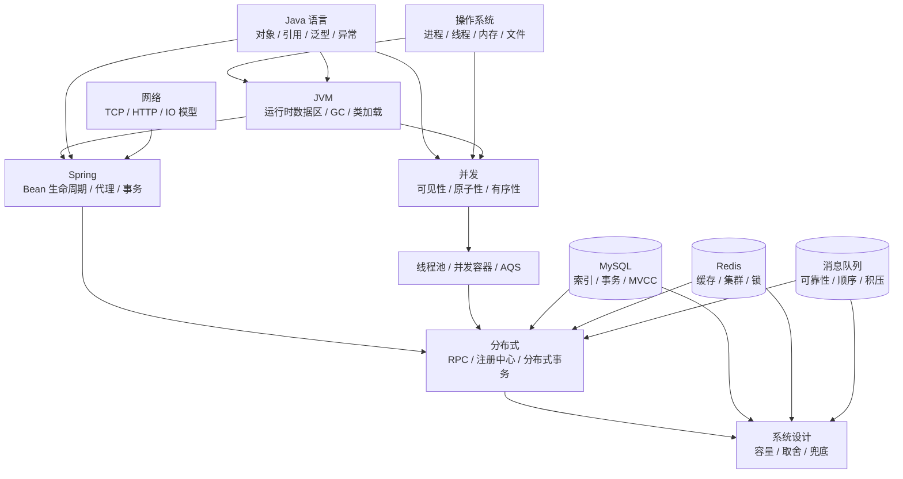

# 第 0 章 前置概念与术语：正文之前的那一层

> 一句话定位：这一章不教你面试，只负责把"你和正文之间那段没人讲的台阶"补上。

## 一、这一章为谁写

正文十三章默认你已经知道一些词。它解释"为什么这么设计""代价是什么""追问怎么接"，但不解释"堆是什么""索引为什么能加速"。如果你在这些词上卡住，读正文会出现一种典型体验：**每个字都认识，连起来不知道在说什么**。

下面四个问题，不看资料能答出三个以上，可以直接跳过这一章：

1. `new` 出来的对象放在哪里？方法里的局部变量又放在哪里？
2. 给数据库某一列加了索引，查询为什么变快？代价是什么？
3. 什么是事务的隔离级别？它解决什么问题？
4. 浏览器输入网址到看到页面，中间大致经过哪几步？

只答得出一到两个，按第五节的三天路径补；一个都答不上，先把这一章读完，再去读第 1 章。

三类读者的用法不同：

| 你的状态 | 怎么用这一章 | 预计耗时 |
| --- | --- | --- |
| 没系统学过 Java，只背过八股 | 读第二、三节建立骨架，术语表当字典查，不要背 | 1 天 |
| 写过项目，但原理说不清 | 只读第三节，对照"为什么后面离不开它"自检 | 2 小时 |
| 只是来复习 | 读第二节点一下地图，其余跳过 | 10 分钟 |

## 二、概念依赖地图

正文的十三章不是并列的，是有依赖的。下面这张图里，**箭头指向"用得上它的地方"**：左边的概念不懂，右边的章节就只能背结论。

读法很简单：**沿着箭头找你的断点**。

- 读第 4 章 JVM 觉得"GC 分代"莫名其妙，断点在第 0 层的堆与栈。
- 读第 3 章并发觉得"可见性"像玄学，断点在第 0 层的缓存与重排。
- 读第 8 章 MySQL 觉得"回表"抽象，断点在第 0 层的索引结构。
- 读第 12 章分布式觉得 CAP 是口号，断点在第 0 层的一致性与复制。

按章节倒查，比从头补一遍快得多：

| 想读的章节 | 先确认会这些 | 不会就去 |
| --- | --- | --- |
| 第 1、2 章 | 对象与引用、堆与栈、哈希 | 本章三节 1~3、15 |
| 第 3 章 | 线程、锁、可见性、原子性、阻塞 | 本章三节 4~7、17~18 |
| 第 4 章 | 堆与栈、栈帧、可达性、分代 | 本章三节 1~3 |
| 第 5、11 章 | 接口与继承、反射、代理、事务 | 本章三节 2、9、14 |
| 第 6 章 | 时间复杂度、哈希、树 | 本章三节 15~16 |
| 第 7 章 | 进程与线程、阻塞、HTTP | 本章三节 4、13、17 |
| 第 8 章 | 索引、事务、隔离级别、日志 | 本章三节 8~10 |
| 第 9、10 章 | 缓存、序列化、异步、幂等 | 本章三节 11~12、14、18、20 |
| 第 12、13 章 | 一致性、复制、分片、幂等 | 本章三节 19~20、术语表 |

## 三、20 个最小概念

这 20 个词是全书出现频率最高、又最少被解释的。每条只给三样东西：它是什么、为什么后面离不开它、第一次真正用到它的地方。**不要背，读到能用自己的话复述即可。**

| # | 概念 | 它是什么 | 为什么后面离不开它 | 首次出现 |
| --- | --- | --- | --- | --- |
| 1 | 堆与栈 | 堆放对象，线程共享；栈放方法调用的局部状态，线程私有 | 不懂它，JVM 内存布局、GC、逃逸分析全是空话 | 第 1、4 章 |
| 2 | 对象与引用 | 变量里存的是地址，不是对象本身；`==` 比的是地址 | `equals`、深浅拷贝、GC 可达性都建立在它上面 | 第 1 章 |
| 3 | 栈帧 | 每次方法调用压入一帧，存局部变量表、操作数栈、返回地址 | `finally` 的返回值、递归溢出、异常表都靠它解释 | 第 1、4 章 |
| 4 | 进程与线程 | 进程是资源分配单位，线程是调度单位，同进程线程共享堆 | 并发的一切问题都源于"共享 + 可变" | 第 3、7 章 |
| 5 | 临界区与锁 | 访问共享可变状态、必须串行的那段代码；锁是进入许可 | `synchronized`、AQS、数据库行锁是它在不同层的实现 | 第 3、8 章 |
| 6 | 可见性 | 一个线程写了，另一个线程何时能看见 | `volatile`、JMM、happens-before 全在讨论它 | 第 3 章 |
| 7 | 原子性 | 一个操作要么全做、要么全不做，中间态不可见 | `i++`、CAS、事务、幂等都在讨论它 | 第 3、8、12 章 |
| 8 | 索引 | 额外维护的一份有序结构，用写代价换查速度 | MySQL 半章、Redis 跳表、ES 都靠它 | 第 8 章 |
| 9 | 事务 | 一组操作作为整体提交或回滚，ACID 是它的四个承诺 | 隔离级别、MVCC、分布式事务的出发点 | 第 8、12 章 |
| 10 | 隔离级别 | 并发事务之间允许多少中间状态被看见 | 脏读、幻读、锁的范围都由它决定 | 第 8 章 |
| 11 | 缓存 | 把慢介质的结果放到快介质，空间换时间 | 代价是一致性，Redis 整章都在还这笔债 | 第 9 章 |
| 12 | 消息队列 | 生产者和消费者之间的可持久化中间层 | 换解耦、削峰、异步，代价是重复、乱序、积压 | 第 10 章 |
| 13 | HTTP 请求 | 请求行 + 头 + 体，服务端返回状态码与响应体 | 接口、跨域、缓存、网关都基于它 | 第 7、11 章 |
| 14 | 序列化 | 内存对象转字节流以便传输或存储，反序列化是逆过程 | RPC、MQ、Redis 存值、深拷贝都涉及 | 第 1、12 章 |
| 15 | 哈希 | 把任意输入映射到固定范围，映射必然冲突 | HashMap、分库分表、一致性哈希、布隆过滤器 | 第 2、12 章 |
| 16 | 时间复杂度 | 用输入规模 n 的函数描述操作次数增长，忽略常数 | 判断"这方案能不能扛住"的第一把尺子 | 第 6 章 |
| 17 | 阻塞与非阻塞 | 发起 IO 后调用方是否被挂起等待结果 | BIO/NIO、Redis 单线程、Netty、虚拟线程 | 第 1、7 章 |
| 18 | 同步与异步 | 调用方是否等结果返回才继续 | 线程池、CompletableFuture、MQ、RPC 超时 | 第 3、10 章 |
| 19 | 一致性强与弱 | 多副本、多系统之间，读到的数据是否保证最新 | CAP、主从延迟、缓存双写、分布式事务 | 第 9、12 章 |
| 20 | 幂等 | 同一请求执行一次和多次，对状态的影响相同 | 重试、重复消费、支付回调、分布式锁 | 第 10、12 章 |

几个最容易想歪的地方，单独说清：

**堆与栈不是"内存的两个区域"这么简单。** 栈是线程私有的，线程一结束栈就没了，所以局部变量不需要 GC；堆是共享的，对象活多久由可达性决定。这一条能解释后面一半的 JVM 问题：为什么局部变量不用回收、为什么 `ThreadLocal` 会泄漏、为什么递归太深是 `StackOverflowError` 而不是 OOM。

**引用不是对象。** `User u = new User()` 里，`u` 是栈上的一个地址，对象在堆上。所以把 `u` 传给方法，方法拿到的是地址的副本，改地址指向的对象内容会影响外面，改 `u` 本身不会。第 1 章 Q18 那道"Java 是值传递吗"，答案就藏在这里。

**索引不是"让数据库变快"的开关。** 它是额外维护的一棵有序结构：查的时候能二分定位，写的时候要同步维护，所以写变慢、占空间。第 8 章所有关于索引的取舍，都是这笔账的不同算法。

**缓存不是"加了就快"。** 它是把一份可能过期的副本放在离用户更近的地方。所以第 9 章真正考的不是"怎么加缓存"，而是"副本什么时候失效、失效期间读到什么"。

## 四、术语表

按主题分组。正文里遇到不认识的词，回到这里查一行即可；这里只给"能继续读下去"的解释，深入原理在对应章节。

### 1. 语言与运行时

| 术语 | 英文 | 一句话 |
| --- | --- | --- |
| 对象头 | Object Header | 每个对象开头的元数据，含 Mark Word、类型指针、数组长度 |
| Mark Word | Mark Word | 对象头里记录 hash、GC 年龄、锁状态的那部分 |
| 常量池 | Constant Pool | 存放字面量与符号引用的表，字符串常量池在堆中 |
| 方法区 | Method Area | 规范中的概念，存类元数据；JDK 8 后由元空间实现 |
| 元空间 | Metaspace | JDK 8 起的方法区实现，使用本地内存 |
| 栈帧 | Stack Frame | 一次方法调用的上下文，含局部变量表与操作数栈 |
| 类加载 | Class Loading | 把 `.class` 字节码读入并转换成运行时类的过程 |
| 双亲委派 | Parent Delegation | 加载类时先交给父加载器，避免核心类被篡改 |
| 反射 | Reflection | 运行时读取类结构并调用方法、访问字段的能力 |
| 动态代理 | Dynamic Proxy | 运行时生成实现接口或继承类的代理对象 |
| 泛型擦除 | Type Erasure | 泛型只存在于编译期，运行时类型参数被擦成上界 |
| 自动装箱 | Autoboxing | 基本类型与包装类型之间的自动转换，有缓存区间 |
| 逃逸分析 | Escape Analysis | 判断对象是否逃出方法，用于标量替换与锁消除 |
| TLAB | Thread Local Allocation Buffer | 线程私有的堆分配缓冲区，避免分配时抢锁 |
| 可达性分析 | Reachability Analysis | 从 GC Roots 出发找引用链，找不到即可回收 |
| GC Roots | GC Roots | 一组必然存活的起点，如栈上引用、静态变量、JNI 引用 |
| 停顿 | Stop The World | GC 时暂停所有应用线程的阶段 |
| 分代收集 | Generational Collection | 按对象存活时间分区，对不同区用不同算法 |

### 2. 并发

| 术语 | 英文 | 一句话 |
| --- | --- | --- |
| 内存模型 | JMM, Java Memory Model | 规定多线程读写的可见性与重排边界的规范 |
| 先行发生 | happens-before | 判断一次写对另一次读是否可见的规则 |
| 重排序 | Reordering | 编译器与 CPU 为优化而调整指令顺序 |
| 内存屏障 | Memory Barrier | 阻止特定重排的 CPU 指令 |
| 可见性 | Visibility | 一个线程的写何时对另一个线程可见 |
| 原子性 | Atomicity | 操作不可被分割，中间态不被观测 |
| CAS | Compare And Swap | 比较并交换的原子指令，乐观锁的基础 |
| ABA 问题 | ABA Problem | 值改回原样导致 CAS 误判，用版本号解决 |
| 自旋 | Spin | 不放弃 CPU，循环重试直到成功 |
| AQS | AbstractQueuedSynchronizer | 用 state + 双向队列实现同步器的框架 |
| CLH 队列 | CLH Queue | AQS 内部使用的变体双向等待队列 |
| 偏向锁 | Biased Locking | 无竞争时把锁偏向第一个线程，JDK 15 后废弃 |
| 轻量级锁 | Lightweight Locking | 用 CAS 在栈帧里放锁记录，适合短临界区 |
| 重量级锁 | Heavyweight Locking | 依赖操作系统互斥量，未抢到锁的线程被挂起 |
| 上下文切换 | Context Switch | 保存与恢复线程执行现场，有固定开销 |
| 线程池 | Thread Pool | 复用线程并约束并发度的执行器 |
| 阻塞队列 | Blocking Queue | 队列空时取阻塞、满时放阻塞的队列 |
| 拒绝策略 | Rejection Policy | 线程池饱和时对新任务的处理方式 |
| 伪共享 | False Sharing | 两个变量落在同一缓存行，互相使对方失效 |
| 死锁 | Deadlock | 多个线程循环等待彼此持有的锁 |

### 3. 存储与数据库

| 术语 | 英文 | 一句话 |
| --- | --- | --- |
| B+ 树 | B+ Tree | 多叉平衡树，非叶只存键，叶节点成链表，适合磁盘 |
| 聚簇索引 | Clustered Index | 索引与数据放在一起，InnoDB 主键即聚簇索引 |
| 二级索引 | Secondary Index | 叶子存主键值，查询常需回表 |
| 回表 | Lookup | 用二级索引拿到主键，再回聚簇索引取整行 |
| 覆盖索引 | Covering Index | 查询所需列都在索引里，不用回表 |
| 最左前缀 | Leftmost Prefix | 联合索引按定义顺序匹配，跳过最左列即失效 |
| 索引下推 | Index Condition Pushdown | 把部分过滤条件下推到存储引擎层减少回表 |
| 执行计划 | Execution Plan | `EXPLAIN` 输出的访问路径与代价估算 |
| 间隙锁 | Gap Lock | 锁住索引记录之间的空隙，防插入 |
| 临键锁 | Next-Key Lock | 行锁 + 间隙锁，锁住左开右闭区间 |
| 多版本并发控制 | MVCC | 用版本链让读写不互相阻塞 |
| 读视图 | ReadView | 判断某个版本对当前事务是否可见的快照 |
| 回滚日志 | undo log | 记录旧版本，用于回滚与 MVCC |
| 重做日志 | redo log | 记录页的物理修改，用于崩溃恢复 |
| 归档日志 | binlog | 记录逻辑变更，用于复制与恢复 |
| 两阶段提交 | 2PC | 协调者先问能否提交，再通知提交或回滚 |
| 缓冲池 | Buffer Pool | InnoDB 在内存中缓存数据页的区域 |
| 脏页 | Dirty Page | 内存中已修改但尚未刷盘的数据页 |
| 主从复制 | Replication | 主库写 binlog，从库重放保持同步 |
| 分库分表 | Sharding | 按分片键把数据拆到多个库或表 |

### 4. 缓存与消息队列

| 术语 | 英文 | 一句话 |
| --- | --- | --- |
| 缓存穿透 | Cache Penetration | 查不存在的数据，请求每次都打到数据库 |
| 缓存击穿 | Cache Breakdown | 热点 key 过期瞬间，大量请求同时回源 |
| 缓存雪崩 | Cache Avalanche | 大量 key 同时失效，数据库被压垮 |
| 双写一致性 | Cache Consistency | 数据库与缓存两份副本如何保持同步 |
| 分布式锁 | Distributed Lock | 跨进程互斥，通常用 Redis 或 ZooKeeper 实现 |
| 哨兵 | Sentinel | 监控主从并在故障时自动选主 |
| 集群槽 | Cluster Slot | Redis Cluster 把键空间分成 16384 个槽 |
| RDB | Redis Database Backup | 定时生成内存快照的持久化方式 |
| AOF | Append Only File | 追加写命令日志的持久化方式 |
| 大 key | Big Key | 单个键的值过大，操作时会阻塞 |
| 热 key | Hot Key | 访问量集中在单个键，容易打满单分片 |
| 同步副本集 | ISR, In-Sync Replicas | Kafka 中与 leader 保持同步的副本集合 |
| 高水位 | HW, High Watermark | 消费者可见的最大消息位置 |
| 日志末端偏移 | LEO, Log End Offset | 副本最后一条消息的位置 |
| 再平衡 | Rebalance | 消费组内分区重新分配的过程 |
| 死信队列 | DLQ, Dead Letter Queue | 多次消费失败的消息转入的队列 |
| 事务消息 | Transactional Message | 半消息 + 本地事务 + 回查的可靠投递方案 |
| 消息积压 | Backlog | 生产速度持续高于消费速度导致堆积 |

### 5. 网络

| 术语 | 英文 | 一句话 |
| --- | --- | --- |
| 三次握手 | Three-way Handshake | SYN、SYN-ACK、ACK 建立连接并同步序列号 |
| 四次挥手 | Four-way Handshake | 两个方向各发一次 FIN 与 ACK 才能关闭 |
| TIME_WAIT | TIME_WAIT | 主动关闭方等待 2MSL，保证最后 ACK 可达 |
| 滑动窗口 | Sliding Window | 用窗口大小控制未确认数据量，实现流量控制 |
| 拥塞控制 | Congestion Control | 慢启动、拥塞避免、快重传、快恢复 |
| 粘包 | Sticky Packet | TCP 字节流无边界，多条消息粘在一起 |
| 多路复用 | Multiplexing | 一个线程用 selector 管理多个连接 |
| epoll | epoll | Linux 的事件通知机制，就绪事件回调而非轮询 |
| 零拷贝 | Zero Copy | 减少用户态与内核态之间的数据拷贝 |
| 同源策略 | Same-Origin Policy | 浏览器限制跨源读取响应的安全策略 |
| 预检请求 | Preflight | 非简单跨域请求前先发 OPTIONS 询问 |
| 证书链 | Certificate Chain | 由站点证书逐级签往根 CA 的信任链 |
| 内容分发网络 | CDN | 把静态资源放到离用户近的边缘节点 |

### 6. 框架与分布式

| 术语 | 英文 | 一句话 |
| --- | --- | --- |
| 控制反转 | IoC, Inversion of Control | 对象的创建与依赖关系交给容器管理 |
| 依赖注入 | DI, Dependency Injection | 容器把依赖从外部传入，而非对象自己 new |
| Bean 生命周期 | Bean Lifecycle | 实例化、属性填充、初始化、使用、销毁 |
| 循环依赖 | Circular Dependency | A 依赖 B、B 依赖 A，靠三级缓存提前暴露引用 |
| 三级缓存 | Three-level Cache | 单例池、早期引用、工厂，用于解决循环依赖 |
| 面向切面 | AOP | 把日志、事务等横切逻辑织入业务方法 |
| 织入 | Weaving | 把切面应用到目标对象并生成代理的过程 |
| 事务传播 | Propagation | 一个事务方法调用另一个事务方法时的边界规则 |
| 自动配置 | Auto-configuration | 按 classpath 与条件注解决定装配哪些 Bean |
| 起点依赖 | Starter | 一组依赖 + 自动配置的打包约定 |
| 容量与可用性权衡 | CAP | 分区容忍下，一致性与可用性不可同时满足 |
| 基本可用 | BASE | 基本可用、软状态、最终一致 |
| 两阶段提交 | 2PC | 准备与提交两个阶段，强一致但阻塞 |
| 补偿事务 | TCC | Try 预留、Confirm 确认、Cancel 取消 |
| 长事务补偿 | Saga | 把长事务拆成多步，失败时逐步补偿 |
| 幂等 | Idempotency | 重复执行不改变结果 |
| 熔断 | Circuit Breaking | 失败率超阈值后快速失败，避免拖垮上游 |
| 限流 | Rate Limiting | 控制单位时间内的请求量 |
| 降级 | Degradation | 牺牲非核心功能保住主链路 |
| 雪崩 | Cascading Failure | 下游故障沿调用链向上扩散 |
| 链路追踪 | Tracing | 用 TraceID 与 Span 还原一次请求的完整路径 |
| 边车 | Sidecar | 与业务容器同生命周期的代理进程 |

## 五、三天补基础路径

目标不是"学会 Java"，而是"能读懂正文"。所以只做三件事：建立骨架、跑通一个例子、能用自己的话解释。

| 天 | 读什么 | 动手做什么 | 验收标准 |
| --- | --- | --- | --- |
| 第 1 天 | 本章三节 1~3、15~16；第 1 章 Q1、Q2、Q18；第 4 章 Q1、Q2 | 写一个类，在方法里 new 一个对象，用 `==` 和 `equals` 各比较一次 | 能画出"引用在栈、对象在堆"，能解释两次比较为什么结果不同 |
| 第 2 天 | 本章三节 4~7、17~18；第 3 章 Q1~Q3；第 8 章 Q13~Q15 | 起两个线程对同一个 int 各加一万次，看结果是不是两万 | 能解释结果为什么小于两万，能说出"锁"和"原子性"各解决哪一段 |
| 第 3 天 | 本章三节 8~14、19~20；第 7 章 Q1~Q4；第 12 章 Q2 | 用浏览器开发者工具看一次请求的请求头与响应头；给一张表加索引前后各查一次 | 能画出一次 HTTP 请求经过的组件，能说出索引让哪种查询变快、哪种变慢 |

三条原则，比具体读什么更重要：

1. **只补概念，不背结论。** 这一阶段的目标是"听懂别人在说什么"，不是"能答面试题"。看到 `volatile` 只要知道它和可见性有关就够了，具体语义留给第 3 章。
2. **每个概念配一个能跑的例子。** 概念读十遍不如跑一次。第 1 天那个 `==` 与 `equals` 的例子，比读三页文字有用。
3. **允许跳过。** 第 2 天如果线程那段完全读不下去，先跳过，去读第 1、2 章。这本书的章节是独立的，卡住不是失败，是顺序不对。

## 六、自测清单

合上文档，逐条自问。答不上来的，回到对应小节，不要往下读。

1. 能不能用一句话说清"堆"和"栈"分别放什么、归谁所有？
2. 为什么局部变量不需要 GC，而 `new` 出来的对象需要？
3. `User u = new User()` 里的 `u` 到底存了什么？把它传给方法后，方法里能改掉外面的 `u` 吗？
4. 两个线程同时对同一个变量加一，为什么结果可能少？这属于原子性问题还是可见性问题？
5. 加锁能解决上面哪个问题？`volatile` 能解决哪个？两者都不能解决哪个？
6. 索引为什么能让查询变快？为什么它会让写入变慢？
7. 事务的四个特性分别是什么？隔离级别调节的是哪一个？
8. 缓存和数据库之间为什么会不一致？这个不一致能彻底消除吗？
9. "最终一致"和"强一致"的差别，能不能用一个转账的例子说明？
10. 为什么"重试"必须配"幂等"？不配会发生什么？

十条里能答出七条，正文可以开始读了。答不出的那几条，就是你后面最容易"背了但讲不出"的地方——先记住这个位置，读到对应章节时回来对一次。
