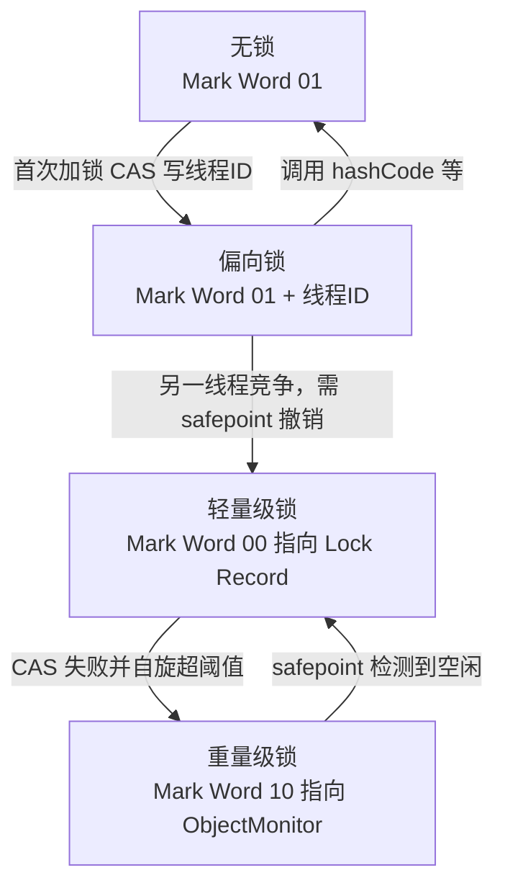
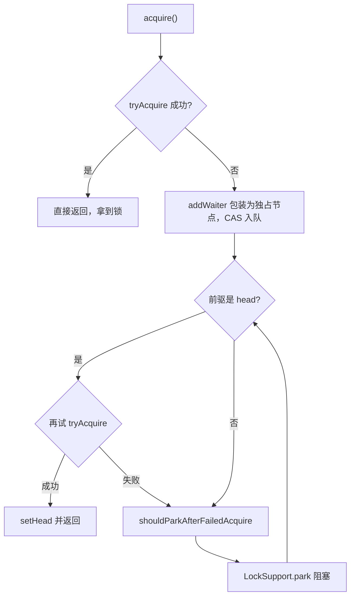
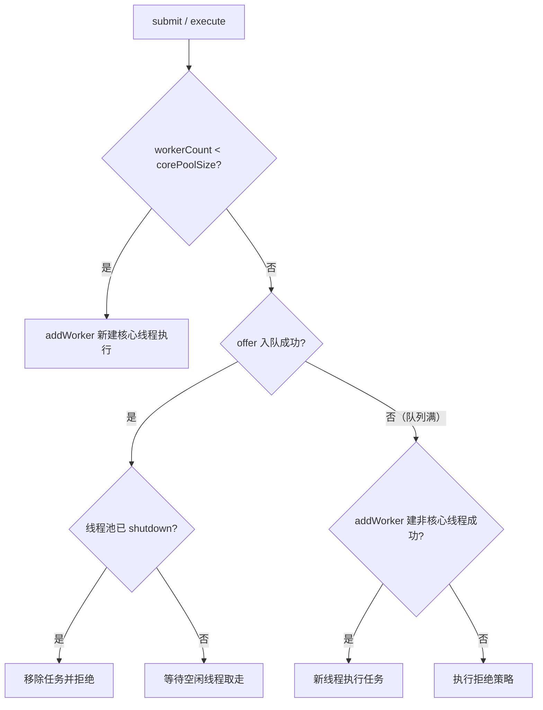

# 第 3 章 并发与多线程：可见性、原子性与有序性的三重门

> 一句话定位：后端面试权重最高的一章。并发题答得含糊，前面的"高并发经验"会被全部重新打折。

## 一、本章考察重点概览

并发这一章的特点是**结论容易背、机制难自洽**。几乎所有人都能说出"volatile 保证可见性不保证原子性"，但一旦被追问"可见性到底是谁保证了什么""i++ 为什么不是原子操作""偏向锁为什么被废弃"，背诵的结论会立刻塌掉。面试官在这章筛的是三件事：你是否理解 Java 内存模型（JMM, Java Memory Model）这套**规范**与 HotSpot 这套**实现**的分层；你能否把一个关键字讲到字节码、对象头、CPU 指令的层级；你在真实项目里是否踩过线程池、ThreadLocal、死锁这些坑，而不是只在纸面上见过。

具体到考点，有四个特征：

1. **JMM 是整章的地基。** 原子性、可见性、有序性、happens-before 讲不清，后面 volatile、synchronized、final、并发容器全部只能靠死记。反过来，JMM 讲通了，这些关键字只是它的具体落地。
2. **锁的实现是分层递进的。** 从字节码的 `monitorenter`，到对象头 Mark Word，到 C++ 的 ObjectMonitor，再到操作系统的 mutex，四层结构要对得上。只答"加锁了"等于没答。
3. **线程池是工程能力的试金石。** 七大参数、执行流程、拒绝策略、为什么禁用 `Executors`、异常为什么被吞掉、怎么优雅关闭，这些是 daily work 里真正会出事故的地方。
4. **版本差异密集。** 偏向锁 JDK 15 废弃、JDK 18 移除；`ConcurrentHashMap` JDK 7 分段锁与 JDK 8 CAS + synchronized 完全不同；虚拟线程 JDK 21 才转正。答并发题不标版本，基本会被认为在背书。

| 考点 | 出现频率 | 难度 | 说明 |
| --- | --- | --- | --- |
| JMM 与 happens-before | 高 | 高级 | 区分初级与中高级的第一道分水岭 |
| volatile 语义与内存屏障 | 高 | 中级 | 几乎必问，常与单例、状态标志联合考 |
| synchronized 原理与锁升级 | 高 | 高级 | 能讲到 Mark Word 与 ObjectMonitor 才算过关 |
| CAS 与 ABA | 高 | 中级 | 常引出 `AtomicStampedReference` 与自旋开销 |
| AQS 与 ReentrantLock | 高 | 高级 | 中高级岗位必问，要求能画队列 |
| ThreadLocal 内存泄漏 | 高 | 中级 | 高频，且能自然延伸到线程池污染 |
| 线程池参数与执行流程 | 高 | 中级 | 工程题，几乎每场都问 |
| 死锁与排查 | 中 | 中级 | 常给代码让你找问题 |
| 并发容器选型 | 中 | 中级 | 与 HashMap、ArrayList 章节联动 |
| 虚拟线程与 ForkJoinPool | 中 | 高级 | JDK 21 后热度明显上升 |

## 二、复习优先级

| 优先级 | 题目编号 | 理由 |
| --- | --- | --- |
| P0 | Q2、Q3、Q5、Q6、Q8、Q10、Q14、Q15 | 每一道都能单独撑起 15 分钟深挖，必须能画图、能写代码 |
| P1 | Q1、Q7、Q9、Q11、Q12、Q13、Q16、Q17、Q18、Q19 | 决定你是"背过"还是"用过"，要求能说清取舍 |
| P2 | Q4、Q20、Q21、Q22、Q23 | 加分项，能讲清核心机制与一个真实场景即可 |

时间分配建议：本章 3 天，是全书投入最多的一章。P0 占 55%，要求能白板画出对象头结构、锁升级路径、AQS 队列、线程池流程图；P1 占 35%，重点是"为什么不那样设计"；P2 剩 10%，面试前一天过一遍结论与关键词。

## 三、高频面试题清单

| 编号 | 题目 | 面试难度 | 阅读门槛 | 优先级 | 一句话答案 |
| --- | --- | --- | --- | --- | --- |
| Q1 | 线程六种状态怎么转换？sleep/wait/join/interrupt 的真实语义？ | 中级 | 中 | P1 | 六态由 JVM 定义，interrupt 只置标志位，不强制终止 |
| Q2 | JMM 是什么？happens-before 八条规则怎么用？ | 高级 | 高 | P0 | JMM 规定多线程读写的可见性与重排边界，hb 是判断数据竞争的标尺 |
| Q3 | volatile 的两层语义是什么？为什么不能保证原子性？ | 中级 | 中 | P0 | 保证可见性与禁止重排，靠内存屏障实现；i++ 三步不可分割 |
| Q4 | MESI 与伪共享是什么？缓存行为什么是 64 字节？ | 高级 | 高 | P2 | 缓存行失效引发伪共享，用填充或 @Contended 隔离 |
| Q5 | synchronized 在字节码和 JVM 层是怎么实现的？ | 高级 | 高 | P0 | 代码块 monitorenter/exit，方法 ACC_SYNCHRONIZED，底层 ObjectMonitor |
| Q6 | 锁升级的过程？偏向锁为什么被废弃？ | 高级 | 高 | P0 | 无锁→偏向→轻量级→重量级，偏向锁撤销代价高于收益被移除 |
| Q7 | 乐观锁与悲观锁、自旋锁、可重入怎么实现？ | 中级 | 中 | P1 | 乐观锁靠版本或 CAS，可重入靠 owner + 计数器 |
| Q8 | CAS 的原理、ABA 问题与开销？ | 中级 | 中 | P0 | 靠 CPU cmpxchg 加 lock 前缀，ABA 用版本号解决 |
| Q9 | LongAdder 为什么比 AtomicLong 快？ | 高级 | 高 | P1 | 用 Cell 数组分散 CAS 热点，代价是 sum 非原子快照 |
| Q10 | AQS 的核心设计是什么？acquire/release 怎么走？ | 高级 | 高 | P0 | 一个 volatile state 加 CLH 变体双向队列，子类实现 tryXxx |
| Q11 | ReentrantLock 公平与非公平差在哪？和 synchronized 怎么选？ | 中级 | 中 | P1 | 差在入队前是否检查前驱；需要超时、中断、多条件时选它 |
| Q12 | 读写锁与 StampedLock 各自解决什么问题？ | 高级 | 高 | P1 | 读写分离提升并发，StampedLock 用乐观读进一步降写阻塞 |
| Q13 | wait/notify 为什么必须在 synchronized 内？为什么用 while？ | 中级 | 中 | P1 | 检查条件与等待必须原子，否则丢失唤醒；while 防虚假唤醒 |
| Q14 | ThreadLocal 会内存泄漏吗？为什么 key 是弱引用？ | 高级 | 高 | P0 | key 弱引用、value 强引用，线程长活则 value 滞留，必须 remove |
| Q15 | 线程池七大参数与执行流程？为什么禁用 Executors？ | 中级 | 中 | P0 | 核心→队列→非核心→拒绝；工厂方法用无界队列或无限线程 |
| Q16 | 核心线程数怎么估？怎么监控和优雅关闭？ | 高级 | 高 | P1 | CPU 密集 N+1，IO 密集 N×(1+WT/ST)，最终靠压测 |
| Q17 | 常见阻塞队列怎么选？ | 中级 | 中 | P1 | 有界优先 ArrayBlocking，高吞吐 LinkedBlocking，配对用 Synchronous |
| Q18 | 死锁的四个条件？线上怎么排查和预防？ | 中级 | 中 | P1 | 互斥/持有等待/不可剥夺/循环等待；jstack 直接报 deadlock |
| Q19 | CountDownLatch、CyclicBarrier、Semaphore、Phaser 的区别？ | 中级 | 中 | P1 | 一次性减法、可重用栅栏、许可限流、多阶段动态协作 |
| Q20 | CompletableFuture 怎么编排？默认线程池有什么坑？ | 中级 | 中 | P2 | thenApply 同类型、thenCompose 扁平化；commonPool 会被阻塞拖垮 |
| Q21 | ConcurrentHashMap、COW、CLQ 各自适合什么场景？ | 中级 | 中 | P2 | 分段 CAS 提并发，写时复制换读性能，CAS 无锁队列高吞吐 |
| Q22 | 虚拟线程和平台线程的区别？什么情况会被 pin 住？ | 高级 | 高 | P2 | 用户态调度、阻塞即卸载；synchronized 阻塞与 native 调用会钉住 |
| Q23 | ForkJoinPool 工作窃取怎么做的？并行流有什么坑？ | 高级 | 高 | P2 | 各自双端队列，从头部取尾部偷；公共池阻塞会互相拖累 |

## 四、题目详解

### Q1. 线程六种状态怎么转换？sleep/wait/join/interrupt 的真实语义？（中级）

> 前置：线程生命周期、monitor、中断标志

**一句话结论**：JVM 把线程划分为 NEW、RUNNABLE、BLOCKED、WAITING、TIMED_WAITING、TERMINATED 六态，其中 RUNNABLE 合并了操作系统的就绪与运行；`interrupt()` 只是设置中断标志，真正让线程退出的是线程自己在安全点检查标志或从阻塞中抛出 `InterruptedException`。

**先把话说白**：很多人把 `interrupt()` 理解成"杀掉线程"，这是最危险的一条误解。它更像按一下门铃：正在睡觉的人会被吵醒（抛异常），正在干活的人只是听见了铃声，要不要停工由他自己决定。Java 从不提供强制终止线程的手段，`Thread.stop()` 早已被废弃，因为它会让对象停在任意中间状态。

**底层原理**：

1. **六态的真实含义。** `NEW` 是创建未启动；`RUNNABLE` 表示可运行，**包括**正在等 IO、等网络的情况，因为 JVM 看不到操作系统的阻塞态；`BLOCKED` 专指等 `synchronized` 的 monitor 锁；`WAITING` 是无超时的 `wait/join/park`；`TIMED_WAITING` 是带超时的版本（含 `sleep`）；`TERMINATED` 是 `run` 结束。

2. **`start` 与 `run` 的分野。** `start()` 是 native 方法，会调用 `pthread_create` 式的底层创建流程，由 JVM 在本机线程就绪后回调 `run()`。直接调 `run()` 只是普通方法调用，仍在当前线程栈上执行。同一个 `Thread` 对象重复 `start` 抛 `IllegalThreadStateException`，因为状态机只允许 NEW → RUNNABLE 一次。

3. **三种"让出"的差别。** `sleep` 是 `Thread` 的静态方法，不释放任何 monitor，只让出 CPU 时间片；`yield` 是给调度器的提示，状态仍是 RUNNABLE，不释放锁，也不保证被采纳；`wait` 是 `Object` 的方法，**必须持有该对象的 monitor**，调用后释放锁并进入该对象的 WaitSet。三者只有 `wait` 会释放锁，这是最常考的一条。

4. **`join` 的本质。** JDK 源码里 `join` 是一个 `synchronized` 方法，内部对线程对象调用 `wait()`，直到 `isAlive()` 为假。所以 `join` 复用 wait/notify 机制，线程终止时 JVM 会调用 `notifyAll` 唤醒所有等待者。这也解释了为什么 `join` 期间持有的是线程对象的锁。

5. **`interrupt` 的三条分支。** 线程处于 `sleep/wait/join` 时，中断会使其抛 `InterruptedException` 并**清除**中断标志；线程阻塞在 `InterruptibleChannel` 的 IO 上时，通道被关闭并抛 `ClosedByInterruptException`；线程正在运行普通代码时，只是把标志位置为 true，代码必须自己调 `isInterrupted()` 检查。`Thread.interrupted()` 会返回标志并清除，`isInterrupted()` 只读不清。

```java
Thread t = new Thread(() -> {
    while (!Thread.currentThread().isInterrupted()) {  // 主动检查，才能响应中断
        try {
            Thread.sleep(1000);                        // 阻塞点会抛 InterruptedException
        } catch (InterruptedException e) {
            Thread.currentThread().interrupt();        // 恢复标志位，把中断信号传出去
            break;                                     // 由本线程决定退出，而不是被强杀
        }
    }
});
t.start();
t.interrupt();   // 只置标志 + 唤醒阻塞，不会直接终止线程
```

**易混对比**：

| 维度 | `sleep` | `wait` | `join` | `yield` |
| --- | --- | --- | --- | --- |
| 所属类 | `Thread`（静态） | `Object` | `Thread` | `Thread`（静态） |
| 是否释放锁 | 否 | 是 | 是（释放线程对象锁） | 否 |
| 是否需同步块 | 否 | 必须 | 内部已同步 | 否 |
| 进入的状态 | TIMED_WAITING | WAITING / TIMED_WAITING | WAITING / TIMED_WAITING | RUNNABLE |
| 唤醒方式 | 超时或被中断 | `notify` / `notifyAll` / 超时 / 中断 | 目标线程终止 | 调度器决定 |

**面试追问**：
- 追问：`RUNNABLE` 里为什么包含 IO 阻塞？→ 答题要点：JVM 只映射到 OS 的"可运行"集合，读 socket 时线程在 OS 层是不可中断睡眠，但 Java 层仍报 RUNNABLE，所以 `jstack` 看到大量 RUNNABLE 也可能是卡在 IO。
- 追问：`interrupt()` 之后线程一定会退出吗？→ 答题要点：不会，全靠代码配合；如果 `catch` 了 `InterruptedException` 却不恢复标志也不 break，中断信号就丢了。
- 追问：为什么 `Thread.stop()` 被废弃？→ 答题要点：它会在任意字节码处抛出 `ThreadDeath`，可能让对象处于半初始化状态、锁被永久持有，破坏一致性。
- 追问：`wait` 被 `notify` 唤醒后立刻继续执行吗？→ 答题要点：不是，需要重新竞争 monitor，抢到才从 `wait` 返回，否则进入 BLOCKED。

### Q2. JMM 是什么？happens-before 八条规则怎么用？（高级）

> 前置：内存模型、指令重排、happens-before

**一句话结论**：JMM 是 Java 语言级的内存模型**规范**，它定义了多线程下共享变量的可见性与指令重排的合法边界，通过 happens-before 关系判定一次读写是否可能看到"不该看到"的值；HotSpot 用内存屏障把这些规则落到具体 CPU 上。

**先把话说白**：CPU 有寄存器、有 store buffer、有乱序执行，编译器也会重排指令。如果 Java 直接把硬件行为暴露给程序员，那写并发代码就等于写汇编。JMM 做的事情是：**给程序员一个可推理的最小保证**（happens-before），同时给编译器一个优化空间（as-if-serial）。前者是承诺，后者是许可。

**底层原理**：

1. **主内存与工作内存是抽象，不是物理。** JMM 说每个线程有自己的工作内存，变量副本在其中，读写得经过主内存。这**不是**指 CPU 缓存，也不是指 TLAB。它是"线程私有可见性视图"的抽象模型，HotSpot 落地时对应的是寄存器、store buffer、L1/L2/L3 缓存这一整套硬件层次。面试时把"工作内存 = CPU 缓存"说死会被扣分，正确说法是"抽象模型，物理上落在缓存与缓冲区"。

2. **三大性质各自的来源。** 原子性由 `synchronized`、`Lock`、`Atomic` 系列提供，JMM 只保证除 `long/double` 外的 32 位读写是原子的（`long/double` 的非 volatile 读写历史上可能被拆分，现代 64 位 HotSpot 已基本不出现）；可见性由 `volatile`、`synchronized`、`final` 提供；有序性靠 happens-before 约束重排。

3. **happens-before 的八条规则。** 这是判断"是否可能看到脏值"的唯一标准，`A hb B` 意味着 A 的结果对 B 可见，且 A 不会重排到 B 之后。
   - 程序顺序：单线程内，前面的操作 hb 后面的操作。
   - 监视器锁：对同一锁的 `unlock` hb 后续的 `lock`。
   - volatile：对同一 volatile 字段的写 hb 后续的读。
   - 线程启动：`Thread.start()` hb 该线程内的任何操作。
   - 线程终止：线程内所有操作 hb 其他线程从 `join()` 成功返回。
   - 线程中断：`interrupt()` hb 被中断线程检测到中断。
   - 对象终结：构造器执行完 hb 该对象 `finalize()` 开始。
   - 传递性：A hb B 且 B hb C，则 A hb C。

4. **用传递性拼出安全发布。** 单靠一条规则往往不够。典型例子：线程 A 写 `data = 1` 再写 `volatile flag = true`；线程 B 读到 `flag == true` 后读 `data`。链条是：`data=1`（程序顺序）hb `flag=true`（volatile 规则）hb B 读 `flag`（程序顺序）hb B 读 `data`，因此 B 一定能看到 `data = 1`。这就是 DCL 单例必须给实例字段加 `volatile` 的原因。

5. **as-if-serial 是给编译器的许可。** 它规定：单线程程序的执行结果不能被重排改变。注意它只约束**单线程语义**，不约束多线程可见性——所以"单线程看起来没问题"完全不能推出"多线程安全"。重排的最小单位是指令，`i++` 这种"读-改-写"本身就可能被拆开与其他线程的写交错。

6. **规范的边界。** JMM 只规定"允许看到什么"，不规定"用什么指令实现"。x86 是 TSO（Total Store Order）模型，只允许 StoreLoad 重排，所以 HotSpot 在 x86 上只需为 volatile 写插入一个 `lock addl` 或 `mfence`；ARM 是弱内存模型，需要插入更多屏障。这也是"同一段 Java 代码在不同 CPU 上性能不同"的原因之一。

```java
// 安全发布：靠 volatile 的 hb 传递性
public class SafePublish {
    private int data = 0;
    private volatile boolean ready = false;

    public void writer() {
        data = 42;          // 步骤 1
        ready = true;       // 步骤 2：volatile 写，禁止步骤 1 重排到其后
    }
    public void reader() {
        if (ready) {        // 步骤 3：volatile 读
            assert data == 42;  // 步骤 4：由 hb 传递性保证可见
        }
    }
}
```

**易混对比**：

| 概念 | 是什么 | 约束谁 | 典型误答 |
| --- | --- | --- | --- |
| JMM | 语言级规范 | 编译器和 JVM 实现 | 说成"CPU 缓存模型" |
| happens-before | 可见性与顺序的判定关系 | 程序员的推理 | 说成"时间上先发生" |
| as-if-serial | 单线程语义不变的许可 | 编译器优化 | 说成"多线程也串行" |
| 内存屏障 | 具体的 CPU 指令 | 硬件重排 | 说成 JMM 的一部分（它是实现手段） |

**面试追问**：
- 追问：happens-before 和时间先后是一回事吗？→ 答题要点：不是，它是可见性保证的偏序关系；两个没有 hb 关系的操作即使物理上先后发生，也可能读到旧值。
- 追问：`final` 字段为什么不需要额外同步？→ 答题要点：JMM 对 final 有专门规则，禁止把构造器内对 final 字段的写重排到构造器返回之后，前提是构造期间 `this` 没有逃逸。
- 追问：`long` 的读写是原子的吗？→ 答题要点：JMM 要求非 volatile 的 long/double 读写**可以**不是原子的，实际 64 位 HotSpot 上是原子的，但规范不保证，跨线程共享应加 volatile。
- 追问：`synchronized` 的可见性从哪来？→ 答题要点：monitor 的 unlock 会把工作内存刷回主内存，lock 会清空本地副本，等价于监视器锁的 hb 规则。

### Q3. volatile 的两层语义是什么？为什么不能保证原子性？（中级）

> 前置：可见性、内存屏障、原子性

**一句话结论**：`volatile` 提供可见性（写立即对其他线程可见）与有序性（禁止特定重排）两层语义，通过插入内存屏障实现；但它不给"读-改-写"这类复合操作加锁，所以 `i++` 依然会丢更新。

**先把话说白**：给变量加 `volatile`，相当于给它装了一个"广播喇叭"：你一改，所有人都听得见；也相当于给它划了一条"禁止越线"的黄线：黄线之前的事不能挪到之后，之后的事不能挪到之前。但喇叭不管"两个人同时加一"这种竞争——它只负责播报，不负责排队。

**底层原理**：

1. **可见性怎么实现。** volatile 写时，JIT 在该指令后插入屏障，强制把 store buffer 刷到缓存并同步到主内存（x86 上是一条带 `lock` 前缀的空操作，兼具全屏障效果）；volatile 读时，屏障保证之前的本地副本失效，必须重新从主内存加载。所以读到的值一定是"某次写之后"的值，不会读到写之前的陈旧副本。

2. **有序性怎么实现。** JMM 采用保守策略，在四个位置插入屏障：每个 volatile 写**前**插 StoreStore（保证前面的普通写先落地），写**后**插 StoreLoad（保证写不被后面的读写越过）；每个 volatile 读**后**插 LoadLoad 与 LoadStore（保证读不被后面的读写越过）。x86 的 TSO 天然满足前三种顺序，所以实际只保留 StoreLoad。

3. **四种屏障的语义。** LoadLoad 保证"先读后读"不乱序；StoreStore 保证"先写后写"不乱序；LoadStore 保证"先读后写"不乱序；StoreLoad 最重，保证"先写后读"不乱序，也顺带清空 store buffer。四条里 StoreLoad 开销最大，因为它要让写对其他核可见。

4. **为什么不保证原子性。** `i++` 编译成三条指令：读 `i` 到寄存器、寄存器加一、写回 `i`。两个线程可能同时读到 5，各自算出 6 再写回，最终结果是 6 而不是 7。volatile 保证"每次读都是最新的"，但不保证"读和写之间没有别人插进来"。原子性只能靠锁或 CAS 提供。

5. **代价与边界。** volatile 的读在 x86 上几乎无额外开销（普通 load 即可），写有一次性屏障成本；在高频写场景下比普通变量慢一个量级。另外 volatile 不能修饰局部变量，不保证复合操作，也不能替代锁去保护多个字段之间的不变式。

```java
public class VolatileCounter {
    private volatile int count = 0;

    public void incr() {
        count++;   // 三步：getfield → iadd → putfield，整体不是原子的
    }
    // 正确写法一：加锁
    public synchronized void incrSafe() { count++; }
    // 正确写法二：CAS
    private final AtomicInteger atomic = new AtomicInteger();
    public void incrCas() { atomic.incrementAndGet(); }
}
```

**易混对比**：

| 维度 | `volatile` | `synchronized` |
| --- | --- | --- |
| 原子性 | 仅保证单次读或写 | 保证整个临界区 |
| 可见性 | 保证 | 保证 |
| 有序性 | 禁止特定重排 | 临界区整体串行 |
| 是否阻塞 | 不阻塞 | 竞争时阻塞 |
| 是否可修饰方法 | 否 | 是 |
| 适用场景 | 状态标志、DCL 实例字段 | 复合不变式、多字段协同 |

**面试追问**：
- 追问：`volatile` 能替代锁吗？→ 答题要点：只在"写不依赖当前值、且只涉及单个变量"时可以，比如布尔开关；一旦有 `i++` 或多字段约束就必须加锁。
- 追问：DCL 单例为什么必须加 volatile？→ 答题要点：对象创建分"分配内存、初始化、赋引用"三步，2 与 3 可能重排，导致别的线程拿到半初始化对象。
- 追问：volatile 数组有意义吗？→ 答题要点：修饰的是数组引用，不是元素；元素可见性要用 `AtomicIntegerArray` 或每元素 volatile 语义的容器。
- 追问：既然 x86 只重排 StoreLoad，为什么还讲四种屏障？→ 答题要点：JMM 是跨平台规范，ARM/POWER 的重排更激进；HotSpot 按架构裁剪屏障。

### Q4. MESI 与伪共享是什么？缓存行为什么是 64 字节？（高级）

> 前置：CPU 缓存行、缓存一致性协议

**一句话结论**：MESI 用 Modified/Exclusive/Shared/Invalid 四态维护多核缓存一致性，CPU 以缓存行（常见 64 字节）为最小同步单位；两个无关变量落在同一行且被不同核频繁写时，会互相使对方缓存行失效，这就是伪共享（False Sharing），用填充或 `@Contended` 隔离。

**先把话说白**：缓存一致性协议不按变量同步，按"行"同步。就像两个人共用一张纸，一个人只改左上角的字，另一个人只改右下角，但纸只有一张，改哪都得把整张纸重新抄一遍。变量本身毫不相干，却被物理布局绑在一起互相拖累。

**底层原理**：

1. **四态的转换逻辑。** Modified 表示本核独占且已修改（脏），Exclusive 表示独占且与内存一致，Shared 表示多核共享只读，Invalid 表示副本失效。本核写 Shared 行时，需要先发 invalidate 让其他核置为 Invalid，拿到独占权后才能改。这个"发无效 + 等确认"的过程就是伪共享的成本来源。

2. **为什么是 64 字节。** 这是空间局部性与成本折中的结果：行太小则标记位开销大、预取收益低；行太大则一次失效影响面广、总线流量大。x86 与多数 ARM 实现取 64 字节，部分处理器（如某些 POWER）是 128 字节，所以 Java 的 `@Contended` 填充量是按"足够覆盖主流平台"设计的，不保证在所有硬件上都完美。

3. **伪共享的形成。** 两个 `long` 相邻存放，必在同一行。核 A 反复写 `x`，核 B 反复写 `y`，每次写都要把对方的行置为 Invalid，行在两核之间来回"乒乓"，性能可能比单线程还差。注意它**不影响正确性**，只影响性能，所以最难被发现。

4. **怎么解决。** 手工填充：在变量前后加若干无用字段把行撑满；JDK 8 起提供 `@sun.misc.Contended`，需要 `-XX:-RestrictContended` 才能对用户类生效（JDK 9 后模块化，用户代码一般不再开启）。JDK 内部大量使用：`LongAdder.Cell`、`ConcurrentHashMap.CounterCell`、`Thread` 的字段布局、`ForkJoinPool` 的工作队列。

5. **真实影响面。** 队列的 head/tail 指针、计数器数组、Disruptor 的 RingBuffer 序列号都是高发区。判断方法是用性能计数（如 `perf c2c`）观察 cache line 的 HITM 次数，而不是靠猜。

```java
// 手工填充：用无意义字段把两个热点变量隔到不同缓存行
final class PaddedCounter {
    private volatile long p1, p2, p3, p4, p5, p6, p7;  // 前置填充
    private volatile long value;                         // 真正的热点
    private volatile long q1, q2, q3, q4, q5, q6, q7;  // 后置填充
    long sum() { return value; }
}
```

**易混对比**：

| 概念 | 解决的问题 | 层面 | 代价 |
| --- | --- | --- | --- |
| MESI | 多核缓存数据一致性 | 硬件协议 | 失效广播的总线流量 |
| 内存屏障 | 指令重排与可见性 | 指令层 | StoreLoad 屏障最贵 |
| 伪共享 | 无关变量共享缓存行 | 数据布局 | 填充浪费内存 |
| 缓存行对齐 | 让热点独占一行 | 数据布局 | 需要知道硬件行大小 |

**面试追问**：
- 追问：伪共享会导致结果错误吗？→ 答题要点：不会，只影响性能；正确性由 MESI 与内存屏障保证。
- 追问：`LongAdder` 里 `Cell` 为什么加 `@Contended`？→ 答题要点：多个 Cell 会被不同线程写，若挤在同一行就退化成串行，填充后每个 Cell 独占行。
- 追问：怎么验证伪共享？→ 答题要点：对比加填充前后的吞吐、用 `perf c2c` 看 HITM，或看 `-XX:+PrintAssembly` 确认字段偏移。

### Q5. synchronized 在字节码和 JVM 层是怎么实现的？（高级）

> 前置：字节码、对象头、ObjectMonitor

**一句话结论**：同步代码块编译为 `monitorenter` / `monitorexit`（正常与异常各一条 exit），同步方法靠方法访问标志 `ACC_SYNCHRONIZED`；JVM 层通过对象头 Mark Word 关联一个 ObjectMonitor，由 owner、EntryList、WaitSet、recursions 四个部分完成互斥与等待。

**先把话说白**：每个 Java 对象天生带一把锁，锁的信息就存在对象头里。`synchronized` 做的事是"进入前先改对象头，把锁占住；退出时改回来"。占不住就在门口排队，这个"门口"就是 EntryList。

**底层原理**：

1. **字节码层面。** 代码块形式会生成 `monitorenter`，以及**两条** `monitorexit`：一条对应正常路径，一条挂在异常表上对应异常路径。这解释了"为什么抛异常也能释放锁"——不是 JVM 特殊照顾，是编译器插了两条指令并登记了异常处理器。方法形式不加指令，而是在 `access_flags` 里置 `ACC_SYNCHRONIZED`，由方法调用与返回指令隐式加锁解锁。

2. **对象头结构。** 64 位 HotSpot 下 Mark Word 占 8 字节，Klass Pointer 通常占 4 字节（开启压缩指针），数组对象再加 4 字节长度。Mark Word 是复用的：无锁时存 hash、分代年龄、偏向标记、锁标志；偏向锁时存线程 ID 与 epoch；轻量级锁时存指向栈上 Lock Record 的指针；重量级锁时存指向 ObjectMonitor 的指针。

3. **ObjectMonitor 的四个部分。** `_owner` 记录当前持有线程；`_recursions` 记录重入次数；`_EntryList` 存放阻塞等待的线程（BLOCKED）；`_WaitSet` 存放调用过 `wait` 的线程（WAITING）。另外还有 `_cxq` 作为竞争激烈时的单向链表，与 EntryList 之间做转移，减少锁竞争。

4. **加锁的完整链路。** 遇到 `monitorenter` → 尝试 CAS 把 Mark Word 替换为 Lock Record 指针（轻量级路径）→ 失败则自旋 → 仍失败则膨胀为重量级锁，向 OS 申请 mutex → 线程进入 EntryList 并 park。释放时递减 recursions，归零才真正释放并唤醒后继。

5. **为什么必须"对象"才能当锁。** monitor 挂在对象头里，所以锁的粒度天然是对象；这也意味着 `synchronized(null)` 会 NPE，`String` 常量、`Integer` 缓存对象作锁会因共享而互相干扰。生产代码里应使用专门的 `private final Object lock`。

```java
public class SyncDemo {
    private final Object lock = new Object();   // 专用锁对象，避免锁住 this 或常量
    private int count = 0;

    public void block() {
        synchronized (lock) {      // monitorenter
            count++;               // 临界区
        }                          // monitorexit（正常路径）
    }
    public synchronized void method() {  // ACC_SYNCHRONIZED，锁的是 this
        count++;
    }
}
```

**易混对比**：

| 维度 | 同步代码块 | 同步方法 |
| --- | --- | --- |
| 字节码表现 | `monitorenter` / `monitorexit` ×2 | `ACC_SYNCHRONIZED` 标志 |
| 锁对象 | 括号里的对象 | 实例方法锁 `this`，静态方法锁 `Class` |
| 粒度 | 可精确到几条语句 | 整个方法体 |
| 异常释放 | 异常表上的第二条 exit | 方法返回时隐式释放 |
| 工程建议 | 优先，粒度小、锁对象可控 | 大方法慎用，容易放大临界区 |

**面试追问**：
- 追问：为什么有两条 `monitorexit`？→ 答题要点：一条正常路径，一条异常路径，保证异常时也解锁，否则会死锁。
- 追问：`synchronized` 锁的是代码还是对象？→ 答题要点：锁的是对象（monitor），代码只是标记了需要持锁执行的区间；不同线程锁同一对象才互斥。
- 追问：静态同步方法和实例同步方法会互斥吗？→ 答题要点：不会，前者锁 `Class` 对象，后者锁实例，是两个不同的 monitor。
- 追问：锁住 `this` 有什么风险？→ 答题要点：外部代码可以拿同一对象当锁，造成意外的锁竞争甚至死锁。

### Q6. 锁升级的过程？偏向锁为什么被废弃？（高级）

> 前置：Mark Word、偏向锁、轻量级锁

**一句话结论**：HotSpot 的锁状态按"无锁 → 偏向锁 → 轻量级锁 → 重量级锁"单向膨胀，依据是竞争程度逐级加码；偏向锁因为撤销必须在安全点执行、维护复杂度高，JDK 15 默认关闭（JEP 374），JDK 18 彻底移除。

**先把话说白**：这是一套"按需付费"的设计。没有竞争时，连 CAS 都不想付，直接把线程 ID 贴在对象头上；有轻度竞争时，用 CAS 加几次自旋解决，不惊动操作系统；真打起来了，才向 OS 申请互斥量，让线程真正睡眠。代价是状态机复杂，而偏向锁正是复杂度的最大来源。

**底层原理**：

1. **偏向锁的假设。** 统计发现多数锁在整个生命周期内只被同一个线程获取。于是第一次加锁时用 CAS 把线程 ID 写进 Mark Word，之后同一线程再进来只比对 ID，**连 CAS 都不做**，只改一个偏向标记。这比轻量级锁还便宜一个数量级。

2. **偏向锁的撤销代价。** 一旦有第二个线程来抢，必须撤销偏向：把线程 ID 清掉，若原线程还活着且仍在同步块内，还要把它升级为轻量级锁。撤销**必须在安全点（safepoint）进行**，需要暂停该线程。高并发短临界区的程序（大量 lambda、集合遍历、日志）会频繁触发撤销，收益反被打平。

3. **轻量级锁的机制。** 在当前线程栈帧中分配 Lock Record，用 CAS 把 Mark Word 指向它（并把原 Mark Word 存进 Lock Record 的 Displaced Header）。成功即持锁；失败说明有竞争，先自旋（适应性自旋，次数由前一次成功率决定），仍失败则膨胀。

4. **重量级锁的机制。** 膨胀后 Mark Word 指向 ObjectMonitor，未抢到的线程进入 EntryList 并 `park`，由操作系统调度，涉及用户态/内核态切换。优点是竞争激烈时不再空耗 CPU。

5. **降级存在但很弱。** HotSpot 支持在安全点时把空闲的重量级锁 deflate 回轻量级（`monitordeflation`），但**不会**降回偏向锁。所以描述锁升级时要说"单向为主、重量级可在安全点回退到轻量级"，说"只能升不能降"是不准确的。



**易混对比**：

| 锁状态 | Mark Word 标志 | 适用场景 | 阻塞行为 | 主要开销 |
| --- | --- | --- | --- | --- |
| 无锁 | 01（无偏向标记） | 无并发 | 无 | 无 |
| 偏向锁 | 01 + 线程 ID | 单线程反复进入 | 无 | 撤销需 safepoint |
| 轻量级锁 | 00 | 交替执行、短临界区 | 自旋，不睡眠 | CAS + 自旋耗 CPU |
| 重量级锁 | 10 | 高竞争、长临界区 | park 睡眠 | 用户态/内核态切换 |

**面试追问**：
- 追问：偏向锁为什么在 JDK 15 被废弃？→ 答题要点：撤销要 safepoint、与 `hashCode`（会清偏向）冲突、状态机维护成本高，而现代程序更多用 `java.util.concurrent`，收益不再显著。
- 追问：自旋一定比阻塞快吗？→ 答题要点：只在临界区极短且竞争不激烈时；自旋空耗 CPU，长临界区下不如直接 park。
- 追问：锁消除和锁粗化是什么？→ 答题要点：锁消除是 JIT 通过逃逸分析判定对象不逃逸后直接去掉同步；锁粗化是把相邻的同一锁的同步块合并，减少反复加解锁。
- 追问：`-XX:-UseBiasedLocking` 现在还生效吗？→ 答题要点：JDK 15 起该参数被标记废弃，JDK 18 移除，相关代码已不存在。

### Q7. 乐观锁与悲观锁、自旋锁、可重入怎么实现？（中级）

> 前置：CAS、自旋、可重入计数

**一句话结论**：悲观锁假设一定冲突，先加锁再操作（`synchronized`、数据库行锁）；乐观锁假设冲突少，操作后校验版本（CAS、版本号字段）；自旋锁是"抢不到就原地重试"不睡眠；可重入靠"持有者标识 + 重入计数器"实现。

**先把话说白**：悲观锁像进试衣间先锁门，乐观锁像先试穿、结账时再核对有没有被别人改过价。自旋是"门锁着我不走，就在门口转圈等"。可重入是"我已经拿着钥匙了，再进一次这个门不用重新排队"。

**底层原理**：

1. **乐观锁的两种落地。** 内存层用 CAS（比较并交换），由 CPU 指令保证原子；数据库层用版本号或时间戳，`update ... where id=? and version=?`，影响行数为 0 说明被改过，需要重试。乐观锁不是"不加锁"，而是把冲突检测推迟到提交时刻。

2. **两者的取舍。** 乐观锁在读多写少时吞吐高，但冲突频繁时重试成本会放大（活锁风险）；悲观锁实现简单、语义强，但持锁期间其他线程全部阻塞，且有死锁风险。选择依据是冲突概率与临界区长度，而不是"哪个更先进"。

3. **自旋锁的演进。** 朴素自旋固定次数，容易在竞争激烈时空耗；**适应性自旋**（Adaptive Spinning）根据上一次在同一锁上的自旋成功率动态调整次数，成功过就多转几圈，总是失败就早点阻塞。JDK 6 起默认开启。

4. **可重入的实现。** ObjectMonitor 用 `_owner` 记录持有线程、`_recursions` 记录次数；ReentrantLock 的 AQS 用 `state` 计数并比对 `exclusiveOwnerThread`。重入时必须计数，因为释放一次只减一，减到 0 才真正释放，否则内层退出就把锁给了别人。

5. **不自旋会怎样、不计数会怎样。** 不自旋则每次竞争都进内核，短临界区下切换开销远大于临界区本身；不计数则内层 `unlock` 直接把锁释放，外层临界区裸奔，破坏互斥。

**易混对比**：

| 维度 | 悲观锁 | 乐观锁 |
| --- | --- | --- |
| 冲突假设 | 一定冲突 | 很少冲突 |
| 代表实现 | `synchronized`、`Lock`、`select for update` | CAS、版本号、`AtomicStampedReference` |
| 冲突时的行为 | 阻塞等待 | 失败重试或报错 |
| 适用场景 | 写多、临界区长 | 读多写少、临界区短 |
| 主要风险 | 死锁、吞吐低 | 活锁、ABA、重试放大 |

**面试追问**：
- 追问：乐观锁一定比悲观锁快吗？→ 答题要点：不一定，高冲突下重试次数爆炸，反而更慢；要看冲突率和重试成本。
- 追问：自旋锁适合什么场景？→ 答题要点：多核、临界区极短（几条指令）、竞争不激烈；单核上自旋毫无意义。
- 追问：可重入锁的最大重入次数有限制吗？→ 答题要点：`ReentrantLock` 的 `state` 是 int，理论上限约 21 亿，实际会先栈溢出。

### Q8. CAS 的原理、ABA 问题与开销？（中级）

> 前置：原子指令、版本号、自旋开销

**一句话结论**：CAS（Compare-And-Swap）由 `Unsafe.compareAndSwapInt` 等本地方法映射到 CPU 的 `cmpxchg` 指令，多核下加 `lock` 前缀保证原子性与内存可见性；它有三个问题：ABA、自旋开销、只能保证单个变量。

**先把话说白**：CAS 是"我认为现在是 A，如果是就改成 B，不是就算了"。整个"比较 + 替换"由一条 CPU 指令完成，中间不可能被打断——这就是它比 `if (x == a) x = b;` 强的地方，后者在判断和赋值之间会被插队。

**底层原理**：

1. **指令层怎么保证原子。** `cmpxchg` 本身在单核上原子，多核需要 `lock` 前缀：它会锁住总线或缓存行，同时充当全内存屏障，把 store buffer 刷出去。所以 CAS 成功既完成了替换，也建立了可见性。HotSpot 在 `AtomicInteger` 里通过 `Unsafe` 调用到这段汇编。

2. **Java 里的三层封装。** 最底层是 `Unsafe`（JDK 9 后逐步迁到 `VarHandle`）；中间是 `AtomicInteger` / `AtomicReference` 等原子类；上层是 `AQS`、`ConcurrentHashMap`、`LongAdder` 这些并发组件。理解 CAS 才能理解后面所有无锁结构。

3. **ABA 问题。** 线程 1 读到 A，线程 2 把 A 改成 B 又改回 A，线程 1 的 CAS 依然成功，但它以为"没变过"。在只做数值覆盖时通常无害；在"栈顶指针""链表头节点"这类结构里会引发节点丢失。解决方式是加版本号：`AtomicStampedReference` 每次更新同时递增 stamp，`AtomicMarkableReference` 用一个布尔标记表达"是否被改过"。

4. **自旋开销。** CAS 失败要重试，高竞争下大量线程同时空转，CPU 利用率飙升但吞吐不涨（所谓的"忙等风暴"）。这也是 `LongAdder` 存在的理由——把热点打散。另一个隐性成本是 CAS 失败后重新读取共享变量，缓存行来回同步。

5. **只能保证一个变量。** 多条 CAS 无法组成一个原子操作。需要同时更新多个字段时，要么用锁，要么把多个值打包进一个对象用 `AtomicReference` 整体 CAS（这也是 `ConcurrentHashMap` 早期 `Segment` 的思路）。

```java
// 手写一个 CAS 自旋计数器，理解重试模型
public class CasCounter {
    private final AtomicInteger value = new AtomicInteger(0);

    public int increment() {
        while (true) {
            int old = value.get();          // 读取当前值
            int next = old + 1;             // 计算新值
            if (value.compareAndSet(old, next)) {  // 期间没被别人改过才成功
                return next;
            }
            // 失败说明有竞争，重新读取再试，这就是"自旋"
        }
    }
}
```

**易混对比**：

| 方案 | 能否解决 ABA | 额外开销 | 适用场景 |
| --- | --- | --- | --- |
| `AtomicInteger` | 否 | 无 | 单纯计数 |
| `AtomicStampedReference` | 是 | 每次多维护一个 int | 引用类型、栈/队列节点 |
| `AtomicMarkableReference` | 部分（只知是否改过） | 一个 boolean | 只需知道"脏没脏" |
| 加锁 | 是 | 阻塞与切换 | 多字段协同 |

**面试追问**：
- 追问：CAS 的 `lock` 前缀做了什么？→ 答题要点：保证指令原子、禁止重排、把写缓冲刷到缓存，等于一条全屏障。
- 追问：CAS 一定比锁快吗？→ 答题要点：低竞争时快，高竞争时自旋与缓存同步成本可能超过锁；`LongAdder` 就是为了缓解这一点。
- 追问：为什么 `AtomicInteger` 的 `getAndIncrement` 是原子的，`i++` 不是？→ 答题要点：前者是单条 CAS 指令完成读改写，后者是三条独立字节码，中间可被抢占。

### Q9. LongAdder 为什么比 AtomicLong 快？（高级）

> 前置：CAS 热点、Cell 分段、伪共享

**一句话结论**：高并发下 `AtomicLong` 的所有线程 CAS 同一个 `value`，缓存行反复失效；`LongAdder` 用 `base` 加 `Cell[]` 把写分散到多个槽，每个线程尽量更新自己的 Cell，最后 `sum()` 汇总，代价是汇总值不是原子快照。

**先把话说白**：`AtomicLong` 像一个收银台，一百个人排队按同一个按钮；`LongAdder` 开了多个收银台，每人尽量去人少的那个，最后把各台的数字加起来。吞吐上去了，但你问"现在总共多少"时，拿到的是各台数字的一个近似合计，不是某一瞬间的准确值。

**底层原理**：

1. **热点在哪。** `AtomicLong` 的 `value` 是一个字段，所有线程对它做 CAS。每次成功写都会让其他核的缓存行失效，CAS 失败还要重读，形成串行化瓶颈。核数越多，竞争越剧烈。

2. **分段累加的设计。** 维护一个 `volatile long base` 和一个 `Cell[] cells`，`Cell` 内部是一个 `volatile long value`。低竞争时直接 CAS `base`；检测到竞争（CAS 失败）后初始化 `Cell[]`，按线程的 probe 值哈希到某个槽，只 CAS 自己的槽。

3. **伪共享的处理。** `Cell` 类上标注 `@sun.misc.Contended`，在字段前后插入填充，保证每个 Cell 独占缓存行。如果没有这个注解，多个 Cell 挤在一行，分段就白做了——这也是这道题和 Q4 的天然连接点。

4. **扩容策略。** `cells` 初始容量 2，随竞争加剧翻倍，上限是不小于 CPU 核数的最小 2 的幂。只增不减，因为扩容本身有成本，且竞争缓解后再缩容意义不大。

5. **`sum()` 的语义边界。** 它遍历 base 与所有 Cell 累加，**遍历期间可能有线程在写**，所以结果不是原子快照。`LongAdder` 适合统计（QPS 计数、监控埋点），不适合"必须先读后判断"的场景（如余额扣减）。需要快照时用 `sumThenReset` 或干脆用 `AtomicLong`。

```java
LongAdder adder = new LongAdder();
// 多线程并发累加，写操作被分散到不同 Cell
for (int i = 0; i < 8; i++) {
    new Thread(() -> {
        for (int j = 0; j < 100_000; j++) adder.increment();
    }).start();
}
// 注意：sum() 是弱一致的汇总值，不是原子快照
long total = adder.sum();
```

**易混对比**：

| 维度 | `AtomicLong` | `LongAdder` |
| --- | --- | --- |
| 写热点 | 单点 CAS | 分散到 Cell 数组 |
| 高并发写吞吐 | 低 | 高 |
| 读取成本 | O(1) 精确 | O(cells) 且非原子 |
| 内存占用 | 一个 long | base + Cell 数组 + 填充 |
| 适用场景 | 需要精确顺序值、CAS 判断 | 统计计数、监控指标 |

**面试追问**：
- 追问：`LongAdder` 能完全替代 `AtomicLong` 吗？→ 答题要点：不能，`sum()` 不精确；需要读后判断（如限流阈值、序列号）必须用 `AtomicLong`。
- 追问：`LongAdder` 的 Cell 为什么必须填充？→ 答题要点：多个 Cell 相邻会共享缓存行，写互相失效，分段失去意义。
- 追问：`ConcurrentHashMap` 的 size 怎么算的？→ 答题要点：JDK 8 用 `baseCount` 加 `CounterCell[]`，思路与 `LongAdder` 同源，所以 `size()` 也是弱一致的。

### Q10. AQS 的核心设计是什么？acquire/release 怎么走？（高级）

> 前置：CAS、CLH 队列、模板方法

**一句话结论**：AQS（AbstractQueuedSynchronizer）用一个 `volatile int state` 表示同步状态，用一个 CLH 变体的双向队列管理等待线程，子类只需实现 `tryAcquire` / `tryRelease` 等模板方法，排队、阻塞、唤醒由基类统一处理。

**先把话说白**：AQS 是"排队机 + 状态位"的组合。状态位是"现在还有几张票"，排队机是"没票的人站在哪、按什么顺序叫号"。`ReentrantLock`、`Semaphore`、`CountDownLatch`、`ReentrantReadWriteLock` 全都是"自己定义票的含义，剩下交给排队机"。

**底层原理**：

1. **state 的三重角色。** 它是 `volatile int`，用 CAS 修改。在 `ReentrantLock` 里表示重入次数（0 空闲，1 持有，n 重入 n 次）；在 `Semaphore` 里表示剩余许可数；在 `CountDownLatch` 里表示剩余计数；在读写锁里高低 16 位分别表示读锁与写锁。这是 AQS 能被复用的关键——只提供机制，不定义语义。

2. **队列结构。** 一个双向链表，`head` 是哨兵节点（不代表等待线程），`tail` 指向队尾。`Node` 里有 `waitStatus`：`SIGNAL(-1)` 表示后继需要被唤醒、`CANCELLED(1)` 表示已取消、`CONDITION(-2)` 表示在条件队列、`PROPAGATE(-3)` 表示共享模式下需要传播唤醒。入队用 CAS 修改 tail，是无锁的。

3. **acquire 的流程。** `tryAcquire` 成功则直接返回（非公平锁在这里就可能插队成功）；失败则 `addWaiter` 包装成 EXCLUSIVE 节点入队；然后 `acquireQueued` 在一个循环里：若前驱是 head 就再试一次 `tryAcquire`，成功则把自己设为 head 并返回；否则判断是否该 park，需要则 `LockSupport.park(this)` 睡眠，被唤醒后继续循环。整个结构是"自旋 + 阻塞"的混合，避免每次失败都进内核。

4. **release 的流程。** 调用 `tryRelease`，返回 false 说明还有重入层未释放，直接返回；返回 true 则取 head 的后继，`unparkSuccessor` 唤醒它。若后继已取消，从尾部向前找最近的未取消节点——**从后往前找**是因为入队时先改 pred 再 CAS tail，正向遍历可能读到 null。

5. **共享模式与 Condition。** 共享模式下多个线程可同时成功，`releaseShared` 会连续传播唤醒（`PROPAGATE` 状态就是为处理这个竞态引入的）。`ConditionObject` 维护一条独立的**单向**条件队列，`await` 把节点从同步队列移到条件队列并释放锁，`signal` 再把它移回同步队列。



**易混对比**：

| 组件 | 角色 | 是否可替换 |
| --- | --- | --- |
| `state` | 同步状态的唯一载体 | 语义由子类定义 |
| 双向同步队列 | 排队等待锁 | 由 AQS 固定实现 |
| 条件队列 | `await/signal` 的等待集 | 每个 `Condition` 一条 |
| `tryAcquire` 等 | 子类实现的判定逻辑 | 必须由子类提供 |
| `LockSupport` | 底层 park/unpark | 由 AQS 调用，不暴露 |

**面试追问**：
- 追问：AQS 为什么用双向队列而不是单向？→ 答题要点：取消节点需要前驱指针来修补链表；唤醒后继时要能从尾部反查，避免 CAS 竞态下的空指针。
- 追问：非公平锁在 AQS 里怎么体现"插队"？→ 答题要点：`tryAcquire` 直接 CAS `state`，不检查队列里有没有人，成功就拿到锁。
- 追问：`LockSupport.park` 和 `wait` 有什么区别？→ 答题要点：park 不需要持锁、以线程为对象、有许可机制（先 unpark 后 park 不会丢），wait 以对象为对象且必须持 monitor。
- 追问：`CountDownLatch` 为什么基于共享模式？→ 答题要点：计数归零时所有等待线程都要被放行，不是独占语义。

### Q11. ReentrantLock 公平与非公平差在哪？和 synchronized 怎么选？（中级）

> 前置：AQS、公平性、条件队列

**一句话结论**：公平锁在 `tryAcquire` 中先调 `hasQueuedPredecessors()` 检查有没有前驱在等，有则乖乖排队；非公平锁直接 CAS 抢，抢到就用，因此吞吐更高但可能饥饿。需要超时、可中断、多条件队列时选 `ReentrantLock`，否则优先 `synchronized`。

**先把话说白**：公平锁像排队买票，谁先来谁先买；非公平锁像公交进站，车一开门谁挤上算谁的。挤的人多了，队伍里等很久的人可能一直上不去——这就是饥饿。但非公平减少了"唤醒线程再让它去抢、结果又没抢到"的浪费，所以整体吞吐反而更高。

**底层原理**：

1. **公平性的判定点。** `FairSync.tryAcquire` 的第一步是 `hasQueuedPredecessors()`：队列为空，或当前线程就是 head 的后继时返回 false（可以抢）；否则返回 true（必须排队）。`NonfairSync` 直接 `compareAndSetState(0, 1)`，成功就 `setExclusiveOwnerThread`。

2. **非公平为什么更快。** 公平锁下，释放锁唤醒队首线程后，该线程要经历"被唤醒 → 调度 → 重新竞争"的过程，这期间 CPU 是空转的；非公平锁允许刚到的线程立刻拿到锁，把这段空窗利用起来。代价是队首线程可能反复被插队。

3. **`tryLock` 的价值。** 带超时的 `tryLock(timeout, unit)` 是死锁预防的标准手段：拿不到就在超时后放弃并回滚，而不是永久阻塞。`lockInterruptibly()` 则让等待可被中断，适合需要响应用户取消的场景。

4. **`Condition` 的多路通知。** 一个 `ReentrantLock` 可以创建多个 `Condition`，实现"生产者唤醒消费者、消费者唤醒生产者"的精确通知；`synchronized` 只有一个 WaitSet，只能 `notifyAll` 全唤醒再各自判断，效率低且容易误唤醒。

5. **选型判据。** 只需要互斥、临界区短、无高级需求 → `synchronized`，JVM 会做锁消除、锁粗化、偏向（旧版本），代码也更简洁；需要公平性、超时、可中断、多条件、跨方法加解锁 → `ReentrantLock`。注意 `ReentrantLock` 必须在 `finally` 里 `unlock()`，漏写就是永久死锁。

```java
private final ReentrantLock lock = new ReentrantLock(true);  // true 为公平锁
private final Condition notFull = lock.newCondition();
private final Condition notEmpty = lock.newCondition();

public void put(Task t) throws InterruptedException {
    lock.lockInterruptibly();          // 支持中断，便于优雅停机
    try {
        while (queue.size() == capacity) notFull.await();  // 精确等待"不满"
        queue.add(t);
        notEmpty.signal();             // 只唤醒消费者，不做无差别广播
    } finally {
        lock.unlock();                 // 必须放在 finally，否则异常后永久持锁
    }
}
```

**易混对比**：

| 维度 | `synchronized` | `ReentrantLock` |
| --- | --- | --- |
| 实现层 | JVM 字节码 + Monitor | JDK 层 AQS + CAS |
| 释放方式 | 自动（异常也释放） | 手动 `unlock`，必须 `finally` |
| 公平性 | 非公平 | 可选公平/非公平 |
| 超时与中断 | 不支持 | `tryLock` / `lockInterruptibly` |
| 条件队列 | 一个 WaitSet | 多个 `Condition` |
| 锁升级 | 有（偏向/轻量级） | 无，纯 AQS 队列 |

**面试追问**：
- 追问：公平锁一定比非公平锁慢吗？→ 答题要点：多数场景是，因为少了插队利用的空窗；但队列很长时公平锁的响应时间更可预测。
- 追问：`ReentrantLock` 怎么实现可重入？→ 答题要点：`state` 累加，且 `exclusiveOwnerThread` 记录持有者，同一线程再来就 `setState(state+1)`。
- 追问：`Condition.await` 和 `Object.wait` 有什么区别？→ 答题要点：await 可以绑定多个条件队列、支持超时与不可中断变体，wait 依附于 monitor 且只有一个等待集。
- 追问：忘记 `unlock` 会怎样？→ 答题要点：锁永久不释放，其他线程全部阻塞；且 AQS 不会像 monitor 那样在异常时自动释放。

### Q12. 读写锁与 StampedLock 各自解决什么问题？（高级）

> 前置：读写分离、乐观读、版本戳

**一句话结论**：`ReentrantReadWriteLock` 让读读并行、读写互斥，用 `state` 高低 16 位分别记录读锁与写锁计数；`StampedLock` 在其上增加"乐观读"，读时不加锁只取版本号，读完 `validate` 校验，进一步降低读对写的阻塞，但不支持重入与条件队列。

**先把话说白**：读写锁的思路是"看书的人可以一起看，改书的人必须独占"。但读锁本身也是锁，写线程还是得等所有读者退出。`StampedLock` 更进一步：读者干脆不占位，先拿一个版本号走人，读完了再问一句"这期间有人改过吗"，没改就继续，改了就退回去加悲观读锁重来。

**底层原理**：

1. **state 的位分配。** 高 16 位是读锁持有数，低 16 位是写锁重入数。读锁上限 65535，超过会走 `ThreadLocal` 的 `HoldCounter` 缓存（`readHolds`），这也是读锁获取比写锁更复杂的原因。写锁是独占的，用 `exclusiveOwnerThread` 判重入。

2. **读写互斥与写锁饥饿。** 非公平模式下，读线程只要当前没有写锁就能拿读锁，持续不断的读请求会让写线程一直排在队尾——这就是写锁饥饿。公平模式可以避免，但吞吐下降。工程上的折中是：写操作频繁时不要用读写锁，直接用互斥锁。

3. **锁降级。** 持有写锁时可以再获取读锁，然后释放写锁，这叫锁降级（支持）。反过来"持有读锁再获取写锁"叫锁升级，**不支持**，会死锁——因为写锁要等所有读锁释放，包括自己持有的那个。

4. **StampedLock 的三种模式。** 写锁 `writeLock()` 返回 stamp；悲观读 `readLock()` 返回 stamp；乐观读 `tryOptimisticRead()` 只返回当前版本号，**不加任何锁**。读完调 `validate(stamp)`，若期间有写发生则 stamp 变化，校验失败，需降级为悲观读重试。

5. **StampedLock 的边界。** 不可重入（重入会死锁）、不支持 `Condition`、`stamp` 必须成对使用、中断支持有限。它适合"读极多、写极少、读逻辑短且可重试"的场景，比如只读配置快照、坐标点读取。JDK 8 引入，官方示例里常见。

```java
private final StampedLock sl = new StampedLock();
private double x, y;

public double distanceFromOrigin() {
    long stamp = sl.tryOptimisticRead();   // 乐观读：不加锁，只取版本
    double curX = x, curY = y;             // 读期间可能被写打断
    if (!sl.validate(stamp)) {             // 校验：期间有写则版本变了
        stamp = sl.readLock();             // 退化为悲观读，保证一致
        try {
            curX = x; curY = y;
        } finally {
            sl.unlockRead(stamp);
        }
    }
    return Math.sqrt(curX * curX + curY * curY);
}
```

**易混对比**：

| 维度 | `ReentrantReadWriteLock` | `StampedLock` |
| --- | --- | --- |
| 读模式 | 只有悲观读 | 乐观读 + 悲观读 |
| 可重入 | 支持 | 不支持 |
| `Condition` | 支持（写锁上） | 不支持 |
| 写锁饥饿 | 非公平下存在 | 同样存在 |
| 适用场景 | 通用读写分离 | 读极多、读逻辑可重试 |

**面试追问**：
- 追问：锁降级为什么允许，升级为什么不允许？→ 答题要点：降级是"独占转共享"，不会与其他人冲突；升级要等所有读者退出，包括自己，必然死锁。
- 追问：`StampedLock` 乐观读期间读到不一致的数据怎么办？→ 答题要点：`validate` 返回 false 后重读，所以读逻辑必须是幂等、无副作用的。
- 追问：读多写少一定用读写锁吗？→ 答题要点：不一定，读锁本身有 CAS 与计数开销；读极短且写极少时 `StampedLock` 或 `CopyOnWrite` 更合适。

### Q13. wait/notify 为什么必须在 synchronized 内？为什么用 while？（中级）

> 前置：monitor、条件队列、虚假唤醒

**一句话结论**：因为"检查条件"与"进入等待"必须是一个原子组合，否则会丢失唤醒；`while` 而非 `if` 是为了应对虚假唤醒（spurious wakeup）以及被唤醒后条件又被其他线程改变的情况。

**先把话说白**：`wait` 的语义是"释放锁并睡下"，但如果检查条件和睡下之间被人插了一脚，就会出现"我以为还有货，刚要看就被人拿走了，然后我睡死过去"——这就是丢失唤醒。把两者放进同一个 monitor，插不进来。`while` 则是"醒来后重新看一眼，条件不满足就接着睡"。

**底层原理**：

1. **丢失唤醒的具体时序。** 如果没有同步：线程 A 判断 `queue.isEmpty()` 为 true，正准备 `wait`；此时线程 B 放入元素并 `notify`，但 A 还没真正进入 WaitSet，通知落空；A 随后 `wait`，永远没人再叫它。加锁后 B 必须等 A 释放 monitor 才能进入临界区，时序被强制串行。

2. **`IllegalMonitorStateException` 的来源。** `wait/notify` 是 `Object` 的方法，要求调用线程持有该对象的 monitor，JVM 检查 `_owner` 是否为当前线程，不是就抛异常。这也是"为什么不能在外面调"的直接原因。

3. **`wait` 释放锁的细节。** 调用 `wait` 时线程进入该对象的 WaitSet，**完全释放** monitor（包括所有重入层），被 `notify` 后需要重新竞争锁，抢到才从 `wait` 返回。所以 `wait` 返回时并不能假设状态没变——等待期间别人可能已经改过了。

4. **虚假唤醒。** 操作系统允许 `wait` 在没有 `notify` 的情况下返回（规范明确写了"spurious wakeup"），原因包括信号处理、底层实现优化。用 `if` 的话，醒来就往下走，条件可能仍不满足，直接操作空队列。写成 `while (!condition) wait();` 才能在醒来后重新校验。

5. **`notify` 与 `notifyAll` 的选择。** `notify` 随机唤醒一个，若被唤醒的线程条件不满足，它会重新 wait，而真正能推进的线程仍在睡，可能导致整体停滞（在单一条件队列、多种等待原因时尤其危险）。`notifyAll` 唤醒全部，代价是"惊群"，但正确性有保障。工程上优先 `notifyAll`，除非确认只有一个等待原因。

```java
// 正确写法：while + notifyAll 的经典生产者消费者
public synchronized void put(Task t) throws InterruptedException {
    while (queue.size() == capacity) {   // 用 while，醒来后重新检查
        wait();                          // 释放锁并进入 WaitSet
    }
    queue.add(t);
    notifyAll();                         // 唤醒所有等待者，各自重新判断
}

public synchronized Task take() throws InterruptedException {
    while (queue.isEmpty()) {
        wait();
    }
    Task t = queue.remove(0);
    notifyAll();
    return t;
}
```

**易混对比**：

| 维度 | `if` 判断 | `while` 判断 |
| --- | --- | --- |
| 虚假唤醒 | 直接穿透，操作非法状态 | 重新校验，安全 |
| 被通知后条件被改 | 穿透 | 重新判断 |
| 多消费者竞争 | 可能取到 null 或越界 | 安全 |
| 性能 | 略少一次判断 | 多一次循环判断，可忽略 |

**面试追问**：
- 追问：`notifyAll` 唤醒后所有线程都立刻执行吗？→ 答题要点：不是，它们从 WaitSet 移到 EntryList 竞争 monitor，只有一个能进入临界区。
- 追问：`wait(0)` 和 `wait()` 有区别吗？→ 答题要点：没有，`wait(0)` 等价于无限等待，源码里对 0 做了特殊处理。
- 追问：为什么 `wait` 要放在 `try/finally` 或循环里？→ 答题要点：`wait` 会抛 `InterruptedException`，且必须保证条件判断在循环中重复执行。
- 追问：`notify` 会不会丢失？→ 答题要点：在没有等待者时调用 `notify` 确实什么都不做，信号不保留——这是与 `LockSupport.unpark` 许可机制的关键差异。

### Q14. ThreadLocal 会内存泄漏吗？为什么 key 是弱引用？（高级）

> 前置：ThreadLocalMap、弱引用、内存泄漏

**一句话结论**：`ThreadLocalMap` 的 Entry key 是 `WeakReference<ThreadLocal>`，value 是强引用；当 ThreadLocal 对象被回收后，key 变 null 但 value 仍被 Entry 强引用，若线程长期存活（线程池），这些 value 无法回收，所以必须显式 `remove()`。

**先把话说白**：每个线程身上挂着一个"储物柜"，柜子的钥匙就是 ThreadLocal 对象，柜子里放的是你的数据。钥匙被垃圾回收了，柜子还在，里面东西拿不出来也扔不掉——除非有人主动清柜子。线程池的线程十年不死，柜子就堆十年。

**底层原理**：

1. **数据结构。** 每个 `Thread` 有一个 `threadLocals` 字段，类型是 `ThreadLocal.ThreadLocalMap`，内部是一个 Entry 数组（开放寻址法，不是链表）。Entry 继承 `WeakReference<ThreadLocal<?>>`，`key` 是弱引用，`value` 是普通强引用。

2. **为什么 key 用弱引用。** 这是"两害相权取其轻"。引用链是 `Thread → ThreadLocalMap → Entry → value`，而 `ThreadLocal` 对象本身只被业务代码持有。如果 key 是强引用，业务代码把 ThreadLocal 置 null 后，Map 仍然强引用它，ThreadLocal 永远不回收——泄漏更严重。用弱引用至少能让 key 被回收。

3. **泄漏为什么依然发生。** key 被回收后 Entry 变成 `(null, value)`，这个 value 再没有任何路径能访问到（无法通过 key 查找），但 Entry 数组强引用着它，GC 不会回收。就形成了"无法访问又无法回收"的滞留对象。如果 value 是大对象（连接、缓冲区、用户上下文），累积起来就是 OOM。

4. **ThreadLocalMap 的自救机制。** `set/get/remove` 时会做探测式清理（`expungeStaleEntry`），遇到 key 为 null 的 Entry 就把 value 置 null 并重整后续元素；`set` 时还有启发式清理（`cleanSomeSlots`）。但这些清理是**机会性**的：如果之后再也不操作这个 Map，脏 Entry 就一直留着。所以不能依赖它。

5. **线程池场景的正确姿势。** 用 try-finally 保证 `remove()`；或用装饰器包装任务，在提交与结束时清理；拦截器/过滤器里设置上下文时，务必在 `finally` 中清理，否则下一个请求可能读到上一个请求的用户身份——这是安全漏洞级别的问题。

```java
private static final ThreadLocal<UserContext> CTX = new ThreadLocal<>();

public void handle(Request req) {
    CTX.set(parse(req));          // 存入当前线程的 Map
    try {
        doBusiness();
    } finally {
        CTX.remove();             // 必须清理：既防泄漏，也防线程复用串数据
    }
}
```

**易混对比**：

| 方案 | 传递范围 | 线程池下是否有效 | 典型问题 |
| --- | --- | --- | --- |
| `ThreadLocal` | 当前线程 | 有效但会串数据 | 必须 remove |
| `InheritableThreadLocal` | 父线程 → 新建子线程 | **失效** | 线程复用，不触发拷贝 |
| `TransmittableThreadLocal` | 跨线程池传递 | 有效 | 需装饰任务，有性能开销 |
| 显式参数传递 | 方法调用链 | 有效 | 侵入性强，但最可靠 |

**面试追问**：
- 追问：为什么 `InheritableThreadLocal` 在线程池里失效？→ 答题要点：值是在 `Thread` 构造时从父线程拷贝的，线程池的线程早已创建，提交任务不会新建线程，拷贝不发生。
- 追问：TTL 是怎么做到的？→ 答题要点：用 `TtlRunnable` / `TtlCallable` 装饰任务，在提交时抓取快照、执行前回填、执行后还原。
- 追问：把 key 改成强引用会怎样？→ 答题要点：ThreadLocal 对象本身也无法回收，泄漏从 value 扩大到 key，问题更严重。
- 追问：`ThreadLocal` 的 hash 冲突怎么解决？→ 答题要点：开放寻址，用黄金分割数 `0x61c88647` 递增，冲突则线性探测下一个槽。

### Q15. 线程池七大参数与执行流程？为什么禁用 Executors？（中级）

> 前置：阻塞队列、拒绝策略、七大参数

**一句话结论**：七大参数是核心线程数、最大线程数、空闲存活时间、时间单位、工作队列、线程工厂、拒绝策略；提交任务按"核心线程 → 队列 → 非核心线程 → 拒绝"的顺序处理；`Executors` 的工厂方法要么用无界队列、要么允许无限建线程，都会 OOM。

**先把话说白**：线程池像一个有固定工位、一个待办筐、若干临时工的公司。活儿来了先看正式工位空不空，空了直接干；工位满了活儿进筐排队；筐也满了才招临时工；临时工也到上限了，就得拒收。关键在于**筐有多大**——筐无限大，就永远不会招临时工，活儿堆到内存爆掉。

**底层原理**：

1. **执行流程的四道关。** `execute` 先判断 `workerCount < corePoolSize`，是则 `addWorker` 新建核心线程；否则尝试入队；入队成功后再检查线程池是否已关闭，若关闭则移除任务并拒绝；入队失败（队列满）则尝试 `addWorker` 建非核心线程；仍失败则执行拒绝策略。注意第三步的二次检查，是为了处理"入队过程中池被 shutdown"的竞态。

2. **无界队列让 `maximumPoolSize` 失效。** `LinkedBlockingQueue` 默认容量是 `Integer.MAX_VALUE`，几乎不可能满，所以非核心线程永远建不出来，`maximumPoolSize` 形同虚设，任务无限堆积直到 OOM。这是 `newFixedThreadPool` 的致命问题。

3. **`newCachedThreadPool` 的问题。** 核心线程 0、最大线程 `Integer.MAX_VALUE`、队列是 `SynchronousQueue`（容量 0）。每个任务都必须立刻有线程接手，接不上就新建线程，高并发下线程数暴涨，最终 `unable to create native thread`。

4. **四种拒绝策略。** `AbortPolicy` 抛 `RejectedExecutionException`（默认，必须显式处理）；`CallerRunsPolicy` 由提交任务的线程自己执行，天然形成背压，但会阻塞上游（如 Tomcat 的工作线程）；`DiscardPolicy` 静默丢弃，最危险，问题被完全掩盖；`DiscardOldestPolicy` 丢队首最老的任务再重试，适合"只关心最新值"的场景。

5. **手动创建的正确姿势。** 显式指定有界队列、有意义的线程名、明确的拒绝策略，并保留引用以便监控与关闭。线程名至关重要——线上出问题时 `jstack` 里全是 `pool-1-thread-3` 根本没法定位业务。

```java
ThreadPoolExecutor pool = new ThreadPoolExecutor(
    8,                                   // corePoolSize：常驻线程
    16,                                  // maximumPoolSize：峰值上限
    60L, TimeUnit.SECONDS,               // 非核心线程空闲存活时间
    new ArrayBlockingQueue<>(200),       // 有界队列，容量必须算过
    new ThreadFactory() {                // 自定义线程名，便于排查
        private final AtomicInteger seq = new AtomicInteger();
        public Thread newThread(Runnable r) {
            Thread t = new Thread(r, "order-pool-" + seq.incrementAndGet());
            t.setDaemon(false);
            return t;
        }
    },
    new ThreadPoolExecutor.CallerRunsPolicy()  // 过载时回退到调用线程，形成背压
);
```



**易混对比**：

| 策略 | 行为 | 优点 | 风险 |
| --- | --- | --- | --- |
| `AbortPolicy` | 抛 `RejectedExecutionException` | 问题立刻暴露 | 调用方不捕获会导致请求失败 |
| `CallerRunsPolicy` | 提交线程自己执行 | 天然背压，不丢任务 | 阻塞上游线程，可能拖垮 Web 容器 |
| `DiscardPolicy` | 静默丢弃 | 不影响调用方 | 数据静默丢失，最难排查 |
| `DiscardOldestPolicy` | 丢队首再重试 | 保住最新任务 | 老任务被无声丢弃 |

**面试追问**：
- 追问：队列满了但线程数没到 max，会拒绝吗？→ 答题要点：不会，先尝试建非核心线程；只有建线程也失败（达到 max 或创建出错）才拒绝。
- 追问：核心线程会超时回收吗？→ 答题要点：默认不会，`allowCoreThreadTimeOut(true)` 可以让核心线程也按 keepAlive 回收。
- 追问：`SynchronousQueue` 配 `maximumPoolSize` 有什么效果？→ 答题要点：队列永远"满"，任务直接触发扩容到 max，相当于纯弹性线程池，适合短任务高突发。
- 追问：`submit` 和 `execute` 有什么区别？→ 答题要点：`submit` 返回 `Future` 并包装成 `FutureTask`，异常被捕获进 Future 而不抛出；`execute` 直接执行，异常会走到线程的未捕获异常处理器。

### Q16. 核心线程数怎么估？怎么监控和优雅关闭？（高级）

> 前置：CPU 密集与 IO 密集、上下文切换

**一句话结论**：CPU 密集取 `N+1`，IO 密集取 `N × (1 + 等待时间/计算时间)`（常简化为 `2N`），但公式只是起点，最终必须靠压测确定；监控看活跃线程数、队列长度、完成任务数，关闭用 `shutdown` + `awaitTermination`，超时再 `shutdownNow`。

**先把话说白**：线程数估算是"让 CPU 别闲着，也别忙着切换"。纯计算的任务，多一个线程只是多一份上下文切换；有 IO 等待的任务，线程大部分时间在等，就得多备几个把等待期填满。

**底层原理**：

1. **两个公式的推导。** CPU 密集任务几乎不阻塞，线程数超过核数只会增加切换，`N+1` 中的 1 是为了在某线程偶发缺页时顶上。IO 密集任务有等待比 `WT/ST`，一个线程的 CPU 利用率是 `ST/(ST+WT)`，要占满 N 核就需要 `N × (1+WT/ST)` 个线程。等待比无法精确测量时按经验取 2 倍。

2. **公式的局限。** 它假设任务同质、等待时间稳定、没有外部瓶颈。真实系统里有数据库连接池上限、下游限流、GC 停顿，线程数超过这些瓶颈只会把压力堆到队列里，反而拉高延迟。所以正确顺序是：先算初值 → 压测看 P99 与 CPU 利用率 → 调整 → 再看队列是否长期堆积。

3. **监控的关键指标。** `getActiveCount()`（正在执行的线程数，近似值）、`getQueue().size()`（积压深度）、`getCompletedTaskCount()`（吞吐）、`getLargestPoolSize()`（历史峰值）、`getPoolSize()`（当前线程数）。真正有用的信号是"队列持续增长"和"活跃线程长期等于最大值"，前者说明处理能力不足，后者说明该扩容或优化。

4. **优雅关闭的两步。** `shutdown()` 不再接受新任务，但会执行完队列中已有的任务；`shutdownNow()` 中断所有线程并返回未执行的任务列表。标准做法是 `shutdown()` 后 `awaitTermination(timeout)`，超时仍未结束再 `shutdownNow()` 并记录日志。注意 `shutdownNow` 的中断能否生效，取决于任务是否响应中断（参考 Q1）。

5. **异常为什么被吞掉。** `execute` 提交的任务抛异常时，工作线程会因未捕获异常而终止，`ThreadPoolExecutor` 会补一个新线程，异常交给 `UncaughtExceptionHandler`（默认打到 `System.err`）——很多人根本没配，于是"什么都没发生"。`submit` 更隐蔽：异常被封装进 `FutureTask`，不调 `get()` 就永远不知道。解决办法有三条：任务内 try-catch、自定义 `ThreadFactory` 设置 handler、重写 `afterExecute` 统一记录。

```java
// 重写 afterExecute，让被吞掉的异常浮出水面
ThreadPoolExecutor pool = new ThreadPoolExecutor(8, 16, 60, TimeUnit.SECONDS,
        new ArrayBlockingQueue<>(200), new NamedThreadFactory("order")) {
    @Override
    protected void afterExecute(Runnable r, Throwable t) {
        super.afterExecute(r, t);
        if (t == null && r instanceof Future<?> f && f.isDone() && !f.isCancelled()) {
            try { f.get(); }                       // submit 的异常藏在这里
            catch (ExecutionException e) {
                log.error("task failed", e.getCause());
            } catch (InterruptedException e) {
                Thread.currentThread().interrupt();
            }
        } else if (t != null) {
            log.error("task failed", t);           // execute 的异常走这里
        }
    }
};

// 优雅关闭
pool.shutdown();
if (!pool.awaitTermination(30, TimeUnit.SECONDS)) {
    List<Runnable> dropped = pool.shutdownNow();   // 返回未执行的任务
    log.warn("force shutdown, dropped {} tasks", dropped.size());
}
```

**易混对比**：

| 维度 | `shutdown()` | `shutdownNow()` |
| --- | --- | --- |
| 接受新任务 | 否 | 否 |
| 队列中任务 | 继续执行完 | 不再执行，作为返回值返回 |
| 运行中线程 | 不中断 | 调用 `interrupt` 尝试中断 |
| 适用场景 | 正常停机 | 超时兜底、故障快速退出 |

**面试追问**：
- 追问：线程数设成 1000 会更快吗？→ 答题要点：不会，超过 CPU 与下游瓶颈后只会增加切换与内存占用（每线程默认约 1MB 栈），延迟反而上升。
- 追问：队列长度怎么定？→ 答题要点：由可接受延迟与下游容量倒推；队列是缓冲不是容量，长期堆积说明处理能力不足。
- 追问：为什么 `submit` 的任务异常不打印？→ 答题要点：被 `FutureTask` 捕获保存在 outcome 字段，只有 `get()` 才抛出 `ExecutionException`。
- 追问：`ThreadPoolExecutor` 为什么要用 `Worker` 包装线程？→ 答题要点：`Worker` 继承 AQS 作为不可重入的独占锁，配合 `shutdown` 的 `tryLock` 判断线程是否空闲，实现"中断空闲线程"的语义。

### Q17. 常见阻塞队列怎么选？（中级）

> 前置：有界队列、生产者消费者模型

**一句话结论**：`ArrayBlockingQueue` 有界、单锁双条件，内存紧凑适合稳定负载；`LinkedBlockingQueue` 双锁、默认近似无界，吞吐高但易积压；`SynchronousQueue` 容量 0 只做配对传递；`PriorityBlockingQueue` 按优先级出队；`DelayQueue` 按到期时间出队；`LinkedTransferQueue` 支持 `transfer` 阻塞直到被消费。

**先把话说白**：这些队列的差别集中在三点——**有没有界**、**用几把锁**、**按什么顺序出队**。选型时先问"能不能无界"（通常不能），再问"是否需要排序或延迟"，最后才是吞吐。

**底层原理**：

1. **`ArrayBlockingQueue` 的单锁模型。** 一个 `ReentrantLock` 同时管 `put` 与 `take`，配 `notEmpty` 与 `notFull` 两个 `Condition`。数组预先分配，无节点对象开销，GC 压力小；缺点是读写互相阻塞，吞吐受限。支持公平锁构造参数。

2. **`LinkedBlockingQueue` 的双锁模型。** `putLock` 与 `takeLock` 分离，入队和出队可以真正并行，用 `AtomicInteger count` 协调。代价是每个元素一个 Node 对象，且**默认容量是 `Integer.MAX_VALUE`**——这正是 `Executors.newFixedThreadPool` 出问题的根源。生产环境必须显式传容量。

3. **`SynchronousQueue` 的零容量语义。** 它不存储元素，`put` 必须等到有 `take`，反之亦然。公平模式下用 `TransferQueue`（FIFO），非公平用 `TransferStack`（LIFO，吞吐更高）。`newCachedThreadPool` 用它实现"来一个任务就必须有一个线程立刻接手"。

4. **排序类的两种。** `PriorityBlockingQueue` 是数组实现的二叉堆，**无界**（`offer` 永不阻塞），按 `Comparable` 或 `Comparator` 出队，不保证同优先级元素的顺序；`DelayQueue` 内部也用优先队列，元素必须实现 `Delayed`，只有到期元素才能被 `take`，用 leader-follower 模式减少无效唤醒。

5. **`LinkedTransferQueue` 的特殊能力。** 在 `BlockingQueue` 基础上增加 `transfer(E)`：如果有消费者在等，直接交付；否则**阻塞生产者**直到被消费。这比 `SynchronousQueue` 更灵活（还能 `tryTransfer` 非阻塞），Netty、Dubbo 的异步转同步场景有使用。

```java
// 线程池配队列的三种典型组合
new ThreadPoolExecutor(8, 8, 0, TimeUnit.SECONDS,
    new ArrayBlockingQueue<>(500));            // 固定线程 + 有界队列，稳定可预期

new ThreadPoolExecutor(4, 64, 60, TimeUnit.SECONDS,
    new SynchronousQueue<>());                 // 弹性线程，任务必须极短

new ThreadPoolExecutor(8, 16, 60, TimeUnit.SECONDS,
    new LinkedBlockingQueue<>(1000));          // 双锁高吞吐，但必须显式给容量
```

**易混对比**：

| 队列 | 是否有界 | 锁模型 | 出队顺序 | 典型用途 |
| --- | --- | --- | --- | --- |
| `ArrayBlockingQueue` | 有界（必须指定） | 单锁 + 双 Condition | FIFO | 稳定负载、内存敏感 |
| `LinkedBlockingQueue` | 默认近似无界 | 双锁 | FIFO | 高吞吐任务队列 |
| `SynchronousQueue` | 容量 0 | CAS 栈/队列 | 配对传递 | 弹性线程池 |
| `PriorityBlockingQueue` | 无界 | 单锁 | 优先级 | 任务分级调度 |
| `DelayQueue` | 无界 | 单锁 + leader | 到期时间 | 定时任务、订单超时 |
| `LinkedTransferQueue` | 无界 | CAS | FIFO | 异步转同步、消息传递 |

**面试追问**：
- 追问：`LinkedBlockingQueue` 为什么能用两把锁？→ 答题要点：入队只动 tail、出队只动 head，用 `count` 的原子操作协调边界，两者不重叠。
- 追问：`DelayQueue` 怎么避免空转？→ 答题要点：leader 线程只 `awaitNanos` 到队首元素的到期时间，其他线程无限等待，到期后重新选举 leader。
- 追问：为什么 `PriorityBlockingQueue` 无界却还可能阻塞？→ 答题要点：`take` 在队列空时阻塞；`put` 不阻塞，所以有 OOM 风险。

### Q18. 死锁的四个条件？线上怎么排查和预防？（中级）

> 前置：锁顺序、`jstack`、资源占用

**一句话结论**：死锁需要同时满足互斥、持有并等待、不可剥夺、循环等待四个条件，破坏任意一个即可预防；线上用 `jstack` 会直接打出 `Found one Java-level deadlock`，或用 `ThreadMXBean.findDeadlockedThreads()` 程序化检测。

**先把话说白**：两个人各拿一双筷子的一根，都在等对方手里那根。谁都不肯先放，谁也吃不上饭。破坏死锁最简单的办法是"规定所有人必须先拿左边的再拿右边的"，循环就不成立了。

**底层原理**：

1. **四个条件的含义。** 互斥：资源一次只能被一个线程占用（锁天然满足，难破坏）；持有并等待：拿着 A 等 B；不可剥夺：不能强行从别人手里抢；循环等待：存在 A→B→A 的环形等待链。破坏后三个中的任意一个都能避免死锁。

2. **代码形态。** 最常见的写法是两个线程以相反顺序获取两把锁。注意嵌套 `synchronized`、`lock()` 不释放、`Future.get()` 互相等待（线程池饥饿型死锁）都属于这一类。

3. **`jstack` 的输出结构。** 它会做可达性分析，找到互相等待的线程环，打印每个线程持有的锁与等待的锁，并明确写出 `Found one Java-level deadlock`。定位时先看这段，再看线程栈判断业务入口。如果只是"卡住"但没有环，可能是线程池耗尽或下游超时，不是死锁。

4. **程序化检测。** `ManagementFactory.getThreadMXBean().findDeadlockedThreads()` 返回死锁线程 ID 数组，可以接进监控告警。注意它检测的是 monitor 与 `Lock` 层面的死锁，数据库行锁、分布式锁的死锁它看不到。

5. **预防的四条实操。** 全局锁顺序（按 ID 或固定字段排序后加锁）；`tryLock` 带超时，失败则回滚重试；一次性申请所有资源（把两把锁合并成一把或用一个协调者）；减少锁粒度与持锁时间。另外，能用无锁结构（`ConcurrentHashMap`、原子类）就不要自己加锁。

```java
// 典型死锁：两个线程以相反顺序获取同一组锁
Object lockA = new Object(), lockB = new Object();

new Thread(() -> {
    synchronized (lockA) {
        sleep(100);                       // 放大交错窗口
        synchronized (lockB) { work(); }  // 等 B
    }
}).start();

new Thread(() -> {
    synchronized (lockB) {
        sleep(100);
        synchronized (lockA) { work(); }  // 等 A，形成环
    }
}).start();

// 修复：全局规定先 A 后 B，破坏循环等待
```

**易混对比**：

| 概念 | 表现 | 排查手段 | 与死锁的区别 |
| --- | --- | --- | --- |
| 死锁 | 线程永久阻塞，CPU 低 | `jstack` 报 deadlock | 有环、不可自愈 |
| 活锁 | 线程一直在重试，CPU 高 | 看日志反复重试 | 没有阻塞，但无法推进 |
| 饥饿 | 某线程长期拿不到锁 | 看锁等待时间分布 | 别人能推进，它不能 |
| 线程池耗尽 | 任务排队不执行 | 看队列长度与活跃线程数 | 无锁环，是容量问题 |

**面试追问**：
- 追问：`synchronized` 能响应中断吗？→ 答题要点：不能，等 monitor 的线程只能一直等；`ReentrantLock.lockInterruptibly` 可以，这也是选它的理由之一。
- 追问：数据库死锁和 Java 死锁是一回事吗？→ 答题要点：机制类似（行锁的循环等待），但 InnoDB 有死锁检测并主动回滚代价小的事务，Java 层没有这种自动机制。
- 追问：`jstack` 显示 BLOCKED 就一定是死锁吗？→ 答题要点：不一定，可能只是锁竞争激烈或临界区过长；要看是否存在等待环。

### Q19. CountDownLatch、CyclicBarrier、Semaphore、Phaser 的区别？（中级）

> 前置：AQS、计数与栅栏

**一句话结论**：`CountDownLatch` 是一次性减法计数器（主线程等多个子任务）；`CyclicBarrier` 是可重用的栅栏（一批线程互相等齐再一起走）；`Semaphore` 是许可池（限流、控制并发数）；`Phaser` 是多阶段、可动态增删参与者的栅栏。

**先把话说白**：`CountDownLatch` 像等所有人交卷才收卷；`CyclicBarrier` 像几个人约在路口，到齐了才一起出发，而且可以反复约；`Semaphore` 像停车场只剩 5 个车位，停满就得在外面等；`Phaser` 像闯关游戏，每一关都要等队友到齐，中途还能有人加入或退出。

**底层原理**：

1. **`CountDownLatch` 基于 AQS 共享模式。** `state` 初始化为计数，`countDown()` 用 CAS 递减，减到 0 时 `releaseShared` 唤醒所有在 `await` 上阻塞的线程。**不能重置**，用完即弃；`getCount()` 可查剩余。典型用法是"主线程等 N 个初始化任务完成"。

2. **`CyclicBarrier` 基于 `ReentrantLock` + `Condition`。** 内部维护 `count` 与 `parties`，每个线程 `await` 时先减 count，减到 0 就 `signalAll` 并重置到下一代（generation），所以可循环使用。支持一个 `Runnable` barrierAction，在最后到达的线程里执行。注意：一个线程在栅栏上被中断，会让整个栅栏 `Broken`，其他线程抛 `BrokenBarrierException`。

3. **`Semaphore` 也是 AQS 共享模式。** `state` 是剩余许可数，`acquire(n)` 减、`release(n)` 加。它不限制线程数，只限制"同时持有许可的操作数"，所以非常适合接口限流、数据库连接数控制。公平模式可以避免线程饿死。

4. **`Phaser` 的阶段性。** 用 `phase` 表示当前阶段号，`arriveAndAwaitAdvance()` 到达并等待推进，`register/unregister` 动态增减参与者，`arriveAndDeregister()` 表示"我这一阶段完成且不再参与"。它把 `CountDownLatch`（一次性）与 `CyclicBarrier`（可重用）统一成一个更通用的模型。

5. **选型的判断链。** 是"一方等多方"还是"多方互等"？前者 `CountDownLatch`；后者若可重用 `CyclicBarrier`；若只是控制并发量而非线程同步 `Semaphore`；若阶段多、参与者会变 `Phaser`。

```java
// CountDownLatch：主线程等 3 个服务预热完成
CountDownLatch latch = new CountDownLatch(3);
for (String svc : services) {
    pool.execute(() -> {
        try { warmUp(svc); } finally { latch.countDown(); }  // 必须放 finally
    });
}
latch.await(10, TimeUnit.SECONDS);   // 带超时，避免永久阻塞

// Semaphore：限制同时访问下游的并发数
Semaphore permits = new Semaphore(20);
permits.acquire();
try { callDownstream(); }
finally { permits.release(); }       // 必须放 finally，否则许可泄漏
```

**易混对比**：

| 维度 | `CountDownLatch` | `CyclicBarrier` | `Semaphore` | `Phaser` |
| --- | --- | --- | --- | --- |
| 语义 | 一方等 N 方完成 | N 方互相等齐 | 控制并发许可数 | 多阶段同步 |
| 可否重用 | 否 | 是 | 是 | 是 |
| 底层 | AQS 共享 | Lock + Condition | AQS 共享 | AQS + phase |
| 参与者可变 | 固定 | 固定 | 无关 | 可动态注册 |
| 典型用途 | 服务预热、并行聚合 | 分片计算汇合 | 限流、连接池 | 多轮迭代算法 |

**面试追问**：
- 追问：`countDown()` 必须放 `finally` 吗？→ 答题要点：必须，任务异常时不减计数，`await` 会永久阻塞（除非用了超时）。
- 追问：`CyclicBarrier` 的 `await` 超时会怎样？→ 答题要点：栅栏被标记 broken，其他等待线程抛 `BrokenBarrierException`，需要 `reset()` 才能复用。
- 追问：`Semaphore(1)` 和互斥锁有什么区别？→ 答题要点：语义上等价于互斥，但 `release` 不要求持有者调用（谁都能放），而锁只能由持有者释放。
- 追问：`CountDownLatch` 的计数能调大吗？→ 答题要点：不能，`state` 只减不加；需要动态调整用 `Phaser`。

### Q20. CompletableFuture 怎么编排？默认线程池有什么坑？（中级）

> 前置：异步编排、线程池、回调

**一句话结论**：`thenApply` 做同类型转换、`thenCompose` 把返回 `CompletableFuture` 的函数扁平化、`thenCombine` 合并两个独立结果、`allOf` 等全部完成、`exceptionally` 兜底异常；默认用 `ForkJoinPool.commonPool()`，并行度只有 CPU 核数减一，且被并行流共用，阻塞任务会互相拖垮。

**先把话说白**：`CompletableFuture` 是把回调地狱改成流水线。但流水线默认跑在"公司公用的一台机器"上——这台机器线程数等于 CPU 核数减一，而且全公司（所有并行流、所有没传 Executor 的异步任务）共用。你在上面做一次慢查询，别人的并行流就跟着卡。

**底层原理**：

1. **五个编排方法的语义边界。** `thenApply` 接收 `Function`，返回值直接作为新结果（同步转换）；`thenCompose` 接收返回 `CompletionStage` 的函数并展平，避免嵌套 `CompletableFuture<CompletableFuture<T>>`；`thenCombine` 等两个都完成后合并；`allOf` 返回 `CompletableFuture<Void>`，本身拿不到结果，需要各自 `join()`；`anyOf` 取最快的一个。

2. **同步与异步的差别。** 不带 `Async` 后缀的方法，若前序已完成，就在**当前线程**执行；带 `Async` 的提交到线程池。所以"用了 `CompletableFuture` 就自动异步"是错的——不 `Async` 也不指定 `Executor`，很多回调仍在调用线程里跑。

3. **异常处理的三个入口。** `exceptionally` 只处理异常，返回兜底值；`handle` 无论成败都执行，能同时拿到结果与异常；`whenComplete` 用于副作用（记日志、埋点），不改变结果。注意异常是**向后传播**的：任一环节抛异常，后续 `thenApply` 直接跳过。

4. **默认线程池的坑。** `commonPool` 的并行度默认是 `Runtime.availableProcessors() - 1`，且是全局共享的守护线程池。一旦在上面执行阻塞操作（JDBC、HTTP、文件 IO），工作线程被占满，所有共用该池的任务（包括 `parallelStream`）都会排队。JDK 9 起 `CompletableFuture` 对 `commonPool` 有一定保护（阻塞时补偿线程），但不应依赖。

5. **工程建议。** 所有异步编排显式传业务线程池，做到隔离与可监控；给每个 `CompletableFuture` 链设置超时（`orTimeout` / `completeOnTimeout`，JDK 9+）；`join` 前确保异常有兜底，否则会抛 `CompletionException` 且堆栈指向组合点，很难定位。

```java
// 三个远程调用并行执行，全部完成后合并，异常与超时都有兜底
CompletableFuture<User> uf = CompletableFuture.supplyAsync(() -> userClient.get(id), bizPool);
CompletableFuture<Order> of = CompletableFuture.supplyAsync(() -> orderClient.list(id), bizPool);
CompletableFuture<Coupon> cf = CompletableFuture.supplyAsync(() -> couponClient.list(id), bizPool);

CompletableFuture<Detail> detail = uf
    .thenCombine(of, (u, o) -> new Detail(u, o))          // 合并两个独立结果
    .thenCombine(cf, (d, c) -> { d.setCoupons(c); return d; })
    .exceptionally(e -> Detail.empty(id))                 // 任一失败给默认值
    .orTimeout(800, TimeUnit.MILLISECONDS);               // JDK 9+，超时兜底

detail.join();   // 注意：join 抛 CompletionException，get 抛 ExecutionException
```

**易混对比**：

| 方法 | 入参 | 返回 | 典型误用 |
| --- | --- | --- | --- |
| `thenApply` | `Function<T,R>` | `CF<R>` | 用它包裹返回 CF 的函数，得到嵌套 CF |
| `thenCompose` | `Function<T,CF<R>>` | `CF<R>` | 与 thenApply 混用导致类型嵌套 |
| `thenCombine` | 另一个 CF + `BiFunction` | `CF<R>` | 误以为会串行执行 |
| `allOf` | 多个 CF | `CF<Void>` | 直接 join 拿不到结果列表 |
| `exceptionally` | `Function<Throwable,T>` | `CF<T>` | 放在链尾之外的位置导致异常继续传播 |

**面试追问**：
- 追问：`thenApply` 和 `thenApplyAsync` 有什么区别？→ 答题要点：前者可能在前序完成的线程或调用线程执行，后者一定提交到线程池。
- 追问：`allOf` 之后怎么拿到各任务的结果？→ 答题要点：保存每个 CF 的引用，`allOf().join()` 后逐个 `join()`，此时不会再阻塞。
- 追问：`commonPool` 被阻塞任务占满会怎样？→ 答题要点：所有依赖它的任务（含并行流）排队，表现为"明明有 CPU 却不动"，必须传自定义线程池隔离。

### Q21. ConcurrentHashMap、COW、CLQ 各自适合什么场景？（中级）

> 前置：ConcurrentHashMap、写时复制、CAS 队列

**一句话结论**：`ConcurrentHashMap` 用 CAS + 桶头 `synchronized` 实现细粒度并发，适合高并发读写 Map；`CopyOnWriteArrayList` 写时复制整个数组，读完全无锁，适合读多写极少；`ConcurrentLinkedQueue` 用 CAS 实现无锁 FIFO 队列，适合高吞吐、不需阻塞的生产消费。

**先把话说白**：三者解决的是不同问题——Map 要按键定位，List 要按序读，Queue 要先进先出。它们的共同点是"尽量不锁"，但手段不同：CHM 锁桶、COW 复制、CLQ 用 CAS 改指针。

**底层原理**：

1. **`ConcurrentHashMap` 的演进。** JDK 7 用 `Segment` 分段锁（默认 16 段，并发度固定）；JDK 8 取消 Segment，改为"数组 + 链表 + 红黑树"，**桶为空时用 CAS 放头节点，桶非空时 `synchronized` 锁住头节点**。并发度从固定的 16 提升到桶数量级，且锁的范围缩小到一个桶。

2. **CHM 的几个细节。** `size()` 用 `baseCount` + `CounterCell[]` 近似统计（思路同 `LongAdder`），所以是弱一致的；`get` 不加锁（依赖 `volatile` 读）；扩容支持多线程协助迁移（`helpTransfer`），通过 `ForwardingNode` 标记已迁移的桶；**不允许 null 键和 null 值**，因为并发下无法区分"不存在"与"值为 null"。

3. **`CopyOnWriteArrayList` 的代价模型。** 写操作加 `ReentrantLock`，复制一份新数组、修改后再替换 `volatile` 的数组引用；读操作无锁直接读。所以写是 O(n) 且内存翻倍，**只适合写极少、读极多的场景**（监听器列表、白名单配置）。它的迭代器是快照式的，遍历期间不会抛 `ConcurrentModificationException`，但也看不到新写入。

4. **`ConcurrentLinkedQueue` 的无锁实现。** 基于 Michael-Scott 算法，`head` 与 `tail` 都是 `volatile`，入队用 CAS 修改 `tail.next`，出队 CAS 移动 `head`。因为不加锁，`size()` 需要遍历全表（O(n)），所以它没有 `size()` 的常量时间保证。它**不阻塞**，取不到就返回 null，需要阻塞语义就用 `BlockingQueue`。

5. **几个反例。** `Collections.synchronizedList` 是单锁包装，所有操作串行；`Vector`、`Hashtable` 是老实现，方法级 `synchronized`，性能差；`Collections.synchronizedMap` 同理。这些应该被上述并发容器替代。

**易混对比**：

| 容器 | 并发手段 | 读性能 | 写性能 | 适用场景 |
| --- | --- | --- | --- | --- |
| `ConcurrentHashMap` | CAS + 桶头 synchronized | 高（无锁） | 高（锁单桶） | 缓存、计数器、注册表 |
| `CopyOnWriteArrayList` | 写时复制 + 锁 | 极高（无锁） | 低（O(n) 复制） | 监听器、配置项 |
| `ConcurrentLinkedQueue` | CAS 无锁 | 高 | 高 | 高吞吐队列，不阻塞 |
| `BlockingQueue` | 锁 + Condition | 中 | 中 | 生产消费、需要阻塞 |
| `Collections.synchronizedXxx` | 单一对象锁 | 低 | 低 | 遗留代码 |

**面试追问**：
- 追问：CHM 为什么不允许 null？→ 答题要点：并发下 `get` 返回 null 无法区分"键不存在"和"值就是 null"，而单线程 `HashMap` 可以用 `containsKey` 补，但并发下这个补充判断本身不安全。
- 追问：CHM 的 `size()` 准确吗？→ 答题要点：不准确，是弱一致估算；需要精确值只能加锁或换数据结构。
- 追问：COW 的迭代器为什么不会抛 `ConcurrentModificationException`？→ 答题要点：迭代的是创建时的数组快照，与原数组完全隔离。

### Q22. 虚拟线程和平台线程的区别？什么情况会被 pin 住？（高级）

> 前置：用户态调度、平台线程、pin

**一句话结论**：平台线程是 1:1 绑定操作系统线程、栈空间预留约 1MB；虚拟线程（JDK 21 转正，JEP 444）由 JVM 在用户态调度，栈按需增长存放在堆上，阻塞时自动从载体线程卸载，因此适合 IO 密集且数量可达百万级。阻塞在 `synchronized` 块内或执行 native 方法时会被 pin 住，无法卸载。

**先把话说白**：平台线程像"一个员工配一间办公室"，人多了办公室不够；虚拟线程像"共享工位"，谁在干活谁用工位，去开会（IO 阻塞）就把工位让出来。所以瓶颈从"线程数"回到了"真正的并发工作量"。

**底层原理**：

1. **调度的两层结构。** 虚拟线程由 JVM 调度，挂载（mount）到载体线程（carrier thread）上执行，载体线程是 `ForkJoinPool` 的工作线程，数量约等于 CPU 核数。虚拟线程的栈是 `StackChunk` 对象，存在堆里，可以随调用深度增长和收缩，不同于平台线程一次性预留的连续栈。

2. **阻塞时发生什么。** 虚拟线程遇到 `Thread.sleep`、`BlockingQueue.take`、socket 读写等 JDK 已知的阻塞点时，会把栈帧拷贝回堆、从载体线程卸载（unmount），载体线程立刻去跑别的虚拟线程；阻塞结束后重新排队挂载。这就是"阻塞不占线程"的实现方式。

3. **pin 住（pinning）的两种情况。** 一是阻塞在 `synchronized` 块/方法内——JDK 21/22 里 monitor 与载体线程绑定，无法卸载，此时虚拟线程会占住载体线程（JDK 24 的 JEP 491 已解决）；二是在 `synchronized` 或普通代码中执行 native 方法/JNI，JVM 无法保存其栈。被 pin 住时若发生阻塞，就等于退化成平台线程，大量出现会耗尽载体线程池。

4. **不要池化虚拟线程。** 虚拟线程创建成本极低（不用预分配栈、不用系统调用），池化只会引入排队与状态污染。正确用法是每个任务 `Thread.ofVirtual().start(task)`，用 `Semaphore` 或信号量控制对下游的并发压力，而不是用线程池限制数量。

5. **对 ThreadLocal 的影响。** 虚拟线程数量可达百万，每个线程的 `ThreadLocalMap` 都占内存，`ThreadLocal` 从"少量线程的便利"变成"内存放大器"。JDK 预览中的 `ScopedValue`（JEP 429/446）提供了不可变、有作用域、自动清理的替代方案。另外，虚拟线程默认不支持 `Thread.stop`、`ThreadGroup` 语义也弱化。

```java
// 每个任务一个虚拟线程，用信号量控制对下游的压力
Semaphore limit = new Semaphore(200);

try (var executor = Executors.newVirtualThreadPerTaskExecutor()) {  // JDK 21
    for (Request req : requests) {
        executor.submit(() -> {
            limit.acquire();
            try { return httpClient.send(req); }   // 阻塞时自动卸载载体线程
            finally { limit.release(); }
        });
    }
}   // close 会等待所有任务结束
```

**易混对比**：

| 维度 | 平台线程 | 虚拟线程 |
| --- | --- | --- |
| 映射关系 | 1:1 绑定 OS 线程 | M:N，JVM 调度 |
| 栈 | 预留约 1MB 连续内存 | 堆上 `StackChunk`，按需增长 |
| 创建成本 | 高（系统调用） | 低（普通对象） |
| 阻塞行为 | 阻塞 OS 线程 | 卸载，让出载体线程 |
| 适用场景 | CPU 密集、需要线程局部状态 | IO 密集、高并发请求 |
| 是否池化 | 是 | 否 |

**面试追问**：
- 追问：虚拟线程能提升 CPU 密集型任务吗？→ 答题要点：不能，CPU 核数不变；它优化的是"等待"，不是"计算"。
- 追问：怎么发现被 pin 住了？→ 答题要点：`-Djdk.tracePinnedThreads=full` 打印被钉住的栈，或用 JFR 的 `jdk.VirtualThreadPinned` 事件。
- 追问：虚拟线程还需要线程池吗？→ 答题要点：不需要池化线程，但需要限制对下游的并发（信号量），否则会把数据库连接打爆。
- 追问：`synchronized` 换成 `ReentrantLock` 有什么好处？→ 答题要点：`LockSupport.park` 是虚拟线程友好的阻塞点，可以正常卸载，避免 pin。

### Q23. ForkJoinPool 工作窃取怎么做的？并行流有什么坑？（高级）

> 前置：工作窃取、双端队列、并行流

**一句话结论**：`ForkJoinPool` 给每个工作线程一个双端队列，自己从头部取任务（LIFO，缓存友好），空闲时从别人队列尾部"偷"（FIFO，减少冲突），配合 `fork/join` 的分治模型实现负载均衡；并行流默认使用公共池，池内执行阻塞任务会让所有并行流一起卡住。

**先把话说白**：分治是"大任务切成小任务"，工作窃取是"干完自己活的线程去帮别人干"。关键设计是两头取：自己拿最近的任务（数据还在缓存里），偷的人拿最老的任务（不容易和主人抢同一个）。

**底层原理**：

1. **双端队列的取舍。** 每个 worker 有一个 `WorkQueue` 数组，`top` 与 `base` 两个指针。所有者从 `top` 端 push/pop（LIFO），窃取者从 `base` 端 poll（FIFO）。LIFO 让刚 fork 的子任务优先执行，提高缓存命中；FIFO 让被偷的是"最早进入、体量最大"的任务，减少窃取次数。

2. **窃取的同步成本。** 所有者操作 `top` 不需要 CAS（只有自己能改），窃取者需要对 `base` 做 CAS 并与所有者协调（JDK 8 用 `base` 上的 CAS 加状态位）。这就是"大部分时间无竞争"的来源——冲突只发生在队列将空时。

3. **分治的阈值。** `RecursiveTask` 里必须设一个阈值，小于阈值直接计算，否则会切到单个元素，任务对象与调度开销远超计算本身。阈值没有通用值，通常几千到几万元素量级，要压测。

4. **公共池的坑。** `parallelStream()` 与未指定 Executor 的 `CompletableFuture` 都用 `ForkJoinPool.commonPool()`，并行度默认 `CPU-1`，且是**全局共享**。如果在里面做阻塞 IO，工作线程被占住，其他并行流无法窃取到可用线程，整个 JVM 的并行能力下降。解决办法：阻塞任务用自定义池，或把并行流改为显式 `ForkJoinPool.submit(...)`。

5. **并行流不适合的场景。** 数据量小（拆分开销大于收益）、有状态或需顺序（`forEach` 乱序、`findFirst` 代价高）、涉及阻塞 IO、共享可变状态需要同步。`parallelStream` 不是"加了就快"的开关，默认应先用串行流，压测证明有收益再并行。

```java
// 自定义 ForkJoinPool 隔离阻塞任务，避免污染公共池
ForkJoinPool pool = new ForkJoinPool(8);

long sum = pool.submit(() ->
    IntStream.rangeClosed(1, 1_000_000)
             .parallel()                 // 使用当前提交所在的池，而非 commonPool
             .filter(i -> i % 3 == 0)
             .asLongStream()
             .sum()
).get();
pool.shutdown();
```

**易混对比**：

| 维度 | `ForkJoinPool` | `ThreadPoolExecutor` |
| --- | --- | --- |
| 任务模型 | 分治，任务可再拆 | 独立任务 |
| 队列 | 每线程一个双端队列 | 全局共享阻塞队列 |
| 调度策略 | 工作窃取，负载均衡 | 抢占式取任务 |
| 适合任务 | 短小、可拆分、CPU 密集 | 通用，含阻塞 IO |
| 阻塞任务 | 会拖累整个池 | 只占用一个线程 |

**面试追问**：
- 追问：为什么自己取头部、偷取尾部？→ 答题要点：头部任务最新、缓存最热；尾部任务最老、体量最大，偷一次能拿一大块，减少竞争。
- 追问：并行流的 `forEach` 有序吗？→ 答题要点：`forEach` 不保证顺序，需要顺序用 `forEachOrdered`，但会牺牲并行收益。
- 追问：`ForkJoinTask` 的 `fork` 和 `join` 分别做什么？→ 答题要点：`fork` 把子任务压入当前线程队列（不立即执行），`join` 等待结果，等待时当前线程会去执行其他任务而不是空等。

## 五、本章速记卡

- 六态：NEW / RUNNABLE / BLOCKED / WAITING / TIMED_WAITING / TERMINATED；RUNNABLE 包含 IO 阻塞，`jstack` 看到的 RUNNABLE 也可能是卡在网络。
- `interrupt()` 只置标志位，阻塞点抛 `InterruptedException` 并**清除**标志；`sleep` 不释放锁，`wait` 释放锁且必须在 `synchronized` 内，`join` 本质是对线程对象 `wait`。
- JMM 是语言级**规范**，不是 CPU 缓存模型；happens-before 八条：程序顺序、监视器锁、volatile、start、join、interrupt、finalize、传递性。
- `volatile` = 可见性 + 禁止重排（StoreStore / StoreLoad / LoadLoad / LoadStore，x86 只留 StoreLoad），**不保证原子性**，`i++` 三步可被打断。
- 缓存行常见 64 字节；伪共享只影响性能不影响正确性，用字段填充或 `@Contended` 隔离。
- `synchronized` 代码块 → `monitorenter` + 两条 `monitorexit`（异常路径那条挂在异常表）；方法 → `ACC_SYNCHRONIZED`；底层 ObjectMonitor = owner + recursions + EntryList + WaitSet。
- 锁升级：无锁 → 偏向 → 轻量级 → 重量级；重量级可在 safepoint 退回轻量级，但不会退回偏向；偏向锁 JDK 15 默认关闭（JEP 374）、JDK 18 移除。
- 可重入 = owner 标识 + 重入计数；自旋按上次成功率自适应；锁消除与锁粗化都由 JIT 在逃逸分析基础上完成。
- CAS 靠 `cmpxchg` + `lock` 前缀，三问题：ABA（用 `AtomicStampedReference`）、自旋开销、只能保证单变量；`LongAdder` 用 base + Cell[] 分散热点、Cell 加 `@Contended` 填充，代价是 `sum()` 非原子快照。
- AQS = `volatile state` + CLH 变体双向队列 + 模板方法，唤醒后继要从尾部反查；非公平锁在 `tryAcquire` 直接 CAS，不查 `hasQueuedPredecessors`。
- `wait` 必须配 `while`（虚假唤醒）、不确定等什么就用 `notifyAll`；需要多路精确通知时用 `Condition`。
- `ThreadLocalMap` key 弱引用、value 强引用 → 线程长活必泄漏；线程池场景必须 `remove()`；ITL 在线程池失效，改用 TTL。
- 线程池流程：核心 → 队列 → 非核心 → 拒绝；无界队列让 `maximumPoolSize` 失效。禁用 `Executors`：`newFixedThreadPool` 队列无界 OOM，`newCachedThreadPool` 线程无限 OOM。
- 线程数：CPU 密集 `N+1`，IO 密集 `N×(1+WT/ST)`，最终靠压测；`submit` 的异常藏在 `Future`，`execute` 的走 `UncaughtExceptionHandler`；关闭用 `shutdown` + `awaitTermination`，超时再 `shutdownNow`。
- 死锁四条件破坏其一即可，`jstack` 会直接报 `Found one Java-level deadlock`；虚拟线程适合 IO 密集、不要池化，`synchronized` 内阻塞会 pin 住载体线程；`ForkJoinPool` 自己取头、偷者取尾，并行流共享 `commonPool`。

## 六、本章自测清单

1. 不看资料，画出 64 位对象头 Mark Word 在无锁、偏向锁、轻量级锁、重量级锁四种状态下的字段布局，并说明每种状态如何判定。
2. 写出一段 `i++` 被两个线程并发执行导致丢更新的时序推演，并说明 `volatile` 在哪一步失效。
3. 用 happens-before 的传递性证明 DCL 单例为什么必须给实例字段加 `volatile`，并指出不加时可能拿到什么样的对象。
4. 完整讲一遍 `ReentrantLock.lock()` 从 `tryAcquire` 到 `LockSupport.park` 的路径，说明为什么唤醒后继必须从队列尾部向前找。
5. 说出 `ThreadLocal` 泄漏的完整引用链，并解释为什么把 key 改成强引用只会更糟。
6. 给一个 `corePoolSize=8, max=16, queue=ArrayBlockingQueue(100)` 的池，描述第 1、9、109、110 个任务分别发生什么。
7. 讲清 `synchronized` 与 `ReentrantLock`、`volatile` 与 `synchronized`、`wait` 与 `sleep` 三组对比，每组至少说出三个维度。
8. 说明虚拟线程在什么情况下会被 pin 住，以及 JDK 21 与 JDK 24 在这个问题上的差异。
