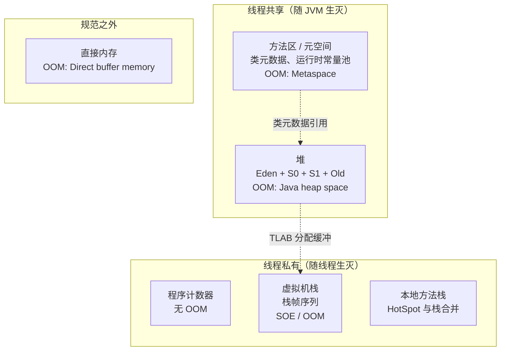
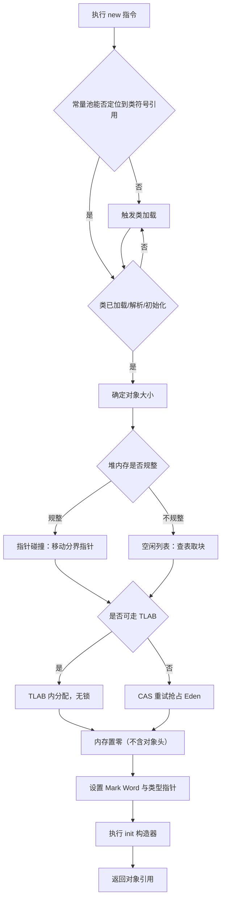
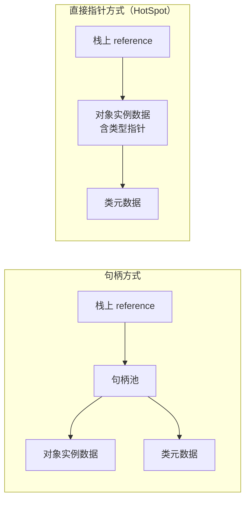
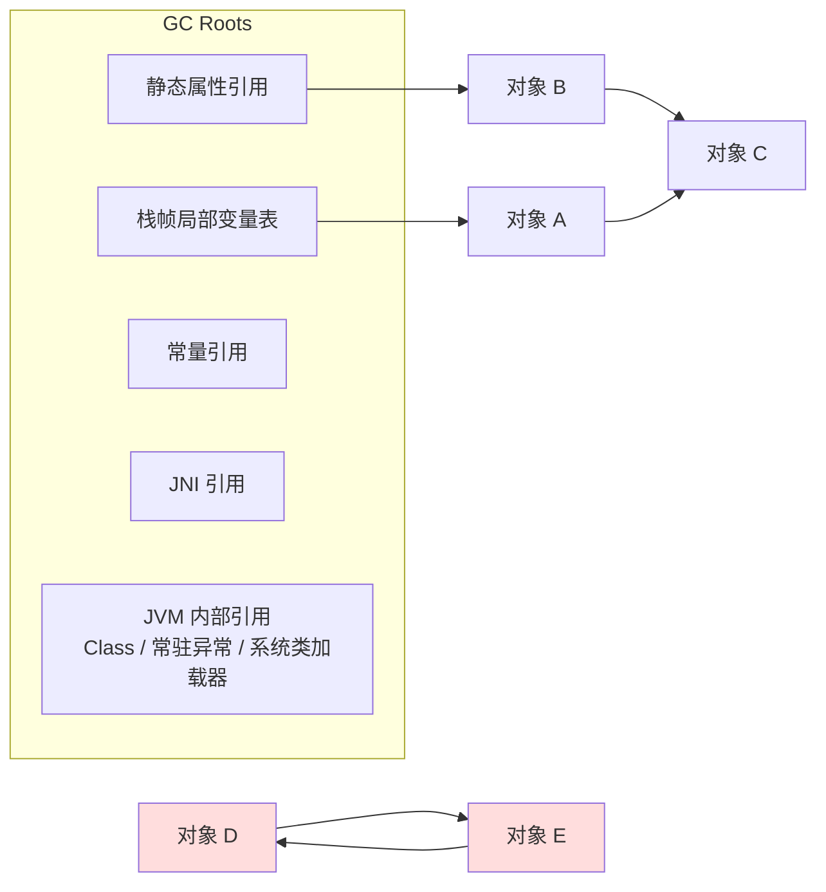
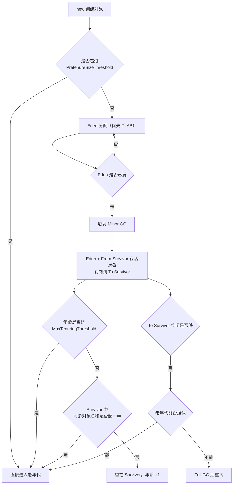
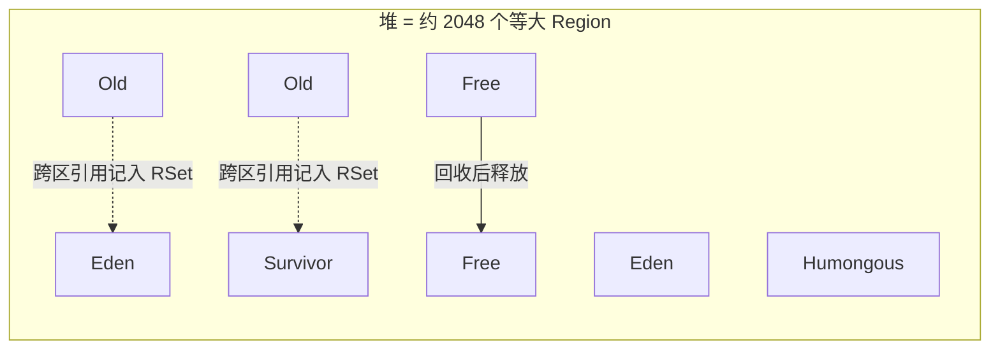
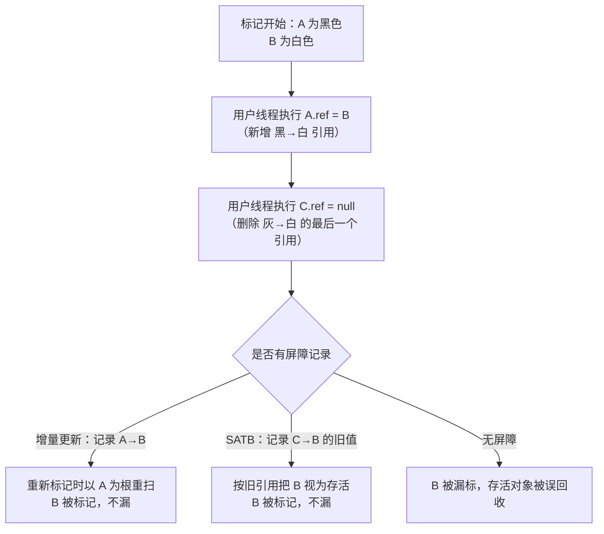
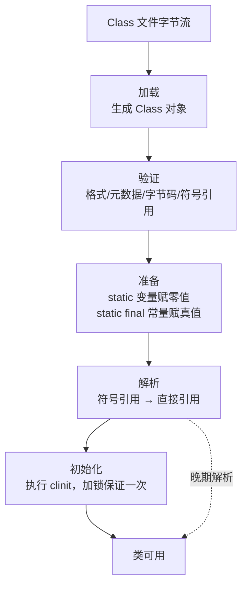
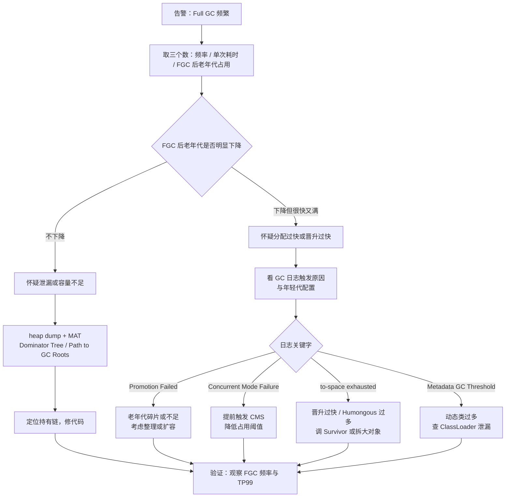

# 第 4 章 JVM：内存布局、垃圾回收、类加载与调优

> 一句话定位：中高级岗位的核心区分模块。前六题决定你"是否真的写过会 OOM 的服务"，中间八题决定你"是否理解 GC 的代价模型"，最后几题决定你"线上出问题敢不敢上手"。

## 一、本章考察重点概览

JVM 这一章在面试中的角色和其它章节不同：它很少被单独考，几乎总是**寄生在别的问题上**。问你 ThreadLocal 会不会泄漏，本质在考引用类型与 GC Roots；问你 Netty 为什么用直接内存，本质在考堆外内存与 Cleaner；问你怎么配线程池，本质在考 `-Xss` 与线程数的关系。所以这一章的目标不是背下数据区列表，而是把内存模型变成你解释其它问题的**底层坐标系**。

具体到考察方式，有四个特征：

1. **画图能力是硬门槛。** 运行时数据区、对象内存布局、G1 的 Region 与 RSet、三色标记的漏标场景，这四张图能徒手画出来，这一章就过了一半。画不出来，说明只是读过。
2. **"为什么这样设计"比"是什么"重要。** 为什么新生代用复制算法、为什么需要两个 Survivor、为什么 G1 要 RSet、为什么 CMS 用增量更新而 G1 用 SATB——这些"为什么"背后都是同一个权衡：**停顿时间、吞吐量、内存占用三者不可兼得**。
3. **调优题考的是判断链条，不是参数表。** 面试官问"Full GC 频繁怎么办"，想听的是"先看 Full GC 后老年代是否下降，据此区分泄漏与分配过快"，而不是"调大 -Xmx"。参数谁都会背，判断依据才是经验。
4. **版本差异是隐形的筛子。** JDK 8 与 JDK 17 的默认收集器、永久代与元空间、CMS 的废弃、偏向锁的禁用、GC 日志格式的变更，这些点答错会直接暴露"只看过旧博客"。

| 考点                          | 出现频率 | 难度 | 说明                                           |
| ----------------------------- | -------- | ---- | ---------------------------------------------- |
| 运行时数据区与 OOM 归属       | 高       | 初级 | 开场题，答错直接掉档                           |
| 对象创建过程与内存布局        | 高       | 中级 | 常要求画图，与 synchronized 锁升级联动         |
| 对象存活判定与四种引用        | 高       | 中级 | ThreadLocal、缓存、DirectByteBuffer 的共同底座 |
| 分代模型与晋升规则            | 高       | 中级 | 决定你能否解释"为什么我的对象提前进老年代"     |
| 垃圾回收算法与收集器演进      | 高       | 中级 | CMS/G1 必问，ZGC 是加分项                      |
| 三色标记与读写屏障            | 中       | 高级 | 中高级岗位的强区分点                           |
| 类加载过程与双亲委派          | 高       | 中级 | 常与 Spring、Tomcat、热部署联合考察            |
| JVM 参数与生产配置            | 高       | 中级 | 考工程感，参数写错比不知道更糟                 |
| OOM / CPU 100% / Full GC 排查 | 高       | 高级 | 高级岗位必问，要有完整步骤                     |

## 二、复习优先级

| 优先级 | 题目编号                                            | 理由                                             |
| ------ | --------------------------------------------------- | ------------------------------------------------ |
| P0     | Q1、Q2、Q3、Q4、Q7、Q8、Q9、Q12、Q16、Q17、Q19、Q20 | 必须背到能画图、能讲三层，任何一场面试都可能命中 |
| P1     | Q5、Q6、Q10、Q11、Q14、Q15、Q18、Q21、Q22、Q24      | 决定你是"中级"还是"背过八股"                     |
| P2     | Q13、Q23                                            | 加分项，ZGC 与 Arthas 讲清结论与一个场景即可     |

时间分配建议：本章建议 2.5 天。P0 占 65%，要求能闭合本子画出运行时数据区、对象创建流程、对象晋升路径、G1 回收流程图；P1 占 25%，重点是把 CMS 与 G1 的取舍讲成一条因果链；P2 剩 10%，面试前一天扫一遍速记卡即可。

## 三、高频面试题清单

| 编号 | 题目                                                           | 难度 | 优先级 | 一句话答案                                                                         |
| ---- | -------------------------------------------------------------- | ---- | ------ | ---------------------------------------------------------------------------------- |
| Q1   | JVM 运行时数据区有哪些？哪些线程私有、哪些共享？               | 初级 | P0     | 私有：PC、虚拟机栈、本地方法栈；共享：堆、方法区；直接内存不属于规范               |
| Q2   | 栈帧里有什么？StackOverflowError 与 OOM 有什么区别？           | 中级 | P0     | 栈帧含局部变量表、操作数栈、动态链接、返回地址；栈深度超限报 SOE，内存不足报 OOM   |
| Q3   | 对象是怎么创建出来的？为什么有指针碰撞和空闲列表两种分配方式？ | 中级 | P0     | 检查类→分配→零值初始化→设对象头→执行构造器；堆规整用指针碰撞，有碎片用空闲列表 |
| Q4   | 对象在内存里长什么样？两种对象访问定位方式怎么选？             | 中级 | P0     | 对象头 + 实例数据 + 对齐填充；HotSpot 用直接指针，句柄的代价是多一次间接寻址       |
| Q5   | 对象一定分配在堆上吗？逃逸分析做了什么？                       | 高级 | P1     | 不一定，逃逸分析后可标量替换、锁消除；HotSpot 用标量替换而非真正栈上分配           |
| Q6   | 字符串常量池、运行时常量池、元空间、永久代是什么关系？         | 中级 | P1     | 常量池是数据，永久代/元空间是它的容器；JDK 8 用本地内存的元空间替代永久代          |
| Q7   | 怎么判断一个对象已经死了？GC Roots 有哪些？                    | 中级 | P0     | 可达性分析，GC Roots 含栈上引用、静态属性、常量、JNI 引用与 JVM 内部引用           |
| Q8   | 四种引用类型分别用在哪？                                       | 中级 | P0     | 强引用不回收；软引用内存不足回收；弱引用下次 GC 回收；虚引用只用于回收通知         |
| Q9   | 为什么要分代？对象什么时候进入老年代？                         | 中级 | P0     | 分代假说决定算法选择；晋升看年龄、大对象、动态年龄判定、Survivor 放不下与担保      |
| Q10  | 三种基础 GC 算法各自的代价是什么？                             | 中级 | P1     | 标记清除有碎片，复制浪费空间但无碎片，标记整理无碎片但要移动对象                   |
| Q11  | Serial / ParNew / Parallel / CMS 分别解决什么问题？            | 中级 | P1     | Serial 单线程省资源，Parallel 追吞吐，CMS 追低延迟但碎片与 CMF 难缠                |
| Q12  | G1 是怎么做到"可预测停顿"的？                                  | 高级 | P0     | Region 化堆 + RSet 记跨区引用 + 按收益排序回收 + 停顿预测模型选回收集合            |
| Q13  | ZGC 和 Shenandoah 为什么能把停顿压到毫秒级？                   | 高级 | P2     | 染色指针 / 转发指针 + 读屏障，标记与转移全并发，STW 只剩根扫描                     |
| Q14  | 三色标记会漏标吗？增量更新与 SATB 有什么区别？                 | 高级 | P1     | 同时满足两个条件才漏标；增量更新破坏条件一，SATB 破坏条件二                        |
| Q15  | Minor GC、Major GC、Full GC 何时触发？怎么减少 Full GC？       | 中级 | P1     | 老年代不足、担保失败、元空间满、System.gc 触发；减少的关键是让对象早死             |
| Q16  | 类加载的五个阶段各做什么？准备阶段为什么赋零值？               | 中级 | P0     | 加载、验证、准备、解析、初始化；零值保证字段可不赋值使用且 GC 不扫到脏值           |
| Q17  | 双亲委派是什么？为什么要它？怎么打破？                         | 中级 | P0     | 向上委派避免重复加载与核心类被替换；SPI、Tomcat、OSGi、热部署都要打破              |
| Q18  | 类的唯一性由什么决定？类什么时候能被卸载？                     | 中级 | P1     | 类加载器 + 全限定名；实例、ClassLoader、Class 对象三者都不可达才卸载               |
| Q19  | 常用 JVM 参数有哪些？生产怎么配？                              | 中级 | P0     | 堆固定、元空间设上限、必开 OOM dump、GC 日志分级滚动、容器按比例分配               |
| Q20  | OOM 有哪几种？分别怎么定位？                                   | 高级 | P0     | 堆、元空间、直接内存、线程创建失败四类最常见，靠错误信息先分流                     |
| Q21  | CPU 100%、内存泄漏、死锁分别怎么排查？                         | 高级 | P1     | top -Hp 定位线程→转十六进制→jstack 对栈；泄漏靠 jmap dump + MAT                  |
| Q22  | 线上一台机器 Full GC 频繁，你怎么查？                          | 高级 | P1     | 先看 Full GC 后老年代是否下降，据此分泄漏与分配过快，再看日志细节定位触发点        |
| Q23  | Arthas 常用命令有哪些？线上排查怎么用？                        | 中级 | P2     | 运行期字节码增强，看线上方法真实行为；必须限次并及时撤销                           |
| Q24  | 为什么调优要先定目标？`MaxGCPauseMillis` 怎么设？            | 中级 | P1     | 吞吐、延迟、内存不可兼得；该参数是软目标，设小反而更频繁                           |

## 四、题目详解

### Q1. JVM 运行时数据区有哪些？哪些线程私有、哪些共享？（初级）

**一句话结论**：线程私有的有程序计数器、虚拟机栈、本地方法栈；线程共享的有堆和方法区（JDK 8 起由元空间实现）；直接内存不属于规范定义的运行时数据区，但 NIO 会大量使用。除程序计数器外，其余区域都可能抛出 `OutOfMemoryError`。

**先把话说白**：JVM 要跑 Java 代码，必须回答三个问题：字节码执行到哪了、方法调用链怎么记、对象放在哪。前两个是"每个线程各有一份"的私有状态，因为线程切换后必须能原地恢复；第三个是"所有线程都能看见"的共享资源，否则对象没法传递。这就是私有与共享划分的根本原因——**是否随线程生命周期独立**。

**底层原理**：

1. **程序计数器（PC, Program Counter Register）。** 一块很小的内存，存当前线程正在执行的字节码指令地址。分支、循环、跳转、异常处理、线程恢复都靠它。它是唯一一个在《Java 虚拟机规范》中**没有规定任何 OOM 情况**的区域。执行 native 方法时它的值是未定义的（Undefined）。之所以私有，是因为 CPU 时间片轮转后，线程要能回到上次执行的位置。
2. **虚拟机栈（VM Stack）。** 生命周期与线程相同，描述 Java 方法执行的内存模型。每个方法调用创建一个栈帧（Stack Frame），方法结束则栈帧出栈。栈深度超过 `-Xss` 限制抛 `StackOverflowError`；栈可以动态扩展但申请不到内存时抛 `OutOfMemoryError`。
3. **本地方法栈（Native Method Stack）。** 为 native 方法服务。HotSpot 直接把虚拟机栈和本地方法栈合并实现，所以 `-Xss` 同时决定两者的深度，这也是"为什么递归深度和 native 调用会互相影响"的原因。
4. **堆（Heap）。** 唯一目的是存放对象实例，几乎所有对象都在这里分配（逃逸分析会打破这个"几乎"）。它是 GC 的主战场，按分代假说分为新生代（Eden + 两个 Survivor）和老年代。通过 `-Xms` / `-Xmx` 控制初始与最大大小。堆内还有线程私有的分配缓冲区（TLAB），但 TLAB 只是分配动作的私有，内存归属仍是堆。
5. **方法区（Method Area）。** 规范中的逻辑概念，存放类型信息、字段与方法描述、运行时常量池、静态变量、JIT 编译后的代码缓存。它的实现经历了三次变化：JDK 7 及以前是永久代（PermGen，堆内）；JDK 8 起是元空间（Metaspace，本地内存）；JDK 7 时字符串常量池与静态变量已被移出永久代放到堆中。
6. **直接内存（Direct Memory）。** 不是运行时数据区的一部分，通过 `ByteBuffer.allocateDirect` 或 `Unsafe.allocateMemory` 申请，由操作系统管理。受 `-XX:MaxDirectMemorySize` 限制，未显式设置时默认等于 `-Xmx`。它的读写少一次堆内到堆外的拷贝，是 Netty 高性能的原因之一，代价是分配慢、回收依赖 `Cleaner`。



**易混对比**：

| 区域          | 线程归属       | 主要存放内容               | 溢出表现                 | 关键参数                    |
| ------------- | -------------- | -------------------------- | ------------------------ | --------------------------- |
| 程序计数器    | 私有           | 当前字节码行号             | 无                       | 无                          |
| 虚拟机栈      | 私有           | 栈帧（局部变量、操作数栈） | StackOverflowError / OOM | `-Xss`                    |
| 本地方法栈    | 私有           | native 方法栈帧            | 同上                     | `-Xss`（HotSpot 合并）    |
| 堆            | 共享           | 对象实例、数组             | Java heap space          | `-Xms` `-Xmx`           |
| 方法区/元空间 | 共享           | 类元数据、常量、静态变量   | Metaspace                | `-XX:MaxMetaspaceSize`    |
| 直接内存      | 共享（进程级） | NIO 缓冲区                 | Direct buffer memory     | `-XX:MaxDirectMemorySize` |

**面试追问**：

- 追问：为什么程序计数器不会 OOM？→ 答题要点：它只存一个指令地址，大小在 JVM 设计时就固定，不随程序规模增长。
- 追问：JDK 7 为什么要把字符串常量池移到堆里？→ 答题要点：永久代回收效率低、大小难预估，字符串数量由业务决定不可控，移入堆后可被正常 GC 回收。
- 追问：`-Xss` 调小有什么风险？→ 答题要点：递归深度变浅、深层调用链（如复杂 JSON 解析、正则）容易 SOE；好处是同样内存能开更多线程。
- 追问：TLAB 在堆里，为什么说是"线程私有"？→ 答题要点：私有的是分配指针，不是内存本身；对象仍可被其他线程访问，TLAB 退役时才需要同步。

### Q2. 栈帧里有什么？StackOverflowError 与 OOM 有什么区别？（中级）

**一句话结论**：栈帧由局部变量表、操作数栈、动态链接、方法返回地址四部分组成；`StackOverflowError` 是单线程栈深度超过 `-Xss` 上限，`OutOfMemoryError` 是申请不到内存，在栈这个区域通常表现为"无法创建新的本地线程"。

**先把话说白**：栈帧就是一次方法调用的"工作台"。参数和局部变量放在台面左边的格子里（局部变量表），计算过程的中间结果堆在台面右边（操作数栈），台面上还贴着一张纸条写着"这个方法的常量池在哪"（动态链接），以及"干完活回哪里"（返回地址）。方法调用一层层叠上去，叠太高就塌了。

**底层原理**：

1. **局部变量表（Local Variable Table）。** 以变量槽（Slot）为最小单位，一个 Slot 通常 32 位。`long`、`double` 占两个 Slot。实例方法的第 0 个 Slot 固定是 `this`（所以静态方法里不能用 `this`）。表的容量在编译期确定，写在 Code 属性的 `max_locals` 中。这也是为什么"方法里声明太多局部变量"会影响栈帧大小。
2. **操作数栈（Operand Stack）。** 后进先出的表达式求值栈，最大深度同样在编译期算好，写在 `max_stack` 中。执行 `iadd` 时从栈顶弹出两个 int、压回一个结果。JIT 编译后大部分操作会落到寄存器，但解释执行时它真实存在于栈帧里。
3. **动态链接（Dynamic Linking）。** 每个栈帧持有指向运行时常量池中"该栈帧所属方法"的引用。字节码中的方法调用、字段访问都是符号引用，运行时通过这个引用解析成直接引用（内存地址）。这就是"动态"的含义：链接发生在运行期而非编译期。
4. **方法返回地址。** 方法正常退出时，把返回值压入调用者的操作数栈，并恢复调用者的 PC；异常退出时，返回地址通过异常表查找 handler 决定。栈帧中还可能保存锁记录（`synchronized` 生成的 monitor 引用）等信息。
5. **两种错误的本质区别。** `StackOverflowError` 发生在**同一个线程内**：栈帧越叠越多，超过 `-Xss` 限制（Linux x64 上 HotSpot 默认 1MB），JVM 直接抛错，异常本身通常不带附加信息，需要结合 `-Xss` 与调用栈深度判断。`OutOfMemoryError` 发生在**申请内存失败**：栈是线程私有的，创建线程时 JVM 要向操作系统申请线程栈内存，申请不到就抛 `OutOfMemoryError: unable to create new native thread`。前者是"这一摞放不下了"，后者是"没有新桌子了"。

```java
// 复现 StackOverflowError：栈深度超过 -Xss
public class StackOverflowDemo {
    private static int depth = 0;

    static void recurse() {
        depth++;          // 每层调用都会新建一个栈帧
        recurse();        // 无终止条件，必然溢出
    }

    public static void main(String[] args) {
        try {
            recurse();
        } catch (StackOverflowError e) {
            // 实际深度与 -Xss、栈帧大小有关，通常几千到几万层
            System.out.println("depth = " + depth);
            throw e;
        }
    }
}
```

6. **为什么"catch 住 SOE 继续跑"很危险。** 抛出时栈已经耗尽，catch 块本身也需要栈空间，且此时对象状态可能不一致。生产上应视为致命错误，记录后退出。

**易混对比**：

| 维度     | StackOverflowError         | OutOfMemoryError（线程相关）           |
| -------- | -------------------------- | -------------------------------------- |
| 直接原因 | 单线程栈帧数量超过深度上限 | 系统无法为新线程分配栈内存             |
| 报错信息 | 通常无附加信息，只有类名   | `unable to create new native thread` |
| 相关参数 | `-Xss`                   | `-Xss`、`ulimit -u`、物理内存      |
| 典型场景 | 无限递归、超深调用链       | 线程池无界、连接数暴涨                 |
| 处理方式 | 修代码，加终止条件         | 限制线程数、调小 `-Xss`、改 NIO 模型 |

**面试追问**：

- 追问：局部变量越多，能递归的层数越少吗？→ 答题要点：会，`max_locals` 变大导致栈帧变大，同样 `-Xss` 下可容纳的帧数减少。
- 追问：栈帧一定分配在栈上吗？→ 答题要点：不一定，JIT 优化后部分栈帧会被消除（方法内联），虚拟线程的栈数据存在堆中。
- 追问：`-Xss` 默认多大？→ 答题要点：HotSpot 在 Linux x64 上默认 1MB，Windows 上通常更大；不同 JDK 版本与平台有差异，以 `java -XX:+PrintFlagsFinal -version` 为准。
- 追问：为什么线程数太多会 OOM 而不是栈溢出？→ 答题要点：每个线程要预留栈空间（默认 1MB），1 万线程就是 10GB 虚拟内存，耗尽的是进程地址空间而非某个线程的栈深度。

### Q3. 对象是怎么创建出来的？为什么有指针碰撞和空闲列表两种分配方式？（中级）

**一句话结论**：`new` 指令依次经过类加载检查、分配内存、零值初始化、设置对象头、执行构造器五步；分配方式取决于堆是否规整——规整用指针碰撞，有碎片用空闲列表；并发分配靠 CAS 重试与 TLAB 保证安全。

**先把话说白**：创建对象像在停车场找车位。如果所有车都按顺序停、中间没有空位，那你只要记住"下一个空位在哪"，把指针往后挪一个车位就行，这叫指针碰撞。如果车进进出出、到处是空洞，就必须维护一张"空闲车位表"，从表里挑一个，这叫空闲列表。选哪种不取决于偏好，取决于**这块内存是否规整**，而是否规整又取决于**用的 GC 算法是否移动对象**。

**底层原理**：

1. **类加载检查。** 遇到 `new` 指令，先检查常量池中能否定位到该类的符号引用，并检查这个类是否已被加载、解析、初始化。没有则先执行类加载流程（见 Q16）。这一步保证了"对象的大小在分配前是已知的"——实例字段布局由类元数据决定。
2. **分配内存。** 类加载完成后对象大小就固定了，JVM 从堆中划出一块。具体方式两种：

   - **指针碰撞（Bump the Pointer）**：所有用过的内存放一边、空闲的放另一边，中间一个指针作为分界，分配就是把指针向空闲区挪一段。前提是内存规整。
   - **空闲列表（Free List）**：JVM 维护一张记录可用内存块的列表，分配时找到足够大的一块并更新列表。前提是内存不规整。
3. **并发安全的两道保险。** 分配动作不是原子的，两个线程可能同时抢到同一块内存。方案一：CAS 加失败重试，保证更新指针的原子性。方案二：**TLAB（Thread Local Allocation Buffer）**，在 Eden 区为每个线程预分一小块，线程优先在自己的 TLAB 里分配，用完再申请新的。TLAB 默认开启（`-XX:+UseTLAB`），空间很小（Eden 的 1% 量级，自适应调整），允许一定浪费（`-XX:TLABWasteTargetPercent` 默认 1%）。TLAB 用满后对象退回共享 Eden 分配，此时才需要同步。
4. **零值初始化。** 内存分配完成后，JVM 把这块内存（不含对象头）全部置零。这一步保证了实例字段即使不在构造器里赋值，也能直接读到 0 / false / null，而不是随机值。从 GC 角度看，这也避免了 GC 把未初始化的内存误认为有效引用。
5. **设置对象头。** 填入 Mark Word（哈希码、GC 分代年龄、锁状态标志）、类型指针（指向类元数据），如果是数组还要写入数组长度。
6. **执行构造器。** 调用 `<init>` 方法，按"父类构造器 → 实例字段初始化与实例代码块（按源码顺序）→ 本类构造器剩余代码"执行。走到这一步，对象才真正可用。



**易混对比**：

| 维度       | 指针碰撞                        | 空闲列表                     |
| ---------- | ------------------------------- | ---------------------------- |
| 前提       | 堆内存规整（用过的在一侧）      | 堆内存不规整（存在碎片）     |
| 分配动作   | 指针偏移 + 更新                 | 查表找块 + 更新表            |
| 分配速度   | 快，接近一次加法                | 较慢，取决于表结构与碎片程度 |
| 配套算法   | 复制、标记整理（会移动对象）    | 标记清除（不移动对象）       |
| 典型收集器 | Serial、ParNew、G1（Region 内） | CMS                          |

**面试追问**：

- 追问：TLAB 里的对象会不会被其他线程访问到？→ 答题要点：会，TLAB 只是分配区私有；对象引用一旦发布出去，其他线程照常访问，GC 也照常扫描整个 Eden。
- 追问：为什么先零值初始化再执行构造器？→ 答题要点：保证字段有确定的默认值，避免读到脏内存；同时让 GC 不会把随机位模式当成引用。
- 追问：大对象会分配在 Eden 吗？→ 答题要点：不一定，`-XX:PretenureSizeThreshold` 可让超过阈值的对象直接进老年代，但该参数只对 Serial / ParNew 有效，G1 下不生效。
- 追问：分配一定发生在堆上吗？→ 答题要点：不一定，逃逸分析后可能被标量替换，字段直接变成栈上的局部变量（见 Q5）。

### Q4. 对象在内存里长什么样？两种对象访问定位方式怎么选？（中级）

**一句话结论**：对象在内存中由对象头、实例数据、对齐填充三部分组成，对象头含 Mark Word 与类型指针（数组还有长度）；访问定位有句柄和直接指针两种，HotSpot 用直接指针换取一次间接寻址的开销。

**先把话说白**：一个对象在内存里不只是"它的字段"。它还需要一张身份证（Mark Word：哈希码、年龄、锁状态）和一个"我属于哪个类"的指针（类型指针）。字段按规则排好，最后如果总长度不是 8 的倍数，补几个字节凑齐——这不是浪费，是让 CPU 一次读完。

**底层原理**：

1. **对象头（Object Header）之 Mark Word。** 64 位 JVM 上占 8 字节，内容随锁状态复用同一块空间：

   - 无锁：25 位哈希码 + 4 位分代年龄 + 1 位偏向标志 + 2 位锁标志
   - 偏向锁：线程 ID + Epoch + 分代年龄 + 偏向标志 + 锁标志
   - 轻量级锁：指向栈中锁记录（Lock Record）的指针
   - 重量级锁：指向 Monitor 对象的指针
   - GC 标记：转发地址（对象被移动时用）

   因为空间复用，**一旦对象调用了 `identityHashCode`（或默认 `hashCode`），就再也无法进入偏向锁**——哈希码占了偏向线程 ID 的位置。这是"为什么用了 HashMap 的 key 之后偏向锁失效"的原因。
2. **对象头之类型指针（Klass Pointer）。** 指向方法区（元空间）中该类的元数据，JVM 靠它判断"这个对象是什么类型"、能否强转、该调哪个方法。开启压缩指针（`-XX:+UseCompressedOops`，堆小于 32GB 时默认开启）后占 4 字节，用 32 位偏移表示 64 位地址（8 字节对齐使低 3 位可省）。
3. **数组的特殊性。** 数组对象头额外有 4 字节长度字段，因为 JVM 无法从元数据推断数组长度（数组的类元数据只描述元素类型）。
4. **实例数据（Instance Data）。** 真正存储的字段内容，包括父类继承来的。HotSpot 的字段分配策略默认（`-XX:+FieldsAllocationStyle=1`）会把相同宽度的字段放在一起，并把父类字段排在子类之前，目的是减少对齐填充产生的空洞。`long`/`double` 优先放在 8 字节边界上。
5. **对齐填充（Padding）。** HotSpot 要求对象起始地址是 8 字节的整数倍，所以对象总大小必须是 8 的倍数，不足则补齐。这也是"为什么 `new Object()` 占 16 字节"（8 字节 Mark Word + 4 字节压缩类型指针 + 4 字节填充）的原因。
6. **两种访问定位方式。**

   - **句柄访问**：堆中划出句柄池，栈上的 reference 指向句柄，句柄内含"到对象实例数据的指针"和"到类型数据的指针"。优点是对象被 GC 移动时只需改句柄里的指针，reference 本身不动；缺点是多一次间接寻址。
   - **直接指针**：reference 直接指向对象，对象头里的类型指针再指向类元数据。优点是快（少一次跳转），缺点是对象移动时要更新所有指向它的引用（包括栈上的），这也是 GC 需要精确知道栈上哪些槽是引用的原因。



**易混对比**：

| 维度         | 句柄访问         | 直接指针             |
| ------------ | ---------------- | -------------------- |
| 寻址次数     | 2 次             | 1 次                 |
| 对象移动成本 | 低（只改句柄）   | 高（要更新所有引用） |
| 实现复杂度   | 需要维护句柄池   | 简单，无额外结构     |
| 空间开销     | 每个对象一个句柄 | 无                   |
| 采用者       | 部分早期 JVM     | HotSpot              |

| 布局部分  | 64 位（压缩指针开） | 说明                   |
| --------- | ------------------- | ---------------------- |
| Mark Word | 8 字节              | 哈希、年龄、锁状态复用 |
| 类型指针  | 4 字节              | 指向 Klass             |
| 数组长度  | 4 字节（仅数组）    | JVM 无法从元数据推导   |
| 实例数据  | 视字段而定          | 同宽度聚集，父类在前   |
| 对齐填充  | 0~7 字节            | 保证 8 字节对齐        |

**面试追问**：

- 追问：为什么压缩指针能把 8 字节压到 4 字节？→ 答题要点：对象按 8 字节对齐，地址低 3 位恒为 0，可右移 3 位存 32 位，理论覆盖 32GB；超过 32GB 压缩失效，指针膨胀反而更慢。
- 追问：Mark Word 里的 hashCode 什么时候生成？→ 答题要点：第一次调用 `Object.hashCode` 或 `System.identityHashCode` 时惰性生成并写入，之后不再变化。
- 追问：偏向锁为什么被废弃？→ 答题要点：撤销偏向需要 STW 安全点，维护成本高；现代应用竞争普遍，收益有限。JDK 15 起默认禁用（JEP 374）。
- 追问：`new Object()` 占多少字节？→ 答题要点：64 位 + 压缩指针下 16 字节（8 + 4 + 4 填充），不同 JVM 实现与参数会有差异。

### Q5. 对象一定分配在堆上吗？逃逸分析做了什么？（高级）

**一句话结论**：不一定。JIT 的逃逸分析（Escape Analysis）能判断对象的作用域是否逃出方法或线程，对未逃逸的对象做标量替换、锁消除，使字段直接落在栈帧或寄存器上。严格说 HotSpot 并未实现"栈上分配"，效果由标量替换达成。

**先把话说白**：如果一个对象创建出来只在方法内部用几下就丢，那把它放进堆里、让 GC 去管，是很大的浪费。JIT 会先看这个对象有没有"跑出去"——被返回、被存进静态字段、被传给别的线程。没跑出去，就可以把它的字段拆成几个普通局部变量，直接放在栈上甚至寄存器里，对象本身根本不存在了。

**底层原理**：

1. **逃逸的两种程度。**

   - **方法逃逸**：对象作为返回值、作为参数传给其他方法、被赋给外部可见的字段。
   - **线程逃逸**：对象被赋给静态字段、实例字段，或被其他线程访问到（相当于"发布"了）。

   只有完全不逃逸（或仅在方法内逃逸但被内联消除）的对象才能被优化。
2. **三种基于逃逸结果的优化。**

   - **标量替换（Scalar Replacement）**：把对象拆成若干标量（基本类型字段或对象引用），直接分配到栈帧的局部变量槽。这是 HotSpot 上"对象在栈上"的真实形态。
   - **栈上分配（Stack Allocation）**：概念上把整个对象放在栈帧里。HotSpot 未单独实现，因为标量替换已经覆盖了绝大多数收益，且整对象栈上分配要处理对齐、同步、栈帧布局等复杂问题。
   - **锁消除（Lock Elision）**：对象没逃逸出线程，对它加锁没有意义，JIT 直接去掉 `synchronized`。这解释了"为什么局部 `StringBuffer` 的 `append` 并不慢"——锁被消除了。
3. **默认开关与生效条件。** `-XX:+DoEscapeAnalysis` 在 JDK 6u23 之后默认开启，`-XX:+EliminateAllocations`（标量替换）与 `-XX:+EliminateLocks`（锁消除）默认开启。关键限制：**只有被 C2 编译后的代码才生效**。方法刚执行时走解释器，对象照样在 Eden 分配；跑够热度（`-XX:CompileThreshold`，分层编译下由 `Tier3`/`Tier4` 阈值决定）之后才可能被优化。
4. **代价与边界。** 逃逸分析本身要遍历字节码、构造连接图（connection graph），有编译时间成本，且在大方法上可能被放弃（超过 `-XX:EliminateAllocationArraySizeLimit` 或方法太大时不分析）。所以"对象在栈上"不是一个可以依赖的语义保证，只是运行时优化，不能用来解释"为什么我的对象不需要 GC"。

```java
// 演示标量替换：Point 不逃逸，JIT 可把 x/y 直接放在栈上
public class ScalarReplaceDemo {
    static class Point {
        int x, y;
        Point(int x, int y) { this.x = x; this.y = y; }
    }

    // 返回值是 int 而非 Point，对象未逃逸出方法
    static int sum(int n) {
        int total = 0;
        for (int i = 0; i < n; i++) {
            Point p = new Point(i, i + 1);   // 可能完全不分配
            total += p.x + p.y;
        }
        return total;
    }

    public static void main(String[] args) {
        long s = System.nanoTime();
        long r = 0;
        for (int i = 0; i < 100_000; i++) r += sum(1000);  // 预热让 C2 编译
        System.out.println(r + " cost " + (System.nanoTime() - s) / 1_000_000 + "ms");
    }
}
```

用 `-XX:-DoEscapeAnalysis` 关闭逃逸分析对比 GC 次数，能观察到 Eden 分配量的差异；用 `-XX:+PrintEliminateAllocations`（需 debug/fastdebug 构建）可以看到标量替换的日志，生产版 JDK 通常不输出。

**易混对比**：

| 优化     | 触发条件             | 效果                             | 是否默认开启 |
| -------- | -------------------- | -------------------------------- | ------------ |
| 标量替换 | 对象不逃逸，字段可拆 | 对象不分配，字段进栈/寄存器      | 是           |
| 栈上分配 | 对象不逃逸           | 整个对象放栈帧（HotSpot 未实现） | 不适用       |
| 锁消除   | 锁对象不逃逸出线程   | 去掉 `synchronized`            | 是           |
| 方法内联 | 方法体小、调用频繁   | 消除栈帧，是其它优化的前提       | 是           |

**面试追问**：

- 追问：既然有标量替换，为什么还说"对象在堆上分配"？→ 答题要点：这是语言规范层面的默认语义，逃逸分析是 JIT 的实现优化，不改变语义，也不能被程序依赖。
- 追问：为什么 HotSpot 不直接做栈上分配？→ 答题要点：需要处理对象身份（`==`、`hashCode`、锁）、对齐、栈帧扩容，而标量替换已能覆盖大部分收益。
- 追问：逃逸分析有开销吗？→ 答题要点：有，构造连接图要遍历字节码，大方法上可能放弃分析，属于"用编译时间换运行时间"。
- 追问：`new` 出来的对象可能不进 Eden 吗？→ 答题要点：可能，大对象直接进老年代、TLAB 快速分配、JIT 标量替换后完全不分配。

### Q6. 字符串常量池、运行时常量池、元空间、永久代是什么关系？（中级）

**一句话结论**：常量池是"数据"，永久代/元空间是"存放这些数据的方法区实现"。Class 文件常量池在类加载后进入运行时常量池，字符串常量池是其中被单独优化（StringTable）的全局表，JDK 7 起位于堆中；JDK 8 用本地内存的元空间替代了永久代。

**先把话说白**：这几个词经常被混着说，其实分两层：一层是"装什么"（常量池、字符串），一层是"装在哪个盒子里"（永久代、元空间）。盒子换过两次：JDK 7 把字符串搬出永久代，JDK 8 干脆把永久代整个换掉，改用本地内存。

**底层原理**：

1. **三个常量池要分清。**

   - **Class 文件常量池**：`.class` 文件中的一张表，存字面量（文本字符串、final 常量值）和符号引用（类、字段、方法的全限定名）。它是静态的、编译期产物。
   - **运行时常量池**：类加载后，Class 文件常量池的内容进入方法区，成为运行时常量池。它比 Class 文件常量池更"动态"——运行期可以新增常量，典型就是 `String.intern()`。
   - **字符串常量池（String Table）**：HotSpot 中的一张全局哈希表，专门用于字符串字面量与 `intern()` 的去重。它不属于某个类的运行时常量池，而是 JVM 级别的结构。
2. **位置的三次变迁。**

   - JDK 6 及以前：字符串常量池在永久代内，`intern()` 会把字符串**复制**到永久代。
   - JDK 7：字符串常量池移到堆中，`intern()` 改为**记录堆中对象的引用**（不再复制）。这次改动的直接动机是永久代太小、回收效率低，大量 `intern` 容易 `PermGen space`。
   - JDK 8：永久代被元空间取代，但字符串常量池仍在堆里，静态变量也在堆里（随 Class 对象）。
3. **永久代为什么被替换。**

   - 大小难定：`-XX:MaxPermSize` 默认 64MB（JDK 7 的 32 位）或 82MB 左右，动态生成类多的应用极容易打满，且预估困难。
   - 回收效率低：永久代的回收依附于 Full GC，且只回收废弃常量与无用的类，条件苛刻。
   - 与 JRockit 合并需要：Oracle 收购 JRockit 后要统一两款虚拟机，JRockit 没有永久代概念，元空间是折中方案。
   - 常量池膨胀不可控：字符串数量由业务数据决定，放在固定大小的区域里风险太高。
4. **元空间（Metaspace）的机制。** 使用本地内存（Native Memory），存储类的元数据（Klass 结构、方法字节码、常量池、注解等）。默认不限制大小（`-XX:MaxMetaspaceSize` 默认 unlimited），受物理内存与容器限制约束。`-XX:MetaspaceSize`（约 21MB）不是初始大小，而是**首次触发 Metaspace GC 的阈值**，JVM 会根据回收情况动态调整这个阈值。元空间有自己的 GC（Metaspace GC），当 committed 接近 MaxMetaspaceSize 时会触发。
5. **元空间为什么会 OOM。** 根因只有一个：**类的数量持续增长且无法卸载**。常见来源：

   - 运行期动态生成类：CGLIB/ByteBuddy 代理、反射的 `MethodAccessor` 字节码版本、Groovy/JS 脚本引擎、`LambdaMetafactory` 大量生成。
   - 热部署/热加载：每次重载都新建 ClassLoader，旧 ClassLoader 未释放，类无法卸载。
   - 字节码增强框架在循环中反复 `defineClass`。

   定位手段：`jstat -gcmetacapacity <pid>` 看 MC/MU 增长；`jcmd <pid> GC.class_stats`（需 `-XX:+UnlockDiagnosticVMOptions`）；`jmap -clstats <pid>` 看各 ClassLoader 加载的类数量；启动加 `-XX:+TraceClassLoading -XX:+TraceClassUnloading` 观察类的加载与卸载是否平衡。

**易混对比**：

| 维度         | 永久代（JDK 7 及以前）           | 元空间（JDK 8 起）                 |
| ------------ | -------------------------------- | ---------------------------------- |
| 内存归属     | JVM 堆内（受 `-Xmx` 间接影响） | 本地内存（不受 `-Xmx` 限制）     |
| 大小控制     | `-XX:MaxPermSize`，默认较小    | `-XX:MaxMetaspaceSize`，默认不限 |
| 字符串常量池 | 在永久代内（JDK 6）              | 在堆内（JDK 7 起已在堆）           |
| 回收触发     | 只能靠 Full GC                   | 有独立的 Metaspace GC              |
| 典型错误     | `PermGen space`                | `Metaspace`                      |
| 调优难度     | 需精确预估，易打满               | 设上限防失控即可                   |

**面试追问**：

- 追问：`-XX:MetaspaceSize` 是初始大小吗？→ 答题要点：不是，是首次触发 Metaspace GC 的水位线，之后会根据回收效果动态调整。
- 追问：元空间无限大是不是就不用管了？→ 答题要点：不行，它吃的是本地内存，会和堆、线程栈、直接内存抢物理内存，容器里还会被 cgroup 限制；生产建议设 `MaxMetaspaceSize`。
- 追问：为什么 JDK 7 要把字符串常量池移到堆？→ 答题要点：字符串数量由业务决定不可控，永久代回收条件苛刻，移到堆后可随 Minor GC 回收。
- 追问：`String.intern()` 在 JDK 7 前后行为有何不同？→ 答题要点：JDK 6 复制字符串进永久代，JDK 7 起只记录堆中对象的引用，后者省内存但要求原对象存活。

### Q7. 怎么判断一个对象已经死了？GC Roots 有哪些？（中级）

**一句话结论**：主流 JVM 用可达性分析（Reachability Analysis）而非引用计数，从 GC Roots 出发遍历引用链，不可达的对象才可回收；GC Roots 包括栈帧局部变量表中的引用、静态属性引用、常量引用、JNI 引用和 JVM 内部引用。

**先把话说白**：引用计数像"每个对象身上挂一个计数器，被指一次加一，少一指减一，归零就死"。听起来直观，但两个人互相指着对方，计数器永远不归零，谁都死不了。可达性分析换了个思路：从一批"绝对活着"的根出发，能走到的都活着，走不到的就是垃圾。互相引用的两个对象如果都没有根能到达，就一起被回收。

**底层原理**：

1. **引用计数为什么不用。** 除了循环引用，还有两个工程原因：每次引用赋值都要更新计数（写操作变重，且需要原子性保证，多线程下开销大）；计数器本身占空间。HotSpot 完全不用它，Python 用引用计数 + 分代 GC 补循环引用，是另一种取舍。
2. **可达性分析的执行模型。** 从 GC Roots 集合出发，沿着引用关系做图遍历（标记阶段），标记到的对象为存活，未标记的为可回收。这个遍历必须保证"一致性快照"——如果在遍历过程中用户线程还在改引用，就会漏标或错标，所以要么 STW，要么用三色标记 + 读写屏障（见 Q14）。
3. **GC Roots 的具体范围（HotSpot 的实践中通常包括）：**

   - 虚拟机栈中引用的对象：各线程栈帧的局部变量表里存放的引用。
   - 方法区中类静态属性引用的对象：`static` 字段指向的对象。
   - 方法区中常量引用的对象：如字符串常量池里的引用、`final` 常量指向的对象。
   - 本地方法栈中 JNI（Native 方法）引用的对象。
   - JVM 内部的引用：基本类型对应的 Class 对象、常驻的异常对象（NPE、OOM）、系统类加载器。
   - 被 `synchronized` 持有的对象（锁对象不能被回收，否则 monitor 无处指向）。
   - 反映 JVM 内部情况的 JMXBean、JVMTI 回调、本地代码缓存。
4. **不可达不等于立即回收。** 对象被标记为不可达后还要过两道关：先检查是否需要执行 `finalize()`（类是否重写、是否已执行过）；若需要，放入 F-Queue 由 Finalizer 线程执行，对象可在其中"自救"（把自己赋给某个 GC Root 可达的变量）。只有第二次标记仍不可达，才真正回收。
5. **`finalize` 为什么被废弃。** 执行时机不确定（可能永远不执行，JVM 退出时直接跳过）；Finalizer 线程优先级低，拖慢回收；对象可能复活导致状态诡异；异常被吞掉。JDK 9 标记 `@Deprecated`，JDK 18（JEP 421）起可通过 `--finalization=disabled` 关闭。替代方案是 `try-with-resources`、`java.lang.ref.Cleaner`、显式 `close()`。
6. **实际排查中的用法。** MAT 里的 "Path to GC Roots" 就是在展示"这个对象是被哪条根引用链拉住的"。看这条路径时要注意排除弱引用、软引用，否则会被大量容器内部结构干扰。



上图中 D 与 E 互相引用但无根可达，会被一起回收；这正是引用计数无法处理的情况。

**易混对比**：

| 判定方式   | 原理                 | 循环引用 | 执行成本                     | 采用者                      |
| ---------- | -------------------- | -------- | ---------------------------- | --------------------------- |
| 引用计数   | 计数归零即死         | 无法回收 | 每次赋值都要维护             | Python、Swift、部分早期 JVM |
| 可达性分析 | 从根遍历，不可达即死 | 可回收   | 需要遍历对象图，需一致性快照 | HotSpot、ART                |

**面试追问**：

- 追问：为什么锁对象要算作 GC Root？→ 答题要点：`synchronized` 的 monitor 记录持有线程，若对象被回收，锁状态无法维护。
- 追问：`finalize` 能让对象复活几次？→ 答题要点：只有一次，`finalize` 对每个对象最多执行一次，第二次不可达就直接回收。
- 追问：栈上的引用一定都是 GC Root 吗？→ 答题要点：不完全，需要 JIT 的 OopMap 精确标记哪些槽是引用；未使用的槽可能被复用，不再算根。
- 追问：为什么不用"引用计数 + 循环检测"？→ 答题要点：循环检测本身要遍历，成本不低于可达性分析，还多维护一份计数。

### Q8. 四种引用类型分别用在哪？（中级）

**一句话结论**：强引用只要可达就不回收；软引用在内存不足时回收，适合做缓存；弱引用在下一次 GC 必回收，是 ThreadLocalMap 与 WeakHashMap 的基础；虚引用无法取出对象，只用于在回收时收到通知，DirectByteBuffer 靠它释放堆外内存。

**先把话说白**：四种引用是给 GC 提供的四档"回收紧迫度"。强引用是"我还死死抓着"；软引用是"缺内存了你可以拿走"；弱引用是"你随时可以拿走，我下次再看还在不在"；虚引用是"我根本抓不到它，只是想在它消失时收到一条通知"。

**底层原理**：

1. **强引用（Strong Reference）。** `Object o = new Object()` 就是强引用。只要引用链上有根可达，GC 绝不回收，宁可抛 `OutOfMemoryError`。这是默认语义，也是内存泄漏的常见来源（集合无限增长、缓存无淘汰、监听器未注销）。
2. **软引用（SoftReference）。** 描述"还有用但非必需"的对象。**内存不足时**（HotSpot 的实现在 OOM 之前清理软引用）被回收。适合做内存敏感的缓存，如本地图片缓存、页面片段缓存。但要注意：软引用的清理策略不透明，`-XX:SoftRefLRUPolicyMSPerMB` 在 JDK 8 之前用于控制"每 MB 空闲堆保留多少毫秒的软引用"，实际 HotSpot 在内存压力下会主动清理。**生产上更推荐用带容量上限和 TTL 的本地缓存（Caffeine），因为它的淘汰策略可预测**，软引用缓存会导致 GC 行为不可控。
3. **弱引用（WeakReference）。** 只要发生 GC，无论内存是否充足都会被回收。典型用途：

   - `ThreadLocalMap.Entry` 继承 `WeakReference<ThreadLocal<?>>`，key 是弱引用。目的是让 ThreadLocal 对象本身在外部不再引用时能被回收。
   - `WeakHashMap`：key 弱引用，适合做"附加属性"容器（如给对象挂元数据）。
   - `ThreadPoolExecutor` 的 `Worker` 持有一个 `ThreadLocal` 清理逻辑。

   注意 ThreadLocalMap 的 **value 是强引用**，key 被回收后会留下 `key=null` 的 entry，value 仍被 Thread 持有，所以必须 `remove()`。这是"ThreadLocal 内存泄漏"的完整解释。
4. **虚引用（PhantomReference）。** `get()` 永远返回 null，无法通过它访问对象。唯一用途是配合 `ReferenceQueue`，在对象被回收时收到入队通知（引用处理线程 ReferenceHandler 处理）。`DirectByteBuffer` 内部有一个 `Cleaner`（`sun.misc.Cleaner`，继承自 `PhantomReference`），在对象被回收后由 Cleaner 调用 `Unsafe.freeMemory` 释放堆外内存。JDK 9 起 `java.lang.ref.Cleaner` 成为公开 API。
5. **引用队列的通用模式。** 软/弱/虚引用都可以注册到 `ReferenceQueue`，对象被回收后引用对象本身入队，程序可从中取出并做清理动作。这是"对象销毁回调"的标准实现，替代 `finalize`。

```java
// 软引用缓存：内存不足时自动释放，适合体积大、可重建的数据
public class SoftCache<K, V> {
    private final Map<K, SoftReference<V>> map = new ConcurrentHashMap<>();

    public void put(K key, V value) {
        map.put(key, new SoftReference<>(value));
    }

    public V get(K key) {
        SoftReference<V> ref = map.get(key);
        if (ref == null) return null;
        V v = ref.get();
        if (v == null) {
            map.remove(key);      // 已被 GC 回收，顺手清理死 entry
        }
        return v;
    }

    public void clean() {
        map.entrySet().removeIf(e -> e.getValue().get() == null);
    }
}
```

```java
// 直接内存复现：依赖 Cleaner 释放，不受 -Xmx 限制
List<ByteBuffer> keep = new ArrayList<>();
while (true) {
    // 每个 1MB，超过 -XX:MaxDirectMemorySize 后抛
    // OutOfMemoryError: Direct buffer memory
    keep.add(ByteBuffer.allocateDirect(1024 * 1024));
}
```

**易混对比**：

| 引用类型 | 回收时机         | `get()` 返回值 | 是否需 ReferenceQueue | 典型用途                    |
| -------- | ---------------- | ---------------- | --------------------- | --------------------------- |
| 强引用   | 永不（只要可达） | 对象本身         | 否                    | 普通对象引用                |
| 软引用   | 内存不足时       | 对象或 null      | 可选                  | 内存敏感缓存                |
| 弱引用   | 下次 GC 必回收   | 对象或 null      | 可选                  | ThreadLocalMap、WeakHashMap |
| 虚引用   | 随时，且无法访问 | 永远 null        | 必须                  | 回收通知、堆外内存释放      |

**面试追问**：

- 追问：ThreadLocal 为什么用弱引用作 key？→ 答题要点：让 ThreadLocal 对象本身可被回收，避免"ThreadLocal 实例泄漏"；但 value 是强引用，仍需 `remove()`。
- 追问：为什么 DirectByteBuffer 不用 `finalize` 释放？→ 答题要点：`finalize` 时机不确定且拖慢 GC，`Cleaner` 基于虚引用 + 引用队列，时机更可控且不依赖用户代码。
- 追问：软引用会导致什么问题？→ 答题要点：回收时机不可控，可能在高负载时把热数据清掉，造成缓存击穿；也可能因清理不及时引发 Full GC。
- 追问：`WeakHashMap` 适合做什么？→ 答题要点：给对象挂"生命周期跟随"的附加数据，如临时元数据、监听器注册表。

### Q9. 为什么要分代？对象什么时候进入老年代？（中级）

**一句话结论**：分代基于"绝大多数对象朝生夕灭、熬过越多次 GC 越难死、跨代引用极少"三条假说，让不同区域用最合适的算法；对象晋升的触发条件有四个：年龄达阈值、大对象直接分配、动态年龄判定、Survivor 放不下时的分配担保。

**先把话说白**：如果不分代，每次 GC 都要扫描整个堆，而堆里 90% 以上是马上要死的短命对象，扫它们纯属浪费。分代就是把"临时工"和"老员工"分开管理：临时工区频繁小规模清理，成本低；老员工区偶尔大规模清理，成本高但次数少。

**底层原理**：

1. **三条分代假说（Weak Generational Hypothesis）。**

   - 弱分代假说：绝大多数对象都是朝生夕灭的。
   - 强分代假说：熬过越多次垃圾收集过程的对象就越难以消亡。
   - 跨代引用假说：跨代引用相对于同代引用来说仅占极少数。

   前两条决定了"分代回收"的收益，第三条决定了"不需要为了找跨代引用而扫描整个老年代"，只需要在新生代建立一个全局数据结构（记忆集 Remembered Set / 卡表 Card Table）记录老年代指向新生代的引用即可。
2. **为什么新生代用复制、老年代用标记整理。** 新生代存活率通常低于 10%，复制算法只需搬运少量存活对象，且能得到规整空间（分配用指针碰撞，极快）。老年代存活率高，复制要搬运大量对象还浪费一半空间，所以用标记清除或标记整理。
3. **新生代的空间结构。** Eden : Survivor0 : Survivor1 默认 8:1:1（`-XX:SurvivorRatio=8`），可用空间 = Eden + 一个 Survivor = 90%，另一个 Survivor 作为复制目标。**两个 Survivor 的意义**：复制算法需要一个空的落脚点，且不能有碎片；只有一个 Survivor 的话，复制时没有目标空间。
4. **对象晋升的四个条件：**

   - **年龄达到阈值**：对象每在 Survivor 中熬过一次 Minor GC，年龄加 1；达到 `-XX:MaxTenuringThreshold`（默认 15，CMS 下默认 6）后晋升老年代。上限 15 是因为 Mark Word 中分代年龄只有 4 位。
   - **大对象直接进老年代**：`-XX:PretenureSizeThreshold` 设置阈值（默认 0，即不启用），超过则直接在老年代分配。目的是避免大对象在 Eden 与 Survivor 之间反复复制（复制成本与对象大小成正比）。该参数**只对 Serial 与 ParNew 有效**，G1 下不生效，G1 用 Humongous Region 处理大对象。
   - **动态年龄判定**：HotSpot 并不总是等到 `MaxTenuringThreshold`。在 Survivor 中，如果年龄 1 到 n 的所有对象大小总和超过 Survivor 空间的一半（`-XX:TargetSurvivorRatio` 默认 50%），则年龄大于等于 n 的对象直接晋升。这条规则是为了避免 Survivor 被同龄对象撑爆。
   - **Survivor 放不下**：Minor GC 后存活对象要复制到 Survivor，如果放不下，通过**分配担保**直接进入老年代。
5. **空间分配担保（Handle Promotion）。** Minor GC 前，JVM 检查老年代最大可用连续空间是否大于新生代所有对象总大小。若成立，Minor GC 安全（最坏情况全部晋升也放得下）。若不成立，则检查是否允许担保失败；JDK 6 Update 24 之后，`-XX:HandlePromotionFailure` 参数已失效，规则改为：比较老年代可用连续空间与**历次晋升到老年代的对象平均大小**，大于则尝试 Minor GC（有风险），小于则改为 Full GC。这一步是"为什么有时 Minor GC 会退化成 Full GC"的答案。



6. **一个具体场景的完整路径。** 假设一个订单查询请求创建一个 `OrderDTO`（约 2KB），在方法内组装后返回给 Controller 序列化成 JSON。这个对象在 Eden 分配；请求结束后引用消失；下次 Minor GC 时它已不可达，直接被清理，**永远不会进入 Survivor**。而一个本地缓存的 `CityConfig` 对象被静态 Map 持有，第一次 Minor GC 时它存活并进入 Survivor（年龄 1），此后每次 Minor GC 都在 S0/S1 之间来回复制，年龄涨到 15（或触发动态年龄判定）后进入老年代——这就是"长生命周期对象最终一定会到老年代"的过程。

**易混对比**：

| 触发条件        | 参数                           | 是否可预测 | 备注                           |
| --------------- | ------------------------------ | ---------- | ------------------------------ |
| 年龄达阈值      | `-XX:MaxTenuringThreshold`   | 是         | 默认 15，CMS 下默认 6          |
| 大对象          | `-XX:PretenureSizeThreshold` | 是         | 仅 Serial / ParNew 有效        |
| 动态年龄判定    | `-XX:TargetSurvivorRatio`    | 否         | 同龄总和超 Survivor 一半即晋升 |
| Survivor 放不下 | 无                             | 否         | 依赖当次存活对象大小           |

**面试追问**：

- 追问：为什么年龄上限是 15？→ 答题要点：Mark Word 中分代年龄占 4 位，最大表示 15；参数设大于 15 会被静默截断。
- 追问：为什么大对象要直接进老年代？→ 答题要点：复制算法的成本与对象大小成正比，大对象在 Eden/Survivor 间反复复制不划算，且容易撑爆 Survivor。
- 追问：动态年龄判定的"一半"是谁的一半？→ 答题要点：目标 Survivor 空间的一半，由 `-XX:TargetSurvivorRatio` 控制，默认 50%。
- 追问：为什么 G1 不推荐设 `-Xmn`？→ 答题要点：固定年轻代大小会破坏 G1 的动态 Region 划分与停顿预测模型，让 `MaxGCPauseMillis` 失去调节空间。

### Q10. 三种基础 GC 算法各自的代价是什么？（中级）

**一句话结论**：标记清除不移动对象但有碎片、分配慢；标记复制无碎片、分配快，但浪费空间且存活率高时复制成本大；标记整理无碎片但要移动对象、需要更新所有引用，停顿最长。分代收集不是第四种算法，而是按区域特性组合前三种。

**先把话说白**：这三种算法的差别，本质是"要不要搬东西"。不搬（清除）：省事，但地上留一堆洞，下次放大件放不进去。搬到另一半（复制）：地面永远平整，但得有一半空间空着，而且东西多的时候搬起来很累。全部往一头堆（整理）：地平整也不浪费，但每次都要挪动大量家具。

**底层原理**：

1. **标记清除（Mark-Sweep）。** 先标记所有可达对象，再统一清除未标记对象。回收后内存不连续。两个问题：一是**执行效率不稳定**，标记与清除的耗时随对象数量线性增长；二是**空间碎片**，导致大对象分配时可能找不到连续空间而提前触发 GC。分配时需要用空闲列表。CMS 的并发清除阶段用的就是它。
2. **标记复制（Copying）。** 把内存分成两块，每次只用一块；回收时把存活对象复制到另一块，然后整块清空。优点：无碎片、分配用指针碰撞、只需处理存活对象（存活率低时极快）。缺点：可用内存减半；存活率高时复制成本高。新生代用 8:1:1 把浪费压到 10%，是对这个缺点的工程修正。
3. **标记整理（Mark-Compact）。** 标记后把所有存活对象向内存一端移动，然后直接清理边界以外的内存。优点：无碎片、不浪费空间。缺点：移动对象要更新所有指向它的引用（栈、寄存器、常量池、其它对象字段），这个"引用修正"必须 STW，且成本与对象数量、引用数量都相关，停顿最长。Serial Old、Parallel Old 用它是老年代的算法。
4. **分代收集不是第四种算法。** 它是策略：按对象存活特征把堆分区，各区用最合适的算法。新生代存活率低 → 复制；老年代存活率高 → 标记清除或标记整理。G1 更进一步，按 Region 做"局部复制"，本质仍是复制算法 + 记忆集。
5. **增量与分区思想。** 为了缩短单次停顿，可以把一次完整的标记拆成多次（增量更新），或者把堆分成多个小区（G1 的 Region、ZGC 的 Page），每次只处理一部分。这两条思路是 CMS 之后所有收集器的共同方向：**用并发和分片把 STW 拆小**。
6. **成本对比的量化直觉。** 设存活对象数为 L、总对象数为 N、堆大小为 H。标记清除成本约 O(N) 且碎片随时间累积；复制成本约 O(L) 但需要 H/2 的空闲；标记整理成本约 O(N) + 移动 L 个对象 + 修正引用，其中移动与修正都需要 STW，且会破坏 CPU 缓存局部性。

**易混对比**：

| 维度               | 标记清除       | 标记复制                          | 标记整理                            |
| ------------------ | -------------- | --------------------------------- | ----------------------------------- |
| 是否移动对象       | 否             | 是                                | 是                                  |
| 内存碎片           | 有             | 无                                | 无                                  |
| 空间利用率         | 高             | 低（需预留）                      | 高                                  |
| 分配速度           | 慢（空闲列表） | 快（指针碰撞）                    | 快（指针碰撞）                      |
| 执行成本与什么相关 | 对象总数       | 存活对象数                        | 对象总数 + 引用数                   |
| 适用区域           | 老年代（CMS）  | 新生代                            | 老年代（Serial Old / Parallel Old） |
| 典型收集器         | CMS            | Serial、ParNew、Parallel Scavenge | Serial Old、Parallel Old            |

**面试追问**：

- 追问：为什么新生代不用标记清除？→ 答题要点：新生代存活率低，复制只需搬少量对象，且能得到规整空间；标记清除会产生碎片，导致频繁分配失败。
- 追问：为什么老年代不用复制？→ 答题要点：存活率高，复制要搬运大部分对象，且需要等量预留空间，性价比低。
- 追问：标记整理时怎么更新引用？→ 答题要点：HotSpot 通过在对象头写入转发指针（forwarding pointer），或维护一张新旧地址映射表，遍历引用时按表修正。
- 追问：G1 用的是哪种算法？→ 答题要点：整体看是标记整理（Region 之间），局部看是复制（把 Region 内存活对象复制到空 Region），本质是分区 + 复制。

### Q11. Serial / ParNew / Parallel / CMS 分别解决什么问题？（中级）

**一句话结论**：Serial 单线程、省资源，适合客户端与小堆；ParNew 是 Serial 的多线程版，主要为配合 CMS；Parallel Scavenge / Parallel Old 以吞吐量为目标，是 JDK 8 的默认组合；CMS 以低延迟为目标，用并发标记与清除换取更短停顿，代价是碎片与并发模式失败。

**先把话说白**：收集器的演进就是一部"如何让停顿更短"的历史。最早的 Serial 简单粗暴：停掉所有用户线程，一个人扫地。ParNew 说，那就多叫几个人一起扫。Parallel 说，别管单次停多久，我要的是总体吞吐最高（GC 占总时间比例最小）。CMS 说，用户线程别停了，我边扫边干活。G1 说，我还能控制每次停多久。

**底层原理**：

1. **Serial / Serial Old。** 单线程，回收时必须 STW（Stop The World）。Serial 用于新生代（复制算法），Serial Old 用于老年代（标记整理）。优点是内存占用小、没有线程交互开销，在单核或小堆（几百 MB）上反而效率最高。JDK 8 中仍是 Client 模式默认，也是 CMS 发生 Concurrent Mode Failure 时的后备。
2. **ParNew。** Serial 的多线程版本，除了多线程外与 Serial 几乎完全一样（共享大量代码）。它存在的唯一理由是**当年只有它能与 CMS 搭配**（CMS 只能配 Serial 或 ParNew 作为新生代收集器）。JDK 9 起随 CMS 一起被废弃。
3. **Parallel Scavenge / Parallel Old。** 新生代复制 + 老年代标记整理，多线程。与 ParNew 的区别在于**关注点不同**：ParNew/CMS 关注停顿时间，Parallel 关注**吞吐量**（用户代码运行时间 / 总时间）。它提供两个直接控制吞吐的参数：

   - `-XX:MaxGCPauseMillis`：最大停顿时间（毫秒），设小了 GC 会更频繁，吞吐下降。
   - `-XX:GCTimeRatio`：GC 时间占总时间的比例，默认 99，即允许 1% 的 GC 时间（1/(1+99)）。

   Parallel Scavenge 还有**自适应调节策略**（`-XX:+UseAdaptiveSizePolicy`，默认开启），会根据目标自动调整 Eden/Survivor 比例与晋升年龄，这也是它不适合手动精细调优的原因。**JDK 8 服务端默认组合是 Parallel Scavenge + Parallel Old**（`-XX:+UseParallelGC`）。
4. **CMS（Concurrent Mark Sweep）。** 老年代收集器，目标是**最短回收停顿**，用标记清除算法，四阶段：

   - **初始标记（Initial Mark，STW）**：只标记 GC Roots 能直接关联到的对象，速度很快。
   - **并发标记（Concurrent Mark）**：从直接关联对象开始遍历整个对象图，与用户线程并发，耗时最长。
   - **重新标记（Remark，STW）**：修正并发标记期间因用户线程继续运行导致引用变动的那部分记录，用增量更新 + 写屏障维护，耗时比初始标记长但远短于并发标记。
   - **并发清除（Concurrent Sweep）**：清除死亡对象，与用户线程并发。
5. **CMS 的四个代价。**

   - **对 CPU 敏感**：并发阶段会占用线程，默认并发线程数是 `(CPU + 3) / 4`（CPU 数 ≤ 8 时），核数少时用户程序吞吐明显下降。
   - **浮动垃圾（Floating Garbage）**：并发清除期间用户线程新产生的垃圾只能留到下次回收。因此 CMS 不能等老年代满了才启动，必须预留空间，`-XX:CMSInitiatingOccupancyFraction` 在 JDK 6 之后默认约 92%。
   - **Concurrent Mode Failure**：如果预留空间不够，并发收集还没完成老年代就满了，CMS 会退化为 Serial Old 单线程 Full GC，停顿可能达到数秒甚至数十秒。这是 CMS 最致命的问题。
   - **碎片**：标记清除不整理，长期运行后大对象分配失败会触发 Full GC。可用 `-XX:+UseCMSCompactAtFullCollection`（默认开启）在 Full GC 时整理，`-XX:CMSFullGCsBeforeCompaction`（默认 0，即每次都整理）控制频率。
6. **版本命运。** CMS 在 JDK 9 被标记废弃（JEP 291），JDK 14 正式移除（JEP 363）。原因是碎片与 CMF 难以根治、代码维护成本高，而 G1 在多数场景已能覆盖。JDK 8 仍是 CMS 的主要使用版本。

**易混对比**：

| 收集器            | 区域   | 算法     | 线程   | 目标     | 默认场景                  |
| ----------------- | ------ | -------- | ------ | -------- | ------------------------- |
| Serial            | 新生代 | 复制     | 单线程 | 低开销   | Client 模式、小堆         |
| ParNew            | 新生代 | 复制     | 多线程 | 配合 CMS | JDK 8 中与 CMS 搭配       |
| Parallel Scavenge | 新生代 | 复制     | 多线程 | 吞吐量   | JDK 8 服务端默认          |
| Serial Old        | 老年代 | 标记整理 | 单线程 | 兜底     | CMS 的 CMF 后备           |
| Parallel Old      | 老年代 | 标记整理 | 多线程 | 吞吐量   | 与 Parallel Scavenge 搭配 |
| CMS               | 老年代 | 标记清除 | 并发   | 低延迟   | JDK 8 低延迟场景          |

**面试追问**：

- 追问：CMS 的初始标记和重新标记为什么都要 STW？→ 答题要点：初始标记要保证根集合一致，重新标记要处理完写屏障队列，两者都不能与用户线程并发修改引用关系。
- 追问：怎么避免 Concurrent Mode Failure？→ 答题要点：降低 `CMSInitiatingOccupancyFraction` 提前启动、增大老年代、减少大对象、缩短并发标记时间（增加并发线程数）。
- 追问：CMS 为什么被废弃？→ 答题要点：碎片无法根本解决、CMF 会导致长停顿、维护成本高，G1 用 Region 复制同时解决了碎片与可预测停顿。
- 追问：JDK 8 默认是什么收集器？→ 答题要点：服务端（多核、内存较大）默认 Parallel Scavenge + Parallel Old，客户端默认 Serial。

### Q12. G1 是怎么做到"可预测停顿"的？（高级）

**一句话结论**：G1 把堆划分为等大小的 Region，用记忆集（RSet）记录跨 Region 引用以避免全堆扫描，用 SATB 保证并发标记不漏标，最后按"回收收益"排序 Region 并按用户设定的停顿目标挑选回收集合，从而实现可预测的停顿。

**先把话说白**：CMS 的问题是"一次要清整个老年代，清多少由不得你"。G1 换了个思路：把堆切成很多小块，每块独立管理。每次 GC 不一定要清完所有块，而是先估算每块能回收多少垃圾、需要多久，然后像装箱一样挑出若干块，凑到刚好不超过你设定的停顿时间。因为只处理一部分，停顿时长就可控了。

**底层原理**：

1. **Region 化的堆。** 堆被划分为大小相等的 Region，大小 1~32MB 且为 2 的幂，默认按"堆大小 / 2048"计算，目标是约 2048 个 Region（可用 `-XX:G1HeapRegionSize` 手动指定）。每个 Region 的角色是**动态**的：Young（Eden / Survivor）、Old、Humongous、Free。一个 Region 这次是 Eden，下次回收后可能变成 Free 再变成 Old。
2. **Humongous Region。** 单个对象大小超过 Region 的一半，就认为是巨型对象，直接在连续的 Humongous Region 中分配。这类对象容易造成 Region 浪费与提前触发 GC，是大字符串、大数组场景下 G1 表现的隐患。
3. **记忆集（RSet, Remembered Set）与卡表。** 每个 Region 有一个 RSet，记录"哪些其它 Region 有指针指向我"。实现基于卡表（Card Table），卡页通常 512 字节。当发生跨 Region 引用赋值时，**写屏障（post-write barrier）**把被引用对象所在 Region 的卡标记为 dirty，加入 RSet。Minor GC 时，只需要扫描 GC Roots + 各 RSet 中记录的跨区引用，不必扫描整个老年代——这是 G1 能把年轻代回收做得很快的关键。
4. **SATB（Snapshot-At-The-Beginning）。** 并发标记开始时，对对象图做一个逻辑快照：标记阶段开始后新分配的对象都视为存活（通过 TAMS 指针，Top At Mark Start 界定），而被覆盖的引用通过 **pre-write barrier** 记录旧值到 SATB 队列。这样保证"快照时活着的对象"一定会被标记，代价是产生浮动垃圾（快照后死亡的对象本轮不回收）。
5. **回收流程四阶段：**

   - **初始标记（STW）**：标记 GC Roots 直接关联的对象，修改 TAMS 指针。借用一次 Young GC 的停顿完成，所以开销很小。
   - **并发标记**：从根开始遍历对象图，同时统计每个 Region 的存活对象比例（用于后续排序）。与用户线程并发。
   - **最终标记（STW）**：处理 SATB 队列中剩余的引用记录，完成标记。
   - **筛选回收（STW）**：按 Region 的"垃圾占比 / 回收成本"排序，根据 `-XX:MaxGCPauseMillis` 选出若干 Region 组成回收集合（Collection Set），把其中存活对象复制到空 Region，然后整体释放这些 Region。这一步是多线程并行的，但仍然 STW。
6. **停顿预测模型（Pause Prediction Model）。** `-XX:MaxGCPauseMillis`（默认 200ms）是一个**软目标**。G1 基于历史数据（衰减平均值）估算每个 Region 的回收耗时，选择总耗时不超过目标的 Region 数量。它不能保证一定达成——如果堆太小、存活对象太多、或者目标设得不切实际，G1 会在日志中标记 "MaxGCPauseMillis not met"。
7. **三种 GC 类型。**

   - **Young GC**：Eden 占满触发，回收所有年轻代 Region，STW。频率高、单次短。
   - **Mixed GC**：老年代占用达到 `-XX:InitiatingHeapOccupancyPercent`（默认 45%）后触发并发标记周期，之后的若干次 Young GC 会附带回收部分老年代 Region（按收益排序，分多次做完）。
   - **Full GC**：当 Mixed GC 赶不上分配速度、Humongous 分配失败、或并发标记期间空间耗尽时触发。JDK 10 之前 G1 的 Full GC 是单线程 Serial 实现，停顿极长；JDK 10 起改为并行（JEP 307）。生产上应把 Full GC 视为异常。



**易混对比**：

| 维度         | CMS        | G1                          | ZGC                      |
| ------------ | ---------- | --------------------------- | ------------------------ |
| 堆布局       | 连续分代   | 等大 Region                 | 动态大小 Page            |
| 算法         | 标记清除   | 分区复制（整体标记整理）    | 并发标记 + 并发转移      |
| 碎片         | 有         | 无                          | 无                       |
| 停顿控制     | 无法预测   | `MaxGCPauseMillis` 软目标 | 亚毫秒级，与堆大小弱相关 |
| 跨代引用     | 卡表       | RSet（每 Region 一份）      | 染色指针 + 读屏障        |
| 并发标记方案 | 增量更新   | SATB                        | 染色指针                 |
| 默认版本     | JDK 8 可选 | JDK 9 起默认                | JDK 15 起正式            |
| 写屏障成本   | 较低       | 较高（post-write + SATB）   | 读屏障（读多时成本明显） |

**面试追问**：

- 追问：G1 一定比 CMS 快吗？→ 答题要点：不一定。小堆、低延迟要求不高的场景 CMS 可能更简单高效；G1 的 RSet 维护与写屏障有固定开销，堆很小时不划算。
- 追问：RSet 占多少内存？→ 答题要点：通常为堆的百分之几到 20%，取决于跨 Region 引用密度（`-XX:G1RemSetArrayOfCardsEntries` 等参数影响），极端情况下会明显拖累性能。
- 追问：为什么 G1 的 Full GC 很可怕？→ 答题要点：JDK 10 前是单线程 Serial Full GC，堆大时停顿可达数十秒；且它意味着 Mixed GC 已失控，通常伴随内存泄漏或参数不当。
- 追问：TAMS 指针是什么？→ 答题要点：Top At Mark Start，标记周期开始时记录各 Region 的分配顶端，之后新分配的对象默认视为存活，避免并发标记期间新对象被误回收。

### Q13. ZGC 和 Shenandoah 为什么能把停顿压到毫秒级？（高级）

**一句话结论**：两者都把"标记、转移、重映射"这些原本需要 STW 的工作改为与应用线程并发执行，靠**指针上的状态位 + 屏障**来保证并发期间引用的一致性；ZGC 用染色指针 + 读屏障，Shenandoah 用转发指针（Brooks Pointer）+ 读写屏障，STW 只剩根扫描等极短阶段。

**先把话说白**：G1 虽然能控制停顿，但"筛选回收"这一步还是要停下来搬对象。ZGC 的想法是：搬对象的时候别停，让应用线程继续跑；如果它访问到一个已经被搬走的对象，就在访问的那一刻顺手把指针改成新地址。这需要指针自己"知道"对象有没有被搬走——于是有了染色指针。

**底层原理**：

1. **ZGC 的染色指针（Colored Pointers）。** 64 位指针在 x86-64 上实际只用到 48 位地址空间，剩余高位可以用来存标志：

   - **Marked0 / Marked1**：两个标记位，两轮标记交替使用，省去每轮开始时清零所有标记的开销。
   - **Remapped**：表示指针是否已指向对象的新地址（已完成重映射）。
   - **Finalizable**：表示对象只能通过 finalizer 访问。

   好处是标记信息存在**指针**上而不是对象头里，遍历对象时不需要读对象头就能判断状态，且可以在不访问对象的情况下判断它是否已被转移。
2. **读屏障（Load Barrier）。** 每次从堆中读取一个引用，JIT 都会插入一小段检查代码（内联后只有几条指令）：检查指针颜色，如果对象已被转移，则通过**转发表（Forwarding Table）**找到新地址，更新指针（自愈，self-healing），再返回。这样应用线程在访问时"顺手"完成了引用修正，不需要 STW 去遍历所有引用。
3. **并发转移（Concurrent Relocate）。** 回收时把存活对象从旧 Page 复制到新 Page，旧地址到新地址的映射记入转发表。应用线程若访问旧地址，读屏障会把它导向新地址。转移完成后进入**重映射（Remap）**阶段，修正剩余引用并清理转发表。
4. **页面模型。** ZGC 把堆分为三类页面：Small（2MB）、Medium（32MB）、Large（N × 2MB，N 可变）。按页面粒度管理，避免大对象造成的碎片问题。ZGC 支持的最大堆在 JDK 11~20 期间标称为 16TB（实际受操作系统与物理内存限制）。
5. **Shenandoah 的差异。** 由 Red Hat 主导，JDK 12 进入 OpenJDK 主线（注意：Oracle JDK 11 不包含它）。它在每个对象头前增加一个**转发指针（Brooks Pointer）**，指向对象自身或新副本。并发转移时，应用线程通过读写屏障检查转发指针，若已指向新副本则重定向。代价是每个对象多一个指针的字长开销（通常 8 字节），且屏障同时存在于读和写路径上。
6. **两者的共同代价。** 屏障指令会让每次引用读写都多几条指令，吞吐量通常低于 G1/Parallel（具体损失比例取决于应用的内存访问模式，不同负载差异很大，不应引用单一数字）。ZGC 还需要操作系统支持多视图映射（multi-mapping），在某些平台/容器环境下不可用。
7. **版本与适用场景。** ZGC 在 JDK 11 为实验特性（JEP 333），JDK 15 转正（JEP 377）；JDK 21 引入**分代 ZGC**（JEP 439），解决"全堆回收在分配速率高时跟不上"的问题。适用场景是**大堆 + 低延迟**：如实时风控、在线推荐、大内存缓存服务。反过来，批处理、离线计算这类吞吐优先的场景，G1 或 Parallel 更合适。

**易混对比**：

| 维度          | CMS                | G1                         | ZGC                 | Shenandoah            |
| ------------- | ------------------ | -------------------------- | ------------------- | --------------------- |
| 并发标记      | 是（增量更新）     | 是（SATB）                 | 是（染色指针）      | 是（SATB + 转发指针） |
| 并发转移/整理 | 否（不移动）       | 否（转移时 STW）           | 是                  | 是                    |
| 碎片          | 有                 | 无                         | 无                  | 无                    |
| 停顿量级      | 数十至数百 ms      | 目标可设，通常数十 ms      | 官方目标 < 1ms 量级 | 与 ZGC 同量级         |
| 额外空间开销  | 低                 | RSet（堆的百分之几到 20%） | 转发表、多视图映射  | 每对象一个转发指针    |
| 吞吐影响      | 中                 | 低                         | 较高（读屏障）      | 较高（读写屏障）      |
| 可用版本      | JDK 8，JDK 14 移除 | JDK 9 起默认               | JDK 15 起正式       | JDK 12 起（OpenJDK）  |

**面试追问**：

- 追问：ZGC 为什么需要读屏障而不是写屏障？→ 答题要点：并发转移要求应用线程在"读到旧地址"时能立刻转向新地址，只有读屏障能在读路径上完成自愈；写屏障无法覆盖"已经存在于栈上的旧引用"。
- 追问：染色指针有什么限制？→ 答题要点：依赖 64 位平台与地址空间高位可用，无法用 32 位压缩指针，需要操作系统支持多视图 mmap，容器环境下要验证。
- 追问：分代 ZGC 解决了什么问题？→ 答题要点：全堆回收时若分配速率高，回收速度可能跟不上；分代后只回收年轻代，降低单次回收成本，提升分配吞吐。
- 追问：低延迟场景一定选 ZGC 吗？→ 答题要点：不一定，要看堆大小、分配速率、JDK 版本、是否可接受吞吐损失；堆不大时 G1 调好 `MaxGCPauseMillis` 往往够用。

### Q14. 三色标记会漏标吗？增量更新与 SATB 有什么区别？（高级）

**一句话结论**：三色标记在并发场景下可能漏标，但必须**同时满足**两个条件：黑色对象新增了指向白色对象的引用，且所有灰色对象到该白色对象的引用都被删除；增量更新通过记录黑色对象的新增引用破坏条件一（CMS 用），SATB 通过记录被删除的旧引用破坏条件二（G1 用）。

**先把话说白**：把对象按"处理进度"分三种颜色：白色是还没碰过，灰色是"我自己看过了，但我引用的对象还没看完"，黑色是"我和我引用的都看完了"。并发标记时用户线程还在改引用，可能出现一种尴尬：一个对象刚被标成黑色（认为它的引用都扫完了），用户线程却给它加了一个新的白色引用；同时别处指向这个白对象的引用又被删了。结果这个白对象既没被扫到，也没有路径能再次到达它——它被"漏掉"了，但它其实还活着。

**底层原理**：

1. **三色的含义与遍历规则。** 白色：未访问。灰色：已访问但成员未全部访问，放在待处理队列。黑色：已访问且成员全部访问完毕。标记过程就是不断从灰色队列取对象，把它引用的白色对象染灰，自己染黑，直到灰色队列为空。
2. **漏标的两个必要条件。**

   - 赋值器插入了一条或多条从**黑色对象到白色对象**的新引用。
   - 赋值器删除了全部从**灰色对象**到该白色对象的直接或间接引用。

   两者必须同时发生才会漏标。只破坏其中一个，白对象就还有机会被重新扫描到。这就是两种方案的切入点。
3. **增量更新（Incremental Update）。** 破坏条件一：只要黑色对象新增了指向白色对象的引用，就把这个**新引用**记录下来（写屏障拦截），并发标记结束后以这些记录中的黑色对象为根重新扫描一遍（重新标记阶段）。CMS 用的就是这个方案。代价是重新标记阶段要重扫一批对象，停顿比 SATB 的最终标记更长，但浮动垃圾较少。
4. **原始快照（SATB, Snapshot At The Beginning）。** 破坏条件二：只要灰色对象删除了指向白色对象的引用，就把这个**旧引用**记录下来（pre-write barrier 在引用被覆盖前记录），之后按记录把该白对象当作存活处理。逻辑上等价于"以标记开始那一刻的对象图为快照"。G1、Shenandoah 用这个方案。代价是会产生更多浮动垃圾（快照后死亡的对象本轮不回收），但最终标记阶段只需处理队列，停顿更短。
5. **写屏障是什么、不是什么。** 这里的写屏障指 JVM 在引用赋值前后插入的一小段代码（类似 AOP），用于维护 RSet、SATB 队列、增量更新队列。它**不是**内存屏障（Memory Barrier），不负责可见性与指令重排；也**不是** `volatile` 的语义。混淆这两者是常见错误。
6. **为什么 G1 选 SATB 而不是增量更新。** G1 的回收单位是 Region，需要保证"标记开始时存活的对象在筛选回收时仍被视为存活"，SATB 的快照语义正好匹配；而且 SATB 的 pre-write barrier 只在引用被覆盖时触发，相比增量更新需要判断"是否黑→白"更简单高效。代价是浮动垃圾更多，但 G1 分多次 Mixed GC 回收，可以容忍。



**易混对比**：

| 维度         | 增量更新（Incremental Update） | 原始快照（SATB）           |
| ------------ | ------------------------------ | -------------------------- |
| 破坏的条件   | 黑色对象新增指向白色的引用     | 灰色对象删除指向白色的引用 |
| 屏障类型     | 写屏障（post-write）           | 写屏障（pre-write）        |
| 记录内容     | 新增的引用（新值）             | 被覆盖的引用（旧值）       |
| 重新标记成本 | 较高（要重扫黑对象）           | 较低（只处理队列）         |
| 浮动垃圾     | 较少                           | 较多                       |
| 采用者       | CMS                            | G1、Shenandoah             |

| 概念                       | 作用                                          | 常见混淆           |
| -------------------------- | --------------------------------------------- | ------------------ |
| 写屏障（Write Barrier）    | 拦截引用赋值，维护 RSet / SATB / 增量更新队列 | 误认为等于内存屏障 |
| 读屏障（Load Barrier）     | 拦截引用读取，ZGC 用于自愈指针                | 误认为只有 ZGC 有  |
| 内存屏障（Memory Barrier） | 约束指令重排与可见性，JMM 层面                | 与 GC 屏障是两回事 |

**面试追问**：

- 追问：为什么初始标记必须 STW？→ 答题要点：GC Roots 数量巨大且分散在各线程栈中，并发扫描无法保证根集合的一致性快照。
- 追问：SATB 的 TAMS 指针解决什么？→ 答题要点：标记开始后新分配的对象地址在 TAMS 之上，默认视为存活，避免"新对象未被标记却被回收"。
- 追问：漏标会导致什么后果？→ 答题要点：存活对象被误回收，表现为随机的 `NullPointerException`、数据错乱，且极难复现，属于最严重的 GC 缺陷。
- 追问：三色标记和引用计数能结合吗？→ 答题要点：可以，部分实现用计数辅助减少遍历，但主流 JVM 仍是纯可达性分析。

### Q15. Minor GC、Major GC、Full GC 何时触发？怎么减少 Full GC？（中级）

**一句话结论**：Minor GC 在 Eden 满时触发，只回收新生代；Major GC 通常指老年代回收，很多收集器里等价于 Full GC；Full GC 回收整个堆与方法区，触发条件包括老年代不足、担保失败、元空间满、`System.gc()` 与 CMS 的并发模式失败。减少 Full GC 的核心是让对象在年轻代死掉，并消除内存泄漏。

**先把话说白**：Minor GC 是日常打扫，天天做，几分钟一次，每次很快。Full GC 是大扫除，把所有房间翻一遍，几十分钟一次，每次全场停摆。你想让系统稳定，方向只有一个：别让垃圾攒到大扫除那天——也就是让对象在年轻代就被清掉，别提前晋升。

**底层原理**：

1. **Minor GC（Young GC）。** Eden 区满时触发。回收 Eden 与 From Survivor，存活对象复制到 To Survivor。特点：频繁（可能几秒一次）、单次快（存活对象少）、会 STW 但通常几毫秒到几十毫秒。G1 的 Young GC 也是这个语义。
2. **Major GC / Full GC 的术语混乱。** 严格说 Major GC 指老年代回收。但很多收集器（如 Parallel Old）没有独立的 Major GC，老年代回收必然伴随整个堆的回收，所以业界常把两者混用。CMS 有独立的并发老年代收集（不算 Full GC）。回答时应先澄清术语，再说具体收集器行为。
3. **Full GC 的触发条件：**

   - **老年代空间不足**：晋升时放不下，或大对象直接分配失败。
   - **空间分配担保失败**：Minor GC 前判断老年代连续空间不足以容纳历次晋升平均值（见 Q9）。
   - **元空间达到 `MaxMetaspaceSize`**：类元数据无法继续扩容。
   - **`System.gc()` 显式调用**：`-XX:+DisableExplicitGC` 可禁用（但要小心 NIO 的 DirectByteBuffer 依赖它触发 Cleaner）。
   - **CMS 的 Concurrent Mode Failure**：并发收集未完成而老年代已满。
   - **晋升失败（promotion failed）**：Survivor 放不下且老年代也放不下。
4. **为什么 Full GC 慢。**

   - 范围大：整个堆 + 元空间，对象数量是新生代的几个数量级。
   - 存活率高：老年代对象大多存活，标记成本高、回收收益低。
   - 需要移动对象：标记整理要更新所有引用（栈、寄存器、常量池、RSet），这部分必须 STW。
   - 并行度受限：G1 的 Full GC 在 JDK 10 前是单线程；即使并行，也不与用户线程并发。
   - 连锁反应：Full GC 会让 RSet、卡表失效，回收后需要重建，进一步增加开销。
5. **减少 Full GC 的六个方向：**

   - **让对象在年轻代死掉**：避免在循环里创建大对象、避免方法返回巨大集合、及时释放引用（置 null 对长生命周期集合有效）。
   - **控制晋升速度**：新生代不宜过小（避免过早晋升），`-Xmn` / `NewRatio` 要结合对象分配速率调；Survivor 要留足，避免动态年龄判定过早触发。
   - **消除内存泄漏**：静态集合无界增长、缓存无淘汰、监听器未注销、ThreadLocal 未 remove、连接/流未关闭。这是最根本的一条。
   - **限制元空间增长**：减少运行期动态类生成，设 `MaxMetaspaceSize` 兜底。
   - **避免显式 GC**：排查代码与框架中的 `System.gc()`，必要时用 `-XX:+ExplicitGCInvokesConcurrent` 让它走并发收集而非 Full GC。
   - **选对收集器**：G1/ZGC 的 Full GC 是兜底机制，正常运行时不应出现；如果频繁出现，说明参数或代码有问题，不是收集器的问题。

**易混对比**：

| 类型                | 回收范围            | 触发条件           | 频率           | 典型停顿                     |
| ------------------- | ------------------- | ------------------ | -------------- | ---------------------------- |
| Minor GC / Young GC | 新生代              | Eden 满            | 高             | 几 ms 至几十 ms              |
| Major GC            | 老年代              | 老年代占用达阈值   | 中             | 取决于收集器                 |
| Mixed GC（G1）      | 年轻代 + 部分老年代 | 并发标记周期结束后 | 中             | 受 `MaxGCPauseMillis` 约束 |
| Full GC             | 整堆 + 元空间       | 见上文六条         | 低（应接近 0） | 数百 ms 至数十秒             |

**面试追问**：

- 追问：Minor GC 会 STW 吗？→ 答题要点：会，但很短；复制算法要移动对象，必须保证引用一致。
- 追问：`System.gc()` 一定触发 Full GC 吗？→ 答题要点：不一定，取决于收集器与参数；`ExplicitGCInvokesConcurrent` 下走并发收集，`DisableExplicitGC` 下直接忽略。
- 追问：为什么 Full GC 之后系统会"变快"？→ 答题要点：碎片被整理、无效对象被清理、缓存局部性变好；但这是以长停顿换来的，不能作为常态。
- 追问：G1 的 Full GC 日志里该看什么？→ 答题要点：看触发原因（to-space exhausted / humongous allocation / evacuation failure），这决定了是调 IHOP、增大堆还是查泄漏。

### Q16. 类加载的五个阶段各做什么？准备阶段为什么赋零值？（中级）

**一句话结论**：类加载分为加载、验证、准备、解析、初始化五个阶段；准备阶段为静态变量分配内存并赋**零值**，`static final` 编译期常量才赋真值；解析可以推迟到初始化之后，以支持动态绑定。

**先把话说白**：一个 `.class` 文件变成能用的类，要经过"读进来 → 检查合法性 → 分配静态变量的房子并打扫干净 → 把符号名换成真实地址 → 执行静态代码"。打扫干净（赋零值）这一步看着多余，其实是保证你写 `static int count;` 之后能直接 `count++` 而不报错的前提。

**底层原理**：

1. **加载（Loading）。** 三件事：通过类的全限定名获取二进制字节流（来源可以是 class 文件、jar、网络、动态代理生成、JSP 编译结果）；把字节流的静态存储结构转化为方法区的运行时数据结构；在堆中生成一个 `java.lang.Class` 对象，作为方法区数据的访问入口。加载与连接的部分动作是交叉进行的。
2. **验证（Verification）。** 四个层次：文件格式验证（魔数、版本号、常量池索引）、元数据验证（是否有父类、是否继承了 final 类、抽象方法是否实现）、字节码验证（数据流与控制流分析，保证不会跳转到非法位置、操作数栈不会溢出）、符号引用验证（引用能否找到对应类/字段/方法、访问权限是否足够）。可以用 `-Xverify:none` 关闭大部分验证以缩短启动时间，但生产不建议。
3. **准备（Preparation）。** 为类变量（`static`）在方法区（JDK 8 起实际随 Class 对象在堆中）分配内存并设置**零值**。注意两点：

   - 只有 `static` 变量，不含实例变量（实例变量在对象实例化时随对象分配）。
   - `static final` 的**编译期常量**（有 ConstantValue 属性，如 `static final int X = 1`）在这一步直接赋真值；而 `static final` 但非编译期常量（如 `static final int X = new Random().nextInt()`）仍在 `<clinit>` 中赋值。
4. **解析（Resolution）。** 把常量池内的符号引用替换为直接引用（指向内存地址的指针、偏移量或句柄）。解析动作可以在初始化之后执行，这叫**晚期解析**，目的是支持动态绑定（如 `invokedynamic`、反射、动态代理）。
5. **初始化（Initialization）。** 执行类构造器 `<clinit>()`，它由编译器自动收集"静态变量赋值"与"静态代码块"合并生成，**按源码顺序**执行。JVM 保证 `<clinit>` 的线程安全：多个线程同时触发时，只有一个执行，其余阻塞等待。这也是"静态内部类单例"能兼顾懒加载与线程安全的原因。
6. **为什么准备阶段要赋零值。**

   - 保证字段有确定的初始值，程序可以不显式初始化就使用（`static int count;` 后直接 `count++` 合法）。
   - 从 GC 角度，零值意味着这块内存里没有随机位模式，不会被误判为有效引用（否则 GC 可能把一个随机数当成对象指针去标记，导致崩溃）。
   - 从安全角度，避免上一个使用者残留的数据被新类读到。
7. **触发初始化的六种情况（主动使用）：**

   - `new`、读取或设置静态字段（非 final 常量）、调用静态方法（对应 `new`、`getstatic`、`putstatic`、`invokestatic` 指令）。
   - 反射调用 `Class.forName(name)`（默认 `initialize=true`）。
   - 初始化子类时，先初始化父类。
   - 虚拟机启动时指定的主类（含 `main` 方法）。
   - `MethodHandle` 解析结果为 `REF_getStatic`、`REF_putStatic`、`REF_invokeStatic` 时。
   - 接口中定义的 default 方法被实现类调用时（JDK 8 新增）。
8. **不触发初始化的情况（被动使用）：** 通过子类引用父类的静态字段（只初始化父类）、定义该类的数组、`ClassLoader.loadClass()`、引用 `static final` 编译期常量（常量在编译期已内联到调用方）。



**易混对比**：

| 阶段   | 主要动作                  | 是否会抛异常                        | 关键细节                    |
| ------ | ------------------------- | ----------------------------------- | --------------------------- |
| 加载   | 读字节流、生成 Class 对象 | 可能（ClassNotFound）               | 来源不限于文件              |
| 验证   | 四层校验                  | 可能（VerifyError）                 | 可 `-Xverify:none` 关闭   |
| 准备   | 分配内存、赋零值          | 可能（OOM）                         | `static final` 常量赋真值 |
| 解析   | 符号引用转直接引用        | 可能（NoSuchMethod）                | 可推迟到初始化后            |
| 初始化 | 执行 `<clinit>`         | 可能（ExceptionInInitializerError） | 加锁、只执行一次            |

**面试追问**：

- 追问：`<clinit>` 会被子类继承吗？→ 答题要点：不会。JVM 调用时按"当前类"查找 `<clinit>`，父类的由父类自己执行，且先于子类。
- 追问：`static final int A = 1` 与 `static final int B = new Random().nextInt()` 有什么区别？→ 答题要点：前者是编译期常量，准备阶段赋真值并被内联；后者在 `<clinit>` 中执行，每次类初始化才计算。
- 追问：`<clinit>` 抛异常会怎样？→ 答题要点：包装为 `ExceptionInInitializerError`，类变为不可用状态（Erroneous），后续访问抛 `NoClassDefFoundError`。
- 追问：为什么解析可以推迟？→ 答题要点：支持动态绑定，让方法调用在运行期才确定目标，这是多态与 `invokedynamic` 的基础。

### Q17. 双亲委派是什么？为什么要它？怎么打破？（中级）

**一句话结论**：双亲委派（Parent Delegation Model）指类加载请求先交给父加载器，父加载器无法完成才由自己加载；目的是避免类重复加载、保护核心类库不被替换。SPI、Tomcat、OSGi、热部署都需要在特定场景打破它。

**先把话说白**：你写了一个 `java.lang.String`，如果 JVM 允许它生效，你就能读取别人的密码。双亲委派就是一道保险：加载 `java.lang.*` 的请求会一路往上交，最终只能由最顶层的 Bootstrap 加载，你自己写的那个版本永远不会被用上。同时它还避免了同一个类被不同层级重复加载，导致"同一个类却互不兼容"。

**底层原理**：

1. **三层类加载器（JDK 8）。**

   - **启动类加载器（Bootstrap ClassLoader）**：C++ 实现，是 JVM 的一部分，加载 `JAVA_HOME/lib` 下的核心类库（`rt.jar`、`charsets.jar` 等）。它无法被 Java 代码直接引用，`String.class.getClassLoader()` 返回 null 就是因为它。
   - **扩展类加载器（Extension ClassLoader）**：`sun.misc.Launcher$ExtClassLoader`，加载 `JAVA_HOME/lib/ext` 或 `java.ext.dirs` 指定路径。
   - **应用程序类加载器（Application ClassLoader）**：`sun.misc.Launcher$AppClassLoader`，加载 `-classpath` 指定的路径，也是 `ClassLoader.getSystemClassLoader()` 的返回值。
2. **JDK 9 之后的变化。** 扩展类加载器被**平台类加载器（Platform ClassLoader）**取代，`rt.jar` 被模块化（JPMS）的 jimage 取代。三层变为：Bootstrap → Platform → App。模块化后，类的可见性还受模块 `exports` 约束，双亲委派的语义有微调，但"向上委派"的主干不变。
3. **委派的具体实现。** `ClassLoader.loadClass` 的逻辑是：先查自己是否已加载 → 调用 `parent.loadClass(name)` → 父加载器再向上 → 顶层加载失败（抛 `ClassNotFoundException`）才调用自己的 `findClass`。注意 JDK 中 `loadClass` 不是 `final` 的，可以重写；`findClass` 才是留给自定义加载器的扩展点。
4. **为什么需要双亲委派。**

   - **避免重复加载**：同一个类被不同加载器加载会产生两个不同的 `Class` 对象，`instanceof` 返回 false，强转抛 `ClassCastException`，程序行为诡异。
   - **保护核心类库**：`java.lang.String`、`java.lang.Object` 等只能由 Bootstrap 加载，防止恶意代码替换。
   - **保证类的一致性**：同一个类在所有加载器视角下语义一致。
5. **四种打破方式：**

   - **SPI / 线程上下文类加载器（TCCL）**：Bootstrap 加载的 `java.sql.DriverManager` 需要加载厂商实现（在 App 路径下），父加载器看不到子加载器的类。解决办法是 `Thread.currentThread().setContextClassLoader(...)`，让父加载器通过 TCCL 反向委派给子加载器。JDBC、SLF4J 都是这个模式。JDK 9 之后 `java.sql` 模块用 `provides` 声明，部分场景不再需要 TCCL。
   - **Tomcat**：每个 Web 应用一个 `WebappClassLoader`，加载时**先自己找**（`WebappClassLoaderBase.loadClass`），找不到再交给父加载器。同时排除 `javax.servlet`、`java.*` 等必须共享的包。目的是**应用隔离**：两个应用可以用不同版本的 Spring，互不干扰；同时支持热部署（替换 ClassLoader 即可）。
   - **OSGi**：网状委派，按包（Package）级别声明依赖，而不是按加载器层级。每个 Bundle 有自己的加载器，可以精确控制哪个包由谁提供。
   - **热部署 / 模块化框架**：每个模块一个 ClassLoader，重新部署时丢弃旧加载器、新建一个，从而实现类的"替换"（本质是新的类，不是修改旧类）。
6. **为什么"打破"不等于"废弃"。** 打破只是在特定链路上改变委派顺序，核心类库的保护依然存在。比如自定义加载器重写 `loadClass` 时，通常仍会对 `java.` 开头的类强制委派给 Bootstrap，否则会被 JVM 拒绝（`SecurityException: Prohibited package name`）。

```java
// 自定义类加载器：重写 findClass，保持双亲委派
public class MyClassLoader extends ClassLoader {
    private final String baseDir;

    public MyClassLoader(String baseDir, ClassLoader parent) {
        super(parent);              // 指定父加载器，维持委派链
        this.baseDir = baseDir;
    }

    @Override
    protected Class<?> findClass(String name) throws ClassNotFoundException {
        try {
            byte[] bytes = Files.readAllBytes(
                    Paths.get(baseDir, name.replace('.', '/') + ".class"));
            // defineClass 把字节数组转为 Class 对象
            return defineClass(name, bytes, 0, bytes.length);
        } catch (IOException e) {
            throw new ClassNotFoundException(name, e);
        }
    }
}
```

**易混对比**：

| 维度             | 双亲委派（标准）           | 打破后的典型形态                              |
| ---------------- | -------------------------- | --------------------------------------------- |
| 加载顺序         | 父 → 子                   | 子 → 父（Tomcat），或按依赖图（OSGi）        |
| 优点             | 避免重复加载、保护核心类   | 应用隔离、支持 SPI、支持热部署                |
| 代价             | 父加载器看不到子加载器的类 | 类唯一性变复杂，易出现 `ClassCastException` |
| 典型实现         | AppClassLoader             | WebappClassLoader、TCCL、BundleClassLoader    |
| 是否完全抛弃委派 | 不适用                     | 否，核心类仍强制委派                          |

**面试追问**：

- 追问：怎么实现一个"先自己加载"的类加载器？→ 答题要点：重写 `loadClass`，去掉 `parent.loadClass` 优先的逻辑，但要对 `java.` 开头的类保留委派，否则 JVM 会拒绝。
- 追问：Tomcat 为什么不能完全打破双亲委派？→ 答题要点：Servlet API、JVM 核心类必须由同一加载器加载，否则容器与应用的类无法互相识别。
- 追问：SPI 为什么要用 TCCL 而不是直接 `Class.forName`？→ 答题要点：`Class.forName` 用的是调用者的加载器（Bootstrap），看不到实现类；TCCL 显式指定"用谁的加载器去找"。
- 追问：JDK 9 模块化对双亲委派有什么影响？→ 答题要点：委派主干不变，但增加了模块可见性检查，未 `exports` 的包即使类加载器能加载也无法访问。

### Q18. 类的唯一性由什么决定？类什么时候能被卸载？（中级）

**一句话结论**：类的唯一性由"类加载器实例 + 全限定名"共同决定，同一个 class 文件被两个加载器加载会得到两个互不相等的 `Class` 对象；类卸载需要同时满足实例全部回收、ClassLoader 被回收、Class 对象无引用三个条件。

**先把话说白**：很多人以为"类名相同就是同一个类"，其实不是。JVM 认的是"哪个加载器加载的这个名字"。就像两个公司都有"张三"，名字一样但是两个人。这也解释了为什么热部署之后老代码报 `ClassCastException`——你以为在转同一个类，其实是两个加载器加载的两个类。

**底层原理**：

1. **唯一性的判定。** JVM 在方法区维护"类加载器 + 全限定名 → 类元数据"的映射。判断两个类是否相同，要同时比较 `Class` 对象的 `getName()` 和 `getClassLoader()`（实际是元数据指针）。所以：

   - 同一个加载器 + 同名 → 同一个类。
   - 不同加载器 + 同名 → 两个不同的类，`equals` 为 false，`instanceof` 为 false，强转抛 `ClassCastException`。
2. **典型翻车场景。**

   - Tomcat 热部署：旧应用的 `User` 类还在某个静态变量/线程 TCCL 里，新应用加载了新的 `User`，两边互相转型失败。
   - SPI：接口由父加载器加载，实现由子加载器加载，若实现类里返回了接口类型但实际是另一个加载器的实现，会转型失败。
   - 序列化/反序列化跨加载器：`ObjectInputStream` 默认用当前线程 TCCL 解析类，若与写入时不一致会 `ClassNotFoundException`。
3. **类卸载的三个条件（必须同时满足）：**

   - 该类的**所有实例**都已被回收（堆中不存在该类的对象）。
   - 加载该类的 **ClassLoader** 已被回收（这通常要求没有地方引用这个加载器）。
   - 该类的 **`Class` 对象**没有被任何地方引用（包括反射的 `Method`/`Field`、静态字段、JNI 全局引用、JVMTI）。
4. **Bootstrap 加载的类永不卸载。** `java.*` 等核心类由启动类加载器加载，它伴随 JVM 生命周期存在，因此这些类永远不会被卸载。这也是"为什么 `java.lang.String` 不可能泄漏"的原因。
5. **常见的 ClassLoader 泄漏源：**

   - **线程池的线程**：线程长期存活，其 `contextClassLoader` 指向 Web 应用的加载器；应用重新部署后旧加载器无法回收。Tomcat 会在停止时清理，但第三方线程池不一定。
   - **ThreadLocal**：key 是弱引用，但 value 可能持有加载器引用；线程不销毁则 value 不释放。
   - **JDBC 驱动 / 注册中心客户端**：`DriverManager`、ZooKeeper、MQ 客户端注册了静态引用，未显式注销。
   - **`sun.misc.Unsafe` / JNI 全局引用**：本地代码持有的引用 JVM 无法感知。
   - **日志框架的静态 Map**：以类名或 Class 为 key 的缓存。
   - **`java.beans.Introspector`**、`ResourceBundle` 的缓存。
6. **如何验证类被卸载。** 启动参数加 `-XX:+TraceClassLoading -XX:+TraceClassUnloading` 观察加载与卸载日志；`jmap -clstats <pid>` 查看各加载器加载的类数量（配合 `-XX:+UnlockDiagnosticVMOptions`）；`jcmd <pid> GC.class_stats`（诊断用，开销大）。若重新部署多次后加载器数量持续增长，就是泄漏。

**易混对比**：

| 判定项             | 是否决定"同一个类" | 说明                               |
| ------------------ | ------------------ | ---------------------------------- |
| 全限定名           | 是（必要）         | 名字不同必不是同一类               |
| 类加载器实例       | 是（必要）         | 不同加载器即使同名也是两个类       |
| class 文件字节内容 | 否                 | JVM 不做内容比对，同名即视为同一类 |
| 包名               | 否                 | 包名只是名字的一部分               |

**面试追问**：

- 追问：为什么核心类永远不会被卸载？→ 答题要点：它们由 Bootstrap 加载，而 Bootstrap 的生命周期等于 JVM，不满足"ClassLoader 被回收"这一条件。
- 追问：Tomcat 热部署怎么避免 ClassLoader 泄漏？→ 答题要点：停止应用时注销 JDBC 驱动、关闭线程池、清理 ThreadLocal、移除 MBean，必要时强制 GC 并检测加载器是否回收。
- 追问：`Class.forName` 和 `ClassLoader.loadClass` 有什么区别？→ 答题要点：前者默认执行初始化（`initialize=true`），后者只加载不初始化，且用的是指定加载器。
- 追问：能不能修改一个已加载的类？→ 答题要点：不能，类的字节码在加载后不可变；只能通过新的 ClassLoader 加载新版本，或用 Instrumentation 做字节码增强（本质仍是 redefine）。

### Q19. 常用 JVM 参数有哪些？生产怎么配？（中级）

**一句话结论**：生产配置的核心是四件事：堆固定（`-Xms` 等于 `-Xmx`）、元空间设上限、必开 OOM 自动 dump、GC 日志分级滚动；其余参数按收集器与业务目标微调，不要照搬网上的"万能模板"。

**先把话说白**：JVM 参数不是越多越好。每加一个参数，就多一个你需要能解释清楚的变量。生产上真正必须的只有几类：告诉 JVM 能用多少内存、出问题时能留下现场、能看懂 GC 在干什么。剩下的调优参数，应该在观察到具体问题之后再加。

**底层原理**：

1. **堆相关。**

   - `-Xms` / `-Xmx`：初始与最大堆。**建议设成相等**，避免运行期动态扩容（扩容本身触发 Full GC，且扩容后可能又缩容，造成抖动）。
   - `-Xmn`：年轻代大小。等价于 `-XX:NewSize` + `-XX:MaxNewSize`。设了它，`-XX:NewRatio` 就失效。**G1 下不推荐设**，会破坏停顿预测。
   - `-XX:NewRatio`：老年代 / 年轻代比例，默认 2（即年轻代占 1/3）。`-XX:SurvivorRatio`：Eden / 单个 Survivor，默认 8。
   - `-XX:MaxTenuringThreshold`：晋升年龄阈值，默认 15（CMS 下默认 6）。
2. **栈与线程。**

   - `-Xss`：单线程栈大小。Linux x64 上 HotSpot 默认 1MB。线程数多（如几千）时应调小到 256KB~512KB，否则光是线程栈就吃掉数 GB。
   - 线程数上限还受 `ulimit -u`、`/proc/sys/kernel/threads-max`、`vm.max_map_count` 约束。
3. **元空间与直接内存。**

   - `-XX:MetaspaceSize`：首次触发 Metaspace GC 的水位（约 21MB），不是初始大小。
   - `-XX:MaxMetaspaceSize`：上限，默认 unlimited，**建议设置**，防止动态类生成打爆本地内存。
   - `-XX:MaxDirectMemorySize`：直接内存上限，未设置时默认等于 `-Xmx`。Netty 应用建议显式设置并留余量。
4. **收集器选择。**

   - `-XX:+UseG1GC`（JDK 9 起默认）、`-XX:+UseParallelGC`（JDK 8 默认）、`-XX:+UseZGC`（JDK 11+，JDK 15 起正式）、`-XX:+UseShenandoahGC`（需支持该收集器的 JDK 发行版）。
   - `-XX:MaxGCPauseMillis`：G1/ZGC 的停顿目标（软目标）。
   - `-XX:ParallelGCThreads`：并行 GC 线程数，默认与 CPU 核数相关（通常 ≤ 8 核时等于核数，> 8 核时为 5/8 核数）。
   - `-XX:ConcGCThreads`：并发标记线程数，默认约为 `ParallelGCThreads / 4`。
   - `-XX:InitiatingHeapOccupancyPercent`：G1 触发并发标记周期的老年代占用比例，默认 45。
5. **诊断与可观测性（生产必开）。**

   - `-XX:+HeapDumpOnOutOfMemoryError -XX:HeapDumpPath=/data/dump`：OOM 时自动 dump，这是排查内存问题最关键的一步。
   - GC 日志：JDK 8 用 `-XX:+PrintGCDetails -XX:+PrintGCDateStamps -XX:+PrintGCTimeStamps -Xloggc:/data/logs/gc.log -XX:+UseGCLogFileRotation -XX:NumberOfGCLogFiles=5 -XX:GCLogFileSize=50M`；JDK 9+ 用统一日志 `-Xlog:gc*:file=/data/logs/gc.log:time,uptime,level,tags:filecount=5,filesize=50m`。
   - `-XX:+PrintFlagsFinal`：启动时打印所有参数的最终值，用于确认参数是否生效（尤其被容器或启动脚本覆盖时）。
6. **容器环境的特殊处理。** JDK 8u191 之后与 JDK 10+ 支持 `-XX:+UseContainerSupport`（默认开启），JVM 会读取 cgroup 限制而非宿主机内存。可用 `-XX:MaxRAMPercentage=75.0` 按容器内存比例分配堆，比写死 `-Xmx` 更适合弹性环境。注意堆之外还要留出元空间、线程栈、直接内存、Code Cache、GC 自身数据结构，通常堆占容器内存的 50%~75%。

```bash
# JDK 17 + G1 的生产启动参数示例（8C16G 容器，堆 8G）
java -server \
  -Xms8g -Xmx8g \
  -Xss512k \
  -XX:MaxMetaspaceSize=512m \
  -XX:MaxDirectMemorySize=1g \
  -XX:+UseG1GC \
  -XX:MaxGCPauseMillis=100 \
  -XX:InitiatingHeapOccupancyPercent=40 \
  -XX:+HeapDumpOnOutOfMemoryError \
  -XX:HeapDumpPath=/data/dump \
  -Xlog:gc*:file=/data/logs/gc.log:time,uptime,level,tags:filecount=5,filesize=50m \
  -XX:+DisableExplicitGC \
  -Dfile.encoding=UTF-8 \
  -jar app.jar
```

**易混对比**：

| 参数                                   | 作用                   | 默认值（HotSpot）      | 生产建议               |
| -------------------------------------- | ---------------------- | ---------------------- | ---------------------- |
| `-Xms` / `-Xmx`                    | 堆初始 / 最大          | 物理内存的 1/64 与 1/4 | 设为相等               |
| `-Xmn`                               | 年轻代大小             | 由 `NewRatio` 推导   | G1 下不要设            |
| `-Xss`                               | 线程栈大小             | Linux x64 约 1MB       | 高并发下调至 256k~512k |
| `-XX:MetaspaceSize`                  | 首次 Metaspace GC 水位 | 约 21MB                | 一般不动               |
| `-XX:MaxMetaspaceSize`               | 元空间上限             | unlimited              | 设 256m~512m           |
| `-XX:MaxDirectMemorySize`            | 直接内存上限           | 等于 `-Xmx`          | Netty 应用显式设置     |
| `-XX:MaxGCPauseMillis`               | G1 停顿目标            | 200ms                  | 按 SLA 设，不宜过小    |
| `-XX:InitiatingHeapOccupancyPercent` | G1 并发标记触发阈值    | 45                     | 提前回收可降到 35~40   |

**面试追问**：

- 追问：为什么 `-Xms` 要等于 `-Xmx`？→ 答题要点：避免动态扩容/缩容带来的 GC 与性能抖动，也让堆布局与 TLAB 更稳定。
- 追问：设了 `-Xmn` 又设 `-XX:NewRatio`，谁生效？→ 答题要点：`-Xmn` 是精确值，优先级更高，`NewRatio` 被忽略。
- 追问：容器里为什么不能把 `-Xmx` 设成容器内存上限？→ 答题要点：堆外还有元空间、线程栈、直接内存、Code Cache、GC 结构，超出会被 cgroup OOMKill，表现为进程被系统杀掉而非 Java OOM。
- 追问：`-XX:+DisableExplicitGC` 有什么风险？→ 答题要点：会屏蔽 NIO 依赖 `System.gc()` 触发 Cleaner 释放直接内存的路径，可能导致 `Direct buffer memory` OOM；用 `ExplicitGCInvokesConcurrent` 更稳妥。

### Q20. OOM 有哪几种？分别怎么定位？（高级）

**一句话结论**：最常见的四类是 `Java heap space`（堆不足）、`Metaspace`（类元数据过多）、`Direct buffer memory`（堆外内存超限）、`unable to create new native thread`（线程数超系统限制）；定位第一步是读错误信息分流，第二步才是选工具。

**先把话说白**：OOM 不是一个错误，而是一族错误。名字里都写着 `OutOfMemoryError`，但原因可能完全不同：堆满了、类的元数据满了、堆外缓冲区超了、线程开不出来了。看到 OOM 先别急着加内存，先看清冒号后面那半句，它已经告诉你答案的一半。

**底层原理**：

1. **`java.lang.OutOfMemoryError: Java heap space`。** 堆内存不足。两种可能：真正的内存泄漏（对象被无意持有，GC 无法回收），或者堆确实不够（业务量增长、一次性加载大量数据）。判断方法：Full GC 后老年代占用是否显著下降。下降 → 不是泄漏，是容量问题；不下降 → 泄漏。定位：`-XX:+HeapDumpOnOutOfMemoryError` 拿到 dump，用 MAT 看 Dominator Tree（谁占的内存最多）和 Path to GC Roots（谁拉住了它）。
2. **`java.lang.OutOfMemoryError: GC overhead limit exceeded`。** GC 花了超过 98% 的时间，却只回收了不到 2% 的堆（`-XX:GCTimeLimit` 与 `-XX:GCHeapFreeLimit` 控制）。本质仍是堆不足，只是表现为"GC 在空转"。可以用 `-XX:-UseGCOverheadLimit` 关闭这个检查，但只是把错误推迟成更难看的 `Java heap space`，不解决问题。
3. **`java.lang.OutOfMemoryError: Metaspace`。** 类元数据区耗尽。原因是运行期生成的类太多且无法卸载：CGLIB/ByteBuddy 动态代理、反射的字节码 accessor、脚本引擎、热部署未清理 ClassLoader。定位：`jstat -gcmetacapacity`、`jcmd GC.class_stats`、`jmap -clstats`，配合 `-XX:+TraceClassLoading`/`-XX:+TraceClassUnloading` 看加载卸载是否平衡。
4. **`java.lang.OutOfMemoryError: Direct buffer memory`。** `ByteBuffer.allocateDirect` 或 Netty 的 `PooledByteBufAllocator` 申请的直接内存超过 `-XX:MaxDirectMemorySize`（未设置时默认等于 `-Xmx`）。注意：直接内存的回收依赖 `Cleaner`，而 `Cleaner` 由 GC 触发，所以"堆很空但直接内存爆了"是可能的。如果开了 `-XX:+DisableExplicitGC`，`System.gc()` 触发的清理路径失效，更容易出问题。定位：看堆外内存监控（`BufferPoolMXBean`、Netty 的 `PooledByteBufAllocatorMetric`），或 `jcmd <pid> VM.native_memory summary`（需开启 NMT）。
5. **`java.lang.OutOfMemoryError: unable to create new native thread`。** 创建线程时操作系统拒绝。原因：线程数超过 `ulimit -u` 或 `kernel.threads-max`；或者每个线程栈占用的虚拟内存耗尽地址空间（`-Xss` 太大 + 线程太多）。**这不是堆的问题**，加 `-Xmx` 没用，甚至可能更糟（堆越大，留给线程栈的地址空间越少）。定位：`jstack <pid> | grep 'java.lang.Thread.State' | wc -l` 数线程，`top -Hp <pid>` 看线程数，检查线程池是否无界、是否有连接泄漏。
6. **`java.lang.OutOfMemoryError: Requested array size exceeds VM limit`。** 试图分配超过 `Integer.MAX_VALUE - 2` 左右长度的数组。通常是代码算错了 size（如 `new byte[Integer.MAX_VALUE]`），或反序列化时长度字段被污染。
7. **`java.lang.OutOfMemoryError: Out of swap space?`** 操作系统层面交换空间不足，JVM 申请不到内存。通常是机器上其它进程吃光了内存，或容器 limit 设置不当。

```java
// 堆 OOM：静态集合无界增长，对象始终被 GC Root 持有
public class HeapOomDemo {
    private static final List<byte[]> LEAK = new ArrayList<>();

    public static void main(String[] args) {
        // 配合 -Xmx64m -XX:+HeapDumpOnOutOfMemoryError 运行
        while (true) {
            LEAK.add(new byte[1024 * 1024]);   // 每个 1MB，永不释放
        }
        // 抛出：java.lang.OutOfMemoryError: Java heap space
    }
}
```

```java
// 直接内存 OOM：不受 -Xmx 约束，受 -XX:MaxDirectMemorySize 约束
public class DirectOomDemo {
    public static void main(String[] args) {
        List<ByteBuffer> list = new ArrayList<>();
        while (true) {
            // 配合 -Xmx64m -XX:MaxDirectMemorySize=16m 运行
            list.add(ByteBuffer.allocateDirect(1024 * 1024));
        }
        // 抛出：java.lang.OutOfMemoryError: Direct buffer memory
    }
}
```

**易混对比**：

| 错误信息                              | 根因                 | 首要定位手段                                 | 是否受 `-Xmx` 约束             |
| ------------------------------------- | -------------------- | -------------------------------------------- | -------------------------------- |
| Java heap space                       | 堆对象过多或泄漏     | heap dump + MAT                              | 是                               |
| GC overhead limit exceeded            | GC 空转，堆近乎耗尽  | GC 日志 + heap dump                          | 是                               |
| Metaspace                             | 动态类过多未卸载     | `jstat -gcmetacapacity`、`jmap -clstats` | 否                               |
| Direct buffer memory                  | 堆外缓冲区超限       | NMT、BufferPoolMXBean                        | 否（受 `MaxDirectMemorySize`） |
| unable to create new native thread    | 线程数或地址空间不足 | `jstack` 数线程、`ulimit -u`             | 否（反而负相关）                 |
| Requested array size exceeds VM limit | 数组长度超上限       | 代码审查、入参校验                           | 是                               |

**面试追问**：

- 追问：怎么快速区分"内存泄漏"和"内存不够"？→ 答题要点：看 Full GC 后老年代占用；不下降是泄漏，下降但很快又满是分配速率过高。
- 追问：`jmap -histo:live` 有什么风险？→ 答题要点：会触发一次 Full GC 以保证统计准确，大堆上停顿可达数秒，生产慎用。
- 追问：dump 文件几十 GB 打不开怎么办？→ 答题要点：先用 `jmap -histo` 看直方图定位嫌疑类，或裁剪 dump（MAT 支持部分解析），必要时在预发环境复现。
- 追问：为什么 `unable to create new native thread` 加堆内存会更糟？→ 答题要点：堆与线程栈共享进程地址空间，堆越大，可用于线程栈的虚拟地址越少。

### Q21. CPU 100%、内存泄漏、死锁分别怎么排查？（高级）

**一句话结论**：CPU 高先用 `top -Hp` 找线程、转十六进制、用 `jstack` 对栈；内存泄漏用 `jmap` 拿 dump、用 MAT 看 Dominator Tree 与 GC Roots 路径；死锁直接 `jstack` 看 JVM 自动检测出的死锁报告。三者都是"先定位到具体线程或对象，再看代码"。

**先把话说白**：排查的本质是"从现象收窄到证据"。CPU 高，要知道是哪个线程在烧；内存涨，要知道是哪类对象在堆里堆积、被谁拉着；死锁，要知道哪两个线程在互相等对方的锁。工具只是帮你把范围从"整个进程"缩到"一行代码"。

**底层原理**：

1. **CPU 100% 的标准五步：**

   - `top` 找到 CPU 最高的 Java 进程 PID。
   - `top -Hp <pid>` 列出该进程内各线程的 CPU 占用，记下最高的 TID。
   - `printf "%x\n" <tid>` 把线程 ID 转成十六进制（jstack 输出中的 `nid` 是十六进制）。
   - `jstack <pid> | grep -A 30 <nid>` 找到该线程的栈。
   - 结合栈判断原因：业务死循环（`while(true)` 无阻塞）、正则回溯（`Pattern.matcher` 卡在 `java.util.regex`）、频繁 GC（线程名形如 `GC task thread#0`）、序列化/加密大对象、锁自旋（`sun.misc.Unsafe.park` 反而不是高 CPU，自旋锁才是）。
2. **死锁排查。** `jstack <pid>` 会自动检测并输出：

   ```
   Found one Java-level deadlock:
   =============================
   "Thread-1": waiting to lock monitor 0x... (object 0x..., a java.lang.Object),
     which is held by "Thread-0"
   "Thread-0": waiting to lock monitor 0x... (object 0x..., a java.lang.Object),
     which is held by "Thread-1"
   ```

   也可用 `jcmd <pid> Thread.print`、`jconsole` 的"检测死锁"按钮。定位后看代码里的加锁顺序，统一顺序即可解决。注意区分**死锁**（互相等待）与**活锁**（都在重试但无法推进）、**饥饿**（优先级或调度导致某线程长期拿不到锁）。
3. **内存泄漏排查四步：**

   - `jstat -gcutil <pid> 1000` 观察老年代占用（`O` 列）是否在 Full GC 后仍持续上升。
   - `jmap -histo:live <pid> | head -30` 看对象数量与占用排行的类（注意会触发 Full GC）。
   - `jmap -dump:live,format=b,file=/tmp/heap.hprof <pid>` 导出堆快照。
   - 用 MAT（Eclipse Memory Analyzer）打开：Leak Suspects 自动报告 → Dominator Tree 看哪个对象支配的内存最多 → 对可疑对象看 "Path to GC Roots"（排除弱引用/软引用），找到持有链。

   `jvisualvm` 也能做，但大堆（> 4GB）建议用 MAT，且要给 MAT 配足够的 `-Xmx`。
4. **频繁 GC 排查。** `jstat -gcutil <pid> 1000` 看 YGC/YGCT/FGC/FGCT/GCT；如果 YGC 频率极高但每次回收后 Eden 很快又满，说明分配速率过高（可能是循环内创建对象、日志拼接、序列化开销）；如果 FGC 频繁且回收后老年代不降，说明有泄漏。
5. **工具选择的原则。** 能用低开销工具就不用高开销工具：`jstat` 几乎无侵入；`jstack` 会 STW（安全点停顿，通常很短）；`jmap -histo:live` 和 `jmap -dump` 会触发 Full GC，大堆上要谨慎，必要时用 `-XX:+HeapDumpBeforeFullGC` 或 Arthas 的 `heapdump`（默认不触发 Full GC，但拿到的快照可能包含浮动垃圾）。

```bash
# CPU 100% 排查
top                              # 找 PID
top -Hp 12345                    # 找最忙的 TID，假设 12377
printf "%x\n" 12377              # 输出 3059
jstack 12345 | grep -A 40 3059   # 对照线程栈

# 死锁排查
jstack 12345 | grep -A 20 "Found one Java-level deadlock"

# 内存与 GC
jstat -gcutil 12345 1000         # 每秒一次，看 O 列与 FGC
jmap -histo:live 12345 | head -30
jmap -dump:live,format=b,file=/tmp/heap.hprof 12345
```

**易混对比**：

| 现象         | 首选工具                  | 关键观察点                      | 常见误判                      |
| ------------ | ------------------------- | ------------------------------- | ----------------------------- |
| CPU 100%     | `top -Hp` + `jstack`  | 线程栈顶方法                    | 误以为是 GC，其实可能是死循环 |
| 内存持续上涨 | `jstat` + `jmap dump` | Full GC 后老年代是否下降        | 只看堆总量，忽略直接内存      |
| 接口变慢     | `jstack` 多次采样       | 多线程是否卡在同一方法          | 只看一次栈，结论片面          |
| 线程数暴涨   | `jstack` 计数           | 线程名前缀与创建位置            | 误以为是堆内存问题            |
| 死锁         | `jstack`                | "Found one Java-level deadlock" | 把长耗时当成死锁              |

**面试追问**：

- 追问：`jstack` 打了三次栈都卡在同一个 native 方法，怎么办？→ 答题要点：可能是本地库或 IO 阻塞，用 `pstack`/`gdb` 看本地栈，或检查下游依赖的超时设置。
- 追问：为什么 CPU 高的线程有时在 `jstack` 里看不到？→ 答题要点：线程可能在两次采样之间结束，或处于 JIT 编译线程、GC 线程（线程名可辨识），需要多次采样。
- 追问：MAT 的 Dominator Tree 和 Histogram 有什么区别？→ 答题要点：Histogram 按类统计实例数与浅堆；Dominator Tree 按"支配关系"统计，能看出谁真正持有最多内存（含被引用对象）。
- 追问：生产环境不能随便 dump 怎么办？→ 答题要点：用低开销的 `jstat`/`jcmd` 先缩小范围，或在预发复现；必须 dump 时选择低峰期并预留磁盘空间（dump 大小约等于堆使用量）。

### Q22. 线上一台机器 Full GC 频繁，你怎么查？（高级）

**一句话结论**：先看 Full GC 之后老年代占用是否下降——不下降是内存泄漏或容量不足，下降但很快又满是分配/晋升过快；再读 GC 日志确定触发原因（分配失败、CMF、元空间、Humongous），最后用 dump 与代码定位根因，而不是先调参数。

**先把话说白**：Full GC 频繁只是一个症状，病因有三种完全不同的可能：一是真的泄漏了，垃圾越攒越多；二是没泄漏，但业务量上来了，堆就是不够；三是对象晋升太快，明明能早死的对象活到了老年代。这三种的处理方式完全不同，所以第一步不是调参数，而是**分清是哪一种**。

**底层原理**：

1. **第一步：量化现象，别急着动手。** 从 GC 日志或 `jstat -gcutil <pid> 1000` 拿到三个数字：Full GC 频率（次/小时）、单次耗时（ms）、Full GC 后老年代占用（O 列）。这三个数字决定了后续所有判断。同时确认影响面：是单机还是全集群？是否伴随 TP99 上涨、超时、熔断？
2. **第二步：用"Full GC 后老年代是否下降"分流。**

   - **不下降（或下降很少）**：对象确实被长期持有 → 内存泄漏，或者堆的基线容量不足。走 dump 分析。
   - **明显下降但很快又满**：回收是有效的，只是分配速率太高或晋升太快 → 看晋升速率与年轻代配置。
   - **下降后缓慢回升**：正常业务增长，但如果增速远超流量增速，仍要怀疑泄漏。
3. **第三步：读 GC 日志定位触发原因。** 不同收集器的日志关键字不同：

   - `Allocation Failure`：年轻代分配失败，正常触发。
   - `Promotion Failed`：晋升时老年代放不下 → 老年代碎片或容量不足。
   - `Concurrent Mode Failure`（CMS）：并发收集未完成老年代已满 → 预留空间不足，需降低 `CMSInitiatingOccupancyFraction` 或增大堆。
   - `to-space exhausted`（G1）：Survivor 或晋升目标空间耗尽 → 晋升过快或 Humongous 过多。
   - `Humongous Allocation`（G1）：巨型对象分配失败。
   - `Metadata GC Threshold`：元空间达到水位，说明动态类过多。
   - `System.gc()`：有人显式调用（框架、`DirectByteBuffer` 清理、RMI 定时 GC）。

   这一步能直接把范围砍掉一半。
4. **第四步：dump 分析找根因。** 用 `jmap -dump:live` 或 OOM 自动 dump，MAT 里按三步走：Leak Suspects 看自动结论 → Dominator Tree 找最大支配者 → Path to GC Roots 找持有链。常见的泄漏模式：静态 Map 当缓存无淘汰、`ThreadLocal` 未 remove、监听器/回调注册后未注销、连接或流未关闭、`ClassLoader` 泄漏、大查询一次性加载全表。
5. **第五步：看外部因素与时间相关性。** Full GC 是否与定时任务、批量导入、缓存预热、发布重启、下游超时重试同一时间发生？很多"频繁 Full GC"其实是某个定时任务每小时全量加载一次数据造成的。用 `jstat` 的时间序列对比业务日志时间点，往往能直接定位。
6. **第六步：处置。**

   - 短期止血：扩容（加机器分摊流量）、重启（临时清空泄漏对象）、降级（关闭非核心功能）、调大堆（如果是容量问题）。
   - 长期修复：修泄漏代码、加缓存淘汰策略、分批处理大查询、调整年轻代与晋升阈值、必要时换收集器。
   - **注意**：调大堆只能延缓泄漏，不能解决；而且堆越大，单次 Full GC 越久，可能把"频繁小停顿"变成"偶发长停顿"，风险更高。



**易混对比**：

| 现象                | 可能原因                    | 判断依据                           | 处置方向                  |
| ------------------- | --------------------------- | ---------------------------------- | ------------------------- |
| FGC 后老年代不降    | 内存泄漏                    | dump 中同一类对象数量持续增长      | 修代码，找出持有链        |
| FGC 后下降但很快满  | 分配速率高                  | YGC 频率也高，Eden 迅速耗尽        | 减少临时对象，增大年轻代  |
| 晋升速率异常高      | Survivor 过小或动态年龄判定 | 对象年龄分布集中在 1~2             | 调大 Survivor，检查大对象 |
| 伴随 Metaspace 增长 | 动态类生成                  | `jstat -gcmetacapacity` 持续上涨 | 限制代理生成，设上限      |
| 定时出现            | 定时任务批量加载            | 与 cron 时间吻合                   | 分批处理，改流式读取      |

**面试追问**：

- 追问：为什么扩容不一定解决问题？→ 答题要点：如果是泄漏，扩容只是推迟爆发时间；而且堆变大后单次 Full GC 更久，可能触发超时级联。
- 追问：怎么区分"内存泄漏"和"内存溢出"？→ 答题要点：泄漏是对象该回收却没回收（逻辑问题），溢出是内存确实不够（容量问题）；前者 dump 里能看到异常增长的类型。
- 追问：G1 的 Full GC 该看哪些日志字段？→ 答题要点：看触发原因（to-space exhausted / humongous allocation / evacuation failure）与回收前后的 Region 分布，判断是晋升失败还是巨型对象问题。
- 追问：如果 dump 显示对象都正常，但 FGC 就是频繁，怎么办？→ 答题要点：看是否 `System.gc()` 被显式调用、是否有大量 Humongous 对象、是否元空间触发的 FGC，这几种在 dump 里不一定明显。

### Q23. Arthas 常用命令有哪些？线上排查怎么用？（中级）

**一句话结论**：Arthas 通过运行期字节码增强提供 `dashboard`（总览）、`thread`（线程）、`heapdump`（堆快照）、`jad`（反编译确认版本）、`watch`/`trace`（观测入参返回值与耗时）等能力，核心价值是不重启就能看清线上方法的真实行为；用完必须 `stop` 撤销增强。

**先把话说白**：Arthas 解决的是"线上不能重启、不能加日志，但我想知道这个方法到底收到了什么参数、跑了多久"的问题。它靠 Instrumentation 在运行时给方法插桩，代价是每次调用多一层拦截，所以它不是"开着不管"的工具，而是一次性的手术刀。

**底层原理**：

1. **工作方式。** Arthas 以 agent 形式 attach 到目标 JVM（`VirtualMachine.attach`），通过 Instrumentation 的 `retransformClasses` 修改已加载类的字节码，在目标方法前后插入监听逻辑。这也是它能"看到"线上正在跑的类、而不需要重启的原因。
2. **常用命令与场景：**

   - `dashboard`：实时面板，含线程列表、内存各区使用、GC 次数与耗时、运行时信息。相当于命令行版的 jconsole，第一眼排查用它。
   - `thread`：`thread -n 3` 看最忙的 3 个线程栈；`thread -b` 找阻塞其他线程的线程（能自动发现死锁）；`thread <id>` 看指定线程；`thread --state BLOCKED` 统计各状态线程数。
   - `heapdump`：`heapdump /tmp/dump.hprof`，默认不触发 Full GC（对比 `jmap -dump:live` 会触发），适合生产快速留证。
   - `jad`：`jad com.foo.service.OrderService` 反编译已加载的类，用来确认"线上跑的到底是不是我以为的那个版本"（发布事故排查的利器）。
   - `watch`：`watch com.foo.Service query '{params, returnObj, throwExp}' -x 2 -n 5`，观察入参、返回值、异常，`-x` 控制展开深度，`-n` 控制次数，条件表达式可过滤（如 `params[0] > 100`）。
   - `trace`：`trace com.foo.Service query '#cost > 100'`，输出方法内部调用链各节点的耗时，用于定位慢在哪一行。
   - `monitor`：`monitor -c 5 com.foo.Service query`，每 5 秒统计一次调用次数、成功失败、平均 RT。
   - `stack`：`stack com.foo.Service query`，看这个方法被谁调用（调用来源追踪）。
   - `sc` / `sm`：搜索已加载的类 / 方法，确认类是否被加载、来自哪个 jar。
   - `ognl`：执行 OGNL 表达式，动态查看/修改静态字段（谨慎）。
   - `profiler`：生成 CPU 火焰图（基于 async-profiler）。
   - `logger`：动态调整日志级别，不用重启。
   - `vmtool`：查看/强制 GC、获取对象实例。

   注意：`watch`/`trace` 会做字节码增强，**高 QPS 方法上要加 `-n` 限制次数**，否则会显著增加开销；排查完用 `stop` 或 `reset` 撤销增强。
3. **生产使用纪律。** `watch`/`trace`/`stack` 都会做字节码增强，**高 QPS 方法上必须加 `-n` 限制次数**（如 `-n 5`），否则每次调用都要经过拦截逻辑，可能把 1ms 的接口拖到几毫秒。排查结束必须 `stop` 关闭 Arthas 或 `reset` 撤销增强类，否则增强会一直生效到进程重启。

```bash
# Arthas 典型排查序列
dashboard                                   # 1. 看全局面板
thread -n 5                                 # 2. 找最忙的线程
thread -b                                   # 3. 查死锁/阻塞
trace com.foo.OrderService create '#cost > 200'   # 4. 找慢方法
watch com.foo.OrderService create '{params, returnObj, throwExp}' -x 2 -n 10
jad com.foo.OrderService                    # 5. 确认线上代码版本
heapdump /tmp/dump.hprof                    # 6. 留堆快照
stop                                        # 7. 排查结束，撤销增强
```

**易混对比**：

| 命令                   | 用途                   | 相对开销        | 使用注意                         |
| ---------------------- | ---------------------- | --------------- | -------------------------------- |
| `dashboard`          | 线程、内存、GC 总览    | 低              | 默认 5 秒刷新，可改间隔          |
| `thread -n` / `-b` | 找忙线程 / 找阻塞源    | 低（采样）      | `-b` 只找"阻塞别人"的线程      |
| `jad`                | 反编译已加载的类       | 低              | 确认线上版本，不做增强           |
| `watch`              | 观测入参、返回值、异常 | 中高            | 必须加 `-n` 限次               |
| `trace`              | 方法内部调用链耗时     | 高              | 表达式过滤，避免全量采集         |
| `heapdump`           | 导出堆快照             | 高（IO 与暂停） | 默认不触发 Full GC，注意磁盘空间 |
| `profiler`           | CPU 火焰图             | 中（采样）      | 适合找热点方法，不宜长时间开     |

**面试追问**：

- 追问：`watch` 和 `trace` 会不会影响性能？→ 答题要点：会，字节码增强有额外开销，高 QPS 方法必须加 `-n` 限次，排查完 `stop` 撤销。
- 追问：`heapdump` 和 `jmap -dump:live` 有什么区别？→ 答题要点：前者默认不触发 Full GC，快照含浮动垃圾；后者先 Full GC 再 dump，更"干净"但会停顿。
- 追问：Arthas 和 jstack/jmap 是什么关系？→ 答题要点：底层能力重叠，Arthas 封装得更好用且支持方法级观测；但 attach 本身有风险，生产要评估版本兼容性。
- 追问：为什么 `jad` 反编译出来的代码和本地不一样？→ 答题要点：线上可能跑的是旧版本 jar，或被字节码增强（APM、AOP）改写过，这正是要用 `jad` 确认的原因。

### Q24. 为什么调优要先定目标？`MaxGCPauseMillis` 怎么设？（中级）

**一句话结论**：吞吐量、延迟、内存占用构成"不可能三角"，调优必须先明确业务要哪一个；`-XX:MaxGCPauseMillis` 是 G1 的软目标，应按 SLA 反推（通常 50~200ms）并观察实际达成率，设得过小会导致回收频率上升、吞吐下降甚至更容易触发 Full GC。

**先把话说白**：调优最常见的错误是"先把网上那套参数抄上去"。但参数没有绝对好坏：把堆调大能减少 GC 次数（利吞吐），却让每次 GC 更久（害延迟）；把停顿目标压到 10ms 能让接口更快响应，却让 GC 跑得更勤、CPU 更多花在回收上。不先说清楚要什么，参数就只能靠猜。

**底层原理**：

1. **"不可能三角"的具体表现。**

   - 要吞吐：减少 GC 次数、增大堆、用 Parallel。代价是单次停顿变长。
   - 要延迟：缩短单次停顿、并发收集。代价是吞吐下降（并发线程抢 CPU）、内存开销增加（RSet、转发表）。
   - 要省内存：小堆、少预留。代价是 GC 更频繁，延迟变差。

   这三者无法同时最优，任何调优动作本质都是在三角上移动位置。
2. **目标如何落到收集器与参数。**

   - **吞吐优先**：`-XX:+UseParallelGC`，用 `-XX:GCTimeRatio`（默认 99，即 GC 时间不超过 1/(1+99)）表达目标，`MaxGCPauseMillis` 只作为辅助约束。
   - **延迟优先**：`-XX:+UseG1GC` + `-XX:MaxGCPauseMillis`，靠"每次少回收一些 Region"换短停顿。
   - **极低延迟**：`-XX:+UseZGC`（JDK 15 起正式），停顿与堆大小弱相关，代价是吞吐下降。

   先选收集器再调参数，顺序不能反：在 Parallel 上追求 10ms 停顿是徒劳的。
3. **`MaxGCPauseMillis` 的作用机制。** 它不是硬性上限，而是给 G1 停顿预测模型的输入。G1 根据历史回收数据（每个 Region 的存活对象大小、复制耗时）估算"再收一个 Region 会增加多少停顿"，在不超过目标的前提下尽量多收。所以设得越小，每次回收的 Region 越少、Young GC 越频繁，对象来不及老死就被晋升，反而可能引发更多 Mixed GC。
4. **怎么设。**

   - **先测基线**：默认 200ms 下运行一段时间，从 GC 日志拿到实际停顿分布（P50 / P99 / Max）与 Young GC 频率。
   - **按 SLA 反推**：若接口 P99 要求 200ms，GC 停顿通常只能占 20%~30% 的预算，即设 50~100ms；如果下游超时是 1s，则 200ms 也可接受。
   - **验证达成率**：GC 日志若频繁出现 "MaxGCPauseMillis not met"，或 Mixed GC 一直做不完，说明目标超出能力，应放宽或增大堆。
   - **经验区间**：在线服务常用 50~200ms；低于 20ms 基本要换 ZGC，或者接受吞吐明显下降。
5. **调优的正确顺序。** 先修代码（减少对象分配、消除泄漏）→ 再调堆结构（大小、年轻代比例）→ 再选收集器 → 最后微调参数。反过来做，等于在错误的代码上用参数打补丁。

**易混对比**：

| 目标             | 首选收集器                       | 关键参数               | 代价                     |
| ---------------- | -------------------------------- | ---------------------- | ------------------------ |
| 吞吐量优先       | Parallel Scavenge + Parallel Old | `GCTimeRatio`        | 单次停顿较长             |
| 延迟优先（通用） | G1                               | `MaxGCPauseMillis`   | 吞吐略降，RSet 占内存    |
| 极低延迟（大堆） | ZGC                              | 堆大小、并发线程数     | 吞吐下降明显，读屏障开销 |
| 内存受限         | Serial / 小堆 G1                 | `-Xmx`、`NewRatio` | GC 频繁，延迟变差        |

| 指标     | 含义                  | 看什么          | 优化方向                 |
| -------- | --------------------- | --------------- | ------------------------ |
| 吞吐量   | 用户代码时间 / 总时间 | GC 时间占比     | 增大堆、减少 GC 次数     |
| 停顿时间 | 单次 STW 时长         | P99 / Max 停顿  | 并发收集、减小回收集合   |
| 内存占用 | 堆 + 堆外总量         | RSS、堆使用曲线 | 小堆、及时释放、压缩对象 |

**面试追问**：

- 追问：`MaxGCPauseMillis` 设成 10ms 会怎样？→ 答题要点：G1 每次只能挑极少数 Region，Young GC 极频繁，对象来不及老死就晋升，可能引发更多 Mixed GC 甚至 Full GC。
- 追问：怎么判断调优是否有效？→ 答题要点：看业务指标（TP99、错误率）与 GC 指标（停顿分布、FGC 次数、GC 占比）是否同时改善，只看堆占用没意义。
- 追问：批处理任务该怎么调？→ 答题要点：吞吐优先，选 Parallel、放大堆、放宽停顿目标，甚至可以接受秒级 STW，换取整体跑得更快。
- 追问：为什么不直接上 ZGC？→ 答题要点：吞吐有损失、需要较新 JDK、内存开销更大；堆不大且延迟要求不极端时，G1 调好参数更划算。

## 五、本章速记卡

- 线程私有：PC、虚拟机栈、本地方法栈；共享：堆、方法区；直接内存不属于运行时数据区。PC 是唯一不会 OOM 的区域。
- 栈帧四件套：局部变量表、操作数栈、动态链接、方法返回地址。栈深度超限报 SOE，线程创建失败报 OOM。
- 对象创建五步：类加载检查 → 分配内存 → 零值初始化 → 设对象头 → 执行 `<init>`。规整用指针碰撞，不规整用空闲列表，并发靠 CAS + TLAB。
- 对象布局：Mark Word（8B）+ 类型指针（4B，压缩）+ 实例数据 + 对齐填充。调过 `hashCode` 就进不了偏向锁。
- 逃逸分析产出三件事：标量替换、锁消除、（概念上的）栈上分配；HotSpot 靠标量替换实现"对象在栈上"。
- 永久代在堆内、大小固定、只能 Full GC 回收；元空间用本地内存、默认不限、有独立 GC。JDK 7 起字符串常量池已在堆中。
- 判定死亡用可达性分析；GC Roots 含栈引用、静态属性、常量、JNI 引用、JVM 内部引用、锁对象。
- 四种引用：强（不回收）、软（内存不足回收）、弱（下次 GC 必回收）、虚（只用于回收通知，DirectByteBuffer 的 Cleaner 靠它）。
- 新生代 8:1:1、可用 90%，配复制算法；老年代配标记清除或标记整理。晋升四条件：年龄 15、大对象、动态年龄判定、Survivor 放不下 + 担保。
- JDK 8 服务端默认 Parallel Scavenge + Parallel Old，JDK 9 起默认 G1；CMS 在 JDK 9 废弃、JDK 14 移除。CMS 四阶段：初始标记、并发标记、重新标记、并发清除。
- G1 = Region + RSet + SATB + 按收益排序 + 停顿预测；ZGC = 染色指针 + 读屏障 + 并发转移；Shenandoah = 转发指针 + 读写屏障。
- 三色标记漏标需同时满足两个条件：增量更新破坏条件一（CMS），SATB 破坏条件二（G1）。写屏障不是内存屏障。
- 类加载五阶段：加载、验证、准备、解析、初始化。准备阶段赋零值，`static final` 编译期常量赋真值，解析可推迟到初始化之后。
- 类的唯一性 = 类加载器 + 全限定名，卸载需实例、ClassLoader、Class 对象三者都不可达。双亲委派防重复加载与核心类被替换，SPI/Tomcat/OSGi 都要打破它。
- OOM 看冒号后半句：heap space / Metaspace / Direct buffer memory / unable to create new native thread。CPU 高五步：top → top -Hp → printf %x → jstack 对 nid → 看栈顶。Full GC 排查先问一句：回收后老年代降不降？降是分配快，不降是泄漏。

## 六、本章自测清单

1. 不看资料，画出运行时数据区，标出哪些线程私有、哪些共享，并写出每个区域对应的 OOM 错误信息。
2. 手画对象创建的五个步骤，说明指针碰撞与空闲列表分别对应哪种 GC 算法，TLAB 解决了什么并发问题。
3. 抛开文档，讲清"一个对象从 Eden 到老年代"的完整路径，包括四种晋升条件与空间分配担保的判断顺序。
4. 用一张表对比 CMS 与 G1 的算法、停顿控制方式、碎片问题与适用场景，并解释 CMS 的 Concurrent Mode Failure 是怎么产生的。
5. 画出三色标记的漏标场景，说明增量更新与 SATB 分别破坏哪个条件，以及为什么 G1 选 SATB。
6. 说出双亲委派的完整委派链，并举出三个打破它的真实场景，说明每个场景打破的原因。
7. 给出一次"线上 Full GC 频繁"的排查步骤，每一步都要说清"看什么数据、据此得出什么结论"。
8. 写出 CPU 100% 的排查命令序列，并说明 `jmap -histo:live` 为什么在生产上要慎用。
