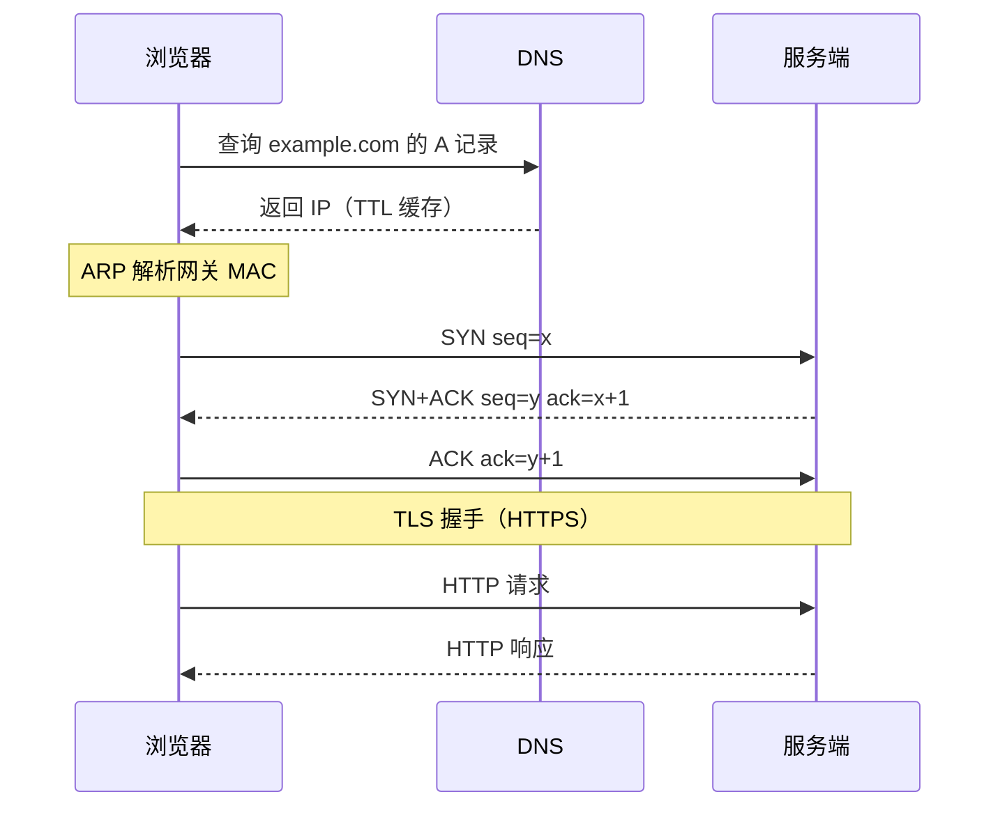
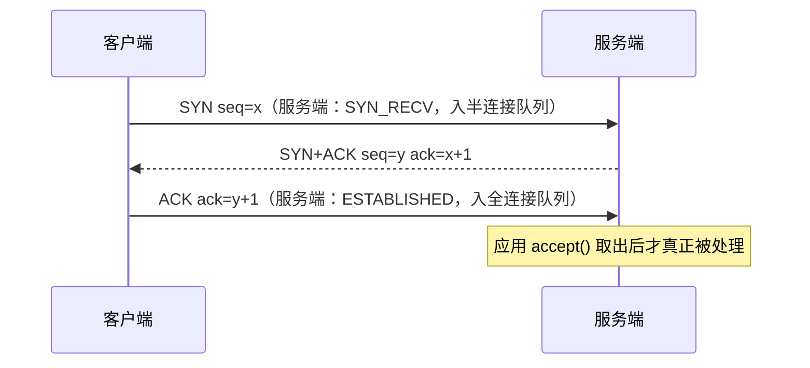
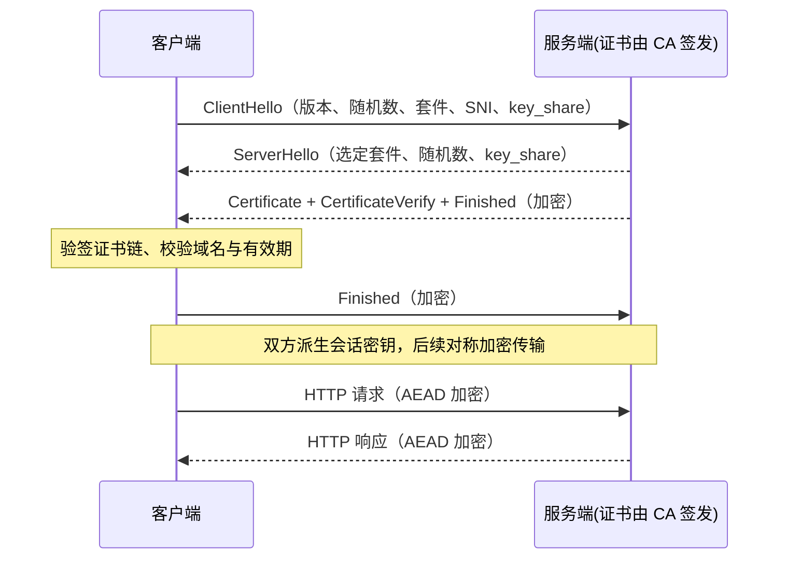

# 第 7 章 计算机网络与操作系统：后端工程师的公共基础设施

> 一句话定位：所有"高并发""高性能""分布式"讨论的物理下限。这一章答不出来，架构设计就只是在背名词。

## 一、本章考察重点概览

网络与操作系统不是"独立知识点"，而是**排查问题的坐标系**。线上出现接口超时，你要能沿着"DNS → 建连 → TLS → 请求 → 服务端处理 → 响应"逐段定位；出现 CPU 打满，你要能区分是用户态死循环、内核态软中断，还是大量上下文切换。面试官在这一章看的是四件事：

1. **能否把链路串起来。** 单点知识（三次握手、四次挥手）谁都能背，但"一次 HTTPS 请求到底发生了什么"能讲清的人不多。这一题几乎可以一次暴露真实水平。
2. **能否把机制和故障对应。** `TIME_WAIT` 过多、`CLOSE_WAIT` 过多、`SYN_RECV` 堆积、`load` 高但 CPU 空闲，这些现象背后的根因是什么，能不能给出处理方案。
3. **能否区分层次与责任。** 应用层的问题（粘包、跨域、缓存）不能靠调内核参数解决，传输层的问题（拥塞、重传）也不该在应用层硬扛。混淆层次就会给出错误方案。
4. **能否用工具验证假设。** `ss` 看连接状态、`tcpdump` 抓包、`vmstat` 看上下文切换、`iostat` 看磁盘饱和度——会不会用工具，决定了你是"猜"还是"查"。

| 考点 | 出现频率 | 难度 | 说明 |
| --- | --- | --- | --- |
| TCP 三次握手 / 四次挥手 | 高 | 初级 | 开场必问，追问会到 SYN 队列与 TIME_WAIT |
| TCP 可靠传输与拥塞控制 | 高 | 中级 | 区分"流量控制"与"拥塞控制"是分水岭 |
| HTTP 版本演进与队头阻塞 | 高 | 中级 | HTTP/2 与 HTTP/3 的动机必须讲清 |
| HTTPS 握手与证书链 | 高 | 中级 | 高级岗会追问 TLS 1.3 与 0-RTT 风险 |
| HTTP 缓存与状态码 | 高 | 初级 | 常结合 CDN、前端优化考察 |
| Cookie / Session / JWT | 高 | 中级 | 分布式场景下的取舍是重点 |
| 进程 / 线程 / 协程 | 高 | 初级 | 上下文切换成本要能拆开讲 |
| 虚拟内存与页面置换 | 中 | 高级 | 与 JVM 堆、mmap、页缓存联动 |
| IO 模型与 epoll | 高 | 中级 | 与第 1 章呼应，高级岗追问 Reactor |
| 死锁与 Linux 排查 | 中 | 中级 | 偏实战，答案要能落到命令 |

## 二、复习优先级

| 优先级 | 题目编号 | 理由 |
| --- | --- | --- |
| P0 | Q1、Q2、Q3、Q7、Q8、Q9、Q15、Q20 | 建连、断连、协议版本、HTTPS、进程模型、IO 模型，构成本章的骨架 |
| P1 | Q4、Q5、Q10、Q11、Q13、Q16、Q17、Q18、Q19 | 决定你能否解释"为什么慢""为什么卡" |
| P2 | Q6、Q12、Q14、Q21、Q22 | 加分与实战项，时间紧时记住结论与一条命令 |

时间分配建议：本章 3 天。P0 占 55%，要求能默画三次握手、HTTPS 握手两张时序图；P1 占 35%，重点是"机制 → 现象 → 处理"的链条；P2 剩 10%，把命令与参数抄一遍即可。

## 三、高频面试题清单

| 编号 | 题目 | 难度 | 优先级 | 一句话答案 |
| --- | --- | --- | --- | --- |
| Q1 | 从输入 URL 到页面返回，中间发生了什么？ | 中级 | P0 | DNS 解析 → ARP 找网关 → TCP 握手 → TLS 握手 → HTTP 请求 → 服务端处理 → 响应渲染 |
| Q2 | 三次握手为什么不是两次或四次？SYN 洪泛怎么防？ | 中级 | P0 | 三次是"双向能力确认"的最小次数；SYN Cookie 用无状态编码替代半连接队列 |
| Q3 | 四次挥手为什么是四次？TIME_WAIT 为什么要等 2MSL？ | 高级 | P0 | 全双工需双向关闭；等 2MSL 保证最后 ACK 可达并让旧报文消亡 |
| Q4 | TCP 如何保证可靠传输？滑动窗口与流量控制是什么关系？ | 中级 | P1 | 序号 + 确认 + 重传保证可靠，窗口机制保证效率，rwnd 防止压垮接收方 |
| Q5 | 拥塞控制的四个阶段是什么？Nagle 与延迟 ACK 为什么会打架？ | 高级 | P1 | 慢启动、拥塞避免、快重传、快恢复；两者叠加会产生约 40ms 的延迟 |
| Q6 | TCP 和 UDP 怎么选？为什么音视频、DNS、QUIC 用 UDP？ | 初级 | P2 | TCP 有序可靠但有延迟与队头阻塞，实时场景宁愿自己实现部分可靠性 |
| Q7 | HTTP/1.0、1.1、2、3 各解决了什么问题？ | 中级 | P0 | 1.1 长连接、2 多路复用、3 用 QUIC 消除 TCP 层队头阻塞 |
| Q8 | HTTPS 握手全过程？为什么需要 CA？TLS 1.3 改进了什么？ | 高级 | P0 | 非对称换密钥、对称传数据、证书防中间人；1.3 压到 1-RTT 并强制前向安全 |
| Q9 | 强缓存与协商缓存怎么配合？304 是怎么产生的？ | 中级 | P1 | 强缓存不发请求，协商缓存带 ETag/Last-Modified 验证，命中返回 304 |
| Q10 | Cookie、Session、Token、JWT 怎么选？分布式 Session 怎么做？ | 中级 | P1 | Session 服务端有状态易集中存储，JWT 无状态但难撤销 |
| Q11 | 跨域是怎么产生的？CORS 的预检请求什么时候触发？ | 中级 | P2 | 同源策略限制读取；非简单请求先发 OPTIONS 预检 |
| Q12 | 粘包拆包的原因是什么？三种解决方案怎么选？ | 中级 | P1 | TCP 是字节流无边界；定长、分隔符、长度字段三选一 |
| Q13 | DNS 解析过程是怎样的？CDN 如何调度到最近节点？ | 中级 | P2 | 递归查询本地 DNS、迭代查询根/顶级/权威；CDN 靠 CNAME + GSLB 返回就近 IP |
| Q14 | 进程、线程、协程的区别？上下文切换到底贵在哪？ | 初级 | P0 | 进程有独立地址空间，线程共享，协程在用户态调度；贵在模式切换与缓存失效 |
| Q15 | 用户态和内核态为什么要区分？系统调用怎么进入内核？ | 中级 | P1 | 隔离权限保护内核；通过中断/陷阱指令切换栈与特权级 |
| Q16 | 虚拟内存解决了什么？多级页表、TLB、缺页中断怎么配合？ | 高级 | P1 | 隔离、按需分配、可超出物理内存；TLB 缓存映射，缺页触发换入 |
| Q17 | 进程间通信有哪几种？为什么共享内存最快？ | 中级 | P1 | 管道、消息队列、共享内存、信号、socket；共享内存免去两次拷贝 |
| Q18 | 死锁的四个必要条件？银行家算法、活锁与饥饿的区别？ | 中级 | P1 | 互斥、占有并等待、不可抢占、循环等待；破坏任一即可预防 |
| Q19 | 五种 IO 模型的区别？epoll 为什么高效？ | 高级 | P0 | 阻塞/非阻塞/多路复用/信号驱动/异步；epoll 用回调 + 就绪链表避免轮询 |
| Q20 | CPU 调度算法有哪些？load average 高但 CPU 空闲说明什么？ | 中级 | P2 | CFS 按 vruntime 调度；load 含不可中断睡眠，可能是 IO 阻塞 |
| Q21 | 线上 CPU 飙高 / 内存泄漏 / 连接堆积，分别用什么命令排查？ | 中级 | P2 | top 定位线程、jstack 抓栈、vmstat 看切换、ss 看连接状态 |

## 四、题目详解

### Q1. 从输入 URL 到页面返回，中间发生了什么？（中级）

**一句话结论**：一次请求要跨过五道关：**DNS 解析**拿到 IP、**ARP** 找到下一跳的 MAC、**TCP 三次握手**建立连接、**TLS 握手**协商密钥（HTTPS）、**HTTP 请求/响应**完成一次事务，最后浏览器解析渲染。每一关都可能成为超时点，排查时必须能分段定位。

**先把话说白**：这就像寄一封挂号信。先查地址簿（DNS），再把信交给小区门口的快递员（ARP 找网关），快递员一路接力送到对方城市（路由），对方签收前要先确认"你能听见我说话吗"（TCP 握手），如果信要保密还得先交换密码本（TLS），最后才是信的内容（HTTP）。

**底层原理**：

1. **DNS 解析。** 浏览器缓存 → 操作系统缓存（`/etc/hosts`、`nsswitch.conf`）→ 本地 DNS 服务器（运营商或 `8.8.8.8`）→ 根域名服务器 → 顶级域（.com）→ 权威域名服务器。本地 DNS 到根/TLD 是**迭代查询**，客户端到本地 DNS 是**递归查询**。结果按 TTL 缓存。

2. **ARP 与路由。** 拿到目标 IP 后，先判断是否同网段（用子网掩码）。不同网段则查路由表找下一跳网关，再用 ARP 把网关 IP 解析成 MAC 地址（广播 ARP 请求，缓存到 ARP 表）。同一网段则直接 ARP 目标 IP。

3. **TCP 三次握手。** 客户端发 SYN（带初始序列号 ISN），服务端回 SYN+ACK，客户端回 ACK。这一步确认双方的发送与接收能力，并同步初始序列号。

4. **TLS 握手（HTTPS）。** 在 TCP 之上再协商：客户端发 ClientHello（支持的版本、密码套件、随机数、SNI），服务端回证书与密钥交换参数，双方算出会话密钥，之后用对称加密传输。TLS 1.2 需要 2-RTT，TLS 1.3 压到 1-RTT。

5. **HTTP 事务。** 请求行 + 请求头 + 请求体；服务端可能经过负载均衡、网关、应用服务器、缓存、数据库，返回状态行 + 响应头 + 响应体。`Connection: keep-alive` 让连接复用，避免重复握手。

6. **浏览器渲染。** 解析 HTML 构建 DOM，解析 CSS 构建 CSSOM，合并成渲染树，布局（layout）、绘制（paint）、合成（composite）。静态资源会触发额外的并发请求（HTTP/1.1 下同域通常 6 个连接）。



**易混对比**：

| 阶段 | 主要协议 | 典型故障 | 排查手段 |
| --- | --- | --- | --- |
| 域名解析 | DNS | 解析慢、被劫持、NXDOMAIN | `dig`、`nslookup` |
| 建连 | TCP | 连接超时、SYN 丢包 | `ss -s`、`tcpdump` |
| 加密协商 | TLS | 证书过期、套件不匹配 | `openssl s_client`、`curl -v` |
| 请求处理 | HTTP | 5xx、响应慢 | 服务端日志、链路追踪 |
| 内容传输 | TCP | 带宽不足、重传 | `iftop`、`nstat` |

**面试追问**：
- 追问：DNS 用 UDP 还是 TCP？→ 答题要点：查询通常用 UDP 53（快、无连接），响应超过 512 字节或区域传送（AXFR）时用 TCP；DNS over HTTPS/TLS 走 TCP。
- 追问：为什么 HTTP/1.1 下浏览器对同域并发连接数有限制？→ 答题要点：避免对服务端造成过大压力，同时减少拥塞；这也是域名分片（domain sharding）出现的原因，HTTP/2 后已无必要。
- 追问：如果 ping 通但 HTTP 访问不了，可能是什么原因？→ 答题要点：ICMP 通只说明三层可达；可能是端口未监听、防火墙拦 TCP、TLS 证书问题、服务端返回 5xx。

### Q2. 三次握手为什么不是两次或四次？SYN 洪泛怎么防？（中级）

**一句话结论**：三次握手是"双方各自确认自己和对方的收发能力都正常"的**最小次数**。两次会让服务端无法确认自己的发送能力（也无法确认客户端收到了自己的 SYN），并且历史上重复的 SYN 可能让服务端建立无效连接；四次则是把第二步的 SYN 与 ACK 拆开，纯属浪费。SYN 洪泛利用半连接队列有限，用伪造源 IP 的大量 SYN 占满队列；防御手段是 **SYN Cookie**（不分配状态，把信息编码进 ISN）、增大队列、缩短超时、以及上游清洗。

**先把话说白**：握手本质是两次"你听得到我吗"的往返。A 说"喂"，B 说"听到了，你听得到我吗"，A 说"听到了"。两句不够——B 不知道 A 是否收到；四句多余——B 的"我听到了"和"你听得到我吗"可以合并成一句。

**底层原理**：

1. **两次握手的问题。** ① 服务端发出 SYN+ACK 后，无法确认客户端是否收到，也就无法确认自己的发送通道正常；② 若网络中滞留了一个旧的 SYN，客户端已不认这个连接，服务端却在收到 SYN 后就建立连接并分配资源，造成"半开连接"浪费；③ 序列号同步需要双向确认，两次只能单向确认。

2. **四次握手为什么多余。** 第二步的 ACK（确认客户端的 SYN）与 SYN（发起自己的方向）可以合并在一个报文里，因为二者都是服务端主动发出的，合并后不损失任何语义。

3. **队列的两层结构。** 内核维护两个队列：**半连接队列**（SYN queue，存放收到 SYN、尚未收到 ACK 的连接，状态 `SYN_RECV`）和**全连接队列**（accept queue，存放已完成三次握手、等待应用 `accept()` 的连接，状态 `ESTABLISHED`）。全连接队列满时，新完成的连接会被丢弃或按 `tcp_abort_on_overflow` 回 RST。相关参数：`net.ipv4.tcp_max_syn_backlog`（半连接队列上限）、`net.core.somaxconn`（全连接队列上限，也是 `listen()` 的 backlog 上限）、`net.ipv4.tcp_syncookies`。

4. **SYN 洪泛的攻击面。** 攻击者伪造源 IP 发大量 SYN，服务端为每个 SYN 分配 `request_sock` 并重传 SYN+ACK，半连接队列被占满，正常用户的 SYN 被丢弃。因为源 IP 是伪造的，SYN+ACK 永远等不到 ACK。

5. **SYN Cookie 的原理。** 开启后，服务端收到 SYN 时**不分配任何状态**，而是把"时间戳的低 5 位 + MSS 编码 + 四元组哈希"算成一个值作为 ISN 放在 SYN+ACK 里发出。客户端回 ACK 时，ACK 号减一就是这个 cookie，服务端重新计算并校验，通过才建立连接。代价是 cookie 里放不下完整的 TCP 选项（如窗口缩放、SACK），功能有损，所以它是**兜底而非默认首选**。

6. **其他防御。** 增大 `tcp_max_syn_backlog` 与 `somaxconn`；缩短 `tcp_synack_retries`（减少重传次数，加快释放）；启用 `tcp_syncookies=1`（队列满时才启用）或 `2`（始终启用）；在四层负载均衡或云清洗中心做 SYN 代理（LB 先与客户端完成握手，再与后端建连）。



**易混对比**：

| 现象 | 队列 | 状态 | 常见原因 |
| --- | --- | --- | --- |
| SYN 丢包、客户端超时 | 半连接队列满 | `SYN_RECV` 堆积 | SYN 洪泛、backlog 太小 |
| 客户端握手成功但请求无响应 | 全连接队列满 | `ESTABLISHED` 但不被 accept | 应用 accept 慢、线程池打满 |
| 大量 `TIME_WAIT` | 无（主动关闭方） | `TIME_WAIT` | 短连接多、由服务端主动关闭 |

**面试追问**：
- 追问：`listen(fd, backlog)` 的 backlog 到底限制哪个队列？→ 答题要点：Linux 上限制的是全连接队列（受 `somaxconn` 截断），半连接队列由 `tcp_max_syn_backlog` 控制。
- 追问：SYN Cookie 有什么副作用？→ 答题要点：丢失 TCP 选项（窗口缩放、SACK 等），且增加 CPU 计算；只应在队列满时启用。
- 追问：为什么 DDOS 攻击常在四层而不是七层？→ 答题要点：四层攻击只需伪造 SYN 或大量 UDP，成本低、难溯源；七层攻击需要完成握手，成本更高但更隐蔽。

### Q3. 四次挥手为什么是四次？TIME_WAIT 为什么要等 2MSL？（高级）

**一句话结论**：TCP 是全双工，两个方向要各自关闭，所以需要"FIN → ACK → FIN → ACK"四次。**TIME_WAIT 出现在主动关闭方**，等待 2MSL 有两个目的：保证最后那个 ACK 能到达对方（丢了可重发 FIN），以及让本次连接中的旧报文在网络中彻底消亡，避免污染使用相同四元组的新连接。`CLOSE_WAIT` 过多则是**应用没有调用 `close()`**，属于代码问题而非内核参数问题。

**先把话说白**：打电话时，你说"我这边说完了"（FIN），对方说"知道了"（ACK），但对方可能还有话没说完，所以不能立刻挂；等他说完，再发一个"我也说完了"（FIN），你回"知道了"（ACK）。你先挂的电话，所以要拿着话筒多等一会儿——万一对方没听到你的"知道了"，他还会再喊一次。

**底层原理**：

1. **状态迁移。** 主动关闭方：`ESTABLISHED → FIN_WAIT_1 → FIN_WAIT_2 → TIME_WAIT → CLOSED`；被动关闭方：`ESTABLISHED → CLOSE_WAIT → LAST_ACK → CLOSED`。收到对方的 FIN 只表示"对方没有数据要发了"，本方向仍可继续发送，这就是"半关闭（half-close）"状态。

2. **为什么 ACK 与 FIN 不能合并。** 服务端收到 FIN 后，ACK 必须立刻发（协议要求尽快确认），但它自己的数据可能还没发完，FIN 只能等数据发完再发。这两个动作时间上分离，所以是四个报文。若服务端确实没有数据要发，ACK 与 FIN 可能在同一批发送中被合并，抓包会看到 3 个报文，但语义仍是四次。

3. **2MSL 的两个理由。** ① **可靠终止**：主动方最后发的 ACK 若丢失，被动方会重传 FIN，主动方必须还在 `TIME_WAIT` 才能重发 ACK；一个 FIN + 一个 ACK 的往返最长为 2MSL，等完即可保证对方收到。② **清除旧报文**：本次连接的报文在网络中最多存活 MSL，等 2MSL 后相同四元组的旧报文必然消亡，新连接不会收到"上一个连接的回声"。

4. **MSL 与 TIME_WAIT 的实际时长。** RFC 建议 MSL 为 2 分钟，Linux 的实现是把 `TIME_WAIT` 固定为 60 秒（`TCP_TIMEWAIT_LEN`），相当于 MSL = 30 秒。这个值不可通过 `sysctl` 修改。

5. **TIME_WAIT 过多的后果。** 每个 `TIME_WAIT` 占用一个四元组（源 IP、源端口、目的 IP、目的端口）。服务端作为主动关闭方时，大量短连接会让本地端口被耗尽（`Cannot assign requested address`），同时占用内核内存。

6. **处理 TIME_WAIT 的正确顺序。** ① 优先改架构：用长连接 / 连接池，或让**客户端主动关闭**（把 `TIME_WAIT` 转移到客户端，客户端端口相对充裕）；② `net.ipv4.tcp_tw_reuse=1`：允许**出方向**连接复用 `TIME_WAIT` 的端口（需开启时间戳，且只对客户端有效，作为服务端监听端口无效）；③ `net.ipv4.tcp_max_tw_buckets`：限制总数，超出直接销毁并打日志（治标）；④ 不要用 `tcp_tw_recycle`，它在 NAT 环境下会导致连接失败，Linux 4.12 起已移除。

7. **CLOSE_WAIT 过多的根因。** 收到对方 FIN 并回了 ACK，但应用没有调用 `close()`，连接停在 `CLOSE_WAIT`。常见原因：`finally` 块没关连接、连接池借出未归还、线程阻塞导致回调没执行、HTTP 客户端没消费完响应体。这是**代码 bug**，调内核参数没有任何用。

```bash
# 统计各状态连接数，定位是 TIME_WAIT 还是 CLOSE_WAIT 问题
ss -tan | awk 'NR>1 {print $1}' | sort | uniq -c | sort -rn
# 只看某端口
ss -tan state time-wait '( sport = :8080 )' | wc -l
```

**易混对比**：

| 状态 | 出现在哪一方 | 含义 | 处理方向 |
| --- | --- | --- | --- |
| `FIN_WAIT_1/2` | 主动关闭方 | 已发 FIN，等待对方确认/发 FIN | 正常过渡，`FIN_WAIT_2` 长时间停留说明对端没关 |
| `TIME_WAIT` | 主动关闭方 | 等 2MSL 后彻底关闭 | 长连接、`tcp_tw_reuse`、改由客户端关闭 |
| `CLOSE_WAIT` | 被动关闭方 | 收到 FIN 但应用未 close | 查代码是否漏关连接 |
| `LAST_ACK` | 被动关闭方 | 已发 FIN，等最后 ACK | 正常过渡 |

**面试追问**：
- 追问：服务端出现大量 `CLOSE_WAIT` 怎么排查？→ 答题要点：`ss -tanp` 找到进程与 fd，`jstack` 看线程是否阻塞在读写，检查连接池配置与 `finally` 关闭逻辑，必要时 `lsof -p pid` 看 fd 增长趋势。
- 追问：`tcp_tw_reuse` 和 `tcp_tw_recycle` 的区别？→ 答题要点：前者只影响出方向且依赖时间戳，安全；后者依赖 per-host 时间戳，NAT 下会误丢包，已被移除。
- 追问：为什么不能直接设 `TIME_WAIT` 为 0？→ 答题要点：会破坏可靠终止与旧报文清除，导致新连接收到旧数据、连接异常重置。
- 追问：HTTP 服务端在 `Connection: close` 场景下是主动关闭方吗？→ 答题要点：通常是服务端发 FIN，成为主动关闭方，所以短连接服务端容易堆积 `TIME_WAIT`；可改为客户端关闭或使用 keep-alive。

### Q4. TCP 如何保证可靠传输？滑动窗口与流量控制是什么关系？（中级）

**一句话结论**：可靠传输靠四件事：**序号**给每个字节编号、**确认（ACK）**告知已收到、**重传**补偿丢失（超时重传 + 三次重复 ACK 触发的快速重传）、**校验和**发现比特错误。滑动窗口则是效率机制：发送方不必等一个 ACK 才发下一个，可以在窗口内连续发送；窗口大小取 `min(cwnd, rwnd)`，其中 `rwnd` 由接收方通告，用于**流量控制**，防止发送太快压垮接收方。

**先把话说白**：可靠传输的核心是"编号 + 回执 + 补发"。但如果每发一个包就等回执，吞吐量会被 RTT 卡死——所以引入窗口：允许"一口气发一批，收到回执再往前滑"。窗口开多大？既要看接收方缓冲区还剩多少（流量控制），也要看网络是否已经堵了（拥塞控制），两者取小。

**底层原理**：

1. **序号与确认。** TCP 把应用层的字节流按字节编号（不是按报文），32 位序列号在 `SYN` 时随机初始化（防伪造与串扰）。ACK 是**累积确认**：`ack=n` 表示"n 之前的字节全部收到，期待 n"。这也意味着丢一个包会导致后续到达的数据也无法被确认（除非用 SACK）。

2. **超时重传（RTO）。** 发送方为每个报文启动定时器，超时未确认则重传。RTO 不是固定值，而是由 RTT 的平滑估计（SRTT）与偏差（RTTVAR）算出：`RTO = SRTT + 4 × RTTVAR`，并设有下限（Linux 通常 200ms）与上限（多次重传后指数退避）。RTT 采样使用 Karn 算法：重传过的报文不采样，避免"重传歧义"。

3. **快速重传。** 接收方收到乱序报文时会立即重复发送上一个有序 ACK。发送方连续收到 3 个重复 ACK，就推断中间那个包丢了，不等超时直接重传（3 次是为了容忍乱序）。配合 **SACK**（选择性确认），接收方可以告诉发送方"我收到了哪些区间"，避免重传已到达的数据。

4. **滑动窗口。** 发送方维护一个窗口，窗口内的数据可以"已发送未确认"或"待发送"。收到 ACK 后窗口右移。窗口大小由接收方在 TCP 头的 16 位窗口字段通告，配合窗口缩放选项（`WS`）可放大到 2^30 字节。

5. **流量控制。** 目的是不压垮接收方。接收方根据缓冲区剩余空间通告 `rwnd`；若缓冲区满则通告 0，发送方停止发送并启动**零窗口探测**（持续发 1 字节的探测包），防止窗口更新报文丢失导致死锁。

6. **发送窗口 = min(cwnd, rwnd)。** `rwnd` 管"对方能不能收"，`cwnd` 管"网络能不能承受"。前者是端到端的，后者是全局的网络状况估计。两者取小，缺一不可。

**易混对比**：

| 维度 | 流量控制 | 拥塞控制 |
| --- | --- | --- |
| 保护对象 | 接收方缓冲区 | 网络链路与中间设备 |
| 信号来源 | 接收方通告的 `rwnd` | 丢包、时延变化推测的 `cwnd` |
| 作用范围 | 端到端 | 全局 |
| 典型手段 | 窗口通告、零窗口探测 | 慢启动、拥塞避免、快重传、快恢复 |

**面试追问**：
- 追问：累积确认有什么缺点？→ 答题要点：丢一个包会阻塞后面所有数据的确认，导致发送方窗口不前进；SACK 通过选择性确认缓解。
- 追问：为什么 RTO 有下限？→ 答题要点：RTT 采样有噪声，太小会导致大量不必要的重传，反而加剧拥塞。
- 追问：零窗口探测为什么必要？→ 答题要点：窗口更新报文不带数据，丢了没有重传机制，双方会互相等待形成死锁。

### Q5. 拥塞控制的四个阶段是什么？Nagle 与延迟 ACK 为什么会打架？（高级）

**一句话结论**：拥塞控制有四个阶段——**慢启动**（cwnd 指数增长到 ssthresh）、**拥塞避免**（超过 ssthresh 后每 RTT 加 1 个 MSS，线性增长）、**快重传**（3 个重复 ACK 立即重传）、**快恢复**（不回到 1，而是把 cwnd 降到 ssthresh 后继续线性增长）。Nagle 算法攒小包等 ACK，延迟 ACK 攒 ACK 等数据，两者互相等待，会产生约 40ms 的固定延迟——解法是设置 `TCP_NODELAY`。

**先把话说白**：网络是公共资源，每个连接都猛发，路由器缓冲区就会溢出、大家一起丢包。所以 TCP 要"试探着加速，遇到拥塞就退让"。Nagle 是为了少发小包（提高带宽利用率），延迟 ACK 是为了少发 ACK（减少反向流量）——两个"省"字碰在一起，就成了互相等待。

**底层原理**：

1. **慢启动。** 连接初期不知道网络容量，从一个较小的初始窗口开始（RFC 6928 允许 10 个 MSS），每收到一个 ACK 就把 cwnd 加 1 个 MSS，效果是**每 RTT 翻倍**，指数增长，直到 cwnd ≥ ssthresh。

2. **拥塞避免。** 超过 ssthresh 后改为每个 RTT 只加 1 个 MSS（约每收到 cwnd 个 ACK 加 1），线性增长，缓慢探测上限。

3. **超时与快重传的两种反应。** ① **超时**：认为网络严重拥塞，`ssthresh = cwnd / 2`，`cwnd = 1`，重回慢启动；② **3 个重复 ACK**：认为只是个别丢包，进入快重传 + 快恢复，`ssthresh = cwnd / 2`，`cwnd = ssthresh`（不回到 1），直接进入拥塞避免。

4. **快恢复的细节。** 重传丢失的报文后，每收到一个重复 ACK 就把 cwnd 加 1 MSS（因为说明有报文离开了网络），收到新数据的 ACK 时把 cwnd 设为 ssthresh。这是 NewReno 的做法，改进了早期 Reno 的"快速恢复期间窗口减半导致吞吐骤降"。

5. **现代拥塞控制算法。** Linux 默认是 **CUBIC**（2.6.19 起），用三次函数代替线性增长，在高带宽长距离链路（高 BDP）上恢复更快；**BBR**（Google）不依赖丢包，而是估计带宽与最小 RTT，在弱网与高丢包链路上优势明显。可在 `net.ipv4.tcp_congestion_control` 查看与切换。

6. **Nagle 算法。** 规则：若还有未确认的小数据，就先把后续小数据攒起来，直到攒满一个 MSS 或收到 ACK 再发。目的是避免"小包泛滥"（silly window syndrome 的一种）。副作用是增加延迟。

7. **延迟 ACK。** 接收方收到数据后不立即回 ACK，而是等一小段（Linux 上限约 40ms，且通常每收到 2 个报文回一次），希望把 ACK 捎带在反向数据上，或合并多个 ACK。

8. **两者打架的完整链条。** 客户端用 Nagle 发了一个小包，等 ACK；服务端用延迟 ACK，等 40ms 再回；客户端收到 ACK 后才发下一个包。于是一个"请求-响应"式的小数据交互被固定拖慢 40ms。典型受害场景：Redis 客户端连续 `set/get`、RPC 的短小请求、游戏操作指令。解法是客户端设置 `TCP_NODELAY`（禁用 Nagle），或让协议层合并请求（pipeline / 批量）。

```java
Socket socket = new Socket();
socket.setTcpNoDelay(true);   // 禁用 Nagle，低延迟场景必开
socket.setKeepAlive(true);    // 开启保活探测
```

**易混对比**：

| 事件 | ssthresh | cwnd | 进入阶段 |
| --- | --- | --- | --- |
| 超时重传 | cwnd/2 | 1 | 慢启动 |
| 3 个重复 ACK | cwnd/2 | ssthresh | 拥塞避免（快恢复） |
| 正常 ACK（慢启动阶段） | 不变 | 每 ACK +1 MSS | 慢启动 |
| 正常 ACK（拥塞避免阶段） | 不变 | 每 RTT +1 MSS | 拥塞避免 |

**面试追问**：
- 追问：为什么快恢复不把 cwnd 降到 1？→ 答题要点：3 个重复 ACK 说明后续报文仍在到达，网络并未完全堵死，降到 1 会浪费可用带宽。
- 追问：CUBIC 相比 Reno 的优势？→ 答题要点：增长曲线是三次函数，与 RTT 弱相关，在高 BDP 链路上恢复更快、更公平。
- 追问：什么场景不该开 `TCP_NODELAY`？→ 答题要点：大数据量顺序传输（如文件下载），攒包能减少头部开销、提高吞吐；小包交互场景才需要关 Nagle。
- 追问：延迟 ACK 最大延迟是多少？→ 答题要点：Linux 上通常 40ms 上限，且快速 ACK 模式（quickack）会在特定条件下立即回。

### Q6. TCP 和 UDP 怎么选？为什么音视频、DNS、QUIC 用 UDP？（初级）

**一句话结论**：TCP 提供**可靠、有序、面向连接、带流量与拥塞控制**的字节流，代价是握手延迟、重传等待与队头阻塞；UDP 只提供**无连接、不可靠的数据报**，代价是要自己在应用层补可靠性。选择标准是：**能不能容忍延迟**。文件传输、数据库连接、HTTP 传统场景用 TCP；实时音视频、游戏、DNS 查询、QUIC 用 UDP。

**先把话说白**：TCP 像顺丰快递，保证送到、按顺序、丢件重发，但慢；UDP 像往窗外扔纸飞机，扔出去就不管了，快但可能丢。视频会议里丢一帧没关系，但卡 200ms 就没法看了——所以宁愿丢也不等。

**底层原理**：

1. **TCP 的代价来自哪里。** ① 握手 1-RTT（HTTPS 再加 TLS）；② 丢包重传要等 RTO 或 3 个重复 ACK；③ 严格有序意味着前一个包没到，后面的包即使到了也不能交付给应用（**队头阻塞**）；④ 拥塞控制会在丢包时主动降速。

2. **UDP 的"无状态"优势。** 无握手、无连接状态、无重传、无拥塞控制，头部只有 8 字节（TCP 至少 20 字节）。发送方想发就发，接收方按数据报边界交付，天然保留消息边界（不存在粘包）。

3. **DNS 为什么用 UDP。** 一次查询就一个请求一个响应，用 UDP 可以省掉握手，且本地 DNS 有缓存、失败可重试。响应超过 512 字节时改用 TCP，或使用 EDNS0 扩大 UDP 报文上限。

4. **音视频 / 游戏为什么用 UDP。** 实时性优先，旧帧没有重传价值（重传到达时已经过期）。应用层用 FEC（前向纠错）、NACK（选择性重传）、抖动缓冲来平衡质量。WebRTC 全套基于 UDP。

5. **QUIC 为什么基于 UDP。** 不是因为 UDP 更可靠，而是因为**中间设备对 UDP 的容忍度高、且 UDP 可以在用户态实现**。QUIC 在 UDP 之上自己实现了可靠传输、流控、拥塞控制与 TLS 1.3，把"传输层"从内核搬到了用户态，从而可以快速迭代、按流独立重传（消除 TCP 层队头阻塞）、支持连接迁移（用 Connection ID 而非四元组标识连接）。

6. **UDP 的风险。** 无拥塞控制会挤占带宽（UDP 洪水），部分运营商与企业网络会限速或封锁 UDP；NAT 映射超时需要应用层保活。

**易混对比**：

| 维度 | TCP | UDP |
| --- | --- | --- |
| 连接 | 面向连接，需握手 | 无连接 |
| 可靠性 | 确认 + 重传 + 校验 | 尽力而为，可能丢、乱序、重复 |
| 有序性 | 严格有序（有队头阻塞） | 无序，按数据报交付 |
| 传输方式 | 字节流（无消息边界） | 数据报（保留边界） |
| 头部开销 | 20~60 字节 | 8 字节 |
| 流量/拥塞控制 | 有 | 无（需应用自实现） |
| 典型场景 | HTTP/1.1、MySQL、文件传输 | DNS、WebRTC、QUIC、游戏 |

**面试追问**：
- 追问：UDP 会不会粘包？→ 答题要点：不会，UDP 保留数据报边界，一次 `recv` 对应一个数据报；但单个数据报超过 MTU 会被 IP 分片，重组失败会整包丢弃。
- 追问：QUIC 解决了 TCP 的哪些问题？→ 答题要点：TCP 层队头阻塞、握手延迟（1-RTT/0-RTT）、连接迁移、协议僵化（内核升级慢）。
- 追问：如果让你基于 UDP 实现可靠传输，要做什么？→ 答题要点：序号 + 确认 + 重传 + 滑动窗口 + 拥塞控制 + 连接标识，本质是把 TCP 搬到用户态，QUIC 就是这么做的。

### Q7. HTTP/1.0、1.1、2、3 各解决了什么问题？（中级）

**一句话结论**：HTTP/1.0 每次请求新建连接；HTTP/1.1 引入**持久连接与管道化**，但管道化仍有应用层队头阻塞，浏览器实际靠多开连接绕过；HTTP/2 用**二进制分帧 + 多路复用**在单连接上并行传输多个流，并用 HPACK 压缩头部，但底层仍是 TCP，丢包时所有流一起被阻塞；HTTP/3 把传输层换成基于 UDP 的 **QUIC**，实现流级别独立重传，彻底消除传输层队头阻塞，并把 TLS 1.3 内建，握手压到 1-RTT 甚至 0-RTT。

**先把话说白**：1.0 是"每说一句话重新拨一次电话"；1.1 是"打通了就不挂"，但一次只能说一件事，后面的排队；2 是"一条线路上切成小包，标上编号，交错着发"，但这条线路（TCP）一旦断了一小段，所有包都得等它补齐；3 是"干脆换一条不怕局部丢失的线路"。

**底层原理**：

1. **HTTP/1.0 的限制。** 默认短连接，每个请求都要 TCP 握手（+ TLS 握手），RTT 成本高；不支持 `Host` 头（一个 IP 只能对应一个站点）；无断点续传（`Range` 是 1.1 的）。

2. **HTTP/1.1 的改进。** ① 默认 `keep-alive`，连接复用；② 管道化（pipelining）：可以连续发多个请求不等响应，但响应必须按序返回，前一个慢就阻塞后面所有——这就是**应用层队头阻塞**，且中间设备兼容性差，浏览器基本关闭；③ 分块传输（`Transfer-Encoding: chunked`），支持流式响应；④ `Host` 头必需，支持虚拟主机；⑤ 新增 `Range`、`PUT/DELETE/PATCH`、更细的缓存控制。

3. **HTTP/2 的二进制分帧。** 把请求/响应拆成帧（HEADERS、DATA、SETTINGS、RST_STREAM 等），每个帧带 `stream id`。一个 TCP 连接上可以并发多个 stream，接收端按 stream id 重组，互不阻塞。这解决了 HTTP 层的队头阻塞。

4. **HPACK 头部压缩。** HTTP 头大量重复（Cookie、User-Agent），HTTP/2 用静态表（61 个常见头）+ 动态表 + 哈夫曼编码压缩，且双方维护同步的动态表，后续只发索引。这显著降低了小请求的开销。

5. **HTTP/2 的遗留问题。** 所有 stream 共享一个 TCP 连接，一旦发生丢包，TCP 的有序交付会让**所有 stream 的数据都卡住**，直到丢失的报文重传成功。这就是**TCP 层队头阻塞**，在弱网下尤其明显。此外，二进制分帧对中间设备的可见性下降，早期还有服务端推送（Server Push）被证明收益有限，Chrome 已移除。

6. **HTTP/3 与 QUIC。** QUIC 在 UDP 之上实现了：① 每个 stream 独立的有序交付与重传，一个流丢包不影响其他流；② 0-RTT/1-RTT 握手，TLS 1.3 集成在传输层握手内；③ 用 Connection ID 标识连接，WiFi 切 4G 时连接不断（连接迁移）；④ 头部压缩用 QPACK（解决了 HPACK 在乱序下的阻塞）；⑤ 用户态实现，升级不依赖操作系统内核。

7. **协议协商。** HTTP/2 通过 TLS 的 ALPN 扩展协商（`h2`）；HTTP/3 通过 `Alt-Svc` 响应头或 HTTPS 记录的 `h3` 参数告知。

**易混对比**：

| 维度 | HTTP/1.0 | HTTP/1.1 | HTTP/2 | HTTP/3 |
| --- | --- | --- | --- | --- |
| 连接复用 | 默认短连接 | 默认长连接 | 单连接多路复用 | 单连接多路复用 |
| 传输格式 | 文本 | 文本 | 二进制分帧 | 二进制分帧 |
| 队头阻塞 | 有（连接级） | 有（应用层，管道化） | 有（TCP 层） | 基本消除（流级独立） |
| 头部压缩 | 无 | 无 | HPACK | QPACK |
| 底层传输 | TCP | TCP | TCP | QUIC（UDP） |
| 握手开销 | TCP + TLS | TCP + TLS | TCP + TLS | 1-RTT / 0-RTT |

**面试追问**：
- 追问：HTTP/2 解决了队头阻塞吗？→ 答题要点：解决了 HTTP 层的，没解决 TCP 层的；弱网丢包时所有流一起等，这正是 HTTP/3 的动机。
- 追问：为什么 HTTP/2 不适合做域名分片？→ 答题要点：多路复用已经让单连接足够高效，分片反而增加连接数、失去头部压缩的共享收益。
- 追问：0-RTT 有什么安全风险？→ 答题要点：0-RTT 数据可被重放，只能用于幂等请求（如 GET），不能用于转账等操作。

### Q8. HTTPS 握手全过程？为什么需要 CA？TLS 1.3 改进了什么？（高级）

**一句话结论**：HTTPS = HTTP + TLS。握手分三段：**用非对称加密（或密钥交换）协商出一个对称密钥**、**用证书验证服务端身份**、**此后用对称加密传输数据**。之所以这样组合，是因为非对称安全但慢、对称快但需要先安全地共享密钥。CA 的作用是给"域名 → 公钥"的绑定背书，防止中间人替换公钥。TLS 1.3 把握手从 2-RTT 压到 1-RTT，只保留 AEAD 类套件，强制前向安全，并加密证书。

**先把话说白**：你要给银行寄密码本，不能直接寄——被人截了就知道密码了。所以先让银行把"密码本"装进一个只有银行能开的箱子（公钥加密），你把自己的密钥放进去寄过去。但你怎么知道那个公钥真是银行的？因为箱子上有公安局（CA）的封条，而公安局的公钥早就装在你的浏览器里了。

**底层原理**：

1. **三类密码学的分工。** 对称加密（AES-GCM、ChaCha20-Poly1305）用于数据，速度快；非对称加密（RSA）或密钥交换（ECDHE）用于协商密钥；哈希与签名（SHA-256 + RSA/ECDSA）用于完整性校验与身份认证。

2. **证书链与信任锚。** 服务端证书由中间 CA 签发，中间 CA 由根 CA 签发，根 CA 的证书内置在操作系统/浏览器的信任库中。验证时逐级验签直到根，同时校验证书域名（SAN）、有效期、吊销状态（CRL / OCSP）。

3. **TLS 1.2 的握手（2-RTT）。**
   - 第 1 个 RTT：`ClientHello`（版本、随机数、套件列表、SNI）→ `ServerHello`（选定套件、随机数）+ `Certificate` + `ServerKeyExchange`（ECDHE 参数）+ `ServerHelloDone`。
   - 第 2 个 RTT：`ClientKeyExchange`（客户端 ECDHE 参数）+ `ChangeCipherSpec` + `Finished` → 服务端 `ChangeCipherSpec` + `Finished`。
   - 双方用 ECDHE 交换的参数 + 两个随机数，各自算出相同的预主密钥（pre-master secret），再派生会话密钥。

4. **为什么需要 CA。** 如果没有 CA，中间人可以把自己的公钥冒充成服务端的公钥，双方都能"正常"加密通信，但中间人能看到全部明文（MITM）。证书的本质是"CA 用私钥对'域名 + 公钥 + 有效期'的摘要签名"，浏览器用内置的 CA 公钥验签，从而确认这个公钥确实属于这个域名。

5. **TLS 1.3 的四点改进。** ① **1-RTT**：客户端在 `ClientHello` 里直接带上 ECDHE 的 key share，服务端一次响应即可完成协商，省掉一个往返；② **只保留 AEAD 套件**（AES-GCM、ChaCha20-Poly1305），删除了 RSA 密钥交换、CBC 模式、RC4、SHA-1 等历史包袱；③ **强制前向安全**：只允许 (EC)DHE，即使服务端私钥日后泄露，也无法解密历史流量；④ **加密更多握手内容**：证书在 TLS 1.3 中是加密传输的，减少信息暴露；⑤ 支持 0-RTT（会话恢复时），但有重放风险。

6. **前向安全（Forward Secrecy）为什么重要。** RSA 密钥交换下，会话密钥由客户端用服务端公钥加密传输，服务端私钥一旦泄露，攻击者可以解密**过去抓到的所有流量**。ECDHE 每次握手生成临时密钥对，私钥用完即弃，历史流量无法回溯解密。

7. **会话复用。** TLS 1.2 用 Session ID 或 Session Ticket；TLS 1.3 用 PSK（预共享密钥）恢复，可做到 0-RTT。代价是 0-RTT 数据可能被重放。

**代码 / 图示**：



```bash
# 查看证书链与握手细节（含 TLS 版本、套件）
openssl s_client -connect example.com:443 -servername example.com -showcerts
# 只看证书有效期与 SAN
echo | openssl s_client -connect example.com:443 2>/dev/null | openssl x509 -noout -dates -subject -ext subjectAltName
```

**易混对比**：

| 维度 | 对称加密 | 非对称加密 | 哈希/签名 |
| --- | --- | --- | --- |
| 密钥 | 同一把 | 公钥/私钥成对 | 无密钥 / 私钥签公钥验 |
| 速度 | 快（硬件加速，GB/s 级） | 慢（差几个数量级） | 中等 |
| 用途 | 传输数据 | 协商密钥、签名 | 完整性、身份认证 |
| 典型算法 | AES-GCM、ChaCha20 | RSA、ECDHE、ECDSA | SHA-256、HMAC |

**面试追问**：
- 追问：抓包能看到的 HTTPS 内容有哪些？→ 答题要点：TLS 1.2 可见 SNI、证书（部分）、流量大小与时间；TLS 1.3 除 SNI 外基本全加密（ECH 可进一步隐藏 SNI）。
- 追问：中间人代理（如公司防火墙）怎么做解密？→ 答题要点：在客户端信任库中安装企业根证书，代理分别与两端建 TLS，本质是"被信任的中间人"。
- 追问：证书过期会怎样？→ 答题要点：客户端直接拒绝握手（`certificate has expired`）；需要 OCSP Stapling 与自动化续期（ACME）。
- 追问：为什么 TLS 1.3 删掉了 RSA 密钥交换？→ 答题要点：不满足前向安全，且性能不如 ECDHE；保留 RSA 仅用于签名。

### Q9. 强缓存与协商缓存怎么配合？304 是怎么产生的？（中级）

**一句话结论**：**强缓存**由 `Cache-Control: max-age`（或过时的 `Expires`）控制，在有效期内浏览器**完全不发请求**，直接读本地副本；**协商缓存**由 `ETag/If-None-Match` 与 `Last-Modified/If-Modified-Since` 控制，浏览器带验证头询问服务端，未变更则返回 **304 Not Modified**（无响应体），变更则返回 200 与新内容。优先级是强缓存 > 协商缓存，`no-cache` 跳过强缓存但仍可协商，`no-store` 完全不缓存。

**先把话说白**：强缓存是"保质期内的罐头，直接吃，不问仓库"；协商缓存是"过期了，打个电话问仓库'还是那批货吗'，是就继续用旧的，不是就发新的"。304 就是那句"还是那批货"。

**底层原理**：

1. **强缓存的判定。** `Cache-Control: max-age=3600` 表示 3600 秒内新鲜。`Expires` 是绝对时间，受客户端时钟影响，已被 `Cache-Control` 取代。`public` 允许代理缓存，`private` 只允许浏览器缓存，`s-maxage` 专指共享缓存（CDN）的时长。

2. **协商缓存的两种验证器。** ① `Last-Modified` / `If-Modified-Since`：精度只到秒，且"文件内容没变但修改时间变了"会误判；② `ETag` / `If-None-Match`：内容摘要或版本号，精度更高，支持强弱校验（`W/` 前缀表示弱校验）。两者同时存在时，`ETag` 优先级更高。

3. **304 的语义。** 服务端返回 304 且不带响应体，浏览器复用本地缓存并**更新缓存的新鲜度**。304 仍然消耗一次 RTT，所以能靠强缓存解决的就不要用协商缓存。

4. **`no-cache` 与 `no-store` 的区别。** `no-cache` 不是"不缓存"，而是"每次使用前必须向服务端验证"（走协商缓存）；`no-store` 才是完全不存储，用于敏感数据。

5. **典型组合策略。** HTML 入口用 `no-cache`（保证拿到最新引用），带 hash 的静态资源（`app.3f2a1b.js`）用 `max-age=31536000, immutable`（一年，内容变则文件名变）。这样发布新版本时只需改 HTML，静态资源永远命中强缓存。

6. **CDN 的分层缓存。** 边缘节点 → 二级节点 → 源站。`s-maxage` 与 `stale-while-revalidate`（先返回旧内容，后台异步刷新）能显著降低源站压力。

**易混对比**：

| 指令 | 是否缓存 | 是否发请求 | 典型用途 |
| --- | --- | --- | --- |
| `max-age=3600` | 是 | 有效期内不发 | 静态资源强缓存 |
| `no-cache` | 是 | 每次都要验证 | HTML 入口 |
| `no-store` | 否 | 每次完整请求 | 支付、个人信息 |
| `must-revalidate` | 是 | 过期后必须验证，不允许用过期副本 | 强一致场景 |
| `immutable` | 是 | 有效期内连刷新都不验证 | 带 hash 的 JS/CSS |

**面试追问**：
- 追问：为什么静态资源要用 hash 文件名？→ 答题要点：内容变则 URL 变，可以放心设置超长强缓存，同时实现"精确失效"而不用清 CDN。
- 追问：`ETag` 是怎么生成的？→ 答题要点：常见是文件内容的哈希或 inode + mtime + size；Nginx 默认用 `Last-Modified` + `Content-Length` 组合生成弱 ETag。
- 追问：304 响应有响应体吗？→ 答题要点：没有，只有响应头；这也是它省流量的原因。
- 追问：用户按 F5 和 Ctrl+F5 有什么区别？→ 答题要点：F5 会带 `If-Modified-Since` 走协商缓存，Ctrl+F5 强制加 `Cache-Control: no-cache` 并跳过缓存。

### Q10. Cookie、Session、Token、JWT 怎么选？分布式 Session 怎么做？（中级）

**一句话结论**：Cookie 是**浏览器存储与自动携带**的机制；Session 是**服务端保存会话状态**、客户端只存 SessionId；Token 是**服务端签发、客户端保存、每次请求携带**的凭证；JWT 是一种**自包含、可验签、无状态**的 Token 格式。单体应用用 Session 最省事；多端、跨域、无状态服务用 JWT；需要即时踢人、精细控制就用"JWT + 服务端黑名单"或直接回归集中式 Session。

**先把话说白**：Cookie 是"通行证的外壳"，Session 是"门卫室里的登记簿"，Token 是"一次性手环"，JWT 是"手环上直接印着你的信息与防伪码"。登记簿最准（随时能改），但门卫室多了就麻烦；手环不用查登记簿，但印上去的信息改不了，也收不回来。

**底层原理**：

1. **Cookie 的属性。** `Domain`/`Path` 控制作用域；`Expires`/`Max-Age` 控制生命周期（不设则是会话 Cookie）；`HttpOnly` 禁止 JS 读取（防 XSS 窃取）；`Secure` 只在 HTTPS 下发送；`SameSite=Lax/Strict/None` 控制跨站携带（防 CSRF，`None` 必须配 `Secure`）。

2. **Session 的工作方式。** 登录成功后服务端生成 SessionId 存入内存/Redis，通过 `Set-Cookie: JSESSIONID=...` 下发；后续请求带上 Cookie，服务端按 id 查会话。缺点是服务端有状态。

3. **分布式 Session 的四种方案。** ① **会话粘滞**（Nginx `ip_hash` / `sticky`）：同一用户固定打到同一台，简单但扩容与故障切换时丢会话；② **会话复制**：节点间广播同步，节点多时网络开销 O(n²)，不推荐；③ **集中存储**（Redis）：最主流，服务端无状态化，需处理 Redis 故障；④ **客户端存储**（JWT / 加密 Cookie）：完全无状态，但有撤销与体积问题。

4. **JWT 的结构。** `header.payload.signature`，前两段是 Base64URL 编码的 JSON，第三段是对前两段的签名（HS256 用共享密钥，RS256 用私钥签、公钥验）。**payload 只是编码不是加密**，任何人都能解出内容，所以不能放密码、身份证号等敏感信息。

5. **JWT 的取舍。** 优点：无状态、天然支持跨域与多端、可携带少量声明（用户 id、角色）、适合网关统一校验。缺点：**无法主动失效**（签发后到期前一直有效）、体积比 SessionId 大（每次请求都带）、密钥泄露后果严重、续期麻烦。

6. **JWT 的撤销方案。** ① 短过期时间（如 15 分钟）+ Refresh Token（长有效期，存服务端可撤销）；② 维护黑名单（Redis 存 jti，到期自动清理）；③ 用户维度维护 `tokenVersion`，改密码或踢人时自增，校验时比对。

7. **安全边界。** Cookie + Session 需要防 CSRF（用 `SameSite` + CSRF Token）；JWT 存 `localStorage` 需要防 XSS（一旦 XSS，token 可被读走）。把 JWT 放 `HttpOnly` Cookie 可以防 XSS 读取，但又回到 CSRF 问题——没有银弹，只能按威胁模型取舍。

**易混对比**：

| 维度 | Cookie-Session | JWT |
| --- | --- | --- |
| 状态位置 | 服务端 | 客户端（自包含） |
| 可撤销性 | 随时（删会话） | 困难（需黑名单/短过期） |
| 跨域/多端 | 需 CORS + 凭证配置 | 放 Header 即可 |
| 体积 | 小（仅 id） | 大（含声明与签名） |
| 服务端压力 | 每次查存储 | 仅验签（CPU 开销） |
| 适用 | 单体、后台管理 | 开放 API、微服务、移动端 |

**面试追问**：
- 追问：JWT 能防篡改吗？→ 答题要点：能，签名保证完整性，但 payload 是明文可读的；用 `alg: none` 或弱密钥会被伪造，必须固定算法并校验 `alg`。
- 追问：Refresh Token 为什么要单独存？→ 答题要点：它有效期长，必须可撤销，通常存服务端（Redis/DB）并绑定设备指纹，泄露时可单独失效。
- 追问：单点登录（SSO）怎么实现？→ 答题要点：独立认证中心签发凭证（CAS 的 ticket 或 OIDC 的 id_token），各子系统重定向到认证中心校验，回调后建立本地会话。

### Q11. 跨域是怎么产生的？CORS 的预检请求什么时候触发？（中级）

**一句话结论**：跨域源于浏览器的**同源策略**（协议 + 域名 + 端口三者完全相同才算同源），它限制的是**脚本读取响应**，而不是请求发出。CORS 是服务端通过响应头授权的方式：简单请求直接发出并检查 `Access-Control-Allow-Origin`；非简单请求（非 GET/HEAD/POST、非简单 Content-Type、有自定义头）会先发一个 `OPTIONS` **预检请求**，通过后才发真实请求。

**先把话说白**：同源策略像"你可以在别人家门口张望，但不能进去翻东西"。请求其实发出去了，服务端也处理了，只是浏览器不把响应交给你的 JS。CORS 就是房主在门上贴一张"允许某某进入"的告示。

**底层原理**：

1. **同源的判定。** `http://a.com:80` 与 `https://a.com:443` 不同源（协议、端口都不同）；`http://a.com` 与 `http://www.a.com` 不同源（域名不同）。`document.domain` 可在同级域名间放宽，但已逐步废弃。

2. **简单请求的三个条件。** 方法为 `GET`/`HEAD`/`POST`；头部仅限 `Accept`、`Accept-Language`、`Content-Language`、`Content-Type` 等少数几个；`Content-Type` 仅限 `text/plain`、`multipart/form-data`、`application/x-www-form-urlencoded`。满足则直接发送，不预检。

3. **预检请求的内容。** 浏览器发 `OPTIONS`，带 `Origin`、`Access-Control-Request-Method`、`Access-Control-Request-Headers`；服务端回 `Access-Control-Allow-Origin`、`Allow-Methods`、`Allow-Headers`、`Max-Age`（预检结果缓存时长）。`Max-Age` 内同一请求不再预检。

4. **带凭证的跨域。** `withCredentials=true` 时，`Access-Control-Allow-Origin` **不能是 `*`**，必须是具体源，且要加 `Access-Control-Allow-Credentials: true`。Cookie 还需满足 `SameSite=None; Secure`。

5. **常见误区。** ① "跨域是服务端拒绝的"——错，是浏览器拦的，服务端日志里能看到请求；② "配置了 CORS 就安全了"——错，CORS 只控制浏览器读取，服务端仍需做鉴权；③ "用 Nginx 反向代理就没跨域了"——对，因为同源了，这是最常见的生产方案。

6. **其他跨域方案。** JSONP（只支持 GET，历史方案）、`postMessage`（iframe 通信）、WebSocket（不受同源策略限制，但服务端要校验 `Origin`）、代理转发（开发环境 `webpack devServer proxy`，生产 Nginx）。

**易混对比**：

| 请求类型 | 是否预检 | 触发条件 | 缓存 |
| --- | --- | --- | --- |
| 简单请求 | 否 | GET/HEAD/POST + 简单头 + 简单 Content-Type | 走 HTTP 缓存 |
| 预检请求 | 是 | PUT/DELETE、`application/json`、自定义头 | `Access-Control-Max-Age` |
| 带凭证请求 | 视方法 | 需精确 Origin + `Allow-Credentials` | 同上 |

**面试追问**：
- 追问：为什么 `application/json` 会触发预检？→ 答题要点：它不在简单 Content-Type 白名单里；这个设计的初衷是防止 `text/plain` 之外的格式被用于 CSRF 之外的信息泄露。
- 追问：CORS 能防 CSRF 吗？→ 答题要点：不能完全防，CORS 限制的是读取响应，请求仍会到达服务端并可能产生副作用；防 CSRF 要用 CSRF Token 或 `SameSite`。
- 追问：预检请求失败会怎样？→ 答题要点：浏览器报 CORS 错误并**不发送真实请求**，服务端只会看到 OPTIONS；排查时看 Network 面板的 OPTIONS 响应头。

### Q12. 粘包拆包的原因是什么？三种解决方案怎么选？（中级）

**一句话结论**：TCP 是**面向字节流**的协议，没有消息边界的概念，内核按自己的节奏合并或拆分发送，所以应用层一次 `read` 可能拿到半个消息、一个半消息或三个消息——这就是"粘包/拆包"。解决方案只有三类：**固定长度**、**分隔符**、**长度字段**（最常见，Netty 的 `LengthFieldBasedFrameDecoder` 就是它），本质都是"在字节流上重新划定消息边界"。

**先把话说白**：TCP 像水管，你往里倒了几杯水，对面接到的是一股连续的水流，没法分出"这是第几杯"。要分杯，只能事先约定：每杯固定多少毫升、或者每杯之间放个隔板、或者每杯前面写个"本杯容量"。

**底层原理**：

1. **为什么会粘。** 发送方有 Nagle 算法与发送缓冲区，多个小包会被合并成一个 TCP 段；接收方的内核缓冲区也会累积数据，应用 `read` 时一次性取走。

2. **为什么会拆。** 单个消息超过 MSS（约 1460 字节，受 MTU 1500 与 IP/TCP 头影响）会被 IP 分片或 TCP 分段；接收方缓冲区不足时也会只返回部分数据。

3. **方案一：固定长度。** 每个消息补足到 N 字节。实现最简单、解析最快，但浪费带宽，且不支持变长消息。适合定长指令协议（如某些游戏协议、硬件通信）。

4. **方案二：分隔符。** 用特殊字符（如 `\r\n`、`\0`）分隔。可读性好（HTTP 头、Redis 的 RESP 协议都用类似思路），但消息体中出现分隔符时必须转义，且需要扫描，性能略差。

5. **方案三：长度字段（推荐）。** 消息头里用固定字节数写明消息体长度，接收方先读头、再按长度读体。支持变长、无需转义、可精确定位。Netty 的 `LengthFieldBasedFrameDecoder` 通过 `lengthFieldOffset`、`lengthFieldLength`、`lengthAdjustment`、`initialBytesToStrip` 四个参数适配各种协议。

6. **半包与粘包的累积处理。** 无论哪种方案，解码器都必须能处理"数据不够一个完整包"的情况：把剩余字节缓存起来，等下一次数据到达再尝试解码。Netty 用 `ByteToMessageDecoder` 的累积缓冲区（`cumulation`）完成这件事。这是手写解码器最容易漏的地方。

```java
// Netty：长度字段解码器，前 4 字节为消息体长度
pipeline.addLast(new LengthFieldBasedFrameDecoder(
        1024 * 1024,   // 最大帧长，防 OOM
        0,             // 长度字段偏移
        4,             // 长度字段占 4 字节
        0,             // 长度调整值（长度字段是否包含头）
        4              // 解析后跳过的字节数（去掉长度字段）
));
```

**易混对比**：

| 方案 | 优点 | 缺点 | 典型场景 |
| --- | --- | --- | --- |
| 固定长度 | 解析最快、实现最简 | 浪费带宽、不支持变长 | 定长指令、硬件协议 |
| 分隔符 | 可读、易调试 | 需转义、需扫描 | 文本协议、Redis RESP |
| 长度字段 | 高效、支持变长、可精确定位 | 需要协议头设计 | RPC、IM、大多数二进制协议 |

**面试追问**：
- 追问：UDP 会粘包吗？→ 答题要点：不会，UDP 保留数据报边界；但超过 MTU 会 IP 分片，重组失败整包丢弃。
- 追问：HTTP 怎么划分消息边界？→ 答题要点：`Content-Length` 定长，或 `Transfer-Encoding: chunked` 分块（每块带长度），两者都没有则按连接关闭界定。
- 追问：为什么 Netty 要限制最大帧长？→ 答题要点：防止恶意或错误的长字段导致内存被撑爆（`TooLongFrameException`）。

### Q13. DNS 解析过程是怎样的？CDN 如何调度到最近节点？（中级）

**一句话结论**：DNS 解析是"浏览器缓存 → 系统缓存/hosts → 本地 DNS（递归）→ 根 → 顶级域 → 权威服务器（迭代）"的逐级查询，结果按 TTL 缓存。CDN 调度的关键是把域名 **CNAME** 到 CDN 厂商的域名，由 CDN 的**智能 DNS（GSLB）**根据来源 IP、网络质量、节点负载返回就近的边缘节点 IP。

**先把话说白**：DNS 像查电话簿。先看自己手机里存没存（浏览器缓存），再问小区物业（本地 DNS），物业不知道就问总台（根），总台说"商业区问 A 分局"（顶级域），A 分局再指向具体的登记处（权威服务器）。CDN 则是在"登记处"这一层做手脚：它不给你真实源站地址，而是给你离你最近的那个仓库地址。

**底层原理**：

1. **递归与迭代。** 客户端到本地 DNS 是递归（"你帮我查到底"）；本地 DNS 到根/TLD/权威是迭代（"你去问下一个"）。这样设计是为了把查询压力分散，同时让本地 DNS 承担缓存职责。

2. **记录类型。** `A`（IPv4）、`AAAA`（IPv6）、`CNAME`（别名）、`MX`（邮件）、`NS`（权威服务器）、`TXT`（校验/SPF）、`SOA`（区域起始授权）。CDN 接入通常给一条 `CNAME` 记录。

3. **TTL 与生效时间。** 解析结果按 TTL 缓存在各级。TTL 太长则切换不灵活，太短则解析压力大。灰度切换时通常先把 TTL 调小，切换后再调回。

4. **CDN 的调度链路。** 用户请求 `static.example.com` → 返回 `CNAME static.example.com.cdn.com` → 继续解析 `cdn.com` 的权威 DNS（即 GSLB）→ GSLB 根据用户 LDNS 的出口 IP 判断归属地与运营商，结合节点健康度、负载、带宽成本，返回最优边缘节点 IP → 用户直连边缘节点。

5. **调度精度的局限。** GSLB 看到的是**本地 DNS 的出口 IP**，不是用户的真实 IP。用户使用 8.8.8.8 或企业统一出口时，会被调度到错误区域。缓解手段是 EDNS Client Subnet（ECS）：本地 DNS 把用户的网段前缀带给权威服务器。

6. **回源与缓存。** 边缘节点未命中时按层级回源（边缘 → 中间层 → 源站），并遵循源站的 `Cache-Control`。`stale-while-revalidate` 与 `stale-if-error` 能在回源失败时继续提供旧内容，提升可用性。

7. **HTTPDNS。** 在移动端，为避免 LocalDNS 劫持与调度不准，客户端直接向 HTTPDNS 服务（走 HTTP 接口）请求 IP，绕过运营商 DNS。这是 App 端的常见做法。

**易混对比**：

| 概念 | 作用 | 典型记录 |
| --- | --- | --- |
| 递归查询 | 客户端 → 本地 DNS，代查到底 | - |
| 迭代查询 | 本地 DNS → 根/TLD/权威，逐级转介 | - |
| CNAME | 域名别名，CDN 接入点 | `static.a.com → a.cdn.com` |
| GSLB | 按地域/运营商/负载返回最优 IP | 权威侧逻辑 |
| ECS | 把用户网段带给权威，提高调度精度 | EDNS0 扩展 |

**面试追问**：
- 追问：DNS 为什么通常用 UDP？→ 答题要点：一次请求一个响应，UDP 省握手；超过 512 字节或区域传送用 TCP。
- 追问：DNS 劫持怎么防？→ 答题要点：HTTPS/TLS（DoH/DoT）、HTTPDNS、DNSSEC 验签。
- 追问：CDN 缓存没刷新导致发布后仍是旧页面，怎么处理？→ 答题要点：URL 带版本/hash 做精确失效，或用厂商的刷新接口；根本解法是静态资源文件名带 hash。

### Q14. 进程、线程、协程的区别？上下文切换到底贵在哪？（初级）

**一句话结论**：进程是**资源分配**的基本单位，有独立地址空间；线程是**CPU 调度**的基本单位，同进程内线程共享地址空间与文件描述符，但各有独立栈与寄存器；协程是**用户态**的轻量级线程，由程序自己调度，切换不经过内核。上下文切换的成本主要来自三块：**用户态/内核态切换**、**地址空间切换导致的 TLB 失效**、**CPU 缓存与分支预测器被污染**。

**先把话说白**：进程像一栋独立的房子，线程像同一栋房子里的几个人，协程像一个人手里的多张任务卡——他看哪张卡就干哪件事，切换只是把手里的卡换一下，不用出门。

**底层原理**：

1. **进程的资源。** 独立虚拟地址空间、页表、文件描述符表、信号处理表、PCB（进程控制块）。进程间通信必须通过内核（管道、共享内存、socket 等）。

2. **线程的资源。** 共享地址空间、全局变量、堆、文件描述符；独享栈、寄存器、程序计数器、线程局部存储（TLS）。所以线程间通信只需共享内存 + 同步，但一个线程崩溃可能拖垮整个进程。

3. **协程的调度。** 在用户态保存/恢复寄存器与栈指针，不陷入内核。Go 的 goroutine 是 M:N 模型（M 个 goroutine 映射到 N 个 OS 线程），由 runtime 的调度器（GMP 模型）管理，栈初始仅 2KB 且可动态增长；Java 的虚拟线程（JDK 21 正式）也是类似的 M:N，由 JVM 调度到 ForkJoinPool 的载体线程上。

4. **上下文切换的成本构成。** ① 保存/恢复寄存器与栈指针，这部分很快（百纳秒级）；② 陷入内核执行调度器，模式切换本身有开销；③ **切换地址空间**（进程切换）会导致 TLB 失效（除非有 PCID/ASID 标记），后续访存要重新走页表；④ 新线程的数据不在当前 CPU 缓存里，缓存命中率骤降；⑤ 分支预测器状态被污染。所以进程切换通常比线程切换贵，而线程切换又比协程切换贵一到两个数量级。

5. **不是线程越多越好。** 线程多了，切换开销占比上升，且每个线程栈默认 1MB（`-Xss`），内存压力大。CPU 密集型任务的线程数应接近核数，IO 密集型可以更高（经验值 `核数 × (1 + IO 时间/CPU 时间)`）。

6. **虚拟线程的价值。** 传统 Java 中"一个请求一个线程"在万级并发下会被线程数与栈内存拖垮；虚拟线程把阻塞式写法映射到少量载体线程上，遇到 IO 阻塞时自动让出，写法不变而吞吐提升。注意：`synchronized` 阻塞会钉住载体线程（JDK 21 已改善），CPU 密集型任务用虚拟线程没有收益。

**易混对比**：

| 维度 | 进程 | 线程 | 协程 |
| --- | --- | --- | --- |
| 资源分配 | 独立地址空间、页表 | 共享进程资源 | 共享线程资源 |
| 调度者 | 操作系统内核 | 操作系统内核 | 用户态 runtime |
| 切换成本 | 高（含地址空间与 TLB） | 中（模式切换 + 缓存污染） | 低（仅寄存器与栈） |
| 栈大小 | 独立，较大 | 默认约 1MB（可调） | 初始几 KB，可增长 |
| 通信方式 | IPC（管道、共享内存、socket） | 共享内存 + 锁 | 共享内存 + 锁 / channel |
| 崩溃影响 | 只影响自身 | 可能拖垮整个进程 | 可能拖垮整个进程 |

**面试追问**：
- 追问：线程切换一定会陷入内核吗？→ 答题要点：同进程内的线程切换仍由内核调度器完成，需要模式切换；协程切换完全在用户态，不陷入内核。
- 追问：协程能利用多核吗？→ 答题要点：单个协程不能，但 M:N 模型下多个协程可并行跑在多个 OS 线程上；Go 的 `GOMAXPROCS` 控制并行度。
- 追问：为什么 Go 的 goroutine 能做到几十万个？→ 答题要点：栈初始 2KB 且按需增长、用户态调度、切换不陷内核；而 OS 线程栈固定 1~8MB 且由内核调度。
- 追问：虚拟线程适合 CPU 密集型任务吗？→ 答题要点：不适合，它解决的是阻塞等待时的线程占用问题，CPU 密集任务仍需靠并行度（核数）提升。

### Q15. 用户态和内核态为什么要区分？系统调用怎么进入内核？（中级）

**一句话结论**：区分特权级是为了**保护内核与硬件不被用户程序破坏**：用户态（Ring 3）不能执行特权指令、不能直接访问硬件与内核内存；内核态（Ring 0）可以。应用通过**系统调用**请求内核服务，入口是一条特殊指令（x86-64 的 `syscall`，早期是 `int 0x80`），CPU 借此切换到 Ring 0、切换到内核栈、跳转到系统调用表。**中断**是异步的（外设触发），**异常**是同步的（指令执行出错或主动陷入）。

**先把话说白**：内核是这栋楼的水电总闸，不能谁都能碰。你想用水，得按铃叫管理员（系统调用），他帮你开。按铃这个动作本身就是一条特殊指令，CPU 认得它，会自动切换到"管理员模式"。

**底层原理**：

1. **特权级与保护。** x86 有 Ring 0~3 四级，Linux 只用 Ring 0（内核）与 Ring 3（用户）。用户态访问内核地址会触发缺页异常（page fault），内核据此判断是非法访问并发送 `SIGSEGV`。

2. **系统调用的执行链路。** 应用调用 `read()` → C 库把系统调用号放入 `rax`、参数放入 `rdi/rsi/rdx` 等寄存器 → 执行 `syscall` 指令 → CPU 保存返回地址与标志寄存器、切换到 Ring 0、加载内核栈 → 查 `sys_call_table[syscall_no]` 跳转到内核函数 → 执行完毕 `sysret` 返回用户态。返回值放在 `rax`，错误码通过 `errno` 传递。

3. **参数传递的安全问题。** 内核不能直接解引用用户态指针（可能是恶意地址），必须用 `copy_from_user` / `copy_to_user` 做校验与拷贝，这也是系统调用有额外开销的原因之一。

4. **中断与异常的区别。** 中断（interrupt）由外设异步触发（网卡收包、时钟滴答），与当前指令无关；异常（exception）由当前指令同步触发，分为故障（fault，如缺页，可恢复）、陷阱（trap，如断点/系统调用，主动陷入）、中止（abort，如硬件错误，不可恢复）。

5. **中断处理的两段式。** 上半部（hardirq）关中断执行关键操作，尽快返回；下半部（softirq / tasklet / workqueue）延后处理耗时逻辑。网卡收包就是典型：硬中断触发后，把数据交给软中断（`NET_RX_SOFTIRQ`）在 `ksoftirqd` 中处理协议栈。`top` 里的 `si`（softirq）高，通常意味着网络流量大。

6. **vDSO 与系统调用的优化。** `gettimeofday`、`clock_gettime` 这类高频调用，内核把只读数据页映射到用户态（vDSO），用户态直接读，完全不陷入内核。这也是为什么"系统调用一定慢"不完全成立。

**易混对比**：

| 维度 | 中断 | 异常 | 系统调用 |
| --- | --- | --- | --- |
| 触发方式 | 异步，外设 | 同步，指令执行 | 同步，主动陷入 |
| 是否与当前指令相关 | 无关 | 相关 | 相关 |
| 典型例子 | 网卡收包、时钟 | 缺页、除零、断点 | `read`、`write` |
| 处理时机 | 任意指令边界 | 指令执行中 | 显式指令 |

**面试追问**：
- 追问：系统调用为什么比普通函数调用慢？→ 答题要点：模式切换、栈切换、参数校验与拷贝、TLB/缓存影响；vDSO 与 `io_uring` 都是在减少这种开销。
- 追问：`strace` 是怎么工作的？→ 答题要点：用 `ptrace` 附加到目标进程，在系统调用入口/出口处暂停并读取寄存器，所以会显著拖慢被跟踪进程。
- 追问：软中断高（`si` 高）说明什么？→ 答题要点：网络收包或定时器处理密集，常见于高流量网关；可调 RSS 多队列、开启 RPS/RFS 分散到多核。

### Q16. 虚拟内存解决了什么？多级页表、TLB、缺页中断怎么配合？（高级）

**一句话结论**：虚拟内存做了三件事：**隔离**（每个进程看到独立的地址空间，互不越界）、**按需分配**（物理页只在真正访问时才分配）、**可超出物理内存**（不常用页换出到磁盘）。实现靠**页表**把虚拟页号映射到物理页框号；多级页表节省页表本身的内存；**TLB** 缓存最近的映射，避免每次访存都走多级页表；访问的页不在内存时触发**缺页中断**，由内核换入页面，必要时按 LRU/Clock 置换。

**先把话说白**：虚拟内存像酒店的房间号。每个客人拿到的房卡上都写着"我的房间是 801"，但 801 具体在哪一层、哪一栋，由前台（页表）决定。客人不需要知道真实位置，酒店也可以把长期不住的客人行李挪到仓库（换出），等他回来再去取（缺页）。

**底层原理**：

1. **地址翻译。** CPU 发出的是虚拟地址，MMU 按页表逐级查到物理地址。以 48 位虚拟地址、4KB 页为例：低 12 位是页内偏移，高 36 位是虚拟页号；四级页表每级用 9 位索引（PGD → PUD → PMD → PTE），剩 9 位留给符号扩展。

2. **多级页表的必要性。** 单级页表需要 2^36 个 PTE，每项 8 字节，约 512GB——每个进程都要一份，根本不可能。多级页表让未使用的地址区间对应的中间层表项为空，按需分配，实际占用与"已使用的地址范围"成正比，而不是与地址空间大小成正比。代价是每次翻译要走 4 次内存访问。

3. **TLB 的作用。** TLB 是 MMU 内部的小型相联缓存（通常几十到几千项），缓存"虚拟页号 → 物理页框号"。命中则一次访存完成；未命中才走页表（page walk）。进程切换时 TLB 需要失效（除非用 PCID/ASID 标记区分），这就是进程切换昂贵的核心原因之一。

4. **缺页中断的类型。** ① **次缺页（minor fault）**：页在内存但没建立映射（如写时复制、按需分页首次访问），只需建立映射；② **主缺页（major fault）**：页在磁盘上，需要读入，代价高（毫秒级）；③ 非法访问：地址不在合法映射内，发送 `SIGSEGV`。

5. **页面置换算法。** 最优置换（OPT，理论下界，不可实现）→ LRU（需要记录访问时间，硬件难支持）→ **Clock（二次机会）**：把页排成环形，每页一个访问位，缺页时指针扫描，访问位为 1 则清零并跳过，为 0 则淘汰。Linux 用近似 LRU 的双链表（active/inactive），配合 `kswapd` 后台回收。

6. **写时复制（COW）。** `fork()` 后父子进程共享物理页并标记只读，任一方写入才触发缺页并复制一份。这让 `fork` 的开销从"复制整个地址空间"降为"复制页表"，是 Redis `BGSAVE`、Nginx 多 worker 的基础。

7. **抖动（thrashing）。** 物理内存不足时频繁换入换出，CPU 大部分时间在等 IO，`si/so` 飙升、`load` 升高但 CPU 利用率低。解决办法是增加内存、降低并发、限制进程的驻留集。

8. **与 JVM 的关系。** JVM 堆是虚拟内存的一部分，`-Xmx` 只是保留地址空间，实际物理页在首次写入时才分配。所以"堆设得大"不等于"立刻占满物理内存"，但 GC 扫描与对象分配会逐步把它变成常驻集（RSS）。

**易混对比**：

| 概念 | 位置 | 作用 | 失效时机 |
| --- | --- | --- | --- |
| 页表 | 内存（多级） | 虚拟页 → 物理页框 | 进程退出、映射变更 |
| TLB | CPU 内部 | 缓存页表项 | 进程切换、页表修改 |
| 页缓存（Page Cache） | 内存 | 缓存磁盘文件内容 | 内存压力、`drop_caches` |
| 缺页中断 | CPU/内核 | 建立缺失的映射或换入页面 | 每次访问未映射页 |

**面试追问**：
- 追问：为什么进程切换比线程切换慢？→ 答题要点：要切换页表基址寄存器（CR3），导致 TLB 失效（无 PCID 时全量刷新），后续访存全部要走页表。
- 追问：`mmap` 一个文件后读它，会发生几次拷贝？→ 答题要点：数据从磁盘到页缓存由 DMA 完成，用户态通过映射直接访问页缓存，没有"内核缓冲区 → 用户缓冲区"那次 CPU 拷贝，只有一次 DMA 拷贝。
- 追问：内存泄漏和内存溢出在系统层面怎么区分？→ 答题要点：泄漏是 RSS 持续增长且不回落，`free` 的 available 下降、可能触发 swap；溢出是分配失败（OOM Killer 或 `OutOfMemoryError`）。

### Q17. 进程间通信有哪几种？为什么共享内存最快？（中级）

**一句话结论**：Linux 的 IPC 有六类：**管道/命名管道**（字节流、半双工）、**消息队列**（有边界、可按类型取）、**共享内存**（最快，免拷贝但需自行同步）、**信号量**（计数器，用于同步而非传数据）、**信号**（异步通知，携带信息极少）、**socket**（可跨主机）。共享内存最快，是因为数据**只拷贝一次**（写入共享区），读写双方直接访问同一块物理内存，不需要经过内核中转。

**先把话说白**：管道像传纸条，必须经过中间人（内核）；共享内存像两个人共用一块白板，谁都能直接写、直接看，但得约定"我写的时候你别擦"——所以必须配信号量或互斥锁。

**底层原理**：

1. **匿名管道。** `pipe()` 创建两个 fd，只能用于有亲缘关系的进程（父子、兄弟），因为 fd 靠继承传递。内核用环形缓冲区实现，容量默认 64KB，写满则阻塞。半双工，需要双向就建两条。

2. **命名管道（FIFO）。** `mkfifo` 创建一个文件系统节点，无亲缘关系的进程也能通过路径打开。仍是字节流，仍走内核缓冲区。

3. **消息队列。** 内核维护的消息链表，消息有类型与边界，接收方可以按类型选择性读取（`msgrcv`）。相比管道，支持"按类型取"和"消息边界"，但仍有两次拷贝（用户 → 内核 → 用户）。

4. **共享内存。** `shmget` + `shmat` 把同一块物理页映射到两个进程的地址空间。写入后对方立即可见，**没有内核中转拷贝**。风险是数据竞争，必须配合信号量或文件锁。`mmap(MAP_SHARED)` 是更现代的用法，还能映射文件实现持久化。

5. **信号量。** 本质是一个内核维护的计数器，`P`（wait）减一、`V`（signal）加一，减到 0 则阻塞。用于互斥（初值 1）或同步（初值 0）。注意它不传数据。

6. **信号。** `kill -9`、`SIGTERM`、`SIGCHLD` 等，异步打断目标进程，只能携带一个整数。不能传复杂数据，且处理函数里只能调用异步信号安全的函数。

7. **socket。** 唯一能跨主机的方案。本机通信可用 `AF_UNIX`（Unix Domain Socket），它绕过网络协议栈、不校验和、不打包拆包，性能明显优于 `AF_INET` 的 loopback。gRPC、Docker、MySQL 本地连接都支持 UDS。

8. **线程间通信。** 严格说线程没有"通信机制"，它们共享地址空间，直接用共享变量 + 同步原语（`synchronized`、`Lock`、`volatile`、`BlockingQueue`、`CountDownLatch`）。这比 IPC 轻量得多，但要注意可见性与原子性。

**易混对比**：

| 方式 | 数据拷贝次数 | 是否跨主机 | 是否有消息边界 | 典型场景 |
| --- | --- | --- | --- | --- |
| 匿名管道 | 2 | 否 | 否（字节流） | shell 管道、父子进程 |
| 消息队列 | 2 | 否 | 是 | 简单任务分发 |
| 共享内存 | 1（写入即可见） | 否 | 无（需自行约定） | 大数据量、高性能场景 |
| 信号 | 0（仅整数） | 否 | - | 进程控制、通知 |
| Unix Socket | 2（可优化） | 否 | 可自定义 | 本机服务调用 |
| TCP Socket | 2 + 协议栈开销 | 是 | 需自定义 | 跨机通信 |

**面试追问**：
- 追问：共享内存为什么还需要同步？→ 答题要点：它只提供内存可见性，不提供互斥与顺序保证；并发写会读到中间状态，需要信号量/锁/原子操作。
- 追问：`mmap` 和 `shmget` 的区别？→ 答题要点：`mmap` 可映射文件（有持久化、可按页回写），`shmget` 是纯内存的 System V 共享内存；`mmap` 更通用，也是零拷贝的基础。
- 追问：为什么 Docker 容器间推荐用 UDS 而不是 TCP？→ 答题要点：省去协议栈处理与校验，延迟更低；但 UDS 不能跨主机，跨主机仍需 TCP。

### Q18. 死锁的四个必要条件？银行家算法、活锁与饥饿的区别？（中级）

**一句话结论**：死锁的四个必要条件是**互斥、占有并等待、不可抢占、循环等待**，四者同时成立才可能死锁，破坏任意一个即可预防。银行家算法是**避免**死锁的方法：分配前先做安全性检查，假设分配后系统仍存在一条安全序列才真正分配。**活锁**是线程都在动但无法推进（互相让路），**饥饿**是某个线程长期得不到资源（优先级太低）。

**先把话说白**：死锁是四个人过独木桥，每人占一段又等下一段，谁也不退；活锁是两个人迎面走，都往左让、又都往右让，一直在让但过不去；饥饿是排队时总有人插队，你永远轮不到。

**底层原理**：

1. **四个条件的含义。** ① 互斥：资源一次只能被一个线程持有；② 占有并等待：持有资源的同时等待其他资源；③ 不可抢占：资源只能由持有者主动释放；④ 循环等待：存在一个等待环 T1 → T2 → … → Tn → T1。

2. **四种处理策略。** ① **预防**：破坏任一条件（如一次性申请全部资源、资源可抢占、按全局顺序加锁）；② **避免**：运行时用银行家算法做安全性检查；③ **检测与恢复**：定期构建资源分配图找环，杀进程或回滚；④ **忽略**：鸵鸟策略，大多数通用操作系统的选择。

3. **工程上最实用的做法：固定加锁顺序。** 所有线程按同一顺序获取多把锁（如按主键 id 排序后加锁），循环等待就不可能形成。其次是使用带超时的 `tryLock`，失败则释放已持有的锁重试（破坏"不可抢占"的等价效果）。

4. **银行家算法。** 维护 `Available`（可用资源）、`Max`（最大需求）、`Allocation`（已分配）、`Need = Max - Allocation`。每次请求时先试分配，然后跑安全性算法：找一个 `Need ≤ Available` 的进程，假设它完成并归还资源，重复直到所有进程都能完成。若存在这样的安全序列则分配，否则让请求者等待。复杂度 O(n²m)，实际系统很少用，因为需要预知最大需求。

5. **活锁的典型场景。** 两个线程都用 `tryLock` 且失败后重试，若重试节奏完全同步，会一直互相谦让。解法是引入随机退避。

6. **饥饿的典型场景。** 非公平锁下高优先级线程持续抢占，低优先级线程永远拿不到锁；线程池中长任务占满核心线程，短任务一直排队。解法是公平锁、优先级老化（aging）、资源配额。

7. **数据库中的死锁。** InnoDB 会检测死锁（等待图找环）并回滚代价较小的事务，报 `Deadlock found when trying to get lock`。常见成因是不同事务以不同顺序更新多行、间隙锁与插入意向锁冲突。处理方式是统一加锁顺序、缩短事务、降低隔离级别或改用乐观锁。

**代码 / 图示**：

```java
// 反面示例：两个线程以相反顺序加锁，必然可能死锁
// 正确做法：全局约定按 id 从小到大加锁
void transfer(Account from, Account to, long amount) {
    Account first  = from.id < to.id ? from : to;
    Account second = from.id < to.id ? to : from;
    synchronized (first) {
        synchronized (second) {
            from.balance -= amount;
            to.balance += amount;
        }
    }
}
```

**易混对比**：

| 现象 | CPU 状态 | 是否能自行恢复 | 典型原因 |
| --- | --- | --- | --- |
| 死锁 | 相关线程阻塞，CPU 空转 | 否 | 循环等待、锁顺序不一致 |
| 活锁 | CPU 持续消耗 | 可能（加随机退避） | 重试策略同步、互相谦让 |
| 饥饿 | 目标线程长期得不到调度 | 可能（公平策略） | 优先级过低、非公平锁 |

**面试追问**：
- 追问：如何排查 Java 死锁？→ 答题要点：`jstack` 会直接输出 `Found one Java-level deadlock` 与线程栈；或用 `jconsole`/`jcmd Thread.print`。
- 追问：`synchronized` 死锁能被打断吗？→ 答题要点：不能，`synchronized` 不可中断；`ReentrantLock.tryLock(timeout)` 可以超时退出。
- 追问：数据库死锁和应用死锁的处理差异？→ 答题要点：数据库有死锁检测器，会主动回滚一个事务；应用层通常没有，需要自己设计超时与重试。

### Q19. 五种 IO 模型的区别？epoll 为什么高效？（高级）

**一句话结论**：五种 IO 模型是**阻塞 IO、非阻塞 IO、IO 多路复用、信号驱动 IO、异步 IO**。前四种都是"同步 IO"——真正的数据拷贝阶段仍由应用线程阻塞等待；只有 AIO 是内核完成全部工作后通知应用。epoll 高效的原因是把"遍历所有 fd 检查就绪"变成"事件回调 + 就绪链表"，`epoll_wait` 只返回真正就绪的 fd，复杂度与总连接数无关。

**先把话说白**：阻塞 IO 是你站在柜台前等餐，不能干别的；非阻塞 IO 是你每隔几秒去问一次"好了吗"；多路复用是你坐在大厅，一个服务员（Selector）盯着所有订单，好了叫你；信号驱动是餐好了给你发条短信；异步 IO 是餐直接送到你手上，你连取都不用取。

**底层原理**：

1. **IO 的两个阶段。** 任何网络读都分两步：① 等待数据到达内核缓冲区（wait for data）；② 把数据从内核缓冲区拷贝到用户缓冲区（copy data）。前四种模型的差别只在第一阶段，第二阶段都是同步阻塞的。

2. **阻塞 IO。** `read` 一直阻塞到数据就绪并拷贝完成。一连接一线程，线程数就是并发上限。

3. **非阻塞 IO。** fd 设为 `O_NONBLOCK`，`read` 立即返回 `EAGAIN`。需要应用轮询，空转浪费 CPU，单独使用没有价值，通常与多路复用配合。

4. **IO 多路复用。** `select`/`poll`/`epoll` 一次系统调用等待多个 fd，返回就绪集合，再对就绪 fd 执行 `read`（这次 `read` 通常不会阻塞）。

5. **信号驱动 IO。** 注册 `SIGIO`，数据就绪时内核发信号，应用在信号处理函数里 `read`。实际用得少，因为信号处理限制多、高并发下信号风暴严重。

6. **异步 IO。** `io_uring`（Linux 5.1+）或 POSIX AIO，提交请求后立即返回，内核完成"等待 + 拷贝"后通知。这才是真正的异步。`io_uring` 通过共享内存的提交/完成环（SQ/CQ）减少系统调用，是当前 Linux 高性能 IO 的方向。

7. **epoll 的三个系统调用与数据结构。** `epoll_create` 创建实例（内核中一棵红黑树 + 一条就绪链表）；`epoll_ctl` 注册/修改/删除 fd（只在此时拷贝一次）；`epoll_wait` 阻塞等待就绪链表非空。当网卡收到数据，中断处理把对应 fd 的回调挂到就绪链表，`epoll_wait` 直接返回链表内容，无需遍历全部 fd。

8. **LT 与 ET。** LT（水平触发，默认）：只要缓冲区有数据，每次 `epoll_wait` 都会返回该 fd；ET（边缘触发）：只在状态变化时通知一次，必须循环 `read` 到 `EAGAIN`，否则数据滞留且不再通知。ET 减少系统调用次数，但编程要求高。

9. **epoll 的边界。** 普通文件不支持 epoll（总是就绪）；fd 数量受 `ulimit -n` 限制；大量空闲连接时红黑树的内存占用需考虑；跨进程共享 epoll 实例需要特殊处理。

**易混对比**：

| 模型 | 第一阶段（等数据） | 第二阶段（拷贝） | 是否同步 | 典型实现 |
| --- | --- | --- | --- | --- |
| 阻塞 IO | 阻塞 | 阻塞 | 同步 | 默认 socket |
| 非阻塞 IO | 轮询返回 | 阻塞 | 同步 | `O_NONBLOCK` |
| IO 多路复用 | 阻塞在 select/epoll | 阻塞 | 同步 | Netty、Redis、Nginx |
| 信号驱动 | 信号通知 | 阻塞 | 同步 | `SIGIO` |
| 异步 IO | 内核完成 | 内核完成 | 异步 | `io_uring`、Windows IOCP |

**面试追问**：
- 追问：epoll 一定比 select 快吗？→ 答题要点：连接数少且都活跃时差别不大；优势在"连接多但活跃少"，因为 select 每次都要 O(n) 扫描与拷贝。
- 追问：Redis 单线程为什么能扛高并发？→ 答题要点：纯内存操作、命令执行极快、epoll 事件驱动、避免锁与上下文切换；瓶颈通常在网络带宽而非 CPU。
- 追问：Netty 为什么默认用 ET？→ 答题要点：减少 `epoll_wait` 返回次数，配合循环读到 `EAGAIN` 保证数据读净；LT 更简单但系统调用更多。
- 追问：`io_uring` 相比 epoll 的进步在哪？→ 答题要点：epoll 只是"通知就绪"，读写仍需系统调用；`io_uring` 把读写请求也提交到内核，通过共享环批量提交与收割，减少系统调用次数。

### Q20. CPU 调度算法有哪些？load average 高但 CPU 空闲说明什么？（中级）

**一句话结论**：常见调度算法有 **FCFS、SJF、时间片轮转（RR）、优先级调度、多级反馈队列（MLFQ）**；Linux 现在用 **CFS**（完全公平调度），按 `vruntime`（虚拟运行时间）选择最小者运行，并用权重（nice 值）调节分配比例。`load average` 统计的是"**可运行 + 不可中断睡眠**"的进程数，所以它高但 CPU 空闲，通常说明大量进程卡在 **IO 等待**（D 状态）或内存换页上。

**先把话说白**：`load` 不只数"在跑的人"，还数"堵在路上的人"。如果 CPU 利用率只有 10% 但 load 是 20，说明有 20 个人堵在门口——不是 CPU 不够，而是门（磁盘、网络、锁）太慢。

**底层原理**：

1. **批处理 vs 交互式。** FCFS 简单但"护航效应"明显（长任务挡住短任务）；SJF 平均等待时间最优但需要预知运行时间，且长任务可能饥饿；RR 用时间片保证响应性，时间片太小切换开销大、太大退化成 FCFS。

2. **MLFQ。** 多个优先级队列，新任务进最高优先级，用完时间片就降级，低优先级队列时间片更长；定期把所有任务提升回高优先级防饥饿。这是"兼顾响应性与吞吐"的经典设计。

3. **CFS 的核心。** 每个任务维护 `vruntime`，每次调度选 `vruntime` 最小的；运行中的任务 `vruntime` 按 `实际运行时间 × (NICE_0_LOAD / 权重)` 增长，权重越大增长越慢，从而获得更多 CPU。用红黑树按 `vruntime` 排序，`pick_next` 是 O(log n)。新任务入队时把 `vruntime` 设为当前最小值，避免"睡久了醒来霸占 CPU"。

4. **实时调度。** `SCHED_FIFO`（先进先出，直到被更高优先级抢占或主动让出）与 `SCHED_RR`（带时间片）。实时任务优先级高于普通任务，配置不当会让系统"卡死"（普通任务永远得不到 CPU）。

5. **load average 的构成。** 内核采样 `nr_running`（可运行队列长度）+ `nr_uninterruptible`（D 状态进程数），做 1/5/15 分钟的指数加权移动平均。所以它衡量的是"**需求**"而不是"**利用率**"。

6. **判断方法。** 先看核数：`nproc`。load 接近核数说明基本跑满；持续超过核数的 1~2 倍需要关注。再看 `vmstat 1`：`r` 列（可运行队列）大 → CPU 不足；`b` 列（阻塞）大且 `wa` 高 → IO 瓶颈；`si/so` 非零 → 内存不足在换页。

7. **容器里的 load。** 容器共享宿主内核，`/proc/loadavg` 是**宿主全局**的值，不代表容器自身负载。容器内看 load 容易误判，应该结合 cgroup 的 `cpu.stat`（`nr_throttled`、`throttled_time`）判断是否被限流。

**易混对比**：

| 指标 | 含义 | 高值说明 |
| --- | --- | --- |
| load average | 可运行 + 不可中断进程数 | 可能是 CPU 不足，也可能是 IO 阻塞 |
| CPU 使用率（`us+sy`） | CPU 实际忙碌比例 | 真正的计算压力 |
| `wa`（iowait） | CPU 等待 IO 的时间占比 | 磁盘或网络存储慢 |
| `si/so` | 换入/换出页速率 | 内存不足，性能急剧下降 |

**面试追问**：
- 追问：load 高但 CPU 低，怎么定位？→ 答题要点：`vmstat 1` 看 `b` 与 `wa`，`iostat -x 1` 看 `%util` 与 `await`，`ps -eo state,pid,cmd | grep '^D'` 找 D 状态进程，常见是磁盘 IO、NFS 挂起、内存换页。
- 追问：CFS 的 `vruntime` 为什么要用权重缩放？→ 答题要点：让高权重任务的虚拟时间增长更慢，从而在同样真实时间内获得更多 CPU，实现按权重的比例分配。
- 追问：时间片设太小会怎样？→ 答题要点：上下文切换开销占比上升，缓存命中率下降，吞吐降低；太大会让交互式任务响应变慢。

### Q21. 线上 CPU 飙高 / 内存泄漏 / 连接堆积，分别用什么命令排查？（中级）

**一句话结论**：排查的通用套路是"**先定位资源维度，再定位进程，再定位线程/调用栈**"。CPU 高用 `top` → `top -Hp` → `jstack`；内存涨用 `free` / `jstat` / `jmap`（或 `jcmd`）+ `MAT` 分析堆转储；连接堆积用 `ss -s` / `ss -tanp` 看状态分布，再回到应用日志与线程栈。每个命令都要知道"看哪一列"。

**先把话说白**：这就像医生看病，先量体温（`top`/`free`），确认是哪个系统出了问题，再做专项检查（线程栈、堆转储、抓包）。最忌讳的是上来就重启——问题会复发，而且现场没了。

**底层原理（按场景给命令）**：

1. **CPU 飙高。** `top` 找到高 CPU 的 PID → `top -Hp <pid>` 找到高 CPU 的线程 TID → `printf '%x\n' <tid>` 转十六进制 → `jstack <pid> | grep -A 30 <hex>` 定位栈。常见根因：死循环、正则回溯爆炸、频繁 Full GC（此时是 GC 线程占 CPU）、序列化大对象。

```bash
top -Hp 12345                 # 按线程看 CPU
printf '%x\n' 12377           # TID 转十六进制
jstack 12345 | grep -A 30 3059   # 在栈里找 nid=0x3059
```

2. **内存泄漏。** `free -h` 看 `available`（不是 `free`，`free` 小是正常的，页缓存会占用）→ `jstat -gcutil <pid> 1000` 观察老年代是否只增不减、Full GC 后回落很少 → `jmap -histo:live <pid> | head` 看对象数量 TOP → `jmap -dump:format=b,file=/tmp/heap.hprof <pid>` 导出堆，用 MAT 看支配树与 GC Roots 引用链。注意 `jmap -dump` 会 STW，生产环境慎用，优先用 `-XX:+HeapDumpOnOutOfMemoryError` 自动转储。

```bash
jstat -gcutil 12345 1000 10   # 每秒一次，看 O 列与 FGC 次数
jcmd 12345 GC.heap_info       # 更轻量的堆概况
```

3. **连接堆积。** `ss -s` 看总览（`timewait`、`orphaned`）→ `ss -tan state close-wait | wc -l` 判断是 `CLOSE_WAIT` 还是 `TIME_WAIT` → `ss -tanp | grep :8080 | head` 看 `Recv-Q`/`Send-Q`（`Recv-Q` 持续非零说明应用没来得及 `accept` 或读得慢）→ `lsof -p <pid> | wc -l` 看 fd 是否接近 `ulimit -n`。

```bash
ss -s                                   # 连接状态总览
ss -tan state established | wc -l       # 已建立连接数
ss -tanp '( sport = :8080 )' | awk '{print $1}' | sort | uniq -c
cat /proc/12345/limits | grep 'open files'   # 确认 fd 上限
```

4. **磁盘 IO 慢。** `iostat -x 1` 看 `%util`（接近 100% 说明饱和）、`await`（平均等待毫秒，机械盘 > 20ms 需关注）、`aqu-sz`（队列长度）。`iotop -oP` 找具体进程。

5. **网络问题。** `tcpdump -i eth0 -nn port 8080 -w /tmp/a.pcap` 抓包后用 Wireshark 看握手、重传、RST；`nstat -az | grep -i retrans` 看重传计数；`ss -ti` 看单连接的 `cwnd`、`rtt`、`retrans`。

6. **系统整体。** `vmstat 1` 一屏看全：`r`（可运行）、`b`（阻塞）、`si/so`（换页）、`us/sy/id/wa`（CPU 分布）、`cs`（上下文切换）。`cs` 异常高说明锁竞争或线程数过多。

**易混对比**：

| 现象 | 首要命令 | 关键列 | 常见根因 |
| --- | --- | --- | --- |
| CPU 高 | `top -Hp` + `jstack` | `%CPU`、线程栈 | 死循环、正则回溯、频繁 GC |
| 内存涨 | `jstat -gcutil` | `O`、`FGC` | 集合无界增长、ThreadLocal 未清理、类加载器泄漏 |
| 连接堆积 | `ss -tan` | `Recv-Q`、状态分布 | 未 `close`（CLOSE_WAIT）、短连接（TIME_WAIT） |
| 磁盘慢 | `iostat -x 1` | `%util`、`await` | 大量随机写、日志同步刷盘 |
| 整体卡顿 | `vmstat 1` | `r`/`b`/`si`/`cs` | 内存不足、锁竞争、线程过多 |

**面试追问**：
- 追问：`free` 显示的 `free` 很小，是内存不足吗？→ 答题要点：不是，Linux 会用空闲内存做页缓存，应看 `available`（可回收后能给应用用的量）。
- 追问：`jstack` 抓不到现场怎么办？→ 答题要点：连续抓 3~5 次（间隔 5 秒）对比，看哪些线程栈一直不变；或用 `jcmd Thread.print`、`arthas thread`。
- 追问：`Recv-Q` 和 `Send-Q` 在 `ss` 里分别表示什么？→ 答题要点：`ESTABLISHED` 状态下 `Recv-Q` 是接收缓冲区中未被应用读取的字节数，`Send-Q` 是已发送未确认的字节数；`LISTEN` 状态下 `Recv-Q` 是已完成握手但未被 `accept` 的连接数（即全连接队列长度）。

## 五、本章速记卡

- 一次请求五关：DNS → ARP → TCP 握手 → TLS 握手 → HTTP；每关都能独立超时。
- 三次握手是"双向能力确认"的最小次数；两次无法确认服务端发送能力，也无法抵御旧 SYN。
- 半连接队列看 `tcp_max_syn_backlog`，全连接队列看 `somaxconn`；`SYN Cookie` 是无状态兜底。
- 四次挥手因为全双工；`TIME_WAIT` 在主动关闭方，Linux 固定 60s。
- `CLOSE_WAIT` 多是应用没 `close()`，调内核参数无效，要查代码。
- 可靠传输 = 序号 + 累积确认 + 超时重传 + 快速重传（3 个重复 ACK）+ 校验和。
- 发送窗口 = `min(cwnd, rwnd)`；`rwnd` 管接收方，`cwnd` 管网络。
- 拥塞控制：慢启动指数增、拥塞避免线性增、3 个重复 ACK 走快重传 + 快恢复。
- Nagle 攒小包 + 延迟 ACK 攒回执 = 约 40ms 固定延迟，低延迟场景设 `TCP_NODELAY`。
- HTTP/1.1 长连接但有应用层队头阻塞；HTTP/2 多路复用但有 TCP 层队头阻塞；HTTP/3 用 QUIC 消除。
- HTTPS = 非对称协商密钥 + 证书验身份 + 对称传数据；TLS 1.3 是 1-RTT、只留 AEAD、强制前向安全。
- 强缓存不发请求，协商缓存问一次得 304；带 hash 的静态资源可设一年 `immutable`。
- Session 服务端有状态、可撤销；JWT 无状态、难撤销；分布式 Session 首选 Redis 集中存储。
- 跨域是浏览器拦读取，不是服务端拒绝；非简单请求先 `OPTIONS` 预检。
- 粘包的本质是 TCP 字节流无边界；长度字段是工程首选。
- 进程切换贵在页表与 TLB，线程切换贵在模式切换与缓存污染，协程切换只在用户态。
- 系统调用靠 `syscall` 指令陷入内核；中断异步、异常同步。
- 多级页表省空间，TLB 省时间，缺页中断补映射；进程切换会刷新 TLB。
- 共享内存最快是因为只有一次拷贝；Unix Socket 比 TCP loopback 更快。
- 死锁四条件破坏任一即可；工程上最有效的是固定加锁顺序。
- epoll = 红黑树 + 就绪链表，只返回就绪 fd；ET 必须读到 `EAGAIN`。
- load 含 D 状态进程，load 高而 CPU 闲通常是 IO 或换页问题。
- 排查顺序：资源维度 → 进程 → 线程/栈 → 具体调用。

## 六、本章自测清单

1. 不看资料，完整讲一遍"输入 URL 到页面返回"，并指出三个最可能超时的环节及对应的排查命令。
2. 画出三次握手与四次挥手的状态迁移图，说明 `TIME_WAIT` 与 `CLOSE_WAIT` 分别由谁产生、如何处理。
3. 解释流量控制与拥塞控制的区别，并说明超时与 3 个重复 ACK 两种情况下 `cwnd`、`ssthresh` 的变化。
4. 说清 HTTP/2 的多路复用为什么没有消除队头阻塞，HTTP/3 又是如何消除的。
5. 默画 TLS 1.3 握手时序，说明 1-RTT 相比 1.2 省在哪一步，以及 0-RTT 的重放风险。
6. 说明强缓存与协商缓存的判定顺序，并给出一个"HTML 不缓存 + 静态资源长缓存"的完整头配置。
7. 解释进程、线程、协程的切换成本构成，并说明为什么虚拟线程不适合 CPU 密集任务。
8. 说明 epoll 的三个系统调用与数据结构，解释 ET 模式为什么必须循环读到 `EAGAIN`。
9. 给出 `load` 高但 CPU 空闲的完整排查路径，至少用到 `vmstat`、`iostat`、`ps` 三条命令。
