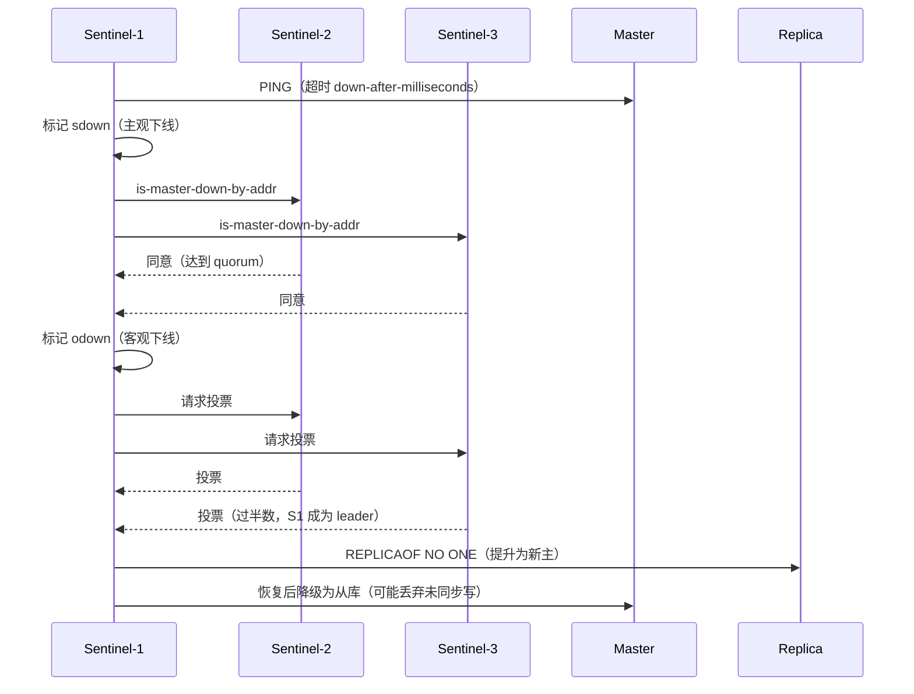

# 第 9 章 Redis：数据结构、持久化、缓存治理与集群

> 一句话定位：缓存是 Java 后端最常被问、也最容易问出工程判断力的模块。答得出"五种类型"，只是入门；能讲清"为什么单线程还快""缓存和库怎么才不错""锁为什么会失效"，才算过关。

## 一、本章考察重点概览

Redis 在面试里承担两个角色：一是**基本功校验**，看你是否真的理解内存数据结构与单线程模型的代价；二是**场景题载体**，缓存穿透、分布式锁、双写一致性这些题，本质考的是你在"性能、一致性、可用性"三角里怎么做取舍。

面试官通常在这三个层面筛人：

1. **能不能把"快"讲成机制而不是口号。** 说"因为它是内存数据库"只能算答了一半，还要说清单线程为什么反而快、6.0 的多线程到底多线程了什么、单线程在什么情况下会成为瓶颈。
2. **有没有量化意识。** 过期策略的采样比例、淘汰策略的采样数、AOF 三种刷盘策略各自丢多少数据、集群为什么是 16384 个槽，这些数字背后都有设计原因，答得出原因才说明不是背的。
3. **缓存治理是否有体系。** 穿透、击穿、雪崩不是三个孤立的名词，而是"请求打到哪里、防护放在哪一层"的三条不同路径；一致性方案也不是"先删缓存"四个字，而要能说清不一致窗口有多大、怎么收敛。

| 考点 | 出现频率 | 难度 | 说明 |
| --- | --- | --- | --- |
| 单线程模型与 6.0 多线程 IO | 高 | 中级 | 常作为开场题，追问会落到阻塞原因 |
| 五种类型的底层编码与切换 | 高 | 中级 | 能说出 listpack/quicklist 的演进是加分项 |
| RDB / AOF / 混合持久化 | 高 | 中级 | 必须能说清 fork 与 COW 的代价 |
| 过期删除与内存淘汰 | 高 | 中级 | 常与"内存满了会怎样"连问 |
| 缓存穿透 / 击穿 / 雪崩 | 高 | 初级 | 必问，区分度在方案细节 |
| 缓存与数据库一致性 | 高 | 高级 | 决定候选人有没有线上经验 |
| 分布式锁 | 高 | 高级 | 误删、续期、Redlock 争议三层递进 |
| 主从 / 哨兵 / Cluster | 中 | 高级 | 高级岗会追问槽迁移与脑裂 |
| 事务与 Lua | 中 | 中级 | 重点在"原子性"到底指什么 |
| 大 key / 热 key 治理 | 中 | 高级 | 有大规模线上经验才答得实 |

## 二、复习优先级

| 优先级 | 题目编号 | 理由 |
| --- | --- | --- |
| P0 | Q1、Q3、Q7、Q8、Q9、Q10、Q11、Q12 | 缓存治理与持久化是主线，几乎每场必问，必须能画图讲 |
| P1 | Q2、Q4、Q5、Q13、Q14、Q15、Q16、Q17、Q20 | 区分"会用"与"懂原理"，集群与复制是高级岗门槛 |
| P2 | Q6、Q18、Q19、Q21 | 加分项，记住结论与一个真实场景即可 |

时间分配建议：本章 2.5 天。P0 占 65%，要求能白板画出 RDB fork+COW 的时间线、缓存三兄弟的请求路径、分布式锁的误删时序；P1 占 25%，重点讲清复制与集群的状态机；P2 剩 10%，面试前一天扫速记卡。

## 三、高频面试题清单

| 编号 | 题目 | 面试难度 | 阅读门槛 | 优先级 | 一句话答案 |
| --- | --- | --- | --- | --- | --- |
| Q1 | Redis 为什么快？单线程模型的天花板在哪？ | 初级 | 低 | P0 | 内存访问 + 无锁串行 + epoll + 紧凑结构；O(N) 命令与大 key 会阻塞全实例 |
| Q2 | Redis 6.0 的多线程 IO 多线程了什么？ | 中级 | 中 | P1 | 只多线程了请求读取解析与响应回写，命令执行仍是单线程 |
| Q3 | 五种基本类型的底层编码与切换条件是什么？ | 中级 | 中 | P0 | 小数据用 listpack/intset/embstr，超阈值转 hashtable/skiplist/raw |
| Q4 | bitmap、HyperLogLog、GEO、Stream 各自解决什么问题？ | 中级 | 中 | P1 | 位统计、基数估算、地理检索、持久化消费组消息流 |
| Q5 | SDS 相比 C 字符串好在哪？ | 中级 | 中 | P1 | O(1) 取长度、二进制安全、预分配、防溢出 |
| Q6 | ZSet 为什么用跳表而不是红黑树？ | 高级 | 高 | P2 | 范围查询天然有序、实现简单、易做无锁与排名 |
| Q7 | RDB 的原理是什么？fork 与 COW 的代价在哪？ | 高级 | 高 | P0 | 子进程写时复制快照；fork 拷贝页表会阻塞，写入放大可能翻倍内存 |
| Q8 | AOF 三种刷盘策略怎么选？重写与混合持久化呢？ | 高级 | 高 | P0 | always 最安全最慢，everysec 默认丢 1 秒，no 交给 OS |
| Q9 | 过期键怎么删？内存满了按什么规则淘汰？ | 中级 | 中 | P0 | 惰性 + 定期采样删除；8 种淘汰策略，LRU/LFU 都是近似实现 |
| Q10 | 缓存穿透、击穿、雪崩的区别与方案？ | 初级 | 低 | P0 | 查不存在、热点失效、大面积失效，防护点各不相同 |
| Q11 | 缓存与数据库怎么保证一致性？ | 高级 | 高 | P0 | Cache Aside 先更库再删缓存，用延迟双删或 binlog 收敛 |
| Q12 | Redis 分布式锁怎么写才不出错？ | 高级 | 高 | P0 | SET NX PX + UUID 校验 + Lua 释放 + 看门狗续期 |
| Q13 | 主从复制的全量与增量流程？ | 高级 | 高 | P1 | psync 触发 RDB 全量，之后按 offset 从 repl_backlog 增量追 |
| Q14 | 哨兵怎么选主？脑裂怎么防？ | 高级 | 高 | P1 | 主观/客观下线 + Raft 选 leader + 优先级/offset 选从库 |
| Q15 | Cluster 的槽为什么是 16384？MOVED 与 ASK 区别？ | 高级 | 高 | P1 | 心跳位图 2KB 的折中；MOVED 永久重定向，ASK 仅本次 |
| Q16 | MULTI/EXEC 与 Lua 的原子性有什么不同？ | 中级 | 中 | P1 | 事务不回滚、不隔离读；Lua 期间不插队但出错也不回滚 |
| Q17 | Pipeline 为什么能提升性能？和批量命令什么关系？ | 中级 | 中 | P1 | 省 RTT 而非省执行，服务端仍逐条串行处理 |
| Q18 | 大 key、热 key 怎么发现与治理？ | 中级 | 中 | P2 | --bigkeys/MEMORY USAGE 抽样，拆分 + 本地缓存 + 多副本 |
| Q19 | 用 Redis 做消息队列合适吗？ | 中级 | 中 | P2 | List/Pub/Sub 能力弱，Stream 可用但堆积受内存限制 |
| Q20 | Redis 常见的阻塞原因有哪些？ | 中级 | 中 | P1 | 大 key 删除、KEYS、AOF fsync、fork、swap、集中过期 |
| Q21 | 内存怎么优化？容量怎么估？ | 高级 | 高 | P2 | 控制编码与 key 长度、分片、算上对象头与对齐开销 |

## 四、题目详解

### Q1. Redis 为什么快？单线程模型的天花板在哪？（初级）

> 前置：内存操作、单线程、IO 多路复用

**一句话结论**：Redis 快的主因是纯内存访问、单线程命令执行省掉了锁竞争与线程切换、epoll 多路复用让一个线程管理大量连接，再加上为场景定制的高效数据结构；单线程的边界是任何 O(N) 命令、大 key 操作、慢脚本都会阻塞整个实例，因为命令处理是严格串行的。

**先把话说白**：一条 Redis 命令的活儿其实很小——解析几个字节的协议，在内存里查一次哈希表或跳表，再把结果写回去。既然单条命令本来就是微秒级，用多线程并行省下的那点时间，还不够抵消加锁、线程切换和 CPU 缓存失效的成本。所以 Redis 的选择是：把并发留给"连接管理"，把执行留成"排队"。

**底层原理**：

1. **内存与磁盘的数量级差异。** 一次内存访问大约几十到一百纳秒，一次 SSD 随机读在几十到上百微秒，机械盘还要加一次寻道。Redis 把读写都落在内存里，只有持久化时才碰磁盘，这是"快"的第一层，也是最容易被说出口的一层。

2. **单线程带来的三个"省"。** 不用加锁，所以没有锁竞争与死锁风险；不用切换线程，所以没有上下文切换和 TLB、CPU cache 失效；命令串行执行，所以单条命令天然原子，`INCR`、`LPUSH` 这类操作不需要额外同步。代价是没法利用多核做命令并行，这一点后面会讲怎么绕。

3. **IO 多路复用是单线程能撑住高并发的前提。** 如果每个连接一个线程阻塞读，几千连接就是几千线程。Redis 用 epoll 把关心的 fd 注册进内核，事件循环（`ae.c`）里一次 `epoll_wait` 返回一批就绪连接，再逐个处理。线程始终只有一两个，连接数却能到万级——这是"单线程"和"高并发"能同时成立的关键。

4. **数据结构与协议层的效率。** SDS 取长度 O(1)、追加有预分配；小对象用 listpack 连续存储，一次内存分配装下几十个元素，缓存局部性好；哈希表扩容用渐进式 rehash，把搬迁成本摊到每次操作；RESP 协议是文本行协议，解析简单到可以用状态机几十行写完。这些细节单独看都不惊艳，叠起来才让单条命令稳定在微秒级。

5. **"单线程"指的是命令执行。** Redis 4.0 起有后台线程做惰性删除（`UNLINK`、`FLUSHALL ASYNC`）和 `close(fd)`；AOF 的 `fsync` 也可能由后台线程完成；6.0 又把网络读写拆了出去（见 Q2）。所以准确说法是"命令执行单线程"，不是"整个进程只有一个线程"。

6. **天花板在哪。** 一是 CPU：单线程只能用一核，QPS 到十万级后 CPU 先满。二是单次操作耗时：`KEYS *`、`HGETALL` 一个几十万字段的 hash、`DEL` 一个百万元素的 zset、`SMEMBERS` 全量返回，都是 O(N)，N 大时这条命令会把后面所有请求一起堵住。三是外部阻塞：AOF `always` 刷盘、fork 拷贝页表、内存被 swap 到磁盘、大 key 集中过期，都会让主线程停下来。生产上判断"是不是 Redis 慢"，第一步不是看 QPS，而是看慢查询日志与 `latency monitor`。

**易混对比**：

| 说法 | 是否准确 | 说明 |
| --- | --- | --- |
| Redis 单线程 | 不准确 | 命令执行单线程，后台有 bio 线程，6.0 有 IO 线程 |
| 单线程所以快 | 只说对一半 | 快的主因是内存 + 短命令，单线程是"避免变慢" |
| 多线程一定更快 | 错 | 命令本身极短，锁与切换成本占比过高 |
| 加机器就能提 QPS | 有条件 | 单实例受单核限制，需分片或读写分离 |

**面试追问**：
- 追问：既然单线程，为什么还能处理上万连接？→ 答题要点：epoll 事件驱动，线程不阻塞在单个连接上，连接多不等于并发执行多。
- 追问：Redis 6.0 之后是不是变成多线程了？→ 答题要点：只多线程了网络读写与协议解析，命令执行仍串行，见 Q2。
- 追问：哪些命令会阻塞 Redis？→ 答题要点：O(N) 命令、大 key 删除、`KEYS`/`FLUSHALL`、Lua 长脚本、fork、AOF fsync、swap。
- 追问：怎么发现线上 Redis 变慢？→ 答题要点：`slowlog`、`latency monitor`、`INFO commandstats`、`--bigkeys`，再看 CPU、内存、网络与持久化指标。

### Q2. Redis 6.0 的多线程 IO 多线程了什么？（中级）

> 前置：网络读写、命令执行

**一句话结论**：Redis 6.0 的多线程 IO 只把"读取 socket 并解析命令"和"把响应写回 socket"这两段搬到了 IO 线程，命令执行、键空间操作、过期判断依旧由主线程串行完成；因此它解决的是网络收发成为瓶颈的场景，不改变单线程执行模型的语义。

**先把话说白**：请求进来到执行之间有两段"搬运工"的活：把字节从内核缓冲区读出来并解析成命令参数，以及把结果写回内核缓冲区。真正"动数据"的那一下很轻，搬东西反而费时间。6.0 的思路是：搬东西可以多人干，动数据还是一个人干，这样既不破坏原子性，又让多核参与进来。

**底层原理**：

1. **开关与默认值。** `io-threads` 默认是 1，也就是关闭状态（等于仍用主线程做读写）；要开启一般设为 CPU 核数或核数减一，官方建议不超过 8，再大收益递减。`io-threads-do-reads` 默认 `no`，即默认只多线程写响应，读仍由主线程做——因为读路径涉及协议解析的边界处理，早期版本收益不如写明显。

2. **读路径。** 主线程的 `epoll_wait` 返回就绪 fd 后，把 fd 分发给 IO 线程，各线程并行 `read` 并解析出命令参数，解析完成的请求放进队列；主线程从队列里按顺序取命令执行。注意"分发"和"执行"仍然串行，所以命令之间不存在竞态。

3. **写路径。** 主线程执行完命令后把回复挂到客户端的输出缓冲，再由 IO 线程并行 `write` 回 socket。大 value 的返回、`MGET` 多 key 的返回，写回耗时会明显，这一段并行收益最大。

4. **为什么执行不能并行。** 一旦并行执行，两个命令可能同时改同一个 key，就必须引入锁或分区，复杂度和延迟都会上一个台阶；而且 Redis 的原子性语义（单命令原子、Lua 原子、事务串行）全部建立在"串行执行"上，并行会直接破坏这些承诺。

5. **收益与边界。** 多线程 IO 提升的是"每秒能收发的请求数"，对单条命令的延迟帮助有限，甚至因为线程调度略微增加。若瓶颈是 CPU 执行（复杂 Lua、大 key 运算）或内存带宽，开 IO 线程没有用。经验上单实例超过 10 万 QPS 后，网络读写往往开始成为瓶颈，这时才值得开。

| 环节 | 6.0 之前 | 6.0 之后 |
| --- | --- | --- |
| accept / 监听 | 主线程 | 主线程 |
| 读 socket + 协议解析 | 主线程 | IO 线程（需开 `io-threads-do-reads`） |
| 命令执行 | 主线程 | 主线程（不变） |
| 写响应 | 主线程 | IO 线程 |
| 过期删除、持久化 fork | 主线程 | 主线程 |

**面试追问**：
- 追问：开了 `io-threads` 会不会有并发问题？→ 答题要点：不会，IO 线程只做搬运与解析，执行仍串行，数据竞争面没有扩大。
- 追问：为什么默认关？→ 答题要点：多数实例没到网络瓶颈，多线程反而增加复杂度与延迟抖动。
- 追问：多线程 IO 能提升单条命令的吞吐延迟吗？→ 答题要点：提升总吞吐，单条延迟基本不变，可能略增。
- 追问：和 memcached 的多线程模型比呢？→ 答题要点：memcached 多线程执行 + 分段锁，Redis 用串行换简单与原子语义，各有取舍。

### Q3. 五种基本类型的底层编码与切换条件是什么？（中级）

> 前置：数据结构、底层编码转换

**一句话结论**：String 用 int/embstr/raw，List 用 quicklist（节点是 listpack），Hash 与 ZSet 在小数据量时用 listpack、超阈值转 hashtable 与 skiplist，Set 用 intset/listpack/hashtable；所谓"类型"是对外的逻辑语义，"编码"是 Redis 为省内存做的内部分支，阈值可在 `redis.conf` 调整。

**先把话说白**：同一个 `hash`，存三个字段和存三万个字段，用同一种结构显然浪费。Redis 的做法是：数据少的时候用一块连续内存（listpack）紧凑地排着，遍历靠线性扫描也很快；数据多了再换成哈希表或跳表，保证单次操作是 O(1) 或 O(log N)。这就是"编码转换"。

**底层原理**：

1. **String：三种编码。** 值是整数且能用 long 表示时用 `int`，直接把数值存在 `redisObject.ptr` 里，不额外分配；长度不超过 44 字节用 `embstr`，把 `redisObject` 与 SDS 一次性分配在连续内存，省一次分配与一次指针跳转；超过 44 字节用 `raw`，两次分配。44 这个数字来自 jemalloc 的 64 字节分配档：16 字节对象头 + 3 字节 SDS 头 + 44 字节内容 + 1 字节 `\0` 正好 64。Redis 7 的阈值仍是 44，早期版本 SDS 头长度不同，数字略有差异。

2. **List：quicklist。** 3.2 起用 quicklist，本质是双向链表，每个节点是一个 ziplist；Redis 7.0 把节点换成 listpack（去掉了 ziplist 的级联更新问题）。节点大小由 `list-max-listpack-size` 控制，默认 `-2` 表示每个节点 8KB。这样既保留了链表的 O(1) 头尾插入，又通过分块获得连续内存的局部性。

3. **Hash：listpack → hashtable。** 字段数不超过 `hash-max-listpack-entries`（默认 128）且每个字段名和值的长度不超过 `hash-max-listpack-value`（默认 64）时用 listpack，字段名和值交替存放；任一条件被突破就转成 hashtable（`dict`），转换不可逆。

4. **Set：intset → listpack → hashtable。** 全为整数且元素数不超过 `set-max-intset-entries`（默认 512）时用 intset，有序数组 + 二分查找，非常省内存；Redis 7.2 起，非整数但元素少且短时可用 listpack（`set-max-listpack-entries` 128）；否则用 hashtable，value 为 null。

5. **ZSet：listpack → skiplist + dict。** 元素数不超过 `zset-max-listpack-entries`（默认 128）且 member 长度不超过 `zset-max-listpack-value`（默认 64）用 listpack，按 score 有序排列；超过后转成跳表 + 字典的双结构：字典负责 `ZSCORE` 的 O(1)，跳表负责范围查询与排名。

6. **为什么阈值是这个量级。** 128 / 64 / 512 都是"线性扫描仍然比哈希查找快"的临界区间——元素少时连续内存的一次遍历只有几次 cache miss，而哈希表要算哈希、寻址、处理冲突，反而更慢、更占内存。这些值是可调的，但盲目调大会让单次操作退化为 O(N)。

```bash
# 查看某个 key 的实际编码
redis-cli OBJECT ENCODING user:1001:profile
# 输出可能是 listpack / hashtable / quicklist / intset / skiplist / embstr / raw
```

**易混对比**：

| 类型 | 小数据编码 | 大数据编码 | 转换阈值（默认） |
| --- | --- | --- | --- |
| String | int / embstr | raw | 44 字节 |
| List | quicklist（节点 listpack） | 仍是 quicklist，仅节点变大 | `list-max-listpack-size -2` |
| Hash | listpack | hashtable | 128 个字段或单值 64 字节 |
| Set | intset / listpack | hashtable | 512 个整数 / 128 个短元素 |
| ZSet | listpack | skiplist + dict | 128 个成员或 member 64 字节 |

**面试追问**：
- 追问：为什么 String 的 embstr 阈值是 44？→ 答题要点：jemalloc 64 字节档位减去对象头与 SDS 头，正好装 44 字节内容加结尾符。
- 追问：编码转换后能转回来吗？→ 答题要点：不能，转换是单向的；删除元素不会退回 listpack。
- 追问：listpack 相比 ziplist 改了什么？→ 答题要点：去掉了记录前驱长度的字段，避免中间修改引发的级联更新，代价是反向遍历需要额外处理。
- 追问：为什么 ZSet 要同时用跳表和字典？→ 答题要点：字典管按成员查分数，跳表管按分数范围与排名，单结构无法同时做到两者都高效。

### Q4. bitmap、HyperLogLog、GEO、Stream 各自解决什么问题？（中级）

> 前置：bitmap、HyperLogLog、GEO

**一句话结论**：bitmap 用位数组做布尔统计（签到、在线状态），HyperLogLog 用概率算法做基数估算（UV），GEO 用 ZSet + GeoHash 做地理范围检索，Stream 是 5.0 引入的持久化消息流，支持消费组与 ACK，是 Redis 里唯一接近消息队列的结构。

**先把话说白**：这四种不是"更高级的类型"，而是四种不同的问题被塞进了 String 或 ZSet 的底层：签到只需要记住"哪天来过"，用一位就够；UV 只需要"大概多少人"，允许 0.81% 误差换固定 12KB 内存；附近的人需要把二维坐标压成一维再排序；消息流需要能重放、能确认。

**底层原理**：

1. **bitmap 本质是 String。** `SETBIT key offset 1` 直接在 SDS 的字节上改位，`BITCOUNT` 统计 1 的个数，`BITOP` 做与或非。一位一个用户，一亿用户也只要 12.5MB。边界是 offset 太大时会一次性分配整段内存（`SETBIT k 100000000 1` 会分配十几 MB），稀疏场景应改用分段 key。Redis 4.0 起 `BITFIELD` 支持按任意位宽读写整数字段，可以做多字段紧凑存储。

2. **HyperLogLog 是概率计数器。** 它不存元素，只维护 16384 个桶（2^14），每个桶记录哈希值前导零的最大长度，用调和平均估算基数，标准误差约 0.81%，固定占用约 12KB（稀疏编码时更小）。`PFADD` 添加、`PFCOUNT` 估算、`PFMERGE` 合并。它只能估不能取，也不支持删除单个元素——这是"用精度换内存"的典型取舍。

3. **GEO 是 ZSet 的一层封装。** 把经纬度按 GeoHash 交错编码成一个 52 位整数，作为 ZSet 的 score，member 是地点标识。因为 score 有序，`GEOSEARCH`（6.2 起统一了 `GEORADIUS`）可以先按分数区间框出九宫格，再逐个算真实距离过滤。精度约 0.6 米，底层就是 skiplist，没有额外结构。

4. **Stream 是有消费组与 ACK 的日志。** `XADD` 追加，消息 ID 形如 `毫秒时间戳-序号`，单调递增；`XREADGROUP` 配合 `GROUP` 做消费组，读过的消息进入 PEL（Pending Entries List，待确认列表），`XACK` 确认后才算消费完成，`XPENDING` 能看积压，`XCLAIM` 能把超时未确认的消息转给别的消费者。底层用基数树（rax）索引 + listpack 存消息体。

5. **选型判断。** 需要精确计数、需要取元素 → 用 Set 或 bitmap；只需要去重后的数量、能接受误差 → HLL；需要距离排序、附近检索 → GEO；需要"至少消费一次"、能重放、有消费组 → Stream；只是广播通知、丢了也无所谓 → Pub/Sub。

| 结构 | 典型场景 | 精度 | 内存特征 | 明显限制 |
| --- | --- | --- | --- | --- |
| bitmap | 签到、活跃标记 | 精确 | 按最大 offset 分配 | 稀疏时浪费 |
| HyperLogLog | UV 统计 | 约 0.81% 误差 | 固定约 12KB | 不能取元素、不能删单个 |
| GEO | 附近的人、门店 | 约 0.6 米 | 复用 ZSet | 需要全量重建才能改精度 |
| Stream | 轻量消息流 | 精确 | 与消息量线性相关 | 堆积受内存限制 |

**面试追问**：
- 追问：HLL 为什么能只用 12KB 估一亿 UV？→ 答题要点：只保留哈希前导零的最大长度分布，用概率公式反推基数，牺牲精度换常数空间。
- 追问：bitmap 统计 UV 有什么问题？→ 答题要点：需要用户 ID 连续且可映射为 offset，稀疏时内存浪费严重。
- 追问：Stream 能替代 Kafka 吗？→ 答题要点：小规模可以，缺少分区副本、事务消息、海量堆积能力，见 Q19。
- 追问：GEO 的底层为什么不用额外的空间索引？→ 答题要点：GeoHash 把二维降成一维后，ZSet 的分数范围查询天然可用，实现成本最低。

### Q5. SDS 相比 C 字符串好在哪？（中级）

> 前置：C 字符串、扩容、二进制安全

**一句话结论**：SDS（Simple Dynamic String）在字符数组前加了长度与容量字段，因此取长度是 O(1)、按长度判断边界所以二进制安全、追加时按规则预分配减少内存重分配、扩容前检查容量避免缓冲区溢出；C 字符串靠 `\0` 结尾，这四件事全都做不好。

**先把话说白**：C 的字符串就是一个以 `\0` 结尾的字节数组，想知道多长得从头数到尾，想拼接得先自己算够不够，中间还不能出现 `\0` 否则会被截断。Redis 的 value 可能是图片、序列化对象、压缩数据，里面出现 `\0` 太正常了，所以必须换一种表示。

**底层原理**：

1. **结构。** SDS 由头部和 `buf[]` 组成，头部有 `len`（已用长度）、`alloc`（已分配容量）、`flags`（头类型）。头有 `sdshdr5/8/16/32/64` 五种，按字符串长度选择，短字符串用小头省内存——`sdshdr5` 甚至不存 `len`，只用 flags 的低 5 位表示长度（仅用于不可变的短 key）。

2. **O(1) 取长度。** `strlen` 直接读 `len` 字段。这一条看似只影响 `STRLEN`，实际上所有需要判长的路径（追加、比较、协议编码）都受益。

3. **二进制安全。** 所有 API 都传长度而不是靠 `\0` 判断结束，`buf` 中间可以有任意字节。SDS 仍然在末尾补一个 `\0`，目的是让 `printf`、`strcmp` 这类 C 函数能直接复用，属于兼容性设计，不参与逻辑判断。

4. **预分配与惰性释放。** 追加后若 `len < 1MB`，`alloc` 扩到 `len` 的两倍；若 `len >= 1MB`，每次多分配 1MB。这样连续追加 N 次不必每次都 realloc，把 O(N) 次分配降到 O(log N) 量级。缩短字符串时不立即 `free`，只改 `len`，保留空间给后续追加；SDS 有专门的 `sdsRemoveFreeSpace` 在需要时真正收缩。

5. **防溢出。** `sdscatlen` 等函数在拼接前检查 `len + addlen` 是否超过 `alloc`，超过就扩容。C 的 `strcat` 没有这个检查，溢出是经典漏洞来源。

6. **代价。** 头部有额外开销（最小 3 字节），短字符串的内存放大比例比 C 高；预分配会带来最多约一倍的空间冗余；惰性释放让内存占用看起来"不降"。这些都是用空间与实现复杂度换时间与安全的取舍。

| 维度 | C 字符串 | SDS |
| --- | --- | --- |
| 取长度 | O(N) 遍历 | O(1) 读 `len` |
| 二进制安全 | 否，遇 `\0` 截断 | 是，按长度处理 |
| 缓冲区溢出 | 需调用方保证 | API 内部检查并扩容 |
| 追加性能 | 每次可能 realloc | 预分配，均摊 O(1) |
| 内存开销 | 仅内容 + 1 字节 | 内容 + 头部 + 预分配冗余 |

**面试追问**：
- 追问：SDS 为什么还要在末尾加 `\0`？→ 答题要点：兼容 C 字符串函数，便于调试与复用 `strlen` 等库函数，但不作为长度依据。
- 追问：预分配会不会浪费内存？→ 答题要点：会，最多一倍冗余，但换来追加的均摊 O(1)，且可手动收缩。
- 追问：为什么 `sdshdr5` 不存 len？→ 答题要点：只用于长度小于 32 的不可变短字符串（如 key），flags 低 5 位足够表示。
- 追问：SDS 的长度字段会不会溢出？→ 答题要点：`len` 与 `alloc` 是 `size_t`，扩容前用 `SDS_MAX_PREALLOC` 与上限检查，理论上受内存限制而非字段宽度。

### Q6. ZSet 为什么用跳表而不是红黑树？（高级）

> 前置：跳表、红黑树、范围查询

**一句话结论**：ZSet 需要"按分数范围遍历"和"按排名取元素"，跳表底层是有序链表，范围查询只需定位起点后顺序走，且 `span` 字段天然支持 O(log N) 求排名；加上跳表实现比红黑树简单得多、插入删除只改指针不旋转、更容易做并发版本，所以 Redis 选了跳表。

**先把话说白**：红黑树也能做到 O(log N) 的插入与查找，但它的强项是"点查"。ZSet 的高频操作是 `ZRANGEBYSCORE`、`ZRANGE 0 9`、`ZRANK` 这类"从某个位置开始连续取一段"，在树上做这件事需要中序遍历 + 回溯，代码复杂且缓存不友好；在跳表上就是找到起点，然后沿着底层链表往后走，简单直接。

**底层原理**：

1. **跳表的结构。** 最底层是包含全部元素的有序链表，上面每一层是下层的抽样（晋升概率 `p` 默认 0.25），查找时从最高层开始，能往右就往右，不能就往下一层，期望复杂度 O(log N)。层高上限 32，由 `ZSKIPLIST_MAXLEVEL` 控制，够存 2^64 个元素。

2. **范围查询的天然优势。** 定位到第一个满足条件的节点后，沿 level 0 的 `forward` 指针顺序走即可，是纯指针追逐，没有递归、没有回溯。红黑树做范围查询要么中序遍历（需要栈），要么找后继（需要父指针），常数更大。

3. **排名靠 `span` 实现。** 每个 forward 指针带一个 `span`，表示跨越了多少个节点。查找时把沿途 `span` 累加就得到排名，`ZRANK`/`ZREVRANK` 是 O(log N)。红黑树要支持排名得额外维护子树大小，本质是加强版的顺序统计树，实现更重。

4. **实现与维护成本。** 红黑树插入删除要处理变色与旋转，分支多、容易写错；跳表只改指针，插入时随机决定层数，删除时逐层摘链。Redis 作者在《Redis 设计与实现》里明确说过：跳表在实现难度、范围查询、并发友好度上都更合适，而 Redis 是单线程，红黑树的并发优势也用不上。

5. **代价。** 跳表用概率平衡代替严格平衡，最坏情况（极不可能）会退化；每个节点平均 1/(1-p) ≈ 1.33 个指针，内存比红黑树略高；层高随机意味着性能有方差。但这些都是可接受的成本。

6. **ZSet 的双结构。** 单靠跳表按 member 查 score 是 O(log N)，Redis 额外维护一个 `dict<member, score>`，让 `ZSCORE` 变成 O(1)。两边通过指针共享同一个 `zskiplistNode`，改分数时先删后插，两个结构同步更新。

```text
level 3:  head -------------------------> 30
level 2:  head -------> 10 -------------> 30
level 1:  head -> 5 --> 10 --> 20 ------> 30
level 0:  head -> 5 -> 8 -> 10 -> 20 -> 25 -> 30   （有序链表，范围查询走这条）
```

| 维度 | 跳表 | 红黑树 |
| --- | --- | --- |
| 点查 | O(log N) 期望 | O(log N) 最坏 |
| 范围查询 | 定位后顺序走，简单 | 需中序/后继，常数大 |
| 求排名 | `span` 累加，O(log N) | 需额外维护子树大小 |
| 实现复杂度 | 低，只改指针 | 高，需旋转与变色 |
| 内存 | 平均 1.33 个指针/节点 | 每节点固定 3 指针 + 颜色位 |
| 并发友好 | 易做无锁 | 难 |

**面试追问**：
- 追问：跳表的层数是固定的吗？→ 答题要点：随机生成，每层晋升概率 0.25，期望层高 O(log N)，上限 32。
- 追问：为什么不直接用 B+ 树？→ 答题要点：B+ 树为磁盘页设计，节点大、分裂合并复杂，纯内存场景收益不大。
- 追问：跳表最坏情况会怎样？→ 答题要点：概率极低地退化成链表，复杂度 O(N)，但随机化让这种概率可以忽略。
- 追问：ZSet 的 `dict` 和 `skiplist` 如何保持一致？→ 答题要点：共享节点指针，插入删除在同一临界区内同时操作两个结构。

### Q7. RDB 的原理是什么？fork 与 COW 的代价在哪？（高级）

> 前置：`fork`、写时复制、持久化

**一句话结论**：RDB 是把某一时刻的全量数据序列化成二进制快照，`BGSAVE` 通过 `fork` 出子进程写盘、父进程继续服务，靠操作系统的写时复制（COW, Copy-On-Write）保证快照一致性；代价是 `fork` 本身要拷贝页表会短暂阻塞主线程，快照期间写入会触发页复制导致内存膨胀（最坏接近翻倍），两次快照之间的数据会丢。

**先把话说白**：RDB 像给整个数据库拍一张照片。拍照不能停业，所以 Redis 叫来一个分身（子进程）去拍，自己继续接待客人。分身看到的世界在拍照那一刻就固定了——不是因为它复制了所有数据，而是因为谁要改数据，操作系统就先给改的那一页做一份副本，分身继续看老的那页。这就是写时复制。

**底层原理**：

1. **触发方式。** `SAVE` 在主线程执行，全程阻塞，生产禁用；`BGSAVE` fork 子进程，主线程返回继续处理请求；配置 `save 900 1`、`save 300 10`、`save 60 10000` 满足任一条件自动触发；`SHUTDOWN` 时若未开 AOF 也会触发一次；主从全量同步时由主库触发。

2. **fork 到底做了什么。** `fork` 不复制物理内存，只复制页表，把父进程的虚拟地址映射共享给子进程，并把两边的页标记为只读。页表的大小与内存页数成正比：内存越大，页表项越多，拷贝耗时越长。经验上几十 GB 的实例 `fork` 可能阻塞几十到几百毫秒，这期间所有命令都要等——这是 RDB 最容易被忽略的阻塞点。

3. **COW 的写入放大。** 快照期间父进程每写一个 key，只要落在尚未复制的页上，内核就分配一个新页、拷贝原内容、改父进程的映射，子进程仍指向老页。极端情况下（快照期间全量写入），内存会涨到原来的近两倍。所以容量规划要预留 `maxmemory` 之外的余量，并关注 `INFO stats` 里的 `latest_fork_usec` 与 `rdb_changes_since_last_save`。

4. **文件生成与原子替换。** 子进程写到临时文件，完成后 `rename` 覆盖旧文件，`rename` 在同一文件系统内是原子的，避免半成品被当成有效快照。文件带 CRC64 校验（`rdbchecksum yes`），加载时校验失败会拒绝启动。

5. **优缺点。** 优点是文件紧凑（二进制 + LZF 压缩）、加载快（直接重建内存，比回放 AOF 快得多）、适合备份与全量同步。缺点是实时性差，宕机会丢掉最后一次快照之后的所有写；`fork` 有阻塞与内存放大；大数据量下快照本身耗时较长。

6. **Redis 7 的变化。** 7.0 起 RDB 文件格式版本升级，支持函数（Function）与更紧凑的元数据；主从全量同步默认支持无盘复制（`repl-diskless-sync yes`），子进程直接把 RDB 写到 replica 的 socket，省掉落盘再读的一次 IO，适合磁盘慢但网络快的环境。

| 维度 | RDB | AOF |
| --- | --- | --- |
| 数据粒度 | 快照，丢两次快照间的数据 | 按秒级，`everysec` 最多丢约 1 秒 |
| 文件大小 | 小，二进制压缩 | 大，文本命令，重写后仍偏大 |
| 恢复速度 | 快，直接重建 | 慢，逐条回放 |
| 运行时开销 | `fork` 阻塞 + COW 内存放大 | 持续追加写，`fsync` 有开销 |
| 适用场景 | 备份、主从全量同步 | 对丢数据敏感的主库 |

**面试追问**：
- 追问：`fork` 会复制内存吗？→ 答题要点：不会复制物理页，只复制页表并置只读，写入时才按页复制。
- 追问：快照期间内存为什么会涨？→ 答题要点：COW，父进程每改一页就复制一页，最坏接近翻倍。
- 追问：为什么 RDB 恢复比 AOF 快？→ 答题要点：RDB 是内存镜像，直接按结构重建；AOF 要逐条执行命令。
- 追问：主从全量同步为什么也走 RDB？→ 答题要点：一次性传输紧凑快照，从库加载快，之后转增量命令流。

### Q8. AOF 三种刷盘策略怎么选？重写与混合持久化呢？（高级）

> 前置：刷盘策略、重写、混合持久化

**一句话结论**：AOF 把每条写命令追加到日志，`appendfsync` 有 `always`（每条 fsync，最安全最慢）、`everysec`（每秒一次，默认，最多丢约 1 秒）、`no`（交给操作系统，通常 30 秒内）三档；重写（rewrite）通过子进程把当前内存压成最小命令集，Redis 4.0 起的混合持久化把 RDB 头 + 增量 AOF 拼在一起，兼顾加载速度与数据完整度。

**先把话说白**：RDB 是拍照，AOF 是记账。拍照省事但中间的事没记；记账能一条不落，但账本会越来越厚，得定期誊写一份"当前余额汇总"，这就是重写。混合持久化相当于"先放一张照片，再把拍照之后的流水附在后面"。

**底层原理**：

1. **三种刷盘策略的真实代价。** `always` 每条命令都 `fsync`，落盘最可靠，但每次都要等磁盘确认，吞吐会掉一个数量级；`everysec` 由后台线程每秒 `fsync` 一次，主线程只负责 `write` 到页缓存，最坏丢约 1 秒数据（极端情况下 `fsync` 阻塞会让延迟到 2 秒）；`no` 完全交给内核，Linux 通常 30 秒刷一次，宕机丢得多，但性能最好。绝大多数业务用 `everysec`。

2. **AOF 的写入链路。** 命令执行完先追加到 `aof_buf`（服务端缓冲区），事件循环结束前 `write` 到文件（此时已进页缓存），再按策略 `fsync`。所以"写成功"和"落盘"是两件事，`everysec` 丢数据的窗口就来自这里。

3. **重写的触发与流程。** `BGREWRITEAOF` 或满足 `auto-aof-rewrite-percentage`（默认 100%，即比上次重写后大一倍）与 `auto-aof-rewrite-min-size`（默认 64MB）时触发。主进程 `fork` 子进程，子进程遍历当前内存生成最小命令集（一个百万元素的 list 用一条 `RPUSH` 加批量参数表示），主进程同时把新写入追加到 `aof_buf` 和 `aof_rewrite_buf`；子进程写完后，主进程把 `aof_rewrite_buf` 补到新文件末尾，再原子替换。

4. **重写的两个代价。** 一是 `fork` 的阻塞与 COW 内存放大，和 RDB 一样；二是 `aof_rewrite_buf` 在重写期间持续增长，写入量大、重写耗时长时可能吃掉大量内存，甚至触发淘汰。所以重写要避开业务高峰。

5. **Redis 7 的多部分 AOF。** 7.0 把 AOF 拆成 `manifest`（清单）+ `base`（基准，RDB 或 AOF 格式）+ `incr`（增量）。重写只产生新的 base 与 incr 文件，不再重写单一巨型文件，减少了重写期间的写放大，也便于做增量备份。这是 7.0 相对 6.x 的实质改进。

6. **混合持久化。** `aof-use-rdb-preamble yes`（4.0 起，7.0 默认开启）让重写生成的 AOF 前半段是 RDB 二进制、后半段是增量命令。加载时先按 RDB 快速重建，再回放少量增量，兼顾"恢复快"和"丢得少"。这也是目前生产上最常见的组合：`appendonly yes` + `everysec` + 混合持久化 + 定期 RDB 备份到远端。

**选型建议**：

| 场景 | 建议 | 理由 |
| --- | --- | --- |
| 纯缓存，可回源重建 | 只开 RDB 或都不开 | 丢数据可由数据库恢复，优先性能 |
| 有持久化诉求的业务数据 | AOF `everysec` + 混合持久化 | 最多丢约 1 秒，恢复速度可接受 |
| 极敏感（如账务辅助） | AOF `always`，并接受吞吐下降 | 仍不保证不丢，需业务侧对账 |
| 主从 + 定期备份 | RDB 做冷备，AOF 保实时 | 备份文件小，恢复路径清晰 |

**面试追问**：
- 追问：`everysec` 真的只丢 1 秒吗？→ 答题要点：设计目标是 1 秒，但 `fsync` 阻塞或主线程卡顿会让窗口变大，极端可到 2 秒。
- 追问：AOF 重写期间新写入怎么办？→ 答题要点：同时写 `aof_buf` 与 `aof_rewrite_buf`，重写完成后把后者补进新文件。
- 追问：为什么 AOF 文件比 RDB 大很多？→ 答题要点：文本命令有冗余，多次修改同一 key 都留痕，重写后才压缩。
- 追问：混合持久化的文件损坏了能恢复吗？→ 答题要点：`aof-load-truncated yes` 会截断到最后一条完整命令；若 RDB 头损坏则难以恢复，需要备份。

### Q9. 过期键怎么删？内存满了按什么规则淘汰？（中级）

> 前置：惰性删除、定期删除、LRU / LFU

**一句话结论**：过期键用"惰性删除 + 定期删除"组合：访问时检查是否过期，同时每 100ms 随机抽样检查并删除，避免全量扫描；内存达到 `maxmemory` 时按 8 种策略之一淘汰，`noeviction` 直接报错，`allkeys-lru` 最常用，而 Redis 的 LRU/LFU 都是采样近似，不是精确算法。

**先把话说白**：给每个 key 设了过期时间，Redis 并不会挂个定时器到点就删——几千万个 key 就是几千万个定时器，开销受不了。它的办法是"撞见就删"（惰性）加"定期抽查"（定期），剩下的漏网之鱼靠内存淘汰兜底。

**底层原理**：

1. **惰性删除。** 每次读写 key 前先查过期字典，过期就删掉并返回空。实现简单、成本摊到访问上，问题是冷 key 再也没人访问，就会一直占内存。

2. **定期删除。** `serverCron` 默认每 100ms（`hz 10`）执行一次 `activeExpireCycle`：从设置了过期时间的字典里随机取 20 个 key，删掉其中过期的；如果过期比例超过 25%，就继续取下一批，同时受单次执行时间上限约束（不超过 25% CPU 时间）。这是"抽样 + 提前退出"的折中，保证不会因为过期键太多而卡住主线程。

3. **主从下的过期。** 从库不主动删除过期键（避免与主库不一致），而是等主库删除后把 `DEL` 传播过来。3.2 之前从库读到过期 key 会返回旧值，3.2 起读时会返回空但保留数据。所以过期键的清理是"主库驱动"的。

4. **8 种淘汰策略。** `noeviction`（不淘汰，写命令报 OOM）、`volatile-lru`、`allkeys-lru`、`volatile-lfu`、`allkeys-lfu`（4.0 引入）、`volatile-random`、`allkeys-random`、`volatile-ttl`（优先淘汰剩余时间短的）。带 `volatile-` 的只在不设过期时间的 key 里选？正好相反——只在**设置了过期时间**的 key 里选；`allkeys-` 在全量 key 里选。

5. **近似 LRU。** Redis 不维护全局链表（太占内存、每次访问都要改链表），而是给每个对象记 24 位的 `lru` 时钟（秒级时间戳），淘汰时随机采样 `maxmemory-samples`（默认 5）个 key，挑最久未访问的删掉。3.0 起引入"候选池"，把每次采样的结果与池中比较，效果更接近真实 LRU。采样数越大越准，代价是 CPU。

6. **LFU 的改进。** LRU 的问题是一个 key 曾经被访问过但后来没人用，仍可能因为"最近刚被访问"而留下；LFU 按访问频率淘汰。Redis 的 LFU 把 24 位拆成 16 位时间（上次衰减时间，分钟级）+ 8 位计数（0~255，用对数递增，`lfu-log-factor` 控制增速），并按 `lfu-decay-time` 定期衰减。热点数据用 `allkeys-lfu` 更稳。

| 策略 | 候选范围 | 淘汰依据 | 适用场景 |
| --- | --- | --- | --- |
| `noeviction` | 无 | 不淘汰，写报错 | 数据不可丢，宁可拒绝写 |
| `allkeys-lru` | 全部 key | 最久未访问 | 通用缓存，最常用 |
| `allkeys-lfu` | 全部 key | 访问频率最低 | 有明显热点的缓存 |
| `volatile-lru` | 仅设过期的 | 最久未访问 | 缓存与持久数据混布 |
| `volatile-ttl` | 仅设过期的 | 剩余 TTL 最短 | 希望快过期的先走 |
| `allkeys-random` | 全部 key | 随机 | 访问分布均匀、无热点 |

**面试追问**：
- 追问：过期键到期会立刻删除吗？→ 答题要点：不会，惰性 + 定期抽样，存在"已过期但仍占内存"的窗口。
- 追问：为什么不用定时器逐个删？→ 答题要点：海量定时器占用大量内存与 CPU，且删除集中在同一时刻会阻塞。
- 追问：LRU 是精确的吗？→ 答题要点：不是，是采样近似，`maxmemory-samples` 越大越准。
- 追问：从库会自己删过期 key 吗？→ 答题要点：不会，等主库的 `DEL` 传播，保证主从一致。

### Q10. 缓存穿透、击穿、雪崩的区别与方案？（初级）

> 前置：穿透、击穿、雪崩

**一句话结论**：穿透是查一个**根本不存在**的数据，请求每次都打到数据库；击穿是**单个热点 key 过期**瞬间大量请求同时回源；雪崩是**大量 key 同时失效或 Redis 整体不可用**导致请求全部压到数据库。三者防护点不同：穿透靠布隆过滤器与空值缓存，击穿靠互斥锁或逻辑过期，雪崩靠随机 TTL、多级缓存与熔断降级。

**先把话说白**：把缓存想成水库，数据库是后面的河。穿透是有人一直拿不存在的取水证来打水，每次都得去河里确认；击穿是水库的一个闸门突然关了，所有水都从这一个口涌向河里；雪崩是所有闸门同时关，河瞬间被抽干。

**底层原理**：

1. **穿透的成因。** 请求的参数在数据库里不存在（比如 `id=-1`、伪造的手机号），缓存永远不会命中，每次都要查库。恶意攻击会用它打垮数据库。方案有三层：入口做参数校验与限流；用布隆过滤器（Bloom Filter）把所有存在的 key 预先装进去，查询前先判"一定不存在"就直接返回；即使数据库查不到，也缓存一个短 TTL 的空值（如 60 秒），防止同一 key 反复穿透。布隆过滤器有假阳性（可能误判存在）但没有假阴性，且不支持删除，需要定期重建或用布谷鸟过滤器。

2. **击穿的成因。** 某个 key 承载了极高并发（首页配置、秒杀商品），恰好过期，所有请求同时发现未命中，一起冲进数据库。方案：一是互斥锁，只让一个线程回源，其他线程短暂等待后重读缓存；二是逻辑过期，key 本身不设 TTL，value 里带一个过期时间字段，发现逻辑过期就异步起线程刷新，其他线程继续返回旧值——牺牲一致性换可用性；三是热点 key 永不过期 + 后台定时刷新。

3. **雪崩的成因。** 两类：一是大批 key 设置了相同的过期时间（比如凌晨批量预热都设 24 小时），到点同时失效；二是 Redis 集群故障、网络分区、主从切换，整个缓存层不可用。方案：TTL 加随机抖动（如基础 30 分钟 + 0~5 分钟随机）；多级缓存（本地 Caffeine + Redis）；Redis 侧做哨兵或 Cluster 保证高可用；入口做熔断降级（Sentinel/Hystrix 的 fallback 返回兜底数据或限流页）；数据库侧做连接池隔离与限流，避免被打穿后连带拖垮其他业务。

4. **三者的本质区别。** 穿透是"数据不存在"，问题在 key 的命中率；击穿是"单个 key 失效"，问题在并发集中；雪崩是"大面积失效"，问题在容量与可用性。回答时先说这一句，再给方案，层次立刻清楚。

5. **组合使用。** 生产上通常同时做：布隆过滤器挡非法 key、空值缓存兜底、热点 key 逻辑过期、TTL 打散、本地缓存做第一层、Sentinel 做熔断。不要指望一个方案解决三个问题。

| 维度 | 穿透 | 击穿 | 雪崩 |
| --- | --- | --- | --- |
| 触发条件 | 查询不存在的数据 | 单个热点 key 过期 | 大量 key 同时过期或 Redis 故障 |
| 影响范围 | 持续性的无效请求 | 单个 key 对应的接口 | 整个缓存层与数据库 |
| 核心方案 | 布隆过滤器、空值缓存、参数校验 | 互斥锁、逻辑过期、永不过期 | 随机 TTL、多级缓存、熔断降级 |
| 兜底手段 | 接口限流 | 旧值降级 | 限流 + 数据库连接池隔离 |

**面试追问**：
- 追问：布隆过滤器能删除元素吗？→ 答题要点：标准布隆不能，删一个位会影响其他元素；可用计数布隆或布谷鸟过滤器。
- 追问：互斥锁方案会不会把请求堵死？→ 答题要点：会，需设等待超时，超时后返回兜底值或让少量请求直接查库。
- 追问：逻辑过期的一致性怎么处理？→ 答题要点：允许短时间返回旧值，靠异步刷新收敛，适合能容忍短暂不一致的展示类数据。
- 追问：Redis 集群整体挂了怎么办？→ 答题要点：本地缓存顶一阵 + 熔断限流保护数据库，必要时降级到只读或静态兜底。

### Q11. 缓存与数据库怎么保证一致性？（高级）

> 前置：双写、失效、延迟双删

**一句话结论**：工程上不追求强一致，只追求**最终一致且不一致窗口足够小**。主流做法是 Cache Aside：读时先读缓存、未命中读库并回填；写时**先更新数据库、再删除缓存**，删除失败用重试或订阅 binlog（Canal）补偿；并发窗口内仍可能脏读，可用延迟双删或给缓存加短 TTL 兜底。

**先把话说白**：缓存和数据库是两份数据，只要不是同一个事务里原子更新，中间就一定有一个瞬间两者不一样。要做的是：让这个瞬间尽量短、让错误的值尽快被纠正、让业务能接受这几十毫秒的偏差。

**底层原理**：

1. **为什么是"删缓存"而不是"更新缓存"。** 更新缓存有两个问题：一是并发写时两次更新可能乱序（A 更新为 1、B 更新为 2，但到达缓存顺序反了，缓存留下 1）；二是很多缓存值来自多表关联或复杂计算，每次写都重算成本高，而删掉是懒加载，只有真正被读时才计算。所以标准做法是删除，让下一次读去重建。

2. **先删缓存再更新库的问题。** 线程 A 删缓存 → 线程 B 读缓存未命中 → B 读库拿到旧值 → B 回填旧值 → A 更新库为新值。结果缓存里是旧值，且长期有效。这个窗口比"先更新库再删缓存"更大，所以不推荐。

3. **先更新库再删缓存的残留问题。** 缓存刚好在更新前失效，线程 B 读库拿到旧值，A 更新库并删缓存，B 才把旧值写回缓存。这个窗口理论上存在，但要求"读库 + 回填"比"写库 + 删缓存"还慢，实际概率很低。即便如此，仍要加兜底：给缓存设 TTL（如 5 分钟），让脏数据最多存活一个 TTL。

4. **延迟双删。** 更新库前后各删一次，第二次延迟执行（如 500ms~1s，大于一次读库 + 回填的耗时），把并发期间可能回填的旧值再清掉。缺点是延迟时间靠猜，且延迟任务本身要可靠（用消息队列或时间轮，不要用 `Thread.sleep` 占线程）。

5. **订阅 binlog 异步删。** 用 Canal 伪装成 MySQL 从库订阅 row 格式的 binlog，解析出变更后发消息删除缓存。好处是缓存删除与业务代码解耦，所有写入路径（包括其他服务、DBA 手工改库）都能覆盖；代价是引入组件、有秒级延迟，且要考虑消息重复与顺序。

6. **强一致的可能与代价。** 要真正强一致，只能让读写串行化：分布式锁包住"读缓存 + 读库 + 回填"和"写库 + 删缓存"，或者干脆读写都走数据库。这会把缓存的价值抹掉大半，只在极少数场景（如余额）值得，且通常用"数据库为准 + 缓存只做加速 + 读时校验版本号"来替代。

7. **读多写多场景的取舍。** 写多读少时，缓存本身就没什么收益，可以考虑不缓存或只缓存聚合结果；读写都多时，优先保证"缓存最终会收敛"，用 TTL + binlog 补偿，而不是纠缠于某一次写是否绝对一致。

```java
// Cache Aside 的读路径：注意空值缓存与互斥回源
public User getUser(Long id) {
    String key = "user:" + id;
    String cached = redis.get(key);
    if (cached != null) {
        return "".equals(cached) ? null : JSON.parseObject(cached, User.class); // 空值缓存命中
    }
    // 只让一个线程回源，其余线程短暂等待后重读
    if (redis.set(key + ":lock", "1", "NX", "PX", 3000)) {
        try {
            User user = userMapper.selectById(id);
            // 查不到也写入空串，TTL 短一些，防止穿透
            redis.set(key, user == null ? "" : JSON.toJSONString(user),
                      user == null ? 60 : 1800, TimeUnit.SECONDS);
            return user;
        } finally {
            redis.delete(key + ":lock");
        }
    }
    sleepQuietly(50);
    return getUser(id); // 简化写法，生产要有重试次数上限
}

// 写路径：先更新数据库，再删除缓存（删除失败交给 binlog 补偿）
@Transactional
public void updateUser(User user) {
    userMapper.updateById(user);          // 1. 数据库为准
    redis.delete("user:" + user.getId()); // 2. 删除而非更新，让读路径重建
}
```

**面试追问**：
- 追问：为什么删除缓存而不是更新缓存？→ 答题要点：避免并发更新乱序，且复杂聚合值重算成本高，删除是懒加载。
- 追问：先删缓存再更新库行不行？→ 答题要点：不行，并发读会把旧值回填，不一致窗口更大。
- 追问：延迟双删的延迟怎么定？→ 答题要点：大于一次"读库 + 回填"的耗时，通常几百毫秒到 1 秒，靠压测确定。
- 追问：binlog 方案有什么坑？→ 答题要点：组件可用性、秒级延迟、消息重复与乱序，需要幂等删除与顺序保障。

### Q12. Redis 分布式锁怎么写才不出错？（高级）

> 前置：`SETNX`、Lua、锁续期

**一句话结论**：加锁用 `SET key value NX PX ttl` 一条命令保证原子；value 必须是唯一标识（UUID + 线程 ID），释放时用 Lua 先比对再删除，防止误删别人的锁；业务执行时间不确定时用看门狗（watchdog）自动续期；单实例 + 主从切换仍可能丢锁，强一致场景要用 Redlock 或带 fencing token 的方案，而 Redlock 本身有争议。

**先把话说白**：分布式锁要解决的是"多台机器上只能有一个在干活"。用 Redis 做，本质是"抢一个只有一个人能写进去的 key"。难点不在抢，而在"抢到之后出事了怎么办"——进程挂了锁要能自动释放，业务没干完锁不能提前过期，释放时不能把别人的锁删了。

**底层原理**：

1. **加锁必须一条命令。** `SETNX` + `EXPIRE` 两条命令之间如果宕机，锁就永不过期。Redis 2.6.12 起 `SET` 支持 `NX`（不存在才设）与 `PX`（毫秒过期），一条命令原子完成，这是正确写法的起点。

2. **误删问题。** 线程 A 拿到锁，业务卡住超过 TTL，锁自动过期；线程 B 拿到锁；A 恢复后执行 `DEL`，把 B 的锁删了。解决：value 写唯一标识，删除前用 Lua 比对。

3. **续期问题。** TTL 设短了业务没做完锁就没了，设长了进程挂掉后别人要等很久。Redisson 的做法是看门狗：默认锁 30 秒，后台每 10 秒（1/3 TTL）检查一次，业务还在跑就续到 30 秒；只有未显式指定 `leaseTime` 时才启用看门狗。代价是多一次定时任务与网络开销，且续期依赖客户端存活。

4. **可重入。** 同一线程再次加锁应该成功。Redisson 用 Hash 结构：`key` 的 field 是 `UUID:threadId`，value 是重入次数，加锁 `HINCRBY 1`，解锁 `HINCRBY -1`，减到 0 才 `DEL`。整个判断与增减用 Lua 保证原子。

5. **主从切换的漏洞。** 主库加锁成功，还没来得及同步到从库就宕机，哨兵把从库提升为主，另一个客户端就能拿到同一把锁。`WAIT` 命令可以等同步，但会牺牲可用性。Redlock 的思路是向 N 个独立 Redis 实例依次加锁，超过半数成功且总耗时小于 TTL 才算成功，但 Martin Kleppmann 指出它依赖时钟假设、无法防御 GC 停顿与网络延迟，安全性不如带 fencing token 的方案（每次加锁返回单调递增的令牌，下游存储拒绝比已见令牌更小的写）。

6. **什么时候不该用 Redis 锁。** 需要绝对互斥的金融场景，用 ZooKeeper/etcd（基于会话与临时顺序节点，或 Raft）更稳；能用数据库唯一索引或状态机（`UPDATE ... WHERE status = 'INIT'`）解决的，不要引入分布式锁。

```lua
-- 释放锁：value 匹配才删除，避免误删他人锁
-- KEYS[1] = lock key, ARGV[1] = 当前客户端唯一标识
if redis.call('GET', KEYS[1]) == ARGV[1] then
    return redis.call('DEL', KEYS[1])
else
    return 0
end
```

```java
// 加锁：一条 SET 完成"不存在才设 + 过期"，value 用 UUID 防误删
String token = UUID.randomUUID() + ":" + Thread.currentThread().getId();
Boolean ok = redis.opsForValue().setIfAbsent("lock:order:1001", token, 30, TimeUnit.SECONDS);
if (Boolean.TRUE.equals(ok)) {
    try {
        doBusiness(); // 业务执行时间要可控，超过 TTL 需依赖看门狗续期
    } finally {
        // 用 EVAL 执行上面的 Lua，比对成功才删除
        redis.execute(new DefaultRedisScript<>(UNLOCK_LUA, Long.class),
                      Collections.singletonList("lock:order:1001"), token);
    }
}
```

| 问题 | 错误写法 | 正确做法 |
| --- | --- | --- |
| 加锁原子性 | `SETNX` 后再 `EXPIRE` | `SET key val NX PX ttl` |
| 误删他人锁 | 直接 `DEL key` | Lua 比对 value 再删 |
| 业务超时 | TTL 拍脑袋定 | 看门狗续期或任务拆分 |
| 主从丢锁 | 单实例 + 哨兵 | Redlock / fencing token / ZK |
| 不可重入 | 固定 value | Hash 记录线程与重入次数 |

**面试追问**：
- 追问：锁的 TTL 设多长合适？→ 答题要点：略大于 P99 业务耗时；不确定就用看门狗，但要有上限防止无限续期。
- 追问：看门狗进程挂了怎么办？→ 答题要点：锁到期自动释放，业务需保证幂等，或改用带 fencing token 的下游校验。
- 追问：Redlock 为什么有争议？→ 答题要点：依赖时钟与网络延迟假设，GC 停顿会让客户端在锁失效后仍以为自己持锁。
- 追问：Redisson 的可重入是怎么实现的？→ 答题要点：Hash 结构记录 `UUID:threadId` 与计数，加减都用 Lua 保证原子，计数归零才删 key。

### Q13. 主从复制的全量与增量流程？（高级）

> 前置：全量与增量、repl backlog

**一句话结论**：从库启动或断线重连时发送 `PSYNC`，主库若无法增量就触发全量：`fork` 生成 RDB 发给从库，期间的新写命令缓存在复制缓冲区，从库加载完 RDB 后再回放；之后进入增量阶段，主库把写命令持续写入 `repl_backlog` 环形缓冲并按偏移量推给从库，从库上报 `offset`，断线后只要 offset 还在缓冲区内就能部分重同步。

**先把话说白**：全量复制是"把整本书复印一份给你"，增量复制是"把你看过之后我改的几页发给你"。从库要记住自己读到第几页（offset），主库要留一段"最近改动的历史"（backlog），断线重连时对一下页码，能接上就只发差额，接不上就只能重新复印整本。

**底层原理**：

1. **建立连接与握手。** 从库配置 `replicaof host port` 后建连，发 `PING` 探活、`AUTH` 认证、`REPLCONF listening-port` 上报端口、`REPLCONF capa eof capa psync2` 声明支持 PSYNC2，最后发 `PSYNC <replid> <offset>`。首次连接发 `PSYNC ? -1`。

2. **全量同步。** 主库回复 `+FULLRESYNC <replid> <offset>`，然后 `fork` 子进程生成 RDB（可配置无盘复制直接写 socket），同时把这段时间的写命令写入复制缓冲区（replication buffer，每个从库一份）。从库收到 RDB 先落盘再加载（或直接加载），加载完主库再把缓冲区里的命令补发。

3. **增量同步。** 全量完成后进入命令传播阶段，主库每执行一条写命令就发给所有从库，同时写入 `repl_backlog`（默认 1MB，`repl-backlog-size`）。从库每秒 `REPLCONF ACK <offset>` 上报进度，主库据此判断从库延迟。

4. **部分重同步。** 断线重连时从库发 `PSYNC <replid> <offset>`，主库检查 replid 是否匹配、offset 是否还在 backlog 范围内，满足就回 `+CONTINUE`，只补发差额；否则回 `+FULLRESYNC` 重新全量。backlog 太小是"断线就全量"的常见原因，写入量大时应调大到几十 MB。

5. **复制是异步的。** 主库写完内存就返回客户端，不等待从库确认，所以主库宕机可能丢未同步的数据。`WAIT numreplicas timeout` 可以阻塞等待 N 个从库确认，但只是提高概率，不是强一致；Redis 没有类似 Raft 的多数派提交。

6. **复制拓扑与注意点。** 支持链式复制（从库再挂从库）减轻主库压力；`replica-read-only yes` 防止从库误写；从库默认不删过期键，等主库 `DEL` 传播；全量同步时从库会清空自身数据（`replica-serve-stale-data` 控制加载期间是否响应读）；`repl-diskless-sync-delay` 默认 5 秒，等待更多从库一起做无盘复制。

**面试追问**：
- 追问：为什么断线后有时会全量？→ 答题要点：offset 已滑出 `repl_backlog`，或 replid 不匹配（如主库被提升后换了复制 ID）。
- 追问：`repl_backlog` 设多大？→ 答题要点：按写入速率 × 可容忍断线时长估，通常几 MB 到几十 MB，写入洪峰要大一些。
- 追问：主从延迟怎么监控？→ 答题要点：`INFO replication` 的 `master_repl_offset` 与从库 `slave_repl_offset` 差值，或 `ROLE` 输出。
- 追问：主从复制能保证不丢数据吗？→ 答题要点：不能，异步复制；`WAIT` 只降低概率，强一致需业务侧确认或换共识协议存储。

### Q14. 哨兵怎么选主？脑裂怎么防？（高级）

> 前置：选主、故障转移、脑裂

**一句话结论**：哨兵集群通过 `PING` 做主观下线（sdown），达到 `quorum` 个哨兵认定后标记客观下线（odown），再由哨兵之间用类似 Raft 的投票选出 leader，由 leader 按"优先级 → 复制偏移量 → runid"挑选新主库并通知其他从库 `replicaof` 切换；脑裂靠 `min-replicas-to-write` 与 `min-replicas-max-lag` 限制旧主库继续写入。

**先把话说白**：哨兵是"值班室"，不是数据节点。它盯着主库，主库没响应就先自己记一笔（主观），再问其他值班员，够人数就定性（客观），然后推一个值班长去执行换人。换人之后最怕的是老主库"复活"了还在接客，所以要在它写不出去的时候自动拒绝写入。

**底层原理**：

1. **主观下线。** 哨兵每秒 `PING` 一次，超过 `down-after-milliseconds`（默认 30 秒，按网络质量调）没回 `PONG`，就标记 `sdown`。单台哨兵可能误判（网络抖动、自身负载高），所以只是"主观"。

2. **客观下线。** 哨兵向其他哨兵发 `SENTINEL is-master-down-by-addr`，收到 `quorum` 个（配置项，通常设为哨兵数的一半加一）同意后标记 `odown`。注意 `quorum` 只用于判定下线，不用于选 leader。

3. **Leader 选举。** 发现 odown 的哨兵向其他哨兵拉票，每个哨兵在一个选举周期内只投一票，得票超过半数且达到 `quorum` 的成为 leader。若一轮没选出，等待随机时间重试。这一步类似 Raft，但实现简化，没有日志复制。

4. **选新主库的规则。** 先过滤掉不健康的从库（断线超时、优先级为 0）；按 `replica-priority` 从小到大；优先级相同比复制偏移量，选数据最新的；再相同比 `runid`，选字典序小的。选完后 leader 向该从库发 `REPLICAOF NO ONE` 提升为主，向其他从库发 `REPLICAOF newmaster`，并通过 Pub/Sub 通知客户端。

5. **脑裂的成因与防护。** 主库与哨兵之间网络分区，哨兵误判其死亡并提升新主，此时旧主仍在接受写入，恢复后降级为从库会清空自己的数据，这部分写入就丢了。Redis 提供 `min-replicas-to-write N`（至少 N 个健康从库）与 `min-replicas-max-lag S`（从库延迟不超过 S 秒），不满足时主库直接拒绝写，把"能写但会丢"变成"不能写"，让业务立刻感知。

6. **哨兵的边界。** 哨兵只解决主从的高可用，不解决容量扩展（数据仍在单主上）；客户端需要通过哨兵地址 discovery 主库，或在客户端侧做故障转移重连；哨兵自身建议至少 3 个、部署在不同故障域，且与主从节点分开监控。



**面试追问**：
- 追问：`quorum` 和多数派是一回事吗？→ 答题要点：不是，`quorum` 只判定客观下线，选 leader 需要过半数投票。
- 追问：为什么选 offset 最大的从库？→ 答题要点：数据最新，切换后丢失最少。
- 追问：脑裂一定会丢数据吗？→ 答题要点：会丢旧主在分区期间写入且未同步的部分；`min-replicas-to-write` 可以把风险转成写失败。
- 追问：哨兵能解决扩容吗？→ 答题要点：不能，只做主从故障转移，扩容要靠 Cluster 或客户端分片。

### Q15. Cluster 的槽为什么是 16384？MOVED 与 ASK 有什么区别？（高级）

> 前置：槽、MOVED / ASK、Gossip

**一句话结论**：Cluster 把键空间切成 16384 个哈希槽，`CRC16(key) mod 16384` 决定归属，节点间通过 gossip 传播槽位；选 16384 是因为心跳包里用位图表示槽位只需 2KB（65535 则要 8KB），在节点数与带宽之间取平衡；`MOVED` 表示槽已永久迁移、客户端应更新本地映射，`ASK` 表示槽正在迁移、本次请求要到目标节点并先发 `ASKING`。

**先把话说白**：一个 Redis 装不下，就把数据分成 16384 个抽屉，每个节点负责一部分抽屉。客户端拿着"哪个抽屉在哪个节点"的表格直接去找，找错了会被"打回"并附上新地址。搬家过程中，某些抽屉一半在这边一半在那边，于是有了临时指引（ASK）和永久指引（MOVED）的区别。

**底层原理**：

1. **槽与键的映射。** `CLUSTER KEYSLOT key` 计算 `CRC16(key) & 16383`。key 里若含 `{...}`，只对花括号内的内容做哈希（hash tag），用于把相关 key 强制放到同一槽，这是多 key 操作在集群里可用的前提。

2. **为什么是 16384。** 节点间心跳包会携带自己负责的槽位，用位图（bitmap）表示：16384 位 = 2KB，65536 位 = 8KB。集群规模通常不超过一千个节点，16384 个槽足够均匀分配，而心跳包体积能控制在可接受范围。槽再多也不会提升分布均匀度，只会增加心跳开销。

3. **节点通信。** 每个节点开两个端口：客户端端口（如 6379）与集群总线端口（+10000，如 16379）。总线走二进制协议，用于 gossip 传播节点状态、槽位分布、故障判定（pfail/fail）与选主。

4. **MOVED 重定向。** 客户端请求的 key 不在当前节点：节点回 `-MOVED 3999 127.0.0.1:6381`，表示槽 3999 已永久属于 6381。客户端应更新本地槽表并重试。MOVED 会触发客户端刷新拓扑。

5. **ASK 重定向。** 槽正在迁移（`MIGRATING`/`IMPORTING` 状态）：源节点若 key 还在本地就直接处理，若已迁走则回 `-ASK 3999 127.0.0.1:6381`；客户端本次必须向目标节点先发 `ASKING` 再发命令，且**不更新**本地槽表。区别就在"永久 vs 本次"。

6. **槽迁移流程。** `CLUSTER SETSLOT <slot> IMPORTING <source-id>` 在目标节点标记导入；`CLUSTER SETSLOT <slot> MIGRATING <target-id>` 在源节点标记迁出；然后对槽内每个 key 执行 `MIGRATE host port key 0 timeout`（迁移期间该 key 加锁，保证不丢）；全部迁完后 `CLUSTER SETSLOT <slot> NODE <target-id>` 广播给所有节点。迁移大量 key 会占用 CPU 与网络，应在低峰做，并可用 `CLUSTER GETKEYSINSLOT` 批量处理。

7. **集群的限制。** 多 key 命令（`MGET`、`SUNION`、事务、Lua）要求所有 key 在同一槽，否则报 `CROSSSLOT`；只支持 0 号数据库，没有 `SELECT`；`KEYS` 只能在单节点执行，需客户端聚合；批量操作要用 hash tag 或客户端分片。另外 Cluster 是异步复制 + 故障转移，和主从一样可能丢最近写入。

**面试追问**：
- 追问：为什么不用一致性哈希而用固定槽？→ 答题要点：固定槽便于按槽迁移与广播，运维可精确控制，一致性哈希的虚拟节点管理更复杂。
- 追问：客户端访问错节点会怎样？→ 答题要点：收到 MOVED/ASK 重定向，好的客户端会缓存槽表并自动重试，注意重试次数上限。
- 追问：迁移过程中客户端读到旧节点怎么办？→ 答题要点：源节点对已迁走的 key 返回 ASK，客户端按指引去目标节点，不会读到错数据。
- 追问：Cluster 支持事务吗？→ 答题要点：支持，但事务内所有 key 必须在同一槽，且跨槽的 Lua 会直接拒绝。

### Q16. MULTI/EXEC 与 Lua 的原子性有什么不同？（中级）

> 前置：事务、原子性、脚本

**一句话结论**：`MULTI/EXEC` 只是把命令排队后连续执行，**不回滚**（运行时错误继续执行后续命令），也不提供读一致性（无法在事务里根据读结果决定下一步）；Lua 脚本在服务端原子执行，期间不会插入其他客户端的命令，可以"读—判断—写"，但脚本执行出错同样不回滚已执行的写，且脚本必须快，否则阻塞整个实例。

**先把话说白**：Redis 的事务更像"打包发送"，不是数据库意义上的事务。它保证这一串命令中间不会插进别人的命令，但不保证要么全成功要么全失败——第三条命令类型错了，前两条已经生效，后面的照跑。Lua 则像"把一段逻辑寄给服务端执行"，因为是单线程，执行期间天然独占。

**底层原理**：

1. **事务的三个阶段。** `MULTI` 开启（客户端进入事务状态，后续命令不执行而是入队并返回 `QUEUED`）；命令入队；`EXEC` 按顺序执行并返回结果数组，`DISCARD` 放弃。入队阶段如果命令不存在或语法错误，`EXEC` 会整体拒绝（`EXECABORT`）；但如果是运行时错误（对 string 执行 `LPUSH`），只有该条报错，其余继续。

2. **为什么设计成不回滚。** Redis 作者的观点是：运行时错误通常是编程错误，应该在开发阶段发现；支持回滚需要额外的 undo 日志，与"简单快速"的目标冲突。所以用 Redis 事务时，正确性要靠调用方保证。

3. **`WATCH` 实现乐观锁。** `WATCH key` 后，若在 `EXEC` 前该 key 被任何客户端修改，`EXEC` 返回 `nil`，事务不执行。这是 CAS 语义，适合"读—改—写"的轻量场景（如库存扣减），但高并发下重试率高，不如 Lua 直接。

4. **Lua 的原子性来源。** `EVAL` 的脚本由主线程执行，执行期间事件循环不处理其他命令，所以脚本内的多个操作对外表现为一个整体。注意这是"不被插入"的原子性，不是"要么全做要么全不做"——脚本中途报错，已执行的写仍然生效。

5. **Lua 的坑。** 一是脚本必须短，超过 `busy-reply-threshold`（默认 5 秒）后其他客户端会收到 `BUSY` 错误，只能用 `SCRIPT KILL`（仅限未写过数据的脚本）或重启；二是 Redis 7 之前要求脚本 deterministic，禁止 `TIME`、`RANDOMKEY`、`SRANDMEMBER` 等随机命令（7.0 起默认按效果复制，限制放宽但仍有约束）；三是集群下脚本涉及的 key 必须在同一槽，要用 `KEYS` 参数传入而不是在脚本里拼 key；四是脚本缓存用 `SCRIPT LOAD` + `EVALSHA`，注意 `NOSCRIPT` 错误要回退到 `EVAL`。

```lua
-- 库存扣减：判断与扣减在同一个原子脚本里，避免超卖
-- KEYS[1] = stock key, ARGV[1] = 扣减数量
local stock = tonumber(redis.call('GET', KEYS[1]))
if stock == nil then
    return -1                      -- 商品不存在
end
if stock < tonumber(ARGV[1]) then
    return 0                       -- 库存不足
end
redis.call('DECRBY', KEYS[1], ARGV[1])
return 1                           -- 扣减成功
```

| 维度 | MULTI/EXEC | Lua 脚本 |
| --- | --- | --- |
| 是否被其他命令插入 | 否 | 否 |
| 出错是否回滚 | 不回滚 | 不回滚 |
| 能否条件判断 | 不能（只能 WATCH） | 能，读写自由组合 |
| 网络往返 | 2 次（MULTI+EXEC 可合并） | 1 次 |
| 阻塞风险 | 低（命令本身短） | 高（脚本可能写长） |
| 集群要求 | 同槽 | 同槽且 key 用 KEYS 传 |

**面试追问**：
- 追问：Redis 事务支持回滚吗？→ 答题要点：不支持，入队错误整体拒绝，运行时错误只影响单条，其余继续执行。
- 追问：`WATCH` 适合什么场景？→ 答题要点：低冲突的 CAS，如配置更新；高冲突下重试成本高，改用 Lua。
- 追问：Lua 脚本执行太久会怎样？→ 答题要点：阻塞主线程，其他客户端收到 BUSY，只能 `SCRIPT KILL`（未写数据）或重启。
- 追问：集群下 Lua 要注意什么？→ 答题要点：所有 key 同槽，用 `KEYS` 传入，不要在脚本内动态拼 key。

### Q17. Pipeline 为什么能提升性能？和批量命令什么关系？（中级）

> 前置：RTT、批处理

**一句话结论**：Pipeline 把多条命令一次性发出、一次性读回，省掉的是**网络往返时间（RTT）**，服务端仍然逐条串行执行，因此不保证原子性；它适合"大量独立小命令"的场景，配合合理的批次大小（如每批几百到一千条）能把吞吐提升数倍，但不能替代事务或 Lua。

**先把话说白**：从北京往上海寄 100 个包裹，一件一件寄要来回 100 趟；打包一起寄只跑一趟，收件方还是一个一个拆。Pipeline 就是打包寄，省的是路上时间，不是拆包时间。

**底层原理**：

1. **RTT 是主要成本。** 同机房 RTT 约 0.1~0.5ms，跨机房可能几毫秒。单条命令的执行只有微秒级，网络往返反而占大头。100 条命令串行发要 100 个 RTT，Pipeline 只要 1 个。

2. **实现方式。** 客户端把命令写入本地缓冲区，不立即读响应；全部写完后再一次性 `flush`，然后按顺序读回所有回复。服务端仍然从 socket 逐条解析、逐条执行、逐条写回复，只是这些回复在客户端侧被批量读取。

3. **不保证原子性。** 其他客户端的命令可以在 Pipeline 的命令之间插入执行。需要原子性用 `MULTI/EXEC` 或 Lua；需要"批量取多个 key"用 `MGET`/`MSET` 更省（服务端一次处理，返回一个数组）。

4. **批次大小要控制。** 一次发太多（如十万条）会占满客户端与服务端的输出缓冲区，可能触发 `client-output-buffer-limit` 被断开，也会让单次延迟变高。经验上每批几百到一千条，或按总字节数（如 1MB）分批。

5. **与批量命令的区别。** `MGET`/`MSET`/`HMGET` 是服务端原生批量，一次命令处理多个 key，网络与服务端开销都低，但只能用于同类型操作；Pipeline 是客户端技术，什么命令都能拼，但服务端仍逐条执行。能用原生批量命令时优先用它。

6. **误区。** Pipeline 不减少服务端 CPU 消耗，也不提升单条命令速度；它只在高延迟链路或高 QPS 小命令场景收益明显。若服务端已经是 CPU 瓶颈，Pipeline 帮助有限。

**面试追问**：
- 追问：Pipeline 和事务能一起用吗？→ 答题要点：可以，`MULTI`/`EXEC` 也能放进 Pipeline，但要注意错误处理与回复解析。
- 追问：Pipeline 会不会导致内存暴涨？→ 答题要点：会，客户端缓冲区与服务端输出缓冲区都会堆积，需限制批次大小。
- 追问：为什么 Pipeline 不保证原子性？→ 答题要点：服务端仍是逐条执行，中间可插入其他连接的命令。
- 追问：集群下怎么用 Pipeline？→ 答题要点：按槽/节点分组，分别向各节点发 Pipeline，客户端负责合并结果。

### Q18. 大 key、热 key 怎么发现与治理？（中级）

> 前置：分片、监控、拆分

**一句话结论**：大 key 指单个 value 过大（如 String 超过 10KB、集合元素过万），热 key 指单位时间内访问极度集中的 key；发现靠 `--bigkeys` 抽样、`MEMORY USAGE`、`--hotkeys`（需 LFU）、代理层统计与客户端埋点；治理靠拆分（分桶）、压缩、异步删除（`UNLINK`）、本地缓存、多副本与读写分离。

**先把话说白**：大 key 的问题是"一次操作搬太多东西"，会让单条命令从微秒变毫秒，删除时甚至秒级；热 key 的问题是"所有请求都打一个点"，单分片被打满，其他分片闲着。一个伤延迟，一个伤容量分布。

**底层原理**：

1. **大 key 的判定。** 没有统一标准，通常 String 超过 10KB、Hash/List/Set/ZSet 元素超过 5000~10000 就算。它带来的问题：网络带宽被单条命令占满；`DEL` 是 O(N) 同步释放，百万元素可能阻塞数百毫秒；持久化时 COW 放大；集群迁移时单 key 无法拆分，卡住槽迁移；主从同步产生大包，撑大复制缓冲区。

2. **发现手段。** `redis-cli --bigkeys` 用 `SCAN` 抽样，按类型统计最大的 key，注意它是抽样、会漏；`MEMORY USAGE key` 看单个 key 的精确占用（`SAMPLES 0` 全量）；`SCAN` + `STRLEN`/`LLEN`/`HLEN` 自己写脚本巡检；离线用 `rdb-tools` 分析 RDB 文件；云厂商的控制台一般有现成的大 key 分析。

3. **大 key 治理。** 拆分：Hash 按字段哈希分到多个 key（如 `user:1001:profile:0..15`），List 按时间或 ID 段拆；压缩：JSON 换 protobuf、开启 `rdbcompression`；删除用 `UNLINK`（4.0+）走后台线程惰性释放，或开启 `lazyfree-lazy-user-del yes`；设计阶段就限制单个集合的大小，写入时做截断（`LTRIM`）。

4. **热 key 的判定与发现。** 单 key QPS 占到实例的显著比例（如超过 10%），或某个分片 CPU 明显高于其他分片。手段：`redis-cli --hotkeys`（依赖 LFU 的访问计数，需 `allkeys-lfu` 或 `volatile-lfu`）；`MONITOR` 采样（开销大，只能短时用）；代理层（如 Twemproxy、Codis）统计；客户端埋点上报；`INFO commandstats` 看命令级分布。

5. **热 key 治理。** 本地缓存（Caffeine）挡掉绝大部分读，注意失效广播；key 加随机后缀复制多份（如 `hot:item:1:0..9`），读时随机选一个，把压力散到多个分片；读写分离，把读打到从库；对极端热点做请求合并（singleflight），同一时刻只放一个请求回源；限流兜底。

6. **监控闭环。** 大 key 巡检做成定时任务（低峰 `SCAN`），热 key 用采样统计而非全量 `MONITOR`；把"单 key 大小""集合元素数""单 key QPS"纳入日常指标，而不是等故障了再查。

| 问题 | 主要危害 | 发现方式 | 治理手段 |
| --- | --- | --- | --- |
| 大 key | 阻塞、带宽、迁移卡住 | `--bigkeys`、`MEMORY USAGE` | 拆分、压缩、`UNLINK` |
| 热 key | 单分片打满、延迟抖动 | `--hotkeys`、代理统计、埋点 | 本地缓存、多副本、读写分离 |
| 集中过期 | 瞬时 CPU 与回源高峰 | 监控过期速率 | TTL 打散、后台预热 |

**面试追问**：
- 追问：`DEL` 一个大 key 为什么会阻塞？→ 答题要点：同步释放所有元素内存，O(N)；用 `UNLINK` 把释放交给后台线程。
- 追问：`--bigkeys` 准确吗？→ 答题要点：基于 `SCAN` 抽样，只能发现大部分，精确统计要用 `MEMORY USAGE` 或离线分析 RDB。
- 追问：热 key 加随机后缀后怎么读？→ 答题要点：写入时写多份（或异步同步），读时随机选一个后缀，接受短暂不一致。
- 追问：集群里大 key 会影响迁移吗？→ 答题要点：会，`MIGRATE` 是整 key 迁移，大 key 会长时间占用槽，导致该槽请求被重定向或超时。

### Q19. 用 Redis 做消息队列合适吗？（中级）

> 前置：Stream、Pub/Sub、可靠性

**一句话结论**：轻量场景可以，但要看用哪个结构：List 的 `LPUSH` + `BRPOP` 能实现简单的点对点队列但不支持多消费者确认与重投；Pub/Sub 是即发即忘、不持久化，客户端断连就丢；Stream（5.0+）有消费组、PEL、`XACK`、`XCLAIM`，最接近真正的消息队列，但堆积受内存限制、没有分区副本与事务消息，重业务仍应用 Kafka/RocketMQ。

**先把话说白**：Redis 的 List 像一条传送带，放进去、取出来，简单但没签收单；Pub/Sub 像广播喇叭，喊的时候在场的人能听到，不在就永远错过；Stream 像一本带签收簿的流水账，谁读到哪、谁还没确认都记得，但这本账只能放在内存里。

**底层原理**：

1. **List 方案。** 生产者 `LPUSH queue task`，消费者 `BRPOP queue timeout` 阻塞取。优点是实现简单、O(1)；问题是没有 ACK——消费者取出后崩溃，消息就丢了；没有消费组，多个消费者只是竞争同一条队列；`BRPOP` 是阻塞命令，连接被长时间占用，需要独立连接池。

2. **Pub/Sub 方案。** `SUBSCRIBE`/`PUBLISH`，消息不落盘、不重放，订阅者离线期间的消息直接丢弃；`PSUBSCRIBE` 支持模式匹配。只适合配置变更通知、广播事件这类"丢了也无所谓"的场景。

3. **Stream 方案。** `XADD stream * field value` 追加，ID 单调递增；`XGROUP CREATE` 建消费组，`XREADGROUP GROUP g c COUNT 10 BLOCK 2000 STREAMS s >` 读取新消息，消息进入 PEL；处理成功后 `XACK`；消费者崩溃后可用 `XPENDING` 查看未确认消息，用 `XCLAIM` 转移给其他消费者（配合 `min-idle-time` 避免抢正在处理的消息）；`XADD` 时用 `MAXLEN ~ 100000` 做近似裁剪，防止无限增长。

4. **与专业 MQ 的差距。** 没有分区与副本，单 key 受单分片容量限制；没有事务消息与延迟消息（Stream 无原生延迟投递）；没有死信队列（要自己用 PEL 实现）；堆积能力受内存限制，积压百万条可能打爆内存；没有完善的流量控制、多租户、消息轨迹与运维工具。

5. **什么时候可以用。** 任务量不大、能接受内存级堆积、团队不想再维护一套 MQ；或者作为"轻量事件总线"用于服务内部的异步解耦。什么时候不该用：订单、支付这类要求不丢不漏、需要重试与死信、需要削峰填谷扛住百万级堆积的场景。

| 方案 | 持久化 | ACK/重投 | 消费组 | 适用 |
| --- | --- | --- | --- | --- |
| List | 有（RDB/AOF） | 无 | 无 | 简单队列、任务分发 |
| Pub/Sub | 无 | 无 | 无 | 广播通知、配置推送 |
| Stream | 有 | 有（PEL + `XCLAIM`） | 有 | 轻量消息队列、事件流 |
| Kafka/RocketMQ | 有（落盘） | 有 | 有 | 高可靠、大堆积、削峰 |

**面试追问**：
- 追问：List 做队列怎么保证不丢？→ 答题要点：用 `BRPOPLPUSH`（或 `LMOVE`）把消息转到处理中的备份队列，处理完再删，崩溃后从备份队列恢复。
- 追问：Stream 的 PEL 是什么？→ 答题要点：待确认列表，记录已投递未 ACK 的消息与消费者，用于故障转移与积压观测。
- 追问：Stream 消息会无限增长吗？→ 答题要点：会，需 `MAXLEN` 或 `XTRIM` 裁剪，但裁剪会丢掉未消费的消息，要按业务定策略。
- 追问：什么时候必须上专业 MQ？→ 答题要点：需要不丢、可重放、大堆积、事务消息、延迟消息、死信与完善监控时。

### Q20. Redis 常见的阻塞原因有哪些？（中级）

> 前置：大 key、慢查询、持久化

**一句话结论**：Redis 的阻塞分两类：一类是**命令本身慢**（O(N) 命令、大 key 删除、`KEYS`/`FLUSHALL`、长 Lua），一类是**进程被外部拖住**（`fork` 拷贝页表、AOF `fsync`、swap、CPU 争抢、网卡打满）；排查顺序是先看慢查询与延迟监控，再看持久化、内存与系统指标。

**先把话说白**：Redis 只有一个收银台，前面的人结账慢，后面全排队。慢的原因要么是这位顾客东西太多（大 key、O(N) 命令），要么是收银员被叫去干别的（fork、刷盘），要么是收银台本身出了问题（swap、CPU 被抢）。

**底层原理**：

1. **O(N) 命令。** `KEYS *` 全库扫描、`HGETALL`/`SMEMBERS`/`LRANGE 0 -1` 返回超大集合、`SORT`、`ZRANGEBYSCORE` 大范围、`BITOP` 大位图。N 大时单条命令可能几十毫秒到秒级。生产禁用 `KEYS`，用 `SCAN` 分批；大集合用 `HSCAN`/`SSCAN`。

2. **大 key 删除与过期。** `DEL` 同步释放内存，百万元素会阻塞；过期键集中失效时，定期删除任务单次执行时间变长。用 `UNLINK` + `lazyfree-lazy-expire yes`/`lazyfree-lazy-eviction yes` 把释放交给后台线程。

3. **持久化相关。** `fork` 拷贝页表，内存越大阻塞越久（`latest_fork_usec` 可观测）；AOF `always` 每条都等 `fsync`，磁盘抖动直接传导到命令延迟；AOF 重写与 RDB 快照期间的 COW 会加剧内存与 IO 压力；`SAVE` 在主线程执行，绝对禁用。

4. **内存与系统层。** 物理内存不足触发 swap，Redis 访问被换出的页会慢几个数量级；内存碎片率高（`mem_fragmentation_ratio` 远大于 1.5）说明分配器行为异常，可开 `activedefrag`；CPU 被其他进程抢占、容器 CPU 限额（cgroup quota）导致节流；网卡带宽打满，大 value 传输排队。

5. **连接与客户端问题。** 大量连接同时重连（如客户端重启风暴）会占满 `maxclients`；输出缓冲区超限被断开（`client-output-buffer-limit`）；Pipeline 一次发太多把服务端输出缓冲撑爆；阻塞命令（`BLPOP`、`BRPOP`）占着连接不放。

6. **排查工具。** `SLOWLOG GET` 看超过 `slowlog-log-slower-than`（默认 10ms）的命令；`LATENCY MONITOR`/`LATENCY HISTORY` 看事件级延迟（fork、command、expire-cycle）；`INFO` 看 `latest_fork_usec`、`mem_fragmentation_ratio`、`evicted_keys`、`blocked_clients`；`--bigkeys`、`--hotkeys` 找元凶；系统侧看 `vmstat`、`iostat`、`pidstat`。

**面试追问**：
- 追问：怎么确认是 fork 导致的？→ 答题要点：`INFO stats` 的 `latest_fork_usec` 与延迟尖峰时间对齐，且尖峰出现在 `BGSAVE`/`BGREWRITEAOF` 时。
- 追问：`KEYS *` 为什么危险？→ 答题要点：O(N) 全库遍历，且要构造全部结果，几百万 key 时阻塞可达秒级。
- 追问：swap 为什么对 Redis 影响特别大？→ 答题要点：Redis 假设内存访问是纳秒级，换出后变成磁盘 IO，整个延迟模型崩塌。
- 追问：集中过期怎么缓解？→ 答题要点：TTL 加随机抖动、把过期时间打散、用 `lazyfree-lazy-expire` 异步释放。

### Q21. 内存怎么优化？容量怎么估？（高级）

> 前置：编码、过期、容量估算

**一句话结论**：优化分三层：结构层尽量用小编码（listpack/intset/embstr）并缩短 key、控制集合规模；实例层设置 `maxmemory` 与合理淘汰策略、开碎片整理、必要时按业务分片；估算时不能只算 value 字节数，要加上 `redisObject`、SDS 头、`dictEntry`、哈希表负载因子与 jemalloc 的 8/16 字节对齐开销，小 key 的实际占用常是裸数据的 2~3 倍。

**先把话说白**：你以为存了 100 字节，实际可能占了 250 字节——对象头要占、字典项要占、分配器按档位取整还要占、哈希表为了减少冲突会留空槽。做容量规划时按裸数据算，上线一定爆。

**底层原理**：

1. **单个 key 的组成。** 一个 String 至少包含：`redisObject`（16 字节）+ SDS 头（3~9 字节）+ 内容 + `\0`；若在集群模式还有槽信息不需要额外存。作为 key 放在主字典里时，还要一个 `dictEntry`（3 个指针，24 字节）以及桶数组的摊销（负载因子约 1 时每元素约 8 字节）。若设了过期时间，过期字典再存一份 `dictEntry` 与过期时间（8 字节）。

2. **分配器对齐。** jemalloc 按 8/16/32/64 等档位分配，例如需要 100 字节会落到 112 字节档。大量小对象时，对齐浪费能占到 10%~20%。

3. **编码选择的影响。** 同样 100 个字段的 Hash，用 listpack 是"一块连续内存 + 每元素两个长度前缀"，用 hashtable 则是桶数组 + 100 个 `dictEntry` + 100 个 SDS，内存可能差 3~5 倍。所以 `hash-max-listpack-entries` 不要随意调大，也不要轻易调小——调大省内存但单次操作变慢。

4. **碎片与峰值。** `mem_fragmentation_ratio = used_memory_rss / used_memory`，1.0~1.5 属正常，超过 1.5 说明碎片多，可开 `activedefrag yes`（4.0+）；大量删除后 RSS 不会立刻下降，需要重启或整理。容量规划要按峰值写入量 × 1.5~2 预留，因为 RDB `fork` 的 COW 与 AOF 重写缓冲都需要额外内存。

5. **实例层优化。** 设置 `maxmemory` 为物理内存的 60%~70%（留出 fork 与碎片空间）；选 `allkeys-lru` 或 `allkeys-lfu`；`maxmemory-policy` 要与业务确认"宁可淘汰还是宁可报错"；关掉不必要的 `rdbcompression no` 反而增大文件，一般保持开启；key 名用短前缀（如 `u:1001:p`）能省可观内存，但可读性要权衡。

6. **容量估算的粗算法。** 以 1000 万个小 String（key 20 字节、value 50 字节、无 TTL）为例：单条约 16（对象）+ 3（SDS 头）+ 50 + 1 ≈ 70 字节 value，key 约 16 + 3 + 20 + 1 ≈ 40 字节，加 `dictEntry` 24 与桶摊销 8，合计约 142 字节，对齐后约 160 字节；1000 万条约 1.6GB，加上碎片与复制缓冲，规划 2.5~3GB。这个量级只能作为起点，最终要以压测与 `MEMORY USAGE` 实测校准。

| 优化方向 | 手段 | 代价 |
| --- | --- | --- |
| 减少对象数 | 合并小 key、用 Hash 分组 | 单 key 变大，需控制规模 |
| 用紧凑编码 | 控制在 listpack 阈值内 | 超阈值后退化为指针结构 |
| 缩短 key | 统一短前缀、避免长命名空间 | 可读性下降 |
| 控制峰值 | `maxmemory` + 淘汰策略 | 可能淘汰有用数据 |
| 减少碎片 | `activedefrag`、定期重启 | 整理消耗 CPU |

**面试追问**：
- 追问：为什么实际内存比数据大很多？→ 答题要点：对象头、SDS 头、字典项、桶数组摊销、分配器对齐，小对象放大比例最高。
- 追问：`maxmemory` 该设多大？→ 答题要点：物理内存的 60%~70%，给 fork 的 COW 与碎片留余量，并压测验证。
- 追问：碎片率高怎么办？→ 答题要点：开 `activedefrag`，或做主从切换把流量切到新实例后重启旧实例。
- 追问：怎么准确估一个 key 的占用？→ 答题要点：`MEMORY USAGE key SAMPLES 0` 实测，再乘以 key 数量并加 30%~50% 余量。

## 五、本章速记卡

- **快的原因**：纯内存 + 单线程无锁 + epoll 多路复用 + 紧凑数据结构 + RESP 简单协议；单线程指的是命令执行。
- **6.0 多线程 IO**：只并行读写与协议解析，命令执行仍串行；`io-threads` 默认 1（关闭）。
- **编码口诀**：String `int/embstr(≤44)/raw`；List `quicklist`（7.0 节点为 listpack）；Hash、ZSet 小用 `listpack`、大用 `hashtable`/`skiplist`；Set `intset`（≤512 整数）→ `listpack` → `hashtable`。
- **SDS 四优势**：O(1) 长度、二进制安全、预分配（<1MB 翻倍，≥1MB 加 1MB）、防溢出。
- **ZSet 选跳表**：范围查询顺序走、`span` 支持排名、实现简单、易并发；配 `dict` 做 O(1) 查分。
- **RDB**：`fork` + COW，阻塞在 fork 拷页表，快照期写入可能让内存接近翻倍，丢两次快照间数据。
- **AOF**：`always` / `everysec`（默认，丢约 1 秒）/ `no`；重写用子进程 + `aof_rewrite_buf` 补增量；混合持久化 = RDB 头 + 增量 AOF。
- **过期**：惰性 + 定期（每 100ms 抽样 20 个，过期率 >25% 继续）；从库不主动删，等主库 `DEL` 传播。
- **淘汰 8 种**：`noeviction`、`allkeys/volatile` × `lru/lfu/random`、`volatile-ttl`；LRU/LFU 都是采样近似，`maxmemory-samples` 默认 5。
- **三兄弟**：穿透→布隆 + 空值缓存；击穿→互斥锁 / 逻辑过期；雪崩→随机 TTL + 多级缓存 + 熔断。
- **一致性**：Cache Aside，先更新库再删缓存；补延迟双删或 Canal 订阅 binlog；TTL 兜底。
- **分布式锁**：`SET NX PX` + UUID + Lua 释放 + 看门狗续期；主从切换会丢锁，强一致用 fencing token。
- **复制**：`PSYNC` 全量（RDB + 缓冲命令）→ 增量（`repl_backlog` + offset）；异步，可能丢数据。
- **哨兵**：sdown → odown（quorum）→ 选 leader（过半数）→ 按优先级/offset/runid 选新主；脑裂用 `min-replicas-to-write`。
- **Cluster**：16384 槽（心跳位图 2KB）；`MOVED` 永久、`ASK` 本次且要 `ASKING`；多 key 需同槽（hash tag）。
- **事务 vs Lua**：都不回滚；Lua 能做条件判断且一次 RTT，但脚本必须短、集群需同槽。
- **阻塞六因**：O(N) 命令、大 key 删除、fork、AOF fsync、swap、集中过期。

```text
请求路径与防护点

  客户端
    │  ① 参数校验 / 限流（挡穿透）
    ▼
  本地缓存 ──命中──> 返回（挡热 key）
    │ 未命中
    ▼
  Redis ──命中──> 返回
    │ 未命中
    ▼
  布隆过滤器 ──不存在──> 直接返回空（挡穿透）
    │ 可能存在
    ▼
  互斥锁 / 逻辑过期（挡击穿）
    │
    ▼
  数据库 ──查不到──> 缓存空值短 TTL
```

## 六、本章自测清单

1. 能否不看稿讲清"单线程为什么快"，并说出三个会阻塞主线程的具体场景？
2. 能否画出 RDB `fork` + COW 的时间线，并解释快照期间内存为什么会涨？
3. 能否说出 AOF 三种刷盘策略各自最多丢多少数据，以及混合持久化的文件结构？
4. 能否列表说明五种类型的编码与切换阈值，并解释为什么阈值定在 128 / 64 / 512？
5. 能否用一句话区分穿透、击穿、雪崩，并各给两个方案与一个兜底手段？
6. 能否写出 Cache Aside 的读写顺序，并说清"先删缓存"为什么会出问题？
7. 能否手写分布式锁的加锁命令与释放 Lua，并解释看门狗与 Redlock 争议？
8. 能否讲清哨兵从 sdown 到选主再到通知客户端的完整流程，以及脑裂的防护参数？
9. 能否解释 Cluster 为什么是 16384 个槽，`MOVED` 与 `ASK` 的使用时机差在哪？
10. 给你 1000 万个小 key 的缓存需求，能否粗算出需要多少内存并说明预留比例？

## 七、动手实验与失败现象

### 实验：一把能自动过期的锁

```bash
redis-cli --csv SET lock:order uuid-A NX PX 3000
redis-cli --csv SET lock:order uuid-B NX PX 3000
redis-cli --csv EVAL "if redis.call('get',KEYS[1])==ARGV[1] then \
  return redis.call('del',KEYS[1]) else return 0 end" 1 lock:order uuid-A
redis-cli --csv GET lock:order
```

运行结果（Redis 7.x 兼容命令，redis-cli 8.6.3；`NULL` 表示 nil）：

```text
"OK"
NULL
1
NULL
```

四行的含义：A 抢锁成功；B 抢锁失败（key 已存在）；A 用 Lua 校验持有者后释放，返回 1 表示删除成功；最后 key 不存在。三件事必须一起做才算"正确的锁"——`NX` 保证互斥、`PX` 保证不会因为进程崩溃而永久死锁、Lua 比较 value 保证只删自己的锁。

`--csv` 只是为了让 nil 显示成 `NULL`；不用它时 redis-cli 对 nil 输出空行，看日志时很容易和空字符串混淆。

**改一个地方看看**：把 `PX 3000` 改成 `PX 100`，隔 0.2 秒再 `GET lock:order`，结果是 `NULL`——锁已经过期。这说明过期时间不是"清理垃圾"的参数，而是**锁的租约**：业务没在租约内跑完，锁就自动失效，别的进程可以进来。租约该设多长，取决于业务最长执行时间，而不是随手写个 30 秒。

### 失败现象：锁过期后删掉了别人的锁

```bash
redis-cli --csv SET lock:order A NX PX 100
sleep 0.3
redis-cli --csv GET lock:order
redis-cli --csv SET lock:order B NX PX 3000
redis-cli --csv DEL lock:order
redis-cli --csv GET lock:order
```

**症状**：输出依次为 `"OK"`、`NULL`、`"OK"`、`1`、`NULL`。B 刚拿到锁，锁就没了，A 和 B 同时进入临界区——库存被扣了两次，日志里却看不出谁删的。

**原因**：A 的锁 100ms 后自动过期，B 正常抢到；A 执行完业务后仍然执行 `DEL`，而 `DEL` 不校验持有者，删的是 B 的 key。修法就是实验里那段 Lua：先 `GET` 比对 value，相等才 `DEL`。注意"比对 + 删除"必须是原子操作，用两条命令拼是没用的——中间照样能被插入（回指 Q12）。
