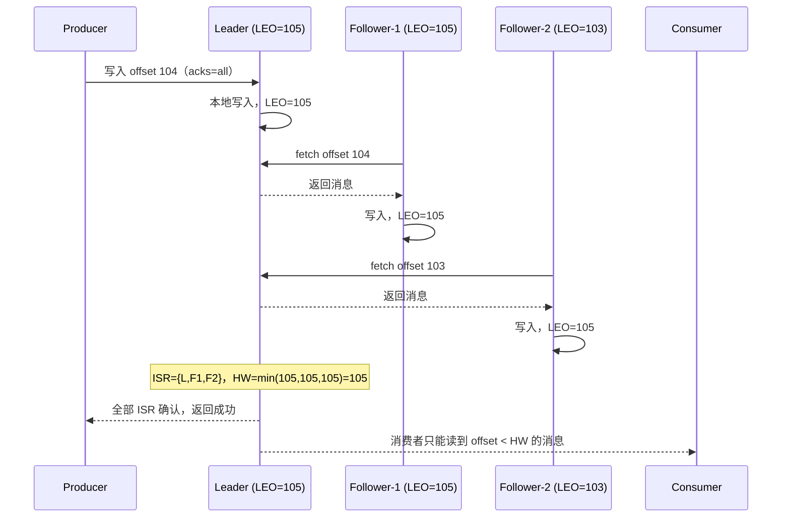
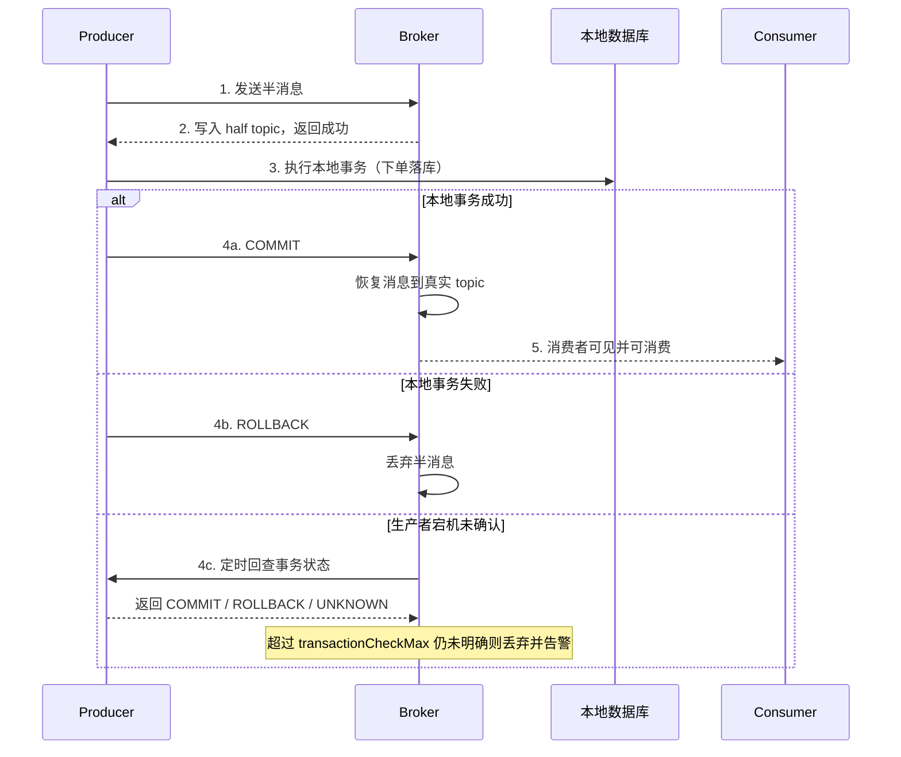

# 第 10 章 消息队列：解耦、削峰与可靠性的代价

> 一句话定位：MQ 是分布式系统里"用一致性换可用性"最典型的一笔交易。会发消息、会消费不难；能说清消息在哪一步会丢、重复了怎么办、积压了怎么救，才是分水岭。

## 一、本章考察重点概览

消息队列的面试题很少单独考"API 怎么用"，绝大多数是**故障场景题**：消费者重启后消息丢了、订单重复扣款、大促积压几百万条、Rebalance 期间整批超时。面试官想知道的是你有没有在生产上被这些问题咬过，或者至少把链路上的每个环节想清楚过。

具体有三条主线：

1. **可靠性是一条链，不是单点。** 生产端发出去、Broker 落盘、副本同步、消费端提交位点，四个环节每一个都可能丢消息。只说"开 acks=all 就可靠"会被追问"那消费端呢""ISR 只剩一个呢"。
2. **MQ 的所有"能力"都有代价。** 解耦的代价是链路变长、问题定位变难；削峰的代价是延迟变大、积压要运维；顺序的代价是并行度受限；事务消息的代价是两阶段与回查。答不出代价，说明只看了收益。
3. **选型要落到约束上。** 吞吐、延迟、顺序、事务、运维成本，五个维度很少能同时满足；能说清"我们为什么选 RocketMQ 而不是 Kafka"，比背诵两者的参数更有说服力。

| 考点 | 出现频率 | 难度 | 说明 |
| --- | --- | --- | --- |
| 为什么用 MQ 与引入的问题 | 高 | 初级 | 开场题，区分度在"什么时候不该用" |
| 选型对比 | 高 | 中级 | 常结合具体业务场景追问 |
| 消息不丢失 | 高 | 高级 | 必问，要求分生产/存储/消费三段作答 |
| 重复消费与幂等 | 高 | 高级 | 与业务结合最紧，几乎必问 |
| 顺序消息 | 中 | 高级 | 分区有序与全局有序的取舍 |
| 消息积压处理 | 中 | 高级 | 有线上经验才答得实 |
| Kafka 高性能原理 | 高 | 中级 | 顺序写、页缓存、零拷贝、批量 |
| Kafka 副本与 acks | 高 | 高级 | ISR/HW/LEO 是分水岭 |
| Rebalance | 中 | 高级 | 3.x 的增量协作协议是加分项 |
| RocketMQ 架构与事务消息 | 中 | 高级 | 国内公司常问 |
| 最终一致性方案对比 | 中 | 高级 | 考察方案设计能力 |

## 二、复习优先级

| 优先级 | 题目编号 | 理由 |
| --- | --- | --- |
| P0 | Q1、Q3、Q4、Q7、Q8 | 可靠性主线，每场必问，要求能画链路图 |
| P1 | Q2、Q5、Q6、Q9、Q11、Q12 | 选型、顺序、积压、事务是高级岗门槛 |
| P2 | Q10、Q13、Q14 | 记住架构与关键参数即可，追问不深 |

时间分配建议：本章 2 天。P0 占 60%，必须做到"给我一个业务，我能说出消息在哪些点会丢、怎么补"；P1 占 30%，重点是顺序与事务的取舍；P2 占 10%，考前扫一遍速记卡。

## 三、高频面试题清单

| 编号 | 题目 | 面试难度 | 阅读门槛 | 优先级 | 一句话答案 |
| --- | --- | --- | --- | --- | --- |
| Q1 | 为什么要用 MQ？引入 MQ 又带来什么问题？ | 初级 | 低 | P0 | 解耦、异步、削峰；代价是复杂性、一致性、重复与运维成本 |
| Q2 | Kafka、RocketMQ、RabbitMQ、Pulsar 怎么选？ | 中级 | 中 | P1 | 看吞吐、延迟、顺序、事务与团队运维能力，没有全能选手 |
| Q3 | 如何保证消息不丢失？ | 高级 | 高 | P0 | 生产确认 + 副本刷盘 + 消费成功后提交位点，三段都要做 |
| Q4 | 消息重复消费怎么解决？ | 高级 | 高 | P0 | 重复不可避免，靠业务幂等：唯一键、状态机、去重表 |
| Q5 | 顺序消息怎么实现？ | 高级 | 高 | P1 | 同 key 进同分区/队列，消费端单线程或按 key 串行 |
| Q6 | 消息积压了怎么办？ | 高级 | 高 | P1 | 先定位消费慢的原因，再扩分区、提并行度、临时转移 |
| Q7 | Kafka 为什么吞吐高？ | 中级 | 中 | P0 | 顺序写、页缓存、零拷贝、批量压缩、分区并行 |
| Q8 | Kafka 的 ISR、HW、LEO 是什么？acks 怎么配？ | 高级 | 高 | P0 | 副本同步进度与可见性边界；acks=all + min.insync 才可靠 |
| Q9 | Rebalance 什么时候触发？有什么危害？ | 高级 | 高 | P1 | 成员/订阅/分区变化触发，期间停止消费，靠静态成员与调参缓解 |
| Q10 | RocketMQ 的架构是怎样的？ | 中级 | 中 | P2 | NameServer 轻量注册中心 + Broker 存储 + 生产/消费组 |
| Q11 | RocketMQ 事务消息怎么实现？ | 高级 | 高 | P1 | 半消息 + 本地事务 + 提交/回滚 + 定时回查 |
| Q12 | 事务消息、本地消息表、最大努力通知怎么选？ | 高级 | 高 | P1 | 按一致性强度与侵入性取舍，最终都要幂等与对账 |
| Q13 | 消息过滤、广播、重试与死信怎么用？ | 中级 | 中 | P2 | Tag/SQL 过滤、广播不共享位点、重试分级、死信人工兜底 |
| Q14 | MQ 要监控哪些指标？ | 中级 | 中 | P2 | 堆积量、消费 TPS、端到端延迟、失败率与重试量 |

## 四、题目详解

### Q1. 为什么要用 MQ？引入 MQ 又带来什么问题？（初级）

> 前置：解耦、削峰、异步

**一句话结论**：MQ 解决三类问题——**解耦**（生产者不必知道谁消费、有几个消费者）、**异步**（把非核心链路从主流程剥离，缩短响应时间）、**削峰**（把瞬时流量缓冲成平稳消费）；代价是系统复杂度上升、链路变长难排查、数据一致性从"事务保证"退化为"最终一致"，以及重复、顺序、积压这些必须自己处理的工程问题。

**先把话说白**：下单要发短信、加积分、写报表、通知仓库。同步做，用户要等所有事情做完才能看到"下单成功"，任何一环挂了整单失败。用 MQ 就是"先把订单落库，喊一嗓子『下单了』，谁关心谁去听"——主流程变快也变稳，但"谁听了、听完没有、听重复了怎么办"，从此变成你的事。

**底层原理**：

1. **解耦的真实收益。** 上游只依赖"消息格式"这一份契约，新增一个下游（比如风控）不用改下单代码，只要订阅；下游故障也不影响主流程，消息堆在 Broker 里等它恢复。这背后的机制是**时空解耦**：生产与消费在时间上不必同时在线，在空间上不必互相寻址。

2. **异步的收益与边界。** 把发短信、加积分这类"必须做但不必须现在做"的动作移到消费端，主流程 RT 从"所有环节之和"降到"落库 + 发消息"。边界是：只有**非强一致**的动作能异步；"扣库存"这种必须与订单同时成功的，不能简单异步，要么用事务消息，要么放同一个本地事务里。

3. **削峰的真实机制。** 秒杀瞬时 10 万 QPS，数据库只能扛 5 千，MQ 把请求堆起来，消费端按 5 千匀速拉取。注意这要求**消息能堆积**（Kafka/RocketMQ 落盘，堆积成本低；RabbitMQ 大量堆积时性能下降明显），并且用户侧的"排队中"体验要能接受。

4. **复杂度上升。** 多了一个必须高可用的中间件，多了一套监控告警，多了一条排查链路（消息到底发出去没有？消费到哪了？）。原本一次 RPC 调用能拿到的结果，现在要靠回调、查询或推送。

5. **一致性退化。** 本地事务能保证"要么都成要么都不成"，跨服务只能靠最终一致：本地事务 + 消息发送必须原子（事务消息或本地消息表），消费端必须幂等，还要有对账兜底。

6. **重复、顺序、积压。** 为了不丢，必然要重试；重试就带来重复，所以消费端必须幂等。为了吞吐，必然要分区并行；并行就打破全局顺序，所以要顺序只能按 key 分区。为了削峰，必然有堆积；堆积就要监控与扩容预案。这三件事是 MQ 的"固有成本"，不是配置错了。

7. **什么时候不该用。** 调用方需要同步结果（查余额）、逻辑简单且只有一两个消费者（直接 RPC 更清晰）、团队没有能力维护 MQ 与排查链路问题、数据量很小（引入 MQ 的运维成本远大于收益）、强一致要求无法通过补偿实现（如账务核心的实时记账）。这些场景用 MQ 是"为了架构而架构"。

| 收益 | 代价 | 缓解手段 |
| --- | --- | --- |
| 解耦，新增下游不改上游 | 链路变长，问题定位难 | 消息轨迹、全链路 traceId |
| 异步，主流程 RT 降低 | 结果不可同步获得 | 回调、查询接口、推送 |
| 削峰，保护下游 | 延迟变大，需要堆积能力 | 监控堆积、扩容预案 |
| 广播，一份消息多方消费 | 重复消费与幂等成本 | 去重表、状态机 |

**面试追问**：
- 追问：所有异步场景都适合 MQ 吗？→ 答题要点：只有非核心、可最终一致、能接受延迟的链路适合；需要同步结果或强一致的不能。
- 追问：MQ 挂了系统还能用吗？→ 答题要点：取决于设计，可本地落表 + 补偿发送，或降级为同步但限流，不能假设 MQ 永远在。
- 追问：消息重复能不能从根源上避免？→ 答题要点：不能，网络不可靠 + 至少一次投递，只能在消费端做幂等。
- 追问：引入 MQ 后怎么排查"消息没消费"？→ 答题要点：先看生产是否成功（发送结果/本地表），再看 Broker 堆积与位点，最后看消费端日志与异常。

### Q2. Kafka、RocketMQ、RabbitMQ、Pulsar 怎么选？（中级）

> 前置：吞吐、顺序、事务消息

**一句话结论**：Kafka 胜在吞吐与生态（日志、流处理、大数据管道），RocketMQ 胜在金融级可靠性与业务特性（事务消息、延迟消息、顺序消息，国内生态好），RabbitMQ 胜在低延迟与灵活路由（小规模、复杂路由、企业集成），Pulsar 胜在存算分离与多租户（大规模、多业务共用集群）；选型要按"吞吐量级 + 是否需要事务/延迟 + 团队运维能力"三问落地。

**先把话说白**：这四个不是同一类东西的不同牌子。Kafka 像高速公路（跑量大、结构简单），RocketMQ 像带专用车道的物流园（量大且能办报关、冷链这些特殊业务），RabbitMQ 像城市快递网络（灵活、投递快、单件成本高），Pulsar 像云上的仓储中心（存储和计算分开，谁都能租一块）。

**底层原理**：

1. **存储模型的差异决定性能上限。** Kafka 每个分区一个追加日志文件，顺序写 + 页缓存 + 零拷贝，吞吐最高，但分区数过多时文件句柄与刷盘压力上升。RocketMQ 用所有 topic 共享的 CommitLog + 每队列的 ConsumeQueue 索引，写入更集中，单机堆积能力强，长轮询拉取兼顾了低延迟。RabbitMQ 以队列为单位存储（经典队列或 3.8+ 的 Quorum Queue），消息确认与路由灵活，但大量堆积时内存与磁盘压力大。Pulsar 用 BookKeeper 做分层存储，Broker 无状态，存算分离，扩容与多租户更自然。

2. **延迟与吞吐的取舍。** Kafka 为吞吐优化，端到端延迟通常在毫秒到几十毫秒；RabbitMQ 为低延迟与灵活路由优化，小消息延迟可到亚毫秒级；RocketMQ 介于两者之间，长轮询让"没消息时不空转"；Pulsar 取决于是否开启分层存储与读缓存。

3. **业务特性。** RocketMQ 原生支持事务消息、18 级延迟消息、顺序消息、消息轨迹、死信队列，这些在 Kafka 里大多要自己实现（Kafka 0.11+ 有事务但与 RocketMQ 的"半消息 + 回查"语义不同，且不解决本地事务）；RabbitMQ 有 TTL + 死信队列模拟延迟、有 publisher confirm，但没有原生事务消息。

4. **生态与运维。** Kafka 生态最广（Flink、Spark、Debezium、各类 Connector），3.x 起 KRaft 去掉 ZooKeeper，运维简化；RocketMQ 国内文档与社区支持好，4.x 依赖 NameServer（无状态，部署简单），5.x 引入 Proxy 与 gRPC 支持多语言；RabbitMQ 基于 Erlang，运维门槛稍高，但管理界面与插件成熟；Pulsar 运维最重（BookKeeper + ZooKeeper/etcd），小团队慎选。

5. **版本注意点。** Kafka 2.8 引入 KRaft 预览，3.3 起生产可用，4.0 彻底移除 ZooKeeper；RocketMQ 4.9 是 4.x 的稳定末版，5.x 引入 Proxy 与定时消息（任意时间精度）；RabbitMQ 3.8 引入 Quorum Queue，3.9 起 Stream 队列可用；Pulsar 2.10 后分层存储逐渐成熟。

| 维度 | Kafka | RocketMQ | RabbitMQ | Pulsar |
| --- | --- | --- | --- | --- |
| 单机吞吐 | 最高（十万级以上） | 高（十万级） | 中（万级） | 高 |
| 端到端延迟 | 毫秒级 | 毫秒级 | 亚毫秒~毫秒 | 毫秒级 |
| 顺序消息 | 分区有序 | 队列有序，支持严格顺序 | 单队列有序 | 分区有序 |
| 事务消息 | 有（0.11+，语义不同） | 原生半消息 + 回查 | 无（仅 confirm） | 有 |
| 延迟消息 | 不支持（需自建） | 18 级 / 5.x 任意时间 | TTL + 死信模拟 | 支持 |
| 堆积能力 | 强（落盘顺序写） | 强 | 弱（堆积性能下降） | 强（分层存储） |
| 运维复杂度 | 中（KRaft 后降低） | 低 | 中 | 高 |
| 典型场景 | 日志、埋点、流计算 | 电商交易、订单、金融 | 企业集成、复杂路由 | 多租户云原生 |

**选型建议**：日增消息亿级以内、需要事务/延迟/顺序、团队以 Java 为主 → RocketMQ；日志采集、流式处理、与大数据生态打通 → Kafka；消息量不大但路由复杂、需要低延迟与丰富插件 → RabbitMQ；多业务共用、需要存算分离与多租户 → Pulsar。

**面试追问**：
- 追问：为什么 Kafka 不适合做业务消息？→ 答题要点：缺少原生延迟/事务回查/消息轨迹，分区数过多时延迟抖动，运维模型偏日志管道。
- 追问：RocketMQ 的 CommitLog 设计好处是什么？→ 答题要点：所有 topic 顺序写同一文件，把随机写变顺序写，ConsumeQueue 只是轻量索引。
- 追问：RabbitMQ 堆积为什么会变慢？→ 答题要点：消息在队列中索引与换页开销大，堆积时内存压力高，吞吐明显下降。
- 追问：KRaft 解决了什么？→ 答题要点：去掉 ZooKeeper 依赖，元数据由 Controller quorum 管理，部署与故障恢复更简单。

### Q3. 如何保证消息不丢失？（高级）

> 前置：生产、存储、消费三阶段

**一句话结论**：把链路拆成三段分别保证——**生产端**要拿到 Broker 的确认（同步发送 + 失败重试 + `acks=all`），**Broker 端**要落盘且有多副本（刷盘策略 + 副本数 ≥3 + `min.insync.replicas ≥2`），**消费端**要在业务处理成功后再提交位点（关闭自动提交，手动 ack）；三段都做到才叫"不丢"，只做一段只是把丢失概率挪了个位置。

**先把话说白**：寄快递丢件可能丢在三个地方：你交给快递员时他没登记（生产端）、中转站没入库（Broker）、收件人签收了但没告诉你（消费端）。要保证不丢，每一段都要有"回执"。

**底层原理**：

1. **生产端。** 用同步发送并检查返回结果，失败按退避策略重试（注意重试会带来重复，消费端必须幂等）；Kafka 设 `acks=all`（`-1`），让 leader 等 ISR 中所有副本写入；RocketMQ 用同步发送 `send()` 而非 `sendOneWay()`，并关注 `SendStatus`；RabbitMQ 开 publisher confirm 与 returns 回调。异步发送必须挂回调记录失败，否则失败无人知晓。

2. **Broker 端。** 一是刷盘：Kafka 依赖页缓存 + 副本冗余，通常不强制每条 `fsync`（`log.flush.interval.messages` 默认极大），可靠性交给副本；RocketMQ 有同步刷盘（`SYNC_FLUSH`，每条等落盘）与异步刷盘（`ASYNC_FLUSH`，性能好但宕机丢少量）。二是副本：`replication.factor=3`、`min.insync.replicas=2`，保证至少两个副本有数据才确认。三是 `unclean.leader.election.enable=false`，禁止非 ISR 副本当选 leader，避免"选了数据最旧的上台"。

3. **消费端。** 关闭自动提交（Kafka `enable.auto.commit=false`），业务处理成功后再 `commitSync`；RocketMQ 返回 `CONSUME_SUCCESS` 才更新位点，异常返回 `RECONSUME_LATER`；RabbitMQ 手动 `basicAck`。注意"先提交后处理"会在处理失败时丢消息，"先处理后提交"会在提交前崩溃时重复消费——后者才是正确取舍。

4. **链路上的隐性丢失点。** 生产端缓冲区满被丢弃（Kafka `buffer.memory` 与 `max.block.ms`）、异步回调异常没记录、Rebalance 前未提交的位点被回退（重复而非丢失）、消费线程池里异常被吞掉却返回了成功、DLQ 配置错误把消息直接丢弃、Broker 磁盘满导致写入失败但生产端未检查。

5. **兜底。** 无论怎么配，都要有对账：定时比对"应处理"与"已处理"的数量或业务状态，发现缺口用本地消息表或补偿任务重发。可靠性是"配置 + 监控 + 对账"三件套，不是某个参数。

```yaml
# Kafka 生产者：可靠优先的配置（2.x/3.x 通用）
spring:
  kafka:
    producer:
      acks: all                    # leader 等 ISR 全部写入才确认
      retries: 3                   # 配合幂等性，重试不会产生重复
      enable-idempotence: true     # 幂等生产者，去重靠 broker 的 PID + sequence
      properties:
        max.in.flight.requests.per.connection: 1   # 幂等开启后可放宽到 5，这里保守
        delivery.timeout.ms: 120000
    consumer:
      enable-auto-commit: false    # 关键：手动提交，处理成功后再提交
      auto-offset-reset: earliest  # 新消费组从头消费，避免漏读历史
```

| 环节 | 关键配置 | 仍可能丢的场景 |
| --- | --- | --- |
| 生产端 | 同步发送、`acks=all`、重试、幂等生产者 | 缓冲区满、回调未处理、超时后放弃 |
| Broker | 副本数 3、`min.insync.replicas=2`、同步刷盘 | 全副本宕机、磁盘损坏、非 ISR 选主 |
| 消费端 | 手动提交、处理成功再 ack | 处理成功但提交前崩溃（重复而非丢失） |

**面试追问**：
- 追问：`acks=all` 就一定不丢吗？→ 答题要点：还要 `min.insync.replicas≥2` 且 ISR 健康，否则 ISR 只剩 leader 时 all 退化为 1。
- 追问：Kafka 为什么默认不每条 fsync？→ 答题要点：靠副本冗余保证可靠性，每条 fsync 会把吞吐打下来，页缓存 + 多副本是更划算的取舍。
- 追问：先提交位点还是先处理？→ 答题要点：先处理成功再提交，宁可重复不可丢，重复由幂等兜底。
- 追问：怎么发现"悄悄丢消息"？→ 答题要点：生产/消费计数比对、业务对账、消息轨迹与堆积监控，不能只看有没有报错。

### Q4. 消息重复消费怎么解决？（高级）

> 前置：幂等、去重表

**一句话结论**：重复是"至少一次投递"的必然结果——网络超时重试、消费端提交位点前崩溃、Rebalance 都会导致重投；解法不在 MQ，而在**消费端幂等**：用业务唯一键做去重（唯一索引/去重表）、用状态机做条件更新、用版本号做乐观锁，或借助 Redis `SETNX` 做短期去重。

**先把话说白**：MQ 只能保证"这条消息至少被你收到一次"，不能保证"只收一次"。所以消费逻辑必须写成"执行一次和执行十次，结果一样"，这就是幂等。

**底层原理**：

1. **重复从哪来。** 生产端重试（发出去了但确认丢了）、Broker 重复投递（副本切换、位点回退）、消费端处理成功但提交位点失败、Rebalance 导致分区被重新分配后从上次提交位点重读、消费超时被判定失败而重投。这些都不是 bug，是"至少一次"语义的代价。

2. **数据库唯一索引。** 最可靠的一层：消费前插入一条去重记录（业务唯一键，如订单号 + 事件类型），唯一键冲突说明已处理，直接返回成功。要点是"业务写入与去重记录在同一个本地事务里"，否则会出现"去重记录写了但业务没写"的假成功。

3. **状态机 + 条件更新。** `UPDATE order SET status='PAID' WHERE id=? AND status='UNPAID'`，靠影响行数判断是否首次处理。适合有明确状态流转的业务（订单、支付、退款），天然幂等且不需要额外表。

4. **去重表 / Redis 去重。** 用 Redis `SET key NX EX 86400` 做短期去重，适合"重复窗口有限"的场景（如 24 小时内同一消息不重复处理）；缺点是 Redis 不可用或过期后仍可能重复，只能作为第一道闸，不能替代数据库唯一约束。

5. **版本号 / CAS。** 消息带数据版本，消费时 `UPDATE ... WHERE version = #{oldVersion}`，旧版本消息自然被丢弃。适合有明确先后顺序的更新流，同时能解决乱序覆盖问题。

6. **幂等的边界。** 有副作用的操作（发短信、调第三方支付）不能靠数据库唯一键，需要"业务去重 + 第三方幂等键"（如支付网关的 `out_trade_no`）；累加类操作（加积分）要用"幂等记录 + 增量"或改成"设置绝对值"；消息体里必须带全局唯一 ID（`messageId` 或业务单号），否则消费端无从判断。

```java
// 消费端幂等：唯一索引 + 本地事务，重复消息直接返回成功
@Transactional
public void onOrderPaid(OrderPaidEvent event) {
    try {
        // 1. 去重表插入，唯一键 (bizId, eventType)，冲突则抛 DuplicateKeyException
        dedupMapper.insert(new DedupRecord(event.getOrderId(), "ORDER_PAID"));
    } catch (DuplicateKeyException e) {
        log.warn("重复消息，忽略: {}", event.getOrderId());
        return; // 已处理过，直接 ack，避免无限重投
    }
    // 2. 与去重记录同一事务，保证"记录写了业务一定写了"
    orderMapper.updateStatus(event.getOrderId(), OrderStatus.PAID);
    pointService.addPoint(event.getUserId(), event.getOrderId()); // 内部再用 orderId 做幂等
}
```

| 方案 | 适用场景 | 优点 | 局限 |
| --- | --- | --- | --- |
| 唯一索引 / 去重表 | 有业务唯一键的写操作 | 强可靠，数据库兜底 | 多一次写，表会膨胀需清理 |
| 状态机条件更新 | 订单、支付等状态流转 | 无额外表，天然幂等 | 只适用有状态机的业务 |
| Redis `SETNX` | 短期重复窗口 | 快、实现简单 | 过期或宕机后失效 |
| 版本号 CAS | 有顺序的更新流 | 同时解决乱序 | 需要消息携带版本 |

**面试追问**：
- 追问：为什么不能靠 MQ 保证"只消费一次"？→ 答题要点：确认与处理无法原子完成，网络超时下必须重投，只能做到至少一次。
- 追问：去重表越来越大怎么办？→ 答题要点：按时间分区、定期归档，只保留业务重复窗口内的记录。
- 追问：先写去重记录还是先写业务？→ 答题要点：同一本地事务，顺序不影响，关键是原子；跨库时用事务消息或本地消息表。
- 追问：调用第三方接口怎么幂等？→ 答题要点：用业务生成的幂等键（如 `out_trade_no`），让对方按幂等键去重，本地记录调用状态。

### Q5. 顺序消息怎么实现？（高级）

> 前置：分区、队列、单线程消费

**一句话结论**：只有**分区（队列）内有序**是工程上可实现的，全局有序等于把并行度降到 1；做法是生产端按业务 key（订单号、用户 ID）哈希到固定分区，消费端对同一分区用单线程消费或按 key 分发到内存队列串行处理，代价是热点 key 会导致分区倾斜。

**先把话说白**：MQ 保证的是"一个队列里的消息按写入顺序排好"，跨队列没有先后。所以想要"同一个订单的消息不乱"，就把这个订单的所有消息塞进同一个队列；不同订单之间乱序没关系，因为它们互不影响。

**底层原理**：

1. **Kafka 的分区有序。** 同一 partition 内消息按 offset 严格有序，生产端指定 key 后用 `hash(key) % partitions` 选分区（默认分区器），相同 key 必进同一分区。消费端一个分区只能被同组内一个消费者消费，天然单线程处理该分区，顺序得以保持。若要提高并行度，只能增加分区数，但分区数受限于消费者数与文件句柄。

2. **RocketMQ 的顺序消息。** 生产端用 `MessageQueueSelector` 按业务 key 选队列，发送 `MessageQueue` 顺序消息；Broker 端把消息写入指定队列；消费端用 `MessageListenerOrderly`，Broker 会对队列加锁（`broker` 侧的队列锁 + 客户端本地锁），保证同一队列同一时刻只有一个消费者线程在处理，失败时 `SUSPEND_CURRENT_QUEUE_A_MOMENT` 让当前队列暂停一会儿再重试，避免阻塞其他队列。

3. **消费端并行的陷阱。** 即使 MQ 保证了分区内顺序，消费端如果用线程池并发处理同一分区的消息，顺序依然会乱。正确做法是：一个分区一个消费线程；或按 key 哈希到多个内存队列，每个队列一个线程（相当于二次分区）；处理完成后按顺序提交位点。

4. **全局有序的代价。** 只能单分区、单消费者、单线程，吞吐被锁死在单核，堆积风险极高。只有极少数场景（如binlog 回放、账户流水）需要，通常也不是靠 MQ 全局有序，而是在消费端按主键串行。

5. **顺序与重试的冲突。** 顺序消费中某条消息失败，不能跳过（会破坏顺序），只能原地重试或暂停该队列；这会导致该队列阻塞，进而堆积。所以顺序消息要求消费逻辑尽量不失败，失败要能快速判定为"死信"并人工介入，否则一条坏消息能堵死整个队列。

6. **顺序与并发的取舍。** 实践中常用"局部有序"：按订单号分区，订单之间并行，订单内部串行。这既满足业务（同一订单的状态变更有序），又保留了水平扩展能力，是绝大多数交易系统的选择。

| 方案 | 有序范围 | 并行度 | 适用 |
| --- | --- | --- | --- |
| 单分区单线程 | 全局 | 1 | 极少数强顺序场景 |
| 按 key 分区 | 分区内 | = 分区数 | 订单、支付等按业务主体有序 |
| 消费端按 key 二次分发 | 分区内 + key 内 | 线程数 | 分区数不足时提升并行 |
| 无顺序 + 版本号 | 无 | 最高 | 可容忍乱序、靠版本收敛 |

**面试追问**：
- 追问：增加分区会影响已有消息的顺序吗？→ 答题要点：不会改变已写入消息的顺序，但 key 到分区的映射可能变化，扩容期间同一 key 可能落到新分区，需要停机或双写过渡。
- 追问：顺序消费失败了怎么办？→ 答题要点：原地重试并设上限，超过上限转死信并告警，不能跳过也不能无限阻塞。
- 追问：Kafka 能保证全局有序吗？→ 答题要点：只能单分区单消费者，吞吐极低，通常不这么做。
- 追问：RocketMQ 顺序消费的锁在哪？→ 答题要点：Broker 侧队列锁保证同一队列只投给一个消费者，客户端再加本地锁保证单线程处理。

### Q6. 消息积压了怎么办？（高级）

> 前置：扩容、降级、丢弃策略

**一句话结论**：先别急着扩容，先分清是**生产突增**（流量真的涨了）还是**消费变慢**（下游超时、数据库慢、消息体变大、异常重试打转）；前者靠扩分区 + 提消费并行度 + 限流生产，后者要修消费逻辑；如果积压已经影响业务，用"临时搬运 + 临时扩容消费者 + 事后恢复"的应急方案，并明确哪些消息可以丢弃。

**先把话说白**：积压就是水池进水比出水快。要么关小进水（限流生产），要么加大出水（扩消费者），要么临时把水引到另一个池子（转移消息）。但先得搞清楚为什么出水慢了——如果下游数据库已经打满，加消费者只会让它更快崩。

**底层原理**：

1. **先定位原因。** 看消费 TPS 曲线：是骤降（消费端有异常/阻塞）还是持平但生产涨了（流量问题）。常见消费变慢原因：下游 RPC 超时、数据库慢查询或锁等待、消息体变大导致反序列化慢、批量参数不合理、异常消息无限重试、消费线程池队列堆积、GC 停顿。RocketMQ 看 `Consume TPS` 与 `Diff Total`，Kafka 看 consumer group 的 `lag` 与 `consume rate`。

2. **扩容消费并行度。** Kafka 的前提是分区数：消费者数超过分区数后多余的会空闲，所以要先扩分区（注意扩分区会改变 key 映射，且不能缩）。RocketMQ 的并行消费受队列数限制，`consumeThreadMin/Max` 可调，队列数不足要新建 topic 或扩队列。扩消费者时注意下游容量，别把数据库打死。

3. **提升单条处理效率。** 批量拉取 + 批量处理（`max.poll.records`、RocketMQ 批量消费）、把同步调用改异步、慢 SQL 加索引、去掉消费逻辑里不必要的锁、把非核心动作再异步出去。

4. **应急转移。** 积压几百万条、短时间内消费不完时，临时起一个"搬运消费者"，把消息快速转到新的 topic（分区数更多），再用大量消费者并行处理新 topic；或者在业务低峰用脚本把消息搬到临时队列，先恢复主链路。

5. **丢弃策略要提前定。** 有些消息过期即无价值（实时性强的推送、行情），可以按业务规则丢弃或合并（只保留最新状态）；有些绝对不能丢（订单、支付），只能慢慢消化。这个决策要在设计阶段就和业务确认，故障时来不及讨论。

6. **生产端限流。** 如果是突发流量，除了扩容，还要在入口限流（令牌桶/漏桶），并把非核心消息降级（如日志、埋点先丢弃），保住核心链路。事后要复盘：为什么消费能力没有按峰值设计、监控为什么没有提前告警。

| 原因 | 判断依据 | 处理 |
| --- | --- | --- |
| 流量突增 | 生产 TPS 明显高于历史峰值 | 限流生产 + 扩分区 + 扩消费者 |
| 消费逻辑变慢 | 消费 TPS 骤降，下游 RT 升高 | 修下游、加索引、批量化 |
| 异常消息重试 | 单条消息反复重投、日志有固定异常 | 修复或转死信，避免阻塞队列 |
| 消费者不足 | 分区数 > 消费者数，部分分区无消费 | 扩消费者到分区数 |
| 消息体变大 | 反序列化耗时上升、网络打满 | 精简消息体、压缩、拆分 |

**面试追问**：
- 追问：Kafka 扩消费者一定能提吞吐吗？→ 答题要点：不能超过分区数，且下游容量是瓶颈时扩容反而更糟。
- 追问：扩分区有什么副作用？→ 答题要点：key 到分区的映射变化，顺序消息可能短暂乱序；分区只能增不能减。
- 追问：积压时能直接丢弃消息吗？→ 答题要点：按业务定，实时性消息可以，交易类不行；要提前约定丢弃规则并记录。
- 追问：怎么提前发现积压？→ 答题要点：监控 lag/堆积量、消费 TPS 与生产 TPS 的差值，设阈值告警，别等用户投诉。

### Q7. Kafka 为什么吞吐高？（中级）

> 前置：顺序写、零拷贝、批处理

**一句话结论**：Kafka 把"随机写"变成"顺序追加"、把"自己管缓存"变成"复用页缓存"、把"多次拷贝"变成"零拷贝"、把"一条一条发"变成"批量 + 压缩"，再用分区把读写并行到多台机器；这五件事叠加，才有了单机十万级以上的吞吐。

**先把话说白**：磁盘并不可怕，可怕的是随机读写。Kafka 只做一件事：往文件末尾追加。追加是顺序写，操作系统和磁盘都最擅长；再加上"不自己缓存、交给操作系统页缓存"和"数据从页缓存直接送到网卡"，省掉了两次内存拷贝。

**底层原理**：

1. **顺序写。** 每个分区是一个追加日志（segment 文件），写入只在末尾进行。顺序写磁盘的吞吐可以接近内存带宽的量级，远高于随机写；配合 segment 滚动与索引文件（`.index`、`.timeindex`），读取也能快速定位。

2. **页缓存（Page Cache）。** Kafka 不把消息缓存在 JVM 堆里，而是写入后由操作系统页缓存持有，消费者读时大概率直接命中页缓存。好处是没有 JVM 对象开销、没有 GC 压力，进程重启后缓存仍然有效（只要机器没重启）。代价是缓存归 OS 管，无法精细控制，且与其它进程争抢。

3. **零拷贝（Zero-Copy）。** 传统读取要经过"磁盘 → 内核缓冲区 → 用户缓冲区 → socket 缓冲区 → 网卡"四次拷贝；Kafka 用 `sendfile` 让数据从页缓存直接到 socket，减少两次拷贝与两次上下文切换。注意开启 SSL 或消息需要转换（如压缩格式不匹配）时零拷贝会失效。

4. **批量与压缩。** 生产端按 `batch.size`（默认 16KB）与 `linger.ms`（默认 0，建议 5~20ms）攒批，一次网络请求发一批；批内用 snappy/lz4/zstd 压缩，网络与磁盘占用都下降。压缩是"以 CPU 换 IO"，在 CPU 不紧张时非常划算。

5. **分区并行。** 一个 topic 分成多个 partition 分散在不同 Broker，生产与消费都能并行；分区数决定了最大消费并行度。这也是 Kafka 扩展性的来源，但分区过多会增加文件句柄、选举与 Rebalance 成本。

6. **其它细节。** 稀疏索引（不是每条消息都建索引，而是按字节间隔）、mmap 索引文件、消息格式的批头复用（v2 格式把多条消息打包）、避免 JVM 堆内大对象。这些都在减少"每字节的成本"。

**面试追问**：
- 追问：零拷贝为什么能提升性能？→ 答题要点：省掉内核态到用户态的两次拷贝与上下文切换，数据从页缓存直接进网卡。
- 追问：页缓存有什么风险？→ 答题要点：缓存由 OS 管理，内存不足时会被换出，消费者落后太多时读会打到磁盘；也影响故障恢复后的冷读性能。
- 追问：`linger.ms` 调大有什么代价？→ 答题要点：吞吐上升但延迟增加，低延迟场景要权衡，通常 5~20ms。
- 追问：分区越多越好吗？→ 答题要点：不是，分区多会增加文件句柄、元数据、Rebalance 与端到端延迟，按消费并行度需求定。

### Q8. Kafka 的 ISR、HW、LEO 是什么？acks 怎么配？（高级）

> 前置：副本同步、HW / LEO、acks

**一句话结论**：LEO（Log End Offset）是每个副本下一条待写消息的位点；HW（High Watermark，高水位）是 ISR 中所有副本 LEO 的最小值，消费者只能读到 HW 之前的消息；ISR（In-Sync Replicas，同步副本集合）是与 leader 保持同步的副本集合；`acks` 决定 leader 何时向生产者确认，`all` 要配合 `min.insync.replicas` 才有意义。

**先把话说白**：leader 收消息，follower 来抄。每个副本记着"我抄到第几页"（LEO）。leader 要判断"哪些页是所有人都抄完的"，这个位置就是 HW——消费者只能看到 HW 之前的内容/consumer 只能消费已提交消息，否则读到一半 leader 挂了，新 leader 可能没有这条消息。ISR 就是"抄得还算跟得上"的那批 follower。

**底层原理**：

1. **LEO 的更新时机。** 每个副本（包括 leader）都有 LEO，指向下一条要写入的位置。leader 收到消息写入本地日志后 LEO +1；follower 拉取并写入后自己的 LEO +1。注意 follower 的 LEO 更新发生在 `fetch` 请求携带 offset 时，leader 据此知道 follower 的进度。

2. **HW 的推进。** leader 维护每个 follower 的 LEO，取 ISR 中所有副本（含自己）LEO 的最小值作为 HW。HW 之前的消息才算"已提交"（committed），消费者只能消费到 HW。HW 的推进依赖 follower 的 fetch 请求，所以 follower 长时间不拉取会拖住 HW。

3. **ISR 的维护。** follower 在 `replica.lag.time.max.ms`（默认 30 秒，2.x 起取代了按条数的 `replica.lag.max.messages`）内没有追上 leader 的 LEO，就被踢出 ISR。ISR 收缩到只剩 leader 时，`acks=all` 退化为只等 leader，可靠性下降——这正是 `min.insync.replicas` 要防的：ISR 小于该值时，leader 直接拒绝写入（`NOT_ENOUGH_REPLICAS`）。

4. **Leader 选举与 HW 截断。** leader 挂掉后从 ISR 中选新 leader（默认），新 leader 的 HW 以上、LEO 以下的消息会被截断（因为可能未被所有副本确认）。若允许非 ISR 副本当选（`unclean.leader.election.enable=true`），可用性提高但会丢数据，金融场景必须关闭。

5. **acks 的三种取值。** `acks=0`：生产者发出即认为成功，不等任何确认，吞吐最高，可能大量丢失；`acks=1`：leader 写入本地日志即确认，不等 follower，leader 挂掉会丢；`acks=all`（`-1`）：leader 等 ISR 中所有副本写入才确认，最可靠。`acks=all` 并不等于"所有副本"，只等于"当前 ISR 的所有副本"，所以必须配 `min.insync.replicas`。

6. **幂等与事务。** 0.11 起支持幂等生产者（`enable.idempotence=true`），Broker 用 `PID + epoch + sequence` 去重，解决重试导致的重复；事务（`transactional.id`）在此之上提供跨分区的原子写入，但消费者要配 `isolation.level=read_committed` 才能只读已提交消息。



| acks | 确认条件 | 可靠性 | 吞吐 | 适用 |
| --- | --- | --- | --- | --- |
| `0` | 发出即成功 | 最低，可能大量丢失 | 最高 | 日志、埋点等可丢数据 |
| `1` | leader 本地写入 | 中，leader 挂会丢 | 高 | 一般业务、可容忍少量丢失 |
| `all` | ISR 全部写入 | 高（需配 `min.insync.replicas`） | 较低 | 订单、支付等核心链路 |
| `all` + ISR 仅剩 leader | 退化为 `1` | 实际下降 | — | 必须靠 `min.insync.replicas≥2` 拦截 |

**面试追问**：
- 追问：HW 之前的消息一定不丢吗？→ 答题要点：在 ISR 正常时是"已提交"语义，但 leader 选举仍可能截断，取决于是否允许非 ISR 选主。
- 追问：为什么消费者只能读到 HW？→ 答题要点：HW 之后的消息可能未被所有 ISR 确认，读到后若 leader 崩溃会产生不一致。
- 追问：`acks=all` 为什么还要 `min.insync.replicas`？→ 答题要点：ISR 可能收缩到只剩 leader，此时 all 等价于 1，必须有下限拒绝写入。
- 追问：Kafka 3.x 的 KRaft 改变了这些语义吗？→ 答题要点：元数据管理从 ZooKeeper 换成 Controller quorum，ISR/HW/LEO 的副本语义不变。

### Q9. Rebalance 什么时候触发？有什么危害？（高级）

> 前置：消费组、协调器、分区分配

**一句话结论**：Rebalance 是消费组重新分配分区的过程，触发条件有三类——组成员变化（上线、下线、心跳超时）、订阅的 topic 或分区数变化、订阅关系变化；期间整个消费组**停止消费**（Stop-The-World），分区还会短暂重复消费，所以要通过静态成员、合理超时、缩短单批处理时间来减少触发。

**先把话说白**：一个消费组像一群人分桌子吃饭，有人来、有人走、菜变多了，就要重新分桌。分桌的时候所有人都得放下筷子等着——这就是 Rebalance 期间消费停摆。

**底层原理**：

1. **触发条件。** 消费者加入或主动离开（`close()`）；消费者崩溃或 GC 停顿导致心跳超时（`session.timeout.ms` 默认 10 秒，2.x；3.x 默认 45 秒，`heartbeat.interval.ms` 3 秒）；订阅的 topic 分区数增加；订阅的 topic 列表变化（正则订阅匹配到新 topic）；coordinator 认为成员不健康。

2. **协议演进。** 2.4 之前是 "eager" 协议（Range/RoundRobin/Sticky），所有成员先放弃全部分区再重新加入，停摆时间等于全员重新加入的耗时。2.4 引入增量协作协议（CooperativeSticky），只回收需要迁移的分区，其他成员继续消费，停摆大幅缩短。3.x 默认仍是 eager，需要显式配置 `partition.assignment.strategy=CooperativeStickyAssignor`。

3. **协调过程。** 消费者向 group coordinator（某分区 leader）发 `JoinGroup`，coordinator 选出 leader consumer，leader 拿到所有成员元数据后做分配，通过 `SyncGroup` 下发方案；期间所有成员阻塞等待。之后靠心跳保活，靠 `OffsetCommit` 提交位点。

4. **危害。** 一是消费暂停，积压上涨；二是位点提交时机不当导致重复消费（未提交的分区被新成员从上次位点重读）；三是频繁 Rebalance 会让消费 TPS 剧烈抖动，甚至陷入"一直 Rebalance"的死循环（如处理时间超过 `max.poll.interval.ms`）；四是分区迁移带来额外的网络与状态开销。

5. **规避手段。** 用静态成员（`group.instance.id`，2.3+）让重启的消费者在 `session.timeout` 内保留分区，避免滚动发布引发全员 Rebalance；调大 `max.poll.interval.ms`（默认 5 分钟）以容纳长耗时处理，但更好的做法是缩小 `max.poll.records` 并异步处理；避免在 `poll` 循环里做阻塞调用；控制分区数不要过大；用增量协作协议减少停摆。

6. **监控。** 关注 `kafka.consumer:type=consumer-coordinator-metrics` 的 `rebalance-rate-per-hour`、`rebalance-latency-avg`，以及消费 lag 的突增。Rebalance 频繁时先看日志里的 `Attempt to heartbeat failed`、`Member ... has left`、`Rebalance started`。

**面试追问**：
- 追问：Rebalance 一定会重复消费吗？→ 答题要点：不一定，取决于位点是否已提交；未提交的分区被重新分配后会从上次提交位点重读。
- 追问：静态成员解决了什么？→ 答题要点：滚动重启时保留 `group.instance.id` 对应的分区，避免每次都触发全员重平衡。
- 追问：`max.poll.interval.ms` 设太大会怎样？→ 答题要点：消费者卡死后很久才被判定失联，分区长期无人消费，lag 持续上涨。
- 追问：怎么减少 Rebalance 的停摆？→ 答题要点：用 CooperativeSticky 增量协议、缩短单批处理时间、避免处理逻辑阻塞心跳线程。

### Q10. RocketMQ 的架构是怎样的？（中级）

> 前置：NameServer、Broker、CommitLog

**一句话结论**：RocketMQ 由 NameServer（无状态注册中心，管理 Topic 路由）、Broker（存储与投递，分 Master/Slave）、Producer（生产组）、Consumer（消费组）组成；Broker 用所有 topic 共享的 CommitLog 顺序写，再用 ConsumeQueue 做轻量索引，靠长轮询兼顾低延迟，4.x 依赖 NameServer，5.x 增加 Proxy 层支持 gRPC 与多语言。

**先把话说白**：NameServer 像电话簿，告诉你某个 topic 的消息在哪些 Broker 上；Broker 像仓库，所有货先堆在一条大传送带（CommitLog）上，再在门口贴一张"哪个 topic 的货在第几件"的索引（ConsumeQueue）；生产者送货前先查电话簿，消费者取货也先查电话簿。

**底层原理**：

1. **NameServer。** 多个节点彼此不通信（4.x），Broker 每 30 秒向所有 NameServer 注册心跳（包含 topic 与队列信息），Producer/Consumer 每 30 秒拉取路由并缓存在本地。NameServer 无状态、无选举，挂一台不影响整体，但路由可能短暂不一致。5.x 引入 Controller 模式支持主备自动切换（4.x 的 Master 挂了需要人工或外部组件切主）。

2. **Broker 存储。** 所有 topic 的消息顺序追加到同一个 CommitLog 文件（默认 1GB 一个），写满滚动；同时异步构建 ConsumeQueue（每个 topic 每个队列一个索引文件，存 offset + size + tag hash）与 IndexFile（按 key 或时间查消息）。这种"一份数据 + 多份轻量索引"的设计，让写入只顺序写一次，读取靠索引定位，兼顾吞吐与堆积能力。

3. **队列模型。** 一个 topic 默认 4 个队列（`defaultTopicQueueNums`），分布在多个 Broker 上；生产端按轮询或自定义 selector 选队列；消费端有集群消费（Clustering，同组内分摊）与广播消费（Broadcasting，每个消费者全量）。

4. **长轮询。** 消费者拉取时若没有新消息，Broker 不立即返回，而是把请求挂起（默认 15 秒，`longPollingEnable`），有新消息或超时才响应。这样既避免空轮询浪费，又保持接近推送的低延迟。

5. **刷盘与复制。** 刷盘有同步（`SYNC_FLUSH`，每条等落盘）与异步（`ASYNC_FLUSH`，后台批量刷）；主从复制有同步（`SYNC_MASTER`，等 slave 写成功）与异步（`ASYNC_MASTER`）。核心业务常用"同步刷盘 + 同步复制"，代价是延迟升高、吞吐下降。

6. **5.x 的变化。** 引入 Proxy（可选）提供 gRPC 协议与多语言 SDK，存储层引入 RocketMQ DLedger（Raft）支持自动主备切换；延迟消息从 18 个固定级别升级为任意时间（定时消息）；新增 POP 消费模式，支持无状态消费者与消息粒度的负载均衡，缓解队列数对并发的限制。

**面试追问**：
- 追问：为什么 CommitLog 要所有 topic 共用？→ 答题要点：保证全局顺序写，避免多文件随机写，显著提升写入吞吐。
- 追问：ConsumeQueue 存的是什么？→ 答题要点：消息在 CommitLog 中的物理偏移、消息大小、tag 哈希，用于快速定位与过滤。
- 追问：NameServer 为什么不做成集群选举？→ 答题要点：它只存路由元数据，各节点数据可由 Broker 心跳重建，无状态设计更简单、可用性更高。
- 追问：4.x 的 Master 挂了怎么办？→ 答题要点：默认不能自动切主，需外部组件（如 DLedger 或运维脚本）切换，5.x 原生支持。

### Q11. RocketMQ 事务消息怎么实现？（高级）

> 前置：半消息、事务回查

**一句话结论**：RocketMQ 事务消息分三步——生产者先发**半消息**（对消费者不可见），Broker 返回成功后执行本地事务，再根据结果向 Broker 发送**提交或回滚**；如果生产者中途宕机，Broker 会定时**回查**生产者的本地事务状态，据此决定提交或丢弃。它解决的是"本地事务与发消息的原子性"，消费端仍需幂等。

**先把话说白**：你不能既保证"数据库写成功"又保证"消息一定发出去"，因为这是两个系统。RocketMQ 的办法是先把消息"预存"在 Broker 上但藏起来，等你本地事务做完再决定"放出来"还是"扔掉"；你要是做到一半挂了，Broker 过一会儿来问你"那笔事务到底成没成"。

**底层原理**：

1. **半消息（Half Message）。** 生产者发送事务消息，Broker 把消息写入 `RMQ_SYS_TRANS_HALF_TOPIC`，此时消息对消费者不可见，但已持久化。Broker 返回 `SEND_OK` 后，生产者才执行本地事务。

2. **本地事务与二次确认。** 本地事务成功 → 向 Broker 发送 `COMMIT`，Broker 把消息从半消息 topic 恢复到真实 topic，消费者可见；本地事务失败 → 发送 `ROLLBACK`，Broker 删除半消息（实际是标记，定期清理）。

3. **回查机制。** 若生产者在执行本地事务后、发送确认前宕机，Broker 会在 `transactionTimeOut`（默认 6 秒）后发起回查，默认最多 15 次（`transactionCheckMax`），每次间隔递增。生产者需实现 `TransactionListener.checkLocalTransaction`，通过本地事务表或业务状态判断该笔事务是提交还是回滚。超过最大回查次数仍未明确，消息被丢弃并记录日志/告警。

4. **为什么需要回查。** 这是"两阶段提交"在没有全局事务管理器时的落地方式：Broker 充当协调者，但协调者无法直接读生产者的数据库，只能"问"。所以生产者必须能根据业务主键反查本地事务状态——这是实现事务消息的硬性要求，也是很多人落地失败的原因（本地没有可查的状态记录）。

5. **与 Kafka 事务的区别。** Kafka 的事务是"多分区写入的原子性 + 消费者 read_committed 隔离"，解决的是"一批消息要么都可见要么都不可见"，不涉及外部数据库事务；RocketMQ 的事务消息解决的是"本地数据库事务与发消息的原子性"，更贴近业务需求。两者不能互相替代。

6. **消费端仍要幂等。** 事务消息只保证"消息最终会被投递且只提交一次"，但重试、重复投递依然可能发生；而且回查可能导致同一消息被重复提交（幂等处理）。所以消费端仍要用唯一键去重。



**面试追问**：
- 追问：回查时生产者怎么知道事务状态？→ 答题要点：查本地事务表或业务表状态（如订单是否存在），所以本地必须有可反查的记录。
- 追问：回查次数用完还没结果怎么办？→ 答题要点：消息被丢弃，需告警 + 人工/定时对账补偿，不能假设一定成功。
- 追问：事务消息能保证消费端只消费一次吗？→ 答题要点：不能，只保证提交一次；重复投递仍可能，消费端必须幂等。
- 追问：为什么半消息对消费者不可见？→ 答题要点：写入内部 half topic，只有 COMMIT 后才恢复到真实 topic，避免未确定的消息被消费。

### Q12. 事务消息、本地消息表、最大努力通知怎么选？（高级）

> 前置：本地消息表、最大努力通知

**一句话结论**：三者都是最终一致方案，差别在**一致性强弱与侵入性**：事务消息由 MQ 保证"本地事务 + 发消息"原子，适合已有 RocketMQ 且能实现回查的场景；本地消息表把消息和业务写进同一个本地事务，再由定时任务投递，最通用、不依赖 MQ 特性，但要自己处理投递与重试；最大努力通知只做有限次重试 + 对账，一致性最弱，适合通知类、可容忍丢失最终靠对账补齐的场景。

**先把话说白**：要解决的问题是"我改了数据库，怎么保证下游一定知道"。事务消息是"让 MQ 帮我盯着"，本地消息表是"我自己记账、自己催"，最大努力通知是"我尽力喊几嗓子，没听到就靠事后对账"。

**底层原理**：

1. **事务消息。** 依赖 RocketMQ 的半消息 + 回查，业务代码要实现 `TransactionListener`，本地事务与消息发送由 Broker 协调。优点是对业务侵入小、不用自己写投递任务；缺点是与 RocketMQ 强绑定、回查要求本地状态可查、回查失败会丢消息（需告警补偿）。适合订单创建后通知库存/积分的场景。

2. **本地消息表。** 在同一个数据库里建 `outbox` 表，业务写库与插入消息记录在同一个本地事务中完成；再由独立的任务（定时扫表或 CDC 订阅 binlog）读取未发送记录投递到 MQ，成功后标记已发送，失败按退避重试。优点是强依赖只剩数据库，跨 MQ 实现都可用，消息不会因为 MQ 短暂不可用而丢；缺点是要自己实现投递、重试、清理，表会膨胀，且存在"投递成功但标记失败"导致的重复（消费端需幂等）。

3. **最大努力通知。** 发起方执行本地事务后，通过 MQ 或直接 RPC 通知接收方，失败按阶梯策略重试有限次（如 5 次，间隔递增）；接收方提供查询接口，发起方或接收方定时对账，发现不一致再补。优点是实现最简单、对系统侵入最小；缺点是不保证送达，只能"尽力"，一致性依赖对账兜底。适合支付结果通知、物流状态推送这类"漏了也能查"的场景。

4. **共同前提。** 三者都要求消费端幂等（重复不可避免），都需要对账（极端情况下会丢），都不能提供强一致。真正的强一致只能靠分布式事务（2PC/TCC/Saga），而它们的代价是性能与复杂度，业务系统很少为通知类场景付出这个成本。

5. **选型判断。** 已有 RocketMQ、追求低侵入 → 事务消息；多 MQ 混用、需要绝对可控的投递 → 本地消息表；只是通知、可接受最终对账 → 最大努力通知。规模大时常见组合：核心链路用本地消息表（最稳），非核心通知用最大努力通知，事务消息作为轻量替代。

| 维度 | 事务消息 | 本地消息表 | 最大努力通知 |
| --- | --- | --- | --- |
| 一致性强度 | 较高（提交一次） | 较高（不丢，可能重复） | 最弱（可能丢，靠对账） |
| 对 MQ 的依赖 | 强，需支持半消息 | 弱，任何 MQ 均可 | 弱 |
| 业务侵入 | 中，需实现回查 | 高，需建表与投递任务 | 低 |
| 实现复杂度 | 中 | 高 | 低 |
| 典型场景 | 下单通知库存 | 订单 → 积分/优惠券 | 支付结果、物流推送 |

**面试追问**：
- 追问：本地消息表怎么保证不丢？→ 答题要点：业务与消息同库同事务，投递任务扫描未发送记录并重试，直到成功标记。
- 追问：本地消息表会不会重复投递？→ 答题要点：会，"投递成功但标记失败"必然重复，消费端必须幂等。
- 追问：事务消息回查失败怎么办？→ 答题要点：超过最大回查次数会丢弃，需要告警 + 对账补偿。
- 追问：为什么不直接用分布式事务？→ 答题要点：2PC/TCC 性能和复杂度代价高，多数业务只需最终一致，用消息 + 幂等 + 对账更划算。

### Q13. 消息过滤、广播消费、重试与死信怎么用？（中级）

> 前置：消费语义、死信队列

**一句话结论**：过滤让消费者只收关心的消息（RocketMQ 的 Tag/SQL92 过滤在 Broker 侧完成，Kafka 没有原生过滤，只能消费后客户端筛）；广播消费让同组每个消费者都收到全量消息（位点不共享）；重试是失败后的分级重投，超过次数进入死信队列（DLQ），由人工或补偿任务处理，避免坏消息堵死正常队列。

**先把话说白**：过滤是"订阅时就说清楚我只关心哪一类"，避免把不需要的消息也拉过来；广播是"每个人都听全部"，集群消费则是"一件事只派给一个人"；重试是"没做成再试几次"，死信是"试够了还不行，先放一边别挡路"。

**底层原理**：

1. **RocketMQ 过滤。** Tag 过滤在 Broker 侧用 ConsumeQueue 中存的 tag hash 做粗筛，客户端再用字符串精确匹配，开销小；SQL92 过滤（`SQL92` 模式）支持按消息属性做表达式匹配，Broker 需要解析属性，开销略大。Kafka 没有 Broker 侧过滤，只能在消费端拉取后自行判断，浪费网络与消费能力。

2. **广播消费。** RocketMQ 的 `BROADCASTING` 模式下，每个消费者都消费全量消息，位点存在本地（`%USER_HOME%/.rocketmq_offsets`），不共享；Kafka 的"广播"要靠不同消费组实现（每个组独立位点），同组内仍是分摊。广播适合配置刷新、缓存失效通知，注意消费者数量多时 Broker 推送压力大。

3. **重试机制。** RocketMQ 失败返回 `RECONSUME_LATER` 后进入重试队列（`%RETRY%group`），默认 16 次，间隔从 10 秒开始按级别递增（1s/5s/10s/30s/1m/2m/.../2h）；Kafka 没有 Broker 侧重试，靠消费者自己 `seek` 回退或业务重试，配合 `DefaultErrorHandler` 做退避。重试必须有上限与退避，否则会打爆下游。

4. **死信队列。** 超过最大重试次数的消息进入 `%DLQ%group`（RocketMQ），Kafka 需自己实现（转发到 `topic.DLT`）。死信不是"自动解决"，而是"隔离 + 告警 + 人工处理"，要有消费死信的工具与补偿脚本，否则死信队列会变成垃圾场。

5. **幂等与重试的关系。** 重试必然带来重复，消费逻辑必须幂等，否则重试会把"一次失败"放大成"多次副作用"。同时要注意：有些异常重试无意义（如参数错误、数据不存在），应立即判定为死信而不是耗完 16 次。

**面试追问**：
- 追问：Tag 过滤和 SQL 过滤怎么选？→ 答题要点：Tag 简单高效、够用就用 Tag；需要按属性组合条件才用 SQL92，注意 Broker 开销。
- 追问：广播消费的位点为什么不共享？→ 答题要点：每个消费者都要收全量，共享位点会导致有人收不到，所以各自维护本地位点。
- 追问：重试次数用完了消息去哪？→ 答题要点：进死信队列，需告警与人工/脚本补偿，不能默认丢弃。
- 追问：哪些异常不该重试？→ 答题要点：参数非法、数据不存在、业务规则拒绝等确定性失败，应直接进死信或记录后 ack。

### Q14. MQ 要监控哪些指标？（中级）

> 前置：堆积、延迟、TPS

**一句话结论**：核心看四类——**堆积**（lag/堆积量、积压时长）、**吞吐**（生产 TPS、消费 TPS、两者差值）、**延迟**（端到端延迟、消费耗时 P99）、**错误**（消费失败率、重试量、死信量）；再叠加 Broker 自身指标（磁盘、句柄、GC、副本同步延迟）与业务指标（对账差异），才算完整。

**先把话说白**：MQ 出问题，用户感知到的往往是"怎么还没到"，而不是"MQ 挂了"。所以监控要能回答三个问题：现在堆了多少、还在不在消化、有没有消息已经彻底失败。

**底层原理**：

1. **堆积指标。** Kafka 用 consumer group 的 `lag = logEndOffset - committedOffset`，按分区聚合看总量与最大值；RocketMQ 看 `Diff Total`（Broker 侧堆积量）与消费进度。单看总量不够，要看**增长趋势**与**最长积压时长**——总量不变但最老消息一直不走，说明消费卡在某个分区。

2. **吞吐指标。** 生产 TPS 与消费 TPS 分开看，差值持续为正就是在积压；再细分到 topic/分区，定位是全局问题还是热点分区。消费 TPS 骤降通常对应下游故障。

3. **延迟指标。** 端到端延迟 = 消费时间 - 生产时间，比 lag 更贴近用户体验；消费耗时 P99 能发现慢消费（下游 RT 升高、批量太大）。Kafka 可用 `kafka-consumer-groups.sh --describe` 看 lag，精细化要靠 JMX 或埋点。

4. **错误指标。** 消费失败率、重试次数、死信数量、生产发送失败率与重试率。死信量为 0 不代表没问题，可能是没人看；要有死信告警与处理 SLA。

5. **Broker 指标。** 磁盘使用率与水位数（写满会导致写入失败）、文件句柄数、Page Cache 命中、JVM GC（Kafka/RocketMQ 都是 Java）、副本同步延迟（Kafka 的 `UnderReplicatedPartitions`、RocketMQ 的主从延迟）、网络带宽。`UnderReplicatedPartitions > 0` 持续存在说明副本不健康，可靠性在下降。

6. **业务指标。** 最终对账：应处理数与实际处理数的差异、关键业务表的状态分布。这是最后一道防线，因为监控指标全绿但消息丢了的情况并不罕见（比如消费端吞异常后返回成功）。

**面试追问**：
- 追问：lag 一直不降但消费 TPS 正常，可能是什么原因？→ 答题要点：热点分区、某个分区无消费者、消费端有消息卡在重试、位点提交失败。
- 追问：为什么死信数量要单独告警？→ 答题要点：死信意味着业务确定失败，不处理会造成数据缺失，且容易长期被忽略。
- 追问：`UnderReplicatedPartitions` 说明什么？→ 答题要点：有分区副本数不足，通常是 Broker 宕机或同步落后，可靠性下降。
- 追问：监控都正常还可能丢消息吗？→ 答题要点：可能，消费端吞异常后提交、生产端异步回调未处理都会"静默丢失"，需要业务对账兜底。

## 五、本章速记卡

- **MQ 三收益**：解耦、异步、削峰；**三代价**：复杂度、最终一致、重复/顺序/积压。
- **不该用 MQ**：需要同步结果、强一致无法补偿、只有一个消费者、团队无运维能力。
- **选型**：吞吐与生态选 Kafka，业务特性与可靠性选 RocketMQ，低延迟与路由选 RabbitMQ，多租户与存算分离选 Pulsar。
- **不丢三段**：生产同步 + `acks=all` + 重试；Broker 副本 3 + `min.insync.replicas=2` + 刷盘；消费手动提交 + 处理成功再 ack。
- **重复必然**：至少一次投递，幂等靠唯一索引、状态机条件更新、版本号 CAS、Redis `SETNX`。
- **顺序只能分区内**：同 key 同分区 + 单线程消费；全局有序等于串行，吞吐极低。
- **积压处理**：先定位（生产涨 vs 消费慢），再扩分区/提并行/批量化，应急用临时转移，丢弃策略提前定。
- **Kafka 高性能五件套**：顺序写、页缓存、零拷贝、批量压缩、分区并行。
- **LEO/HW/ISR**：LEO 是下一条待写位点，HW 是 ISR 最小 LEO，消费者只读 HW 之前；ISR 收缩会让 `acks=all` 退化。
- **acks**：`0` 最快易丢、`1` 等 leader、`all` 等 ISR；`all` 必须配 `min.insync.replicas≥2`，并关闭非 ISR 选主。
- **Rebalance**：成员/订阅/分区变化触发，期间停摆；用静态成员、CooperativeSticky、缩短单批处理缓解。
- **RocketMQ 存储**：CommitLog 全局顺序写 + ConsumeQueue 轻量索引 + 长轮询。
- **事务消息**：半消息 → 本地事务 → 提交/回滚 → 定时回查；只保证提交一次，消费仍需幂等。
- **最终一致三方案**：事务消息（低侵入、绑 MQ）、本地消息表（最稳、要自己投递）、最大努力通知（最弱、靠对账）。
- **监控四件套**：堆积（lag）、吞吐（生产/消费 TPS）、延迟（端到端 P99）、错误（失败/重试/死信）。

```text
一条消息的完整链路与丢失点

  Producer
    │  ① 发送失败/超时未重试        ← 丢
    ▼
  Broker（leader）
    │  ② 未刷盘且副本未同步就宕机   ← 丢
    ▼
  ISR 副本
    │  ③ 非 ISR 副本当选 leader     ← 丢（旧数据覆盖）
    ▼
  Consumer
    │  ④ 先提交位点后处理，处理失败  ← 丢
    │  ⑤ 异常被吞后返回成功         ← 静默丢
    ▼
  业务落库（幂等 + 对账兜底）
```

## 六、本章自测清单

1. 能否不看稿说出 MQ 的三类收益与至少四个代价，并举一个"不该用 MQ"的例子？
2. 能否用一张表对比 Kafka、RocketMQ、RabbitMQ 的吞吐、延迟、顺序、事务与运维成本？
3. 能否把"消息不丢"拆成生产、Broker、消费三段，各说出两个关键配置与一个仍会丢的场景？
4. 能否解释为什么重复消费无法根除，并给出三种幂等实现及其适用边界？
5. 能否说清分区有序的实现路径，以及"扩分区"对顺序与 key 映射的影响？
6. 能否画出 Kafka 的 ISR、HW、LEO 关系图，并解释 `acks=all` 为什么会退化？
7. 能否讲清 RocketMQ 事务消息的三步流程与回查机制，并说明它和 Kafka 事务的区别？
8. 能否对比事务消息、本地消息表、最大努力通知，并针对一个下单场景给出选型理由？
9. 消息积压 500 万条、下游数据库已接近瓶颈，能否给出一个分步骤的处置方案？
10. 能否列出 MQ 的四个核心监控指标，并说明监控全绿时为什么仍可能丢消息？
