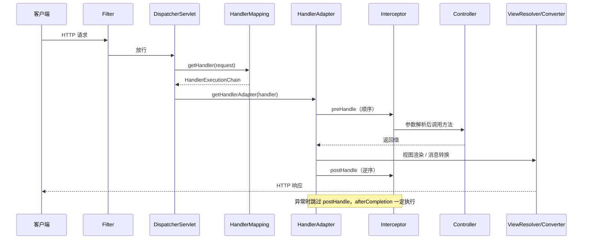

# 第 11 章 Spring 与 Spring Boot：IoC、AOP、事务与自动配置

> 一句话定位：Spring 是面试里"框架深度"的主战场。IoC 与 AOP 决定你能不能讲清框架的底座，事务与自动配置决定你有没有真正在线上排查过问题。

## 一、本章考察重点概览

Spring 相关的题有一个明显特征：**背结论的人和用过的人，回答长度差不多，但信息密度差很多。** 说"Spring 通过三级缓存解决循环依赖"只要一句话，能讲清三级缓存分别存什么、为什么二级不够、为什么构造器注入无解，才是面试官想确认的东西。

面试官在这一章实际筛四件事：

1. **你是否理解"控制反转"是一种设计取舍，而不是一个名词。** 能说清 DI 解决了什么耦合、代价是什么（运行期才暴露装配错误、排查链路变长），比背诵"把创建对象的权利交给容器"有价值得多。
2. **你是否知道扩展点的时间顺序。** Bean 生命周期、`refresh()` 的十二步、AOP 与事务的插入点，这些是回答"为什么我的注解没生效"的唯一依据。顺序记错，后面所有失效分析都会跟着错。
3. **你是否有事务与锁的实战认知。** 长事务、事务未提交导致行锁不释放、`REQUIRES_NEW` 与外层争抢同一行造成死锁，这些是生产事故，不是八股。
4. **你是否理解 Spring Boot 的"约定"是怎么落地的。** 自动配置不是魔法，是条件注解 + 外部化配置 + 固定的加载顺序，三者拼出来的结果。

| 考点 | 出现频率 | 难度 | 说明 |
| --- | --- | --- | --- |
| IoC / DI 的本质与收益 | 高 | 初级 | 开场题，答得空泛会直接影响后续评价 |
| Bean 生命周期与扩展点 | 高 | 中级 | 常与 AOP、事务、`@PostConstruct` 联合问 |
| 三级缓存与循环依赖 | 高 | 高级 | 区分中级与高级的分水岭 |
| AOP 原理与代理选择 | 高 | 中级 | 必问 JDK 代理与 CGLIB 的边界 |
| AOP 失效场景 | 高 | 中级 | 考的是"代理对象"这个心智模型 |
| `@Transactional` 原理与失效 | 高 | 中级 | 几乎每场必问，重点在失效的八种场景 |
| 传播行为 | 中 | 高级 | `REQUIRED` / `REQUIRES_NEW` / `NESTED` 三者对比 |
| Spring MVC 请求流程 | 高 | 中级 | 要求能画出主干，能说清参数解析位置 |
| 自动配置原理 | 高 | 中级 | Spring Boot 2.x 与 3.x 的注册方式不同 |
| 单例 Bean 线程安全 | 中 | 中级 | 高频"送分题"，答错很扣分 |
| Spring 6 / Boot 3 变化 | 中 | 高级 | 近两年新项目必问 jakarta 与 AOT |

## 二、复习优先级

| 优先级 | 题目编号 | 理由 |
| --- | --- | --- |
| P0 | Q1、Q2、Q3、Q7、Q8、Q11、Q12、Q15、Q18 | 主干题，必须做到"一句话结论 + 分层展开 + 能画图"不卡壳 |
| P1 | Q4、Q5、Q6、Q9、Q10、Q13、Q14、Q16、Q17、Q19、Q20、Q22 | 决定你是"用过 Spring"还是"理解 Spring" |
| P2 | Q21、Q23、Q24、Q25 | 加分项与工程经验题，记住结论和一到两个例子即可 |

时间分配建议：本章 3 天。P0 占 65%，其中 Q2（生命周期）、Q3（三级缓存）、Q11（事务）三题必须能默画出流程；P1 占 30%，重点是失效场景的归类；P2 占 5%，面试前一天扫一遍即可。

## 三、高频面试题清单

| 编号 | 题目 | 难度 | 优先级 | 一句话答案 |
| --- | --- | --- | --- | --- |
| Q1 | IoC 与 DI 的本质是什么？控制反转反转了什么？ | 初级 | P0 | 反转的是依赖的获取权，由对象主动 new 变为容器注入，代价是装配错误延迟到运行期 |
| Q2 | Bean 的完整生命周期是怎样的？各扩展点用在哪？ | 中级 | P0 | 实例化 → 属性填充 → Aware → 前置处理 → 初始化 → 后置处理（此处生成代理）→ 使用 → 销毁 |
| Q3 | 三级缓存各存什么？为什么需要三级而不是两级？ | 高级 | P0 | 一级存成品、二级存早期引用、三级存对象工厂，第三级是为了把 AOP 代理延迟到真正发生循环时 |
| Q4 | 构造器注入为什么解决不了循环依赖？ | 中级 | P1 | 实例化都完不成，没有对象可提前暴露；Boot 2.6 起默认直接禁止循环依赖 |
| Q5 | BeanFactory、FactoryBean、ApplicationContext 有什么区别？ | 中级 | P1 | 前者是容器底座，中者是"生产 Bean 的 Bean"，后者是带企业级能力的容器 |
| Q6 | `refresh()` 的十二步分别做什么？ | 高级 | P1 | 准备环境 → 建工厂 → 执行后置处理器 → 注册处理器 → 初始化事件与消息源 → 启容器 → 实例化单例 → 完成刷新 |
| Q7 | `@Autowired` 与 `@Resource` 有什么区别？ | 初级 | P0 | 前者 Spring 的 byType（可配 `@Qualifier`），后者 JSR-250 的 byName 优先 |
| Q8 | AOP 的织入时机？JDK 代理与 CGLIB 怎么选？ | 中级 | P0 | Spring AOP 是运行期织入；有接口用 JDK，Boot 2.x 起默认统一 CGLIB |
| Q9 | 多个切面作用于同一方法，执行顺序如何确定？ | 中级 | P1 | `@Order` 越小越外层，before 升序、after 降序，形成栈式结构 |
| Q10 | AOP 有哪些失效场景？为什么自调用不走代理？ | 中级 | P1 | 自调用用的是 `this`，绕过了代理对象；`private`/`final`/非 Bean 同样失效 |
| Q11 | `@Transactional` 的实现原理是什么？ | 中级 | P0 | 本质是 AOP + `TransactionInterceptor`，在方法前后包了开启、提交、回滚 |
| Q12 | 七种事务传播行为分别是什么？ | 高级 | P0 | 默认 `REQUIRED`；`REQUIRES_NEW` 挂起外层新开事务，`NESTED` 用保存点 |
| Q13 | 事务在哪些情况下会失效？ | 中级 | P1 | 自调用、非 public、异常被吞、checked 异常未配 `rollbackFor`、传播行为不当等 |
| Q14 | 事务与锁有哪些常见坑？ | 高级 | P1 | 事务未提交锁不释放、长事务、异步丢上下文、事务内调远程服务无法回滚 |
| Q15 | Spring MVC 一次请求的完整流程？ | 中级 | P0 | `DispatcherServlet` 取 handler → 找适配器 → 解析参数 → 调 Controller → 处理返回值 → 渲染 |
| Q16 | 过滤器、拦截器、AOP 有什么区别？执行顺序如何？ | 中级 | P1 | Filter 在容器层，Interceptor 在 MVC 层能拿 handler，AOP 在 Bean 方法层 |
| Q17 | `@RequestBody`、`@RequestParam`、`@PathVariable` 怎么区分？全局异常怎么处理？ | 初级 | P1 | 分别取请求体、查询参数、路径变量；`@RestControllerAdvice` 统一兜底 |
| Q18 | Spring Boot 自动配置的原理是什么？ | 中级 | P0 | `@EnableAutoConfiguration` 导入选择器，读 imports 清单，再用条件注解按需装配 |
| Q19 | 如何自定义一个 starter？命名有什么规范？ | 中级 | P1 | autoconfigure 模块写配置类并注册 imports，starter 模块只做依赖聚合 |
| Q20 | Spring Boot 的启动流程主干是什么？ | 中级 | P1 | 推断应用类型 → 准备环境 → 建容器 → `refresh` → 启动内嵌容器 → 执行 Runner |
| Q21 | 配置优先级、Profile、`@ConfigurationProperties` 与 `@Value` 的差异？ | 初级 | P2 | 命令行最高、默认属性最低；`@ConfigurationProperties` 支持批量与宽松绑定 |
| Q22 | 单例 Bean 是线程安全的吗？ | 中级 | P1 | 容器不保证，无状态 Bean 天然安全，有可变成员变量就有并发问题 |
| Q23 | Spring 里用到了哪些设计模式？ | 中级 | P2 | 工厂、单例、代理、模板方法、观察者、策略、适配器、装饰器、责任链 |
| Q24 | Spring 6 与 Spring Boot 3 有哪些关键变化？ | 高级 | P2 | JDK 17 基线、`javax` 换 `jakarta`、AOT 与 native image、Observability |
| Q25 | 启动失败常见原因怎么排查？ | 中级 | P2 | Bean 冲突、循环依赖、配置缺失、端口占用、数据源未配置五类占多数 |

## 四、题目详解

### Q1. IoC 与 DI 的本质是什么？控制反转反转了什么？（初级）

**一句话结论**：IoC（Inversion of Control，控制反转）反转的是"依赖对象的创建权与查找权"，从对象内部主动 `new` 变成由容器在外部装配；DI（Dependency Injection，依赖注入）是 IoC 的一种实现方式，通过构造器、setter 或字段把依赖传进来。

**先把话说白**：不用容器时，`OrderService` 想用一个 `OrderDao`，就得自己在构造器里 `new OrderDaoImpl()`。这意味着 `OrderService` 同时知道了"我需要什么"和"怎么造出来"两件事。容器接管后，第一件事仍然由它声明（构造器参数或字段），第二件事被移走了——它只声明需求，容器负责满足。

**底层原理**：

1. **耦合到底被解掉了哪一部分。** 不是解掉"依赖抽象"这件事（那是接口的功劳），而是解掉"依赖具体实现类"和"依赖生命周期"。`OrderService` 的编译期依赖从 `OrderDaoImpl` 变成 `OrderDao`，运行期用哪个实现由配置或注解决定。这样换实现、加装饰、加代理，都不需要改调用方。

2. **容器的三个动作。** 读取配置得到 BeanDefinition（描述"怎么造"）→ 按需实例化并缓存（默认单例）→ 按类型或名称把依赖注入到目标对象。所以 Spring 容器本质上是一张"Bean 定义表 + 单例注册表"。

3. **为什么值得这样做。** 三方面收益：一是测试时可以注入 mock，不需要启动数据库；二是横切逻辑（事务、日志、缓存）可以统一在容器层织入，业务代码不用关心；三是对象的生命周期（单例、请求作用域、销毁回调）有统一管理点。

4. **代价是什么。** 装配错误从编译期推迟到启动期甚至运行期——`@Autowired` 少一个实现，编译器不会报错，要等启动时抛 `NoSuchBeanDefinitionException`；依赖关系不写在代码里而在注解和配置里，读代码时"这个字段从哪来的"需要跳转；启动变慢，因为要扫描、解析、实例化大量单例。这也是为什么 Spring Boot 3 要引入 AOT，把一部分工作前移到构建期。

5. **DI 的三种方式怎么选。** 构造器注入能保证依赖不为空、字段可声明为 `final`、便于单测，是官方推荐；setter 注入适合可选依赖与循环依赖场景；字段注入代码最短，但无法用 `final`、无法在容器外构造、容易写出十几个依赖的巨型类，通常只在测试和简单场景使用。

```java
@Service
public class OrderService {
    private final OrderDao orderDao;      // final 保证不可变、必然被赋值
    private final PayClient payClient;

    public OrderService(OrderDao orderDao, PayClient payClient) {  // 依赖显式化
        this.orderDao = orderDao;
        this.payClient = payClient;
    }
}
```

**易混对比**：

| 维度 | 传统主动获取 | 容器注入 |
| --- | --- | --- |
| 依赖来源 | 类内部 `new` 或查工厂 | 容器按定义装配 |
| 编译期依赖 | 具体实现类 | 接口 |
| 替换实现的成本 | 改代码重编译 | 改配置或加注解 |
| 错误暴露时机 | 编译期 | 启动期或运行期 |
| 单元测试 | 需要真实依赖或手写桩 | 直接传入 mock |

**面试追问**：
- 追问：IoC 和 DI 是一回事吗？→ 答题要点：不是。IoC 是设计原则（把控制权交出去），DI 是落地手段；依赖查找（Dependency Lookup）也是 IoC 的一种，只是侵入性更强。
- 追问：构造器注入和字段注入的本质差别？→ 答题要点：构造器注入在实例化时就完成装配，对象创建完成即处于可用状态；字段注入靠反射在实例化后赋值，对象存在"半成品"窗口。
- 追问：Spring 的依赖注入是靠反射吗？→ 答题要点：装配靠反射（`Field.set`、`Constructor.newInstance`），但 Spring 5 起大量使用 `MethodHandle`、`ReflectionUtils` 与 `CachedIntrospectionResults` 降低反射开销。

**加分点**：能补一句"Spring 的 DI 是运行期反射装配，Quarkus/Micronaut 走编译期生成，这就是启动速度差异的根源"，说明你理解两类框架的取舍。

### Q2. Bean 的完整生命周期是怎样的？各扩展点用在哪？（中级）

**一句话结论**：主干是"实例化 → 属性填充 → Aware 回调 → `BeanPostProcessor` 前置 → 初始化方法 → `BeanPostProcessor` 后置（AOP 代理在此生成）→ 使用 → 销毁"，其中 `BeanPostProcessor` 是 Spring 留给自己和用户改 Bean 的最强扩展点。

**先把话说白**：容器造一个 Bean 不是 `new` 一下那么简单，它像一条流水线：先把空壳造出来，再把依赖塞进去，然后通知这个对象"你叫什么、你在哪个工厂里"，接着交给一排后置处理器逐个加工，最后才放进单例池。AOP 代理、`@PostConstruct`、`@Autowired` 全都是挂在这条流水线不同位置上的加工站。

**底层原理**：

1. **准备阶段。** 容器扫描注解或读 XML 得到 `BeanDefinition`，合并父子定义得到 `RootBeanDefinition`，检查 `depends-on`，然后判断是否已经在单例池里。这一步不做实例化。

2. **实例化（instantiate）。** 先给 `InstantiationAwareBeanPostProcessor.postProcessBeforeInstantiation` 一次机会，如果它返回了对象（例如 `@Bean` 返回代理），后续流程被短路。否则推断构造器（`SmartInstantiationAwareBeanPostProcessor.determineCandidateConstructors`，`@Autowired` 构造器在这里被选中），反射创建实例。此时对象字段全是默认值。

3. **提前暴露与属性填充。** 实例化后立刻把 `ObjectFactory` 放入三级缓存（这是循环依赖能解决的前提），然后 `populateBean`：先 `postProcessAfterInstantiation`，再 `postProcessProperties` 完成 `@Autowired`、`@Resource`、`@Value` 注入。

4. **Aware 回调分两批。** `BeanNameAware`、`BeanClassLoaderAware`、`BeanFactoryAware` 由 `invokeAwareMethods` 直接调用；`ApplicationContextAware`、`EnvironmentAware`、`ResourceLoaderAware` 等由 `ApplicationContextAwareProcessor` 在 `postProcessBeforeInitialization` 中调用。分成两批是因为前者属于 BeanFactory 层能力，后者需要 ApplicationContext 才具备。

5. **初始化三连。** `postProcessBeforeInitialization`（`@PostConstruct` 由 `CommonAnnotationBeanPostProcessor` 在此执行）→ `InitializingBean.afterPropertiesSet` → 自定义 `init-method`（`@Bean(initMethod=...)` 或 XML）。三者顺序固定，`@PostConstruct` 最早。

6. **后置处理与代理。** `postProcessAfterInitialization` 是所有 `BeanPostProcessor` 最后加工的机会，`AbstractAutoProxyCreator` 就在这里判断是否需要生成 AOP 代理。所以代理对象是在初始化完成后才替换掉原始对象的——这一点决定了三级缓存的设计（见 Q3）。

7. **销毁。** 容器关闭时按依赖逆序销毁：`@PreDestroy` → `DisposableBean.destroy` → 自定义 `destroy-method`。原型 Bean 容器不管理销毁，调用方自己负责。

```mermaid
flowchart TD
    A[读取 BeanDefinition] --> B[实例化前 postProcessBeforeInstantiation]
    B --> C[推断构造器并实例化]
    C --> D[放入三级缓存 ObjectFactory]
    D --> E[属性填充 populateBean<br/>@Autowired / @Value]
    E --> F[Aware 回调<br/>BeanName / BeanFactory / ApplicationContext]
    F --> G[postProcessBeforeInitialization<br/>@PostConstruct 在此]
    G --> H[afterPropertiesSet]
    H --> I[自定义 init-method]
    I --> J[postProcessAfterInitialization<br/>AOP 代理在此生成]
    J --> K[放入一级缓存 singletonObjects]
    K --> L[使用]
    L --> M[销毁 @PreDestroy → destroy]
```

**扩展点的实际用途**：

| 扩展点 | 触发时机 | 典型用途 |
| --- | --- | --- |
| `BeanDefinitionRegistryPostProcessor` | 所有定义加载完、实例化前 | 动态注册 Bean，如 MyBatis 的 Mapper 扫描 |
| `BeanFactoryPostProcessor` | 定义加载完、实例化前 | 修改定义属性，如占位符替换 |
| `InstantiationAwareBeanPostProcessor` | 实例化前后、属性填充前后 | 自定义注入逻辑，如 `@Reference` 注入远程代理 |
| `BeanPostProcessor` | 初始化前后 | AOP 代理、`@PostConstruct`、埋点增强 |
| `InitializingBean` / `init-method` | 属性填充后 | 校验配置、预热缓存、建立连接 |
| `DisposableBean` / `destroy-method` | 容器关闭 | 关闭线程池、注销注册中心、刷盘 |

**面试追问**：
- 追问：`@PostConstruct`、`afterPropertiesSet`、`init-method` 的顺序？→ 答题要点：`@PostConstruct` → `afterPropertiesSet` → `init-method`，前者由后置处理器驱动，后两者由 `invokeInitMethods` 依次调用。
- 追问：`BeanPostProcessor` 和 `BeanFactoryPostProcessor` 的区别？→ 答题要点：前者加工 Bean 实例，后者加工 BeanDefinition；前者在每个 Bean 创建时执行，后者在容器启动时执行一次。
- 追问：原型 Bean 的销毁回调会执行吗？→ 答题要点：不会，容器只记录单例的销毁逻辑；原型对象的销毁由调用方负责。
- 追问：为什么 `BeanPostProcessor` 的实现类里不要注入业务 Bean？→ 答题要点：后置处理器注册得早，此时业务 Bean 还没实例化，容易触发"提前初始化"告警甚至循环依赖。

**易错点**：很多人把"实例化"和"初始化"混为一谈。实例化只是分配内存、调构造器；初始化是 `afterPropertiesSet` 那一套。`@PostConstruct` 在初始化阶段，不在构造器之后紧挨着——中间隔着属性填充和 Aware 回调。

### Q3. 三级缓存各存什么？为什么需要三级而不是两级？（高级）

**一句话结论**：`singletonObjects`（一级）存完整 Bean，`earlySingletonObjects`（二级）存提前暴露的早期引用（可能已是代理），`singletonFactories`（三级）存能生产早期引用的 `ObjectFactory`；第三级的存在是为了把"AOP 代理的创建"延迟到真正发生循环依赖时，保证正常 Bean 的代理仍在初始化后生成。

**先把话说白**：A 依赖 B、B 又依赖 A，谁先造都不完整。Spring 的做法是：A 刚 `new` 出来、还没填属性时就先把"取 A 的方法"登记出去，B 需要 A 时通过这个方法拿到 A 的引用（此时 A 是半成品，但引用有效），B 就能完成创建，A 再回头把 B 填进去。关键在于登记的是"方法"而不是"对象"，因为这时候还判断不了 A 要不要被代理。

**底层原理**：

1. **三级缓存的数据结构。** 都在 `DefaultSingletonBeanRegistry` 中：
   - `singletonObjects`：`ConcurrentHashMap<String, Object>`，成品池，`getBean` 最终都从这里返回。
   - `earlySingletonObjects`：`HashMap<String, Object>`，早期引用池，避免同一 Bean 被反复从工厂取。
   - `singletonFactories`：`HashMap<String, ObjectFactory<?>>`，存 lambda，调用时执行 `getEarlyBeanReference`。
   - 另有 `registeredSingletons` 记录注册顺序，用于销毁时逆序处理。

2. **创建顺序与三次查询。** A 实例化后执行 `addSingletonFactory("a", () -> getEarlyBeanReference("a", mbd, bean))`；填充属性时发现依赖 B，转去创建 B；B 填充属性时 `getBean("a")`，`getSingleton("a", true)` 依次查一级（无）、二级（无）、三级（有），调用工厂得到 A 的早期引用，放入二级并删除三级。B 完成后放入一级，A 继续填充，最后 A 也放入一级。

3. **为什么不能只用两级（一级 + 工厂）。** 如果二级直接存 `ObjectFactory` 而不存对象，每次解析都要调一次工厂；更要命的是工厂里做的是"是否需要提前代理"的判断，重复调用可能重复创建代理对象，破坏单例语义。引入二级缓存后，"是否已经生成过早期引用"这件事被记录下来，工厂对同一个 Bean 只会被消费一次。

4. **为什么不能只用两级（一级 + 对象）。** 这是更常见的追问。看似可以在实例化后立刻创建代理并放入二级缓存，但那样**所有 Bean 都会在实例化后立即被代理**，而正常语义是代理在 `postProcessAfterInitialization` 才生成。后果有两个：一是所有 Bean 都提前走一遍代理创建逻辑，包括那些根本不需要代理的；二是 `@Transactional`、`@Async` 这类依赖后置处理的增强，其代理会错过后续 `BeanPostProcessor` 的加工。三级缓存的 `ObjectFactory` 让"要不要提前代理"变成**按需触发**：只有真的发生循环依赖、有人来取早期引用时才执行 `getEarlyBeanReference`。

5. **`getEarlyBeanReference` 做了什么。** 它遍历 `SmartInstantiationAwareBeanPostProcessor`，调用 `getEarlyBeanReference(beanName, mbd, bean)`。`AbstractAutoProxyCreator` 的实现是：如果这个 Bean 需要被 AOP 代理，就现在创建代理并缓存到 `earlyProxyReferences`，后续 `postProcessAfterInitialization` 发现已提前代理过就直接返回原对象，避免二次代理。

```java
// DefaultSingletonBeanRegistry 的骨架，省略异常与日志
private final Map<String, Object> singletonObjects = new ConcurrentHashMap<>(256);
private final Map<String, Object> earlySingletonObjects = new HashMap<>(16);
private final Map<String, ObjectFactory<?>> singletonFactories = new HashMap<>(16);

protected Object getSingleton(String beanName, boolean allowEarlyReference) {
    Object singleton = singletonObjects.get(beanName);          // 一级：成品
    if (singleton == null && isSingletonCurrentlyInCreation(beanName)) {
        singleton = earlySingletonObjects.get(beanName);        // 二级：早期引用
        if (singleton == null && allowEarlyReference) {
            ObjectFactory<?> factory = singletonFactories.get(beanName);  // 三级：工厂
            if (factory != null) {
                singleton = factory.getObject();                // 可能在此提前创建代理
                earlySingletonObjects.put(beanName, singleton); // 升级到二级
                singletonFactories.remove(beanName);            // 工厂只用一次
            }
        }
    }
    return singleton;
}
```

**易混对比**：

| 缓存 | 结构 | 存的内容 | 生命周期 | 作用 |
| --- | --- | --- | --- | --- |
| 一级 `singletonObjects` | ConcurrentHashMap | 完整 Bean（可能是代理） | 容器存续期 | 所有 `getBean` 的最终来源 |
| 二级 `earlySingletonObjects` | HashMap | 早期引用，可能已是代理 | 循环依赖解决后移除或升级 | 避免工厂被重复调用 |
| 三级 `singletonFactories` | HashMap | `ObjectFactory` lambda | 使用一次即删除 | 延迟决定是否提前代理 |
| `earlyProxyReferences` | HashMap | 原始对象引用 | 代理创建后记录 | 防止二次代理 |

**面试追问**：
- 追问：二级缓存能不能去掉，只用一级 + 三级？→ 答题要点：功能上可以，但工厂会被反复调用、可能重复创建代理；二级缓存是"结果缓存"，保证一个 Bean 的早期引用只生成一次。
- 追问：为什么循环依赖必须是单例？→ 答题要点：三级缓存挂在 `DefaultSingletonBeanRegistry` 上，原型 Bean 每次都新建，无法提前暴露，Spring 直接抛 `BeanCurrentlyInCreationException`。
- 追问：`@Async` 的 Bean 发生循环依赖会怎样？→ 答题要点：`@Async` 代理由 `AsyncAnnotationBeanPostProcessor` 在后置阶段创建，与提前代理路径不一致时可能注入到原始对象，表现为异步失效，通常会在启动时给出警告。
- 追问：Spring Boot 2.6 之后为什么默认禁止循环依赖？→ 答题要点：循环依赖本身是设计问题，能跑通不代表健康；默认 `spring.main.allow-circular-references=false`，强制暴露并重构。

**加分点**：指出"三级缓存不是性能优化，而是生命周期语义的补丁"。它存在的唯一理由是让 AOP 代理的创建时机不被循环依赖打乱，理解这一点就不会在面试里把三级缓存说成"为了提升性能"。

### Q4. 构造器注入为什么解决不了循环依赖？Spring Boot 2.6 之后为什么默认禁止？（中级）

**一句话结论**：构造器注入要求依赖在实例化时就必须就绪，而循环依赖的双方都还没实例化，没有任何对象可以提前暴露，因此无解；Spring Boot 2.6 起默认关闭循环依赖支持，是因为允许循环依赖会掩盖设计缺陷，且与 AOT、native image 的静态分析冲突。

**先把话说白**：字段注入能解决循环依赖，是因为对象先被造出来（空壳），再填字段，所以"半成品"可以被别人先拿去用。构造器注入则要求"造出来的时候依赖就已经在里面"，A 要造出来必须先有 B，B 要造出来必须先有 A，形成死结，没有任何中间状态可利用。

**底层原理**：

1. **实例化与属性填充的顺序差异。** 字段/setter 注入的流程是"new → 暴露 → 填属性"，暴露发生在依赖解析之前。构造器注入的流程是"解析构造器参数 → 拿到依赖 → new"，暴露只能发生在 new 之后，而 new 又依赖解析完成，顺序上不可能。

2. **Spring 的检测点。** `AbstractAutowireCapableBeanFactory.createBeanInstance` 解析构造器参数时，如果发现参数对应的 Bean 正在创建中（`isSingletonCurrentlyInCreation` 为 true），直接抛 `BeanCurrentlyInCreationException`，提示"Requested bean is currently in creation: Is there an unresolvable circular reference?"。

3. **`@Lazy` 为什么能救。** 在构造器参数上加 `@Lazy`，Spring 注入的不是真实对象，而是一个延迟解析的代理（`ContextAnnotationAutowireCandidateResolver.buildLazyResolutionProxy`）。代理对象可以先创建，真正调用方法时才去容器里取目标，死结被打破。代价是多一层代理，且首次调用可能抛异常。

4. **Boot 2.6 的政策变化。** Spring Boot 2.6 把 `spring.main.allow-circular-references` 的默认值改为 `false`，检测到循环依赖直接启动失败并打印完整的依赖环。原因是 Spring 官方在推"清晰依赖"：循环依赖通常意味着两个类职责纠缠，应该抽第三个类或改用事件解耦；同时 AOT 处理需要静态可分析的 Bean 依赖图，运行期动态解环会让 native image 的构建变得不可靠。

5. **实际怎么处理。** 优先重构（抽公共服务、用 `ApplicationEventPublisher` 解耦）；其次用 `@Lazy` 打破；最后才考虑临时打开开关。打开开关只是让程序跑起来，环还在，后续任何一次改动都可能引发新的初始化顺序问题。

**易混对比**：

| 注入方式 | 能否解决循环依赖 | 原因 | 推荐度 |
| --- | --- | --- | --- |
| 构造器注入 | 不能 | 实例化前就需要依赖，无中间态 | 高（应重构消除环） |
| setter 注入 | 能 | 先实例化再注入，可提前暴露 | 中 |
| 字段注入 | 能 | 反射在实例化后赋值 | 低（不利于测试） |
| 构造器 + `@Lazy` | 能 | 注入延迟解析代理，打破即时依赖 | 中（应急手段） |

**面试追问**：
- 追问：`@Lazy` 注入的代理是什么类型？→ 答题要点：JDK 代理或 CGLIB 代理，取决于目标类型是否有接口与 `proxyTargetClass` 配置；本质是 `TargetSource` 在首次调用时解析真实 Bean。
- 追问：`@DependsOn` 能解决循环依赖吗？→ 答题要点：不能，它只控制初始化顺序，不解决"互相需要对方实例"的问题，配错还会加剧启动失败。
- 追问：原型 Bean 的循环依赖呢？→ 答题要点：同样无解且不缓存，Spring 直接抛异常，因为原型没有"提前暴露"的注册表。

### Q5. BeanFactory、FactoryBean、ApplicationContext 有什么区别？（中级）

**一句话结论**：`BeanFactory` 是最底层的容器接口，负责 Bean 的定义、创建与获取；`FactoryBean` 是一种特殊的 Bean，用来生产其他 Bean 的实例；`ApplicationContext` 继承 `BeanFactory`，额外提供事件、国际化、资源加载、自动注册后置处理器等企业级能力。

**先把话说白**：`BeanFactory` 是发动机，只保证"你要的对象我能造出来"。`ApplicationContext` 是整车，发动机之外还带了空调、音响、仪表盘。`FactoryBean` 则是一个"代工厂"——它本身是一个 Bean，但你从容器里 `getBean("x")` 拿到的不是它，而是它生产的产品。

**底层原理**：

1. **BeanFactory 的定位。** 核心方法只有 `getBean`、`containsBean`、`isSingleton`、`getType`、`getAliases`。默认实现 `DefaultListableBeanFactory` 持有 `beanDefinitionMap`，是所有容器的事实底座。它采用懒加载：不调用 `getBean` 就不实例化（除非配置了 `lazy-init=false` 且被 `preInstantiateSingletons` 触发）。

2. **ApplicationContext 增强的四件事。** 启动时一次性实例化所有非懒加载单例（fail-fast，配置错误尽早暴露）；自动注册 `BeanFactoryPostProcessor` 与 `BeanPostProcessor`；内置 `ApplicationEventPublisher` 支持发布订阅；统一资源加载（`ResourcePatternResolver`）与国际化（`MessageSource`）。

3. **FactoryBean 的语义。** 实现 `FactoryBean<T>` 后，容器里存在两个对象：`&beanName` 拿到工厂本身，`beanName` 拿到 `getObject()` 的产物。`getObjectType()` 决定类型匹配（用于按类型注入），`isSingleton()` 决定产物是否缓存。MyBatis 的 `MapperFactoryBean`、Spring 的 `ProxyFactoryBean` 都是典型用法。

4. **BeanDefinition 是什么。** 它是"怎么造 Bean"的元数据：类名、作用域、是否懒加载、构造器参数、属性值、初始化/销毁方法、是否 primary。注解配置在 `ConfigurationClassPostProcessor` 解析后被转成 `BeanDefinition` 注册进 `beanDefinitionMap`。理解这一点就能解释很多现象：为什么 `@Bean` 方法返回的对象类型可以晚于声明、为什么修改 `BeanDefinition` 必须在实例化前做。

5. **三者的关系链。** `ApplicationContext` → 持有一个 `BeanFactory`（组合而非纯继承）；`FactoryBean` 是注册在 `BeanFactory` 里的特殊 Bean，`getBean` 时由 `FactoryBeanRegistrySupport` 判断是否需要调用 `getObject()`。所以三者不是并列关系，而是"容器 / 容器增强 / 容器中的特殊成员"。

```java
public class OrderFactoryBean implements FactoryBean<OrderClient> {
    private String endpoint;
    @Override public OrderClient getObject() { return new OrderClient(endpoint); }  // 真正的产物
    @Override public Class<?> getObjectType() { return OrderClient.class; }         // 供类型匹配
    @Override public boolean isSingleton() { return true; }                         // 产物是否单例
    public void setEndpoint(String endpoint) { this.endpoint = endpoint; }
}
// getBean("orderFactoryBean")  → OrderClient
// getBean("&orderFactoryBean") → OrderFactoryBean 本身
```

**易混对比**：

| 维度 | BeanFactory | FactoryBean | ApplicationContext |
| --- | --- | --- | --- |
| 角色 | 容器底座接口 | 容器中的特殊 Bean | 完整容器 |
| 主要职责 | 定义、创建、获取 Bean | 生产某一类对象 | 容器 + 事件 + 资源 + 国际化 |
| 实例化时机 | 懒加载 | 随容器初始化 | 启动时预实例化单例 |
| 后置处理器 | 需手动注册 | 不涉及 | 自动注册 |
| 典型实现 | `DefaultListableBeanFactory` | `MapperFactoryBean` | `AnnotationConfigApplicationContext` |

**面试追问**：
- 追问：`getBean` 拿到 `FactoryBean` 本身怎么办？→ 答题要点：加 `&` 前缀。
- 追问：`FactoryBean` 与 `@Bean` 方法怎么选？→ 答题要点：需要复杂构造逻辑并希望被容器当作类型匹配的工厂时用 `FactoryBean`；一般场景 `@Bean` 更直观。
- 追问：`ApplicationContext` 是 `BeanFactory` 的子接口，为什么说它是组合？→ 答题要点：接口上是继承，实现上 `AbstractApplicationContext` 内部持有一个 `ConfigurableListableBeanFactory`，大部分方法委托给它。

### Q6. `refresh()` 的十二步分别做什么？（高级）

**一句话结论**：`refresh()` 是容器启动的总流程，从准备环境、创建 BeanFactory、执行后置处理器、注册 Bean 后置处理器、初始化事件与消息源、启动子容器，到实例化所有单例、发布刷新完成事件，是一条严格有序的流水线。

**先把话说白**：`refresh()` 像开工厂的流程：先打扫场地（准备环境）、建厂房（创建 BeanFactory）、改图纸（执行 BeanFactoryPostProcessor）、招工头（注册 BeanPostProcessor）、装广播（事件与消息源）、开机（启动 Tomcat）、正式生产（实例化单例）、剪彩（发布 `ContextRefreshedEvent`）。顺序不能乱，因为后一步依赖前一步的产物。

**底层原理**：

1. **`prepareRefresh()`。** 记录启动时间、设置 `active` 标志、初始化 `PropertySources` 占位符、清理早期事件监听器缓存、校验必需属性。这一阶段还不涉及 Bean。

2. **`obtainFreshBeanFactory()`。** 如果是新容器，创建 `DefaultListableBeanFactory`；然后 `loadBeanDefinitions`，把 XML、注解、`@Bean` 方法解析成 `BeanDefinition` 注册进 map。注意此时只是"图纸"，没有实例。

3. **`prepareBeanFactory()`。** 给工厂配置 `ClassLoader`、`StandardBeanExpressionResolver`、`ResourceEditorRegistrar`；注册 `ApplicationContextAwareProcessor`（负责 `ApplicationContextAware` 等回调）；注册可解析依赖（`BeanFactory`、`ResourceLoader`、`ApplicationEventPublisher`）；注册 `ApplicationListenerDetector`。

4. **`postProcessBeanFactory()`。** 留给子类扩展。`ServletWebServerApplicationContext` 在这里注册 `request`、`session` 作用域。

5. **`invokeBeanFactoryPostProcessors()`。** 按 `PriorityOrdered` → `Ordered` → 其余 的顺序执行 `BeanFactoryPostProcessor`。最核心的是 `ConfigurationClassPostProcessor`：解析 `@Configuration`、`@ComponentScan`、`@Import`、`@Bean`、`@PropertySource`，把扫描到的类注册成 BeanDefinition。**这一步决定了容器里有哪些 Bean**。

6. **`registerBeanPostProcessors()`。** 把 `BeanPostProcessor` 实例化并注册到工厂，同样按优先级排序。注意它们本身也是 Bean，但必须早于普通 Bean 创建，否则普通 Bean 就享受不到增强。

7. **`initMessageSource()` / `initApplicationEventMulticaster()`。** 初始化国际化消息源与事件广播器，没有自定义实现就用默认的。

8. **`onRefresh()`。** 子类扩展点。Spring Boot 在这里创建并启动内嵌 Web 容器（`createWebServer`），Tomcat 的 `Connector` 在这一步初始化完毕。

9. **`registerListeners()`。** 注册 `ApplicationListener`，并把早期收集的事件广播出去。

10. **`finishBeanFactoryInitialization()`。** `preInstantiateSingletons()`，实例化所有非懒加载单例。整个 Bean 生命周期（Q2）在这里反复执行，也是最耗时的一步。

11. **`finishRefresh()`。** 初始化 `LifecycleProcessor` 并调用 `onRefresh` 启动实现了 `Lifecycle` 的 Bean；清理缓存；通过 `publishEvent` 发布 `ContextRefreshedEvent`。

12. **异常时的 `destroyBeans()` + `cancelRefresh()`。** 任何一步抛异常都会销毁已创建的单例并重置状态，避免半启动的容器继续提供服务。

**易混对比**：

| 阶段 | 是否创建 Bean 实例 | 关键产物 |
| --- | --- | --- |
| `obtainFreshBeanFactory` | 否 | BeanDefinition 表 |
| `invokeBeanFactoryPostProcessors` | 否（但会触发配置类解析） | 完整的 Bean 定义集合 |
| `registerBeanPostProcessors` | 是（仅后置处理器） | 增强器链 |
| `onRefresh` | 部分 | 内嵌 Web 容器 |
| `finishBeanFactoryInitialization` | 是（全量单例） | 一级缓存填满 |

**面试追问**：
- 追问：`@Configuration` 里的 `@Bean` 方法为什么能保证单例？→ 答题要点：配置类被 CGLIB 增强（`ConfigurationClassEnhancer`），方法调用被拦截后先查容器；`proxyBeanMethods=false` 时不做增强，直接调用就是普通方法。
- 追问：`ContextRefreshedEvent` 和 `ApplicationReadyEvent` 的区别？→ 答题要点：前者在容器刷新完成时发布，可能多次（多次 refresh）；后者在 Runner 执行完、应用可对外服务时发布，只一次。
- 追问：`refresh()` 能重复调用吗？→ 答题要点：`AbstractApplicationContext` 支持多次 refresh（先 destroy 再重建），但 `GenericApplicationContext` 不支持，重复调用抛 `IllegalStateException`。

### Q7. `@Autowired` 与 `@Resource` 有什么区别？（初级）

**一句话结论**：`@Autowired` 是 Spring 提供的注解，默认按类型（byType）注入，可用 `@Qualifier` 收窄到名称，`required=false` 允许缺失；`@Resource` 是 JSR-250 标准注解，默认按名称（byName）注入，找不到名称匹配再退回按类型，不支持 `required` 与构造器注入。

**先把话说白**：`@Autowired` 的意思是"给我一个这种类型的"，如果有多个再报名字；`@Resource` 的意思是"给我一个叫这个名字的"，名字对不上才看类型。所以同一个接口有多个实现时，`@Resource` 靠字段名就能选中，`@Autowired` 必须配 `@Qualifier` 或 `@Primary`。

**底层原理**：

1. **处理器的差异。** `@Autowired` 由 `AutowiredAnnotationBeanPostProcessor` 处理，它实现 `MergedBeanDefinitionPostProcessor` 与 `SmartInstantiationAwareBeanPostProcessor`，能参与构造器候选筛选。`@Resource` 由 `CommonAnnotationBeanPostProcessor` 处理（父类 `InitDestroyAnnotationBeanPostProcessor` 同时负责 `@PostConstruct`/`@PreDestroy`），只在属性填充阶段生效。

2. **查找顺序的差异。** `@Autowired` 的流程是：按类型找候选 → 多个则用 `@Qualifier` 过滤 → 仍有多个则用 `@Primary` → 再不行按字段名匹配 → 最后抛 `NoUniqueBeanDefinitionException`。`@Resource` 是：按 `name`（未指定则取字段名或 setter 属性名）找 → 找不到再按类型 → 仍不唯一则抛异常。

3. **候选排序的完整规则。** `DefaultListableBeanFactory.determineAutowireCandidate` 会依次看：是否 `primary`、`@Priority` 值、`@Qualifier` 匹配、名称匹配。理解这个顺序能解释"加了 `@Primary` 但 `@Qualifier` 仍生效"这类现象——`@Qualifier` 的优先级高于 `@Primary`。

4. **集合与 Map 注入。** `@Autowired List<PayChannel>` 会注入该类型的所有实现，顺序由 `@Order`/`Ordered` 决定；`@Autowired Map<String, PayChannel>` 的 key 是 Bean 名称。这是策略模式的常见落地方式，比 `if-else` 选渠道更好扩展。

5. **`@Value` 与 `@Autowired(required=false)`。** `@Value` 支持 `${}` 占位符与 `#{}` SpEL，由 `QualifierAnnotationAutowireCandidateResolver` 处理；`required=false` 时若找不到依赖会注入 `null`，容易埋下 NPE，通常更推荐用 `ObjectProvider<T>` 做延迟可选注入。

```java
@Service
public class PayService {
    @Autowired @Qualifier("aliPay") private PayChannel aliPay;   // 类型 + 名称
    @Resource(name = "wechatPay") private PayChannel wechatPay;  // 直接按名称
    @Autowired private List<PayChannel> channels;                // 注入全部实现，按 @Order 排序
    @Autowired private Map<String, PayChannel> channelMap;       // key 为 Bean 名称
}
```

**易混对比**：

| 维度 | `@Autowired` | `@Resource` |
| --- | --- | --- |
| 来源 | Spring | JSR-250（`jakarta.annotation`） |
| 默认策略 | byType | byName，回退 byType |
| 指定名称 | `@Qualifier` | `name` 属性或字段名 |
| 是否必需 | `required` 可配 | 无此语义，找不到即失败 |
| 支持位置 | 构造器、方法、参数、字段、注解 | 字段、setter（不支持构造器） |
| 多实现时的默认 | 需 `@Primary`/`@Qualifier` | 字段名匹配即可 |

**面试追问**：
- 追问：同类型有多个 Bean，`@Autowired` 会怎么处理？→ 答题要点：先 `@Qualifier`，再 `@Primary`，再字段名匹配，最后抛 `NoUniqueBeanDefinitionException`。
- 追问：`@Autowired` 能用在构造器上吗？只有一个构造器时还需要写吗？→ 答题要点：能；Spring 4.3 起单构造器可省略注解，多构造器时必须标一个。
- 追问：为什么字段注入不推荐？→ 答题要点：无法 `final`、无法脱离容器构造、隐藏依赖数量、循环依赖时掩盖设计问题。

### Q8. AOP 的织入时机？JDK 代理与 CGLIB 怎么选？（中级）

**一句话结论**：Spring AOP 是运行期织入，通过动态代理在 `BeanPostProcessor` 后置阶段生成代理对象；目标类有接口时可用 JDK 动态代理，无接口时用 CGLIB 生成子类，Spring Boot 2.x 起默认 `proxyTargetClass=true` 统一走 CGLIB。

**先把话说白**：AOP 就是"在不改原方法的前提下，在方法前后插一段逻辑"。插的方式有三种时机：编译时改字节码（AspectJ）、类加载时改（LTW）、运行时生成代理对象（Spring AOP）。Spring 选了第三种，因为它不需要特殊编译器，代价是只能拦截 Spring 管理的 Bean 的公开方法。

**底层原理**：

1. **五个核心术语。** 切面（Aspect）= 切点 + 通知；切点（Pointcut）= 匹配规则；通知（Advice）= 要插入的逻辑，分 `@Before`、`@AfterReturning`、`@AfterThrowing`、`@After`、`@Around`；连接点（JoinPoint）= 可被拦截的方法执行点；织入（Weaving）= 把切面应用到目标对象的过程。

2. **代理的生成时机。** `AnnotationAwareAspectJAutoProxyCreator` 继承 `AbstractAutoProxyCreator`，在 `postProcessAfterInitialization` 中调用 `wrapIfNecessary`：先找出能应用到该 Bean 的 advisors，若有则创建代理。所以代理对象是在初始化完成后替换原始对象的，这也是循环依赖需要三级缓存的原因。

3. **JDK 代理的边界。** 基于 `Proxy.newProxyInstance` 生成实现相同接口的类，方法调用转到 `InvocationHandler`。限制是只能代理接口方法，目标类自己新增的 public 方法注入后不可见（因为注入的是接口类型）。优点是生成快、不依赖字节码库。

4. **CGLIB 的边界。** 通过 ASM 生成子类，重写非 `final`、非 `private`、非 `static` 的方法。限制是 `final` 类无法代理、`final` 方法无法增强、`private` 方法不可见。Spring 4 起 CGLIB 代理类打包进 `spring-core`（重新打包的 `org.springframework.cglib`），不再需要单独依赖。

5. **为什么 Boot 2.x 默认改成 CGLIB。** 一是避免"Bean 实现了接口但需要注入实现类"时 JDK 代理导致的类型不匹配（`BeanNotOfRequiredTypeException`）；二是统一代理方式后，`@Transactional` 标注在实现类方法上的行为更一致；三是 CGLIB 代理后 `@Autowired` 按实现类类型注入也能成功。代价是无法代理 `final` 类，且首次生成代理略慢。

```java
@Aspect
@Component
@Order(1)
public class CostAspect {
    @Around("execution(* com.example.service..*.*(..)) && @annotation(com.example.Timed)")
    public Object around(ProceedingJoinPoint pjp) throws Throwable {
        long start = System.nanoTime();
        try {
            return pjp.proceed();                      // 调用下一个通知或目标方法
        } finally {
            System.out.println(pjp.getSignature() + " cost " + (System.nanoTime() - start) / 1000 + "us");
        }
    }
}
```

**易混对比**：

| 维度 | JDK 动态代理 | CGLIB |
| --- | --- | --- |
| 前提 | 目标类实现接口 | 目标类非 `final` |
| 实现方式 | 生成实现同接口的代理类 | 生成子类并重写方法 |
| 可代理方法 | 仅接口中声明的方法 | 非 `final`、非 `private` 的方法 |
| 生成速度 | 快 | 慢（需生成字节码） |
| 调用速度 | 反射调用，略慢 | 接近直接调用 |
| Spring 默认 | 有接口时的历史默认 | Boot 2.x 起默认统一使用 |

**面试追问**：
- 追问：AspectJ 和 Spring AOP 的区别？→ 答题要点：AspectJ 是编译期/类加载期织入，能拦截构造器、字段访问、`private` 方法；Spring AOP 是运行期代理，只能拦 Bean 的公开方法。
- 追问：CGLIB 代理会调用目标类的构造器吗？→ 答题要点：不会，Spring 用 Objenesis 绕过构造器实例化代理对象，避免副作用。
- 追问：为什么 JDK 代理要求 `equals`/`hashCode` 也走 handler？→ 答题要点：代理类继承了 `Object` 的实现转发到 handler，若不处理会导致代理对象与原对象比较异常。
- 追问：`@Around` 和 `@Before` 能同时用在一个方法上吗？→ 答题要点：能，`@Around` 会包裹其他通知，执行顺序是 Around 前半段 → Before → 目标 → AfterReturning → After → Around 后半段。

### Q9. 多个切面作用于同一方法，执行顺序如何确定？（中级）

**一句话结论**：切面的顺序由 `@Order` 值或 `Ordered` 接口决定，值越小优先级越高、越靠外层；进入时按升序执行前置通知，退出时按降序执行后置通知，形成栈式结构。

**先把话说白**：切面像洋葱皮，`@Order(1)` 是最外层。请求进来先穿过最外层，一层层往里；返回时从最内层往外一层层退。所以外层的前置最先执行、后置最后执行，内层反之。

**底层原理**：

1. **排序的入口。** `AnnotationAwareAspectJAutoProxyCreator` 收集 advisors 后调用 `sortAdvisors`，比较器是 `AspectJPrecedenceComparator`：先比 `Ordered` 值，值相同再比切面名。`@Order` 未标注时默认 `Ordered.LOWEST_PRECEDENCE`，即最内层。

2. **拦截器链的构建。** 每个 advisor 被适配成 `MethodInterceptor`，按顺序组成 `ReflectiveMethodInvocation` 的拦截器数组。调用 `proceed()` 时索引递增，形成递归调用链——这正是"栈式"的实现方式，不是两套循环。

3. **进入与退出的方向。** 由于是递归，`@Before` 在 `proceed()` 之前执行（升序），`@After` 在 `finally` 中执行（降序）。所以日志切面（最外层）记录的耗时会包含事务切面的耗时，这符合直觉。

4. **同一切面内的通知顺序。** 固定为：`@Around` 前半 → `@Before` → 目标方法 → `@AfterReturning`（或 `@AfterThrowing`）→ `@After` → `@Around` 后半。`@After` 对应 `finally`，所以在 `@AfterReturning` 之后。

5. **事务与自定义切面的顺序陷阱。** 若自定义切面的 `@Order` 小于事务切面（事务默认 `LOWEST_PRECEDENCE`），自定义切面在事务外层，此时读到的数据可能还没提交；若需要读到未提交数据，应让自定义切面进入事务内层（`@Order` 设大），或直接在同事务内处理。缓存切面同理：放在事务外层，可能把回滚前的数据写进缓存。

**面试追问**：
- 追问：`@Order` 对 `@Bean` 方法有效吗？→ 答题要点：有效，但作用于 Bean 的排序（如集合注入顺序），与切面顺序是两套机制，不要混用。
- 追问：两个切面都没写 `@Order` 怎么办？→ 答题要点：顺序不确定（按类名比较，实际不可依赖），必须显式指定。
- 追问：如何让某个切面一定在最内层？→ 答题要点：实现 `Ordered` 返回 `Ordered.LOWEST_PRECEDENCE`，或 `@Order(Ordered.LOWEST_PRECEDENCE)`。

### Q10. AOP 有哪些失效场景？为什么自调用不走代理？（中级）

**一句话结论**：AOP 依赖代理对象，凡是"没有经过代理"的调用都不会被增强；最典型的是同类内部 `this.method()` 自调用，其余包括 `private`/`static`/`final` 方法、`final` 类、非 Spring 管理的对象、切点不匹配、异常被吞。

**先把话说白**：代理对象是容器放在你门口的一个"门童"，所有从外部进来的调用都要经过他。但类内部的方法互相调用，是自己家里的内部通话，不经过门童。所以 `this.b()` 调用 `b()` 时，`b()` 上的 `@Transactional` 完全没有机会生效。

**底层原理**：

1. **自调用的本质。** 容器注入给别的 Bean 的是代理对象 `$Proxy`，代理在调用目标方法前会走拦截器链。而目标对象内部的 `this` 指向原始对象，`this.b()` 是一次普通的 `invokevirtual`，直接进入 `b()` 的字节码，没有任何拦截器参与。所以不是"注解没解析"，而是"根本没人读这个注解"。

2. **方法可见性的限制。** JDK 代理只能代理接口方法，实现类的额外 public 方法不可见；CGLIB 通过重写实现，`private` 方法不可重写、`static` 方法属于类、`final` 方法禁止重写，三者都无法增强。`protected` 方法在 CGLIB 下可以，但 Spring 的事务切点默认只匹配 `public`（`AnnotationTransactionAttributeSource` 对非 public 方法直接返回 null）。

3. **对象来源的限制。** `new OrderService()` 出来的对象不受容器管理，自然没有代理。常见于工具类里手动 new、在 `@Configuration` 中用 `new` 而非 `@Bean` 返回、以及从父容器取子容器对象等场景。

4. **切点与注解位置不匹配。** 例如 `@Transactional` 写在接口方法上而使用 CGLIB 代理（CGLIB 不读接口注解，取决于 `proxyTargetClass` 与注解继承配置）；或切点表达式写错包路径，导致 advisor 根本没匹配上。

5. **异常与上下文导致的"看起来失效"。** `@Transactional` 方法内 `catch` 掉异常没重新抛出，事务管理器收不到异常就不会回滚；`@Async` 方法在同类中调用同样不走代理；`@Cacheable` 在自调用时不查缓存。

```java
@Service
public class OrderService {
    @Transactional
    public void create(Order o) {
        save(o);
        this.afterSave(o);      // 自调用，afterSave 上的事务注解不生效
    }
    @Transactional(propagation = Propagation.REQUIRES_NEW)
    public void afterSave(Order o) { /* 期望独立事务，实际跟随 create 的事务 */ }
}
```

**三种常见解法**：

| 解法 | 做法 | 代价 |
| --- | --- | --- |
| 拆到另一个 Bean | 把 `afterSave` 移到 `OrderLogService` | 类变多，但职责更清晰，首选 |
| 注入自身 | `@Autowired @Lazy private OrderService self;` 再 `self.afterSave()` | 依赖自身的写法不直观，且仍需 `@Lazy` 避免循环 |
| `AopContext.currentProxy()` | 开启 `exposeProxy=true` 后强转调用 | 侵入业务代码，编译期依赖 Spring API |

**面试追问**：
- 追问：`AopContext.currentProxy()` 为什么默认不可用？→ 答题要点：需要 `@EnableAspectJAutoProxy(exposeProxy = true)`，它把代理放进 `ThreadLocal`，有额外开销且跨线程丢失。
- 追问：`private` 方法加 `@Transactional` 会报错吗？→ 答题要点：不会报错，静默失效；Spring 6 起对非 public 方法的事务注解会打警告日志。
- 追问：`final` 类能加 `@Transactional` 吗？→ 答题要点：CGLIB 无法生成子类，启动时报错（`Cannot subclass final class`），除非该类实现了接口并强制用 JDK 代理。
- 追问：`@Async` 失效和 `@Transactional` 失效的原因一样吗？→ 答题要点：本质相同，都是"没走代理"；`@Async` 还多一种情况——返回值必须是 `void` 或 `Future`，否则调用方拿不到结果。

### Q11. `@Transactional` 的实现原理是什么？（中级）

**一句话结论**：`@Transactional` 是 AOP 的典型应用，`TransactionInterceptor` 拦截目标方法，在调用前通过 `PlatformTransactionManager` 开启事务并绑定到当前线程，调用后按结果提交或回滚。

**先把话说白**：注解本身没有任何魔力，它只是给方法贴了个标签。真正干活的是容器在启动时给这个 Bean 生成的代理：代理在方法执行前找事务管理器要一个事务，执行完根据有没有抛异常决定提交还是回滚。所以"注解生效"的前提永远是"调用经过代理"。

**底层原理**：

1. **装配链路。** `@EnableTransactionManagement` 通过 `TransactionManagementConfigurationSelector` 导入两个配置：`AutoProxyRegistrar` 注册 `InfrastructureAdvisorAutoProxyCreator`，`ProxyTransactionManagementConfiguration` 注册 `BeanFactoryTransactionAttributeSourceAdvisor`。该 advisor 的切点是 `TransactionAttributeSourcePointcut`，用 `AnnotationTransactionAttributeSource` 解析方法或类上的 `@Transactional` 得到事务属性。

2. **拦截器内部流程。** `TransactionInterceptor.invoke` → `invokeWithinTransaction`：
   - 读取 `TransactionAttribute`（传播行为、隔离级别、超时、`readOnly`、`rollbackFor`）。
   - `createTransactionIfNecessary`：若当前无事务或传播行为要求新事务，调用 `PlatformTransactionManager.getTransaction`，内部执行 `doBegin`（关闭自动提交、设置隔离级别、绑定连接到 `ThreadLocal`）。
   - `invocation.proceed()` 执行业务。
   - 正常返回 → `commitTransactionAfterReturning`；抛异常 → `completeTransactionAfterThrowing`，判断异常是否匹配回滚规则，匹配则 `rollback`，否则仍然 `commit`。

3. **事务上下文怎么传。** `DataSourceTransactionManager` 把 `ConnectionHolder` 绑定到 `TransactionSynchronizationManager` 的 `ThreadLocal` 中。同一线程内多次 DAO 调用通过 `DataSourceUtils.getConnection` 拿到同一个连接，这就是"事务内操作共用连接"的实现。跨线程不会传播，这就是 `@Async` 里的事务独立甚至失效的原因。

4. **默认回滚规则。** 只对 `RuntimeException` 和 `Error` 回滚，`checked` 异常默认**提交**。这是很多人踩过的坑：`throws IOException` 的方法里数据写了一半，事务却提交了。正确做法是 `@Transactional(rollbackFor = Exception.class)`。

5. **编程式事务的两种写法。** `TransactionTemplate` 用回调包裹，粒度可控，适合"一个方法里只有一段需要事务"；`PlatformTransactionManager` 直接调 `getTransaction`/`commit`/`rollback`，最灵活也最啰嗦。声明式事务的粒度是方法级，方法内无法只回滚一部分（除非用 `NESTED` 保存点）。

```java
// 声明式：粒度是整个方法
@Transactional(rollbackFor = Exception.class, timeout = 3)
public void transfer(Long from, Long to, BigDecimal amount) { ... }

// 编程式：粒度可控，且不受自调用影响
@Autowired private TransactionTemplate template;
public void batch(List<Order> orders) {
    for (Order o : orders) {
        template.execute(status -> {          // 每条独立事务
            try { orderDao.insert(o); return null; }
            catch (Exception e) { status.setRollbackOnly(); return null; }
        });
    }
}
```

**易混对比**：

| 维度 | 声明式 `@Transactional` | 编程式 `TransactionTemplate` |
| --- | --- | --- |
| 粒度 | 方法级 | 代码块级 |
| 侵入性 | 低 | 中 |
| 自调用是否失效 | 是 | 否 |
| 异常控制 | 依赖抛出与 `rollbackFor` | 可显式 `setRollbackOnly` |
| 适用场景 | 常规 CRUD | 批量、需要部分提交、循环内独立事务 |

**面试追问**：
- 追问：事务的隔离级别在哪设置？→ 答题要点：`@Transactional(isolation = ...)`，最终由 `DataSourceUtils.prepareConnectionForTransaction` 调用 `Connection.setTransactionIsolation`，只对当前连接生效。
- 追问：`readOnly=true` 有什么用？→ 答题要点：给驱动和 ORM 的提示，MySQL 下可减少不必要的写检查，Hibernate 会跳过脏检查；不是强制只读。
- 追问：事务超时是怎么实现的？→ 答题要点：`timeout` 传给事务管理器，JDBC 层用 `Statement.setQueryTimeout`，JTA 由事务管理器控制；它约束的是单条语句或整个事务，取决于实现。
- 追问：多个数据源怎么办？→ 答题要点：为每个数据源配独立的 `DataSourceTransactionManager`，`@Transactional` 指定 `transactionManager`，或用 `@Transactional` + 动态数据源（本质是 `AbstractRoutingDataSource` 在 `getConnection` 时选源）。

### Q12. 七种事务传播行为分别是什么？（高级）

**一句话结论**：传播行为定义"当前方法被调用时，事务边界怎么处理"，默认 `REQUIRED`（有则加入、无则新建）；三个需要重点区分的是 `REQUIRES_NEW`（挂起外层、独立物理事务）、`NESTED`（同一物理事务、保存点回滚）、`MANDATORY`（必须已有事务）。

**先把话说白**：传播行为回答的是"我现在要执行了，外面已经有一个事务，我该怎么办"。是凑合着用（`REQUIRED`）、另起炉灶（`REQUIRES_NEW`）、还是在自己家里划一小块地试错（`NESTED`）。选错会导致两种极端：该独立的不独立，一条脏数据把整批回滚；该合并的却独立，外层回滚了内层还留着。

**底层原理**：

1. **`REQUIRED`（默认）。** 有外层事务就加入，共用同一个物理事务与连接；没有就新建。内层抛异常会把整个事务标记为 `rollback-only`，即使外层 `catch` 了异常，提交时也会抛 `UnexpectedRollbackException`。这是"内层失败想被外层忽略却失败"的根因。

2. **`REQUIRES_NEW`。** 总是新建物理事务，外层事务被**挂起**（`SuspendedResourcesHolder` 保存连接与同步状态），使用新连接。内层提交独立生效，外层回滚不影响内层。代价是占用两条连接，且如果内外层操作同一行数据，外层持有的行锁会阻塞内层，直接死锁（见 Q14）。

3. **`NESTED`。** 有外层事务时，用 `Savepoint` 划一个保存点，内层回滚只回到保存点，外层可以继续并最终提交。本质仍是同一个物理事务、同一个连接，因此内层看不到外层未提交的"独立"状态，锁也一直由外层持有。只支持 `DataSourceTransactionManager`（JDBC savepoint），JTA 不支持；外层无事务时等同 `REQUIRED`。

4. **`SUPPORTS` / `NOT_SUPPORTED` / `NEVER` / `MANDATORY`。** `SUPPORTS` 有则加入、无则以非事务执行，适合查询；`NOT_SUPPORTED` 挂起当前事务以非事务执行，适合调用不容忍长事务的第三方；`NEVER` 有事务就抛异常，用于强制"此处不该在事务里"；`MANDATORY` 无事务就抛异常，用于强制"必须由上层开启事务"。

5. **只读与传播的组合。** `SUPPORTS + readOnly=true` 是查询方法的常见组合，能加入外层事务也能独立跑；但如果查询方法内部有写操作，`readOnly` 在部分数据库会直接报错，需要评估。

**七种传播行为对比**：

| 传播行为 | 外层有事务 | 外层无事务 | 是否新物理事务 | 典型场景 |
| --- | --- | --- | --- | --- |
| `REQUIRED` | 加入 | 新建 | 否（加入时） | 绝大多数业务方法 |
| `REQUIRES_NEW` | 挂起外层，新建 | 新建 | 是 | 记日志、发消息记录，必须独立提交 |
| `NESTED` | 建保存点 | 等同 `REQUIRED` | 否 | 批量中单条失败可跳过 |
| `SUPPORTS` | 加入 | 非事务执行 | 否 | 查询方法 |
| `NOT_SUPPORTED` | 挂起外层，非事务执行 | 非事务执行 | 否 | 调用不容忍长事务的外部接口 |
| `MANDATORY` | 加入 | 抛异常 | 否 | 强制事务边界的内部方法 |
| `NEVER` | 抛异常 | 非事务执行 | 否 | 明确禁止事务的场景 |

**面试追问**：
- 追问：`REQUIRED` 内层抛异常被外层 catch，为什么提交时还是失败？→ 答题要点：内层加入同一事务后，异常触发 `rollback-only` 标记，`DataSourceTransactionManager` 在提交时检查到该标记，抛 `UnexpectedRollbackException`。
- 追问：`REQUIRES_NEW` 和 `NESTED` 最本质的差别？→ 答题要点：物理事务数量。前者是两个连接两个事务，后者是一个连接一个事务加保存点；因此前者的内层提交对外可见，后者的内层"提交"只是释放保存点。
- 追问：`NESTED` 内层回滚后外层能拿到异常继续吗？→ 答题要点：能，捕获 `DataAccessException` 后外层可继续，但要注意 ORM 的 session 可能已处于不一致状态，通常需要重新查询。
- 追问：为什么 `REQUIRES_NEW` 容易死锁？→ 答题要点：外层已对某行加锁且未提交，内层用新连接请求同一行，互相等待；解决是让内层操作不同数据，或调整为先内层后外层。

**加分点**：能说出"传播行为只在跨代理调用时生效"，自调用时 `REQUIRED`/`REQUIRES_NEW` 全部退化，因为根本没有第二次拦截。

### Q13. 事务在哪些情况下会失效？（中级）

**一句话结论**：事务失效的本质只有两类——"调用没经过代理"和"事务管理器没有按预期工作"；前者包括自调用、非 public、非 Bean，后者包括异常被吞、`rollbackFor` 不匹配、传播行为配错、数据源或引擎不支持事务。

**先把话说白**：事务不是数据库自动给的，是 Spring 在方法外面套了一层"开关"。开关没套上（没走代理），或者套上了但判断条件不满足（异常没抛出去、引擎不支持），都会表现为"注解写了但没回滚"。

**底层原理**（按八种场景归类）：

1. **自调用。** `this.method()` 不经过代理，拦截器链完全不执行。这是最高频的原因，排查时先看调用方是不是同一个类。

2. **方法不是 `public`。** `AbstractFallbackTransactionAttributeSource.computeTransactionAttribute` 对非 public 方法返回 null，等于没配事务。`private`、`protected`、包级可见都不行（CGLIB 能重写 protected，但 Spring 主动跳过）。

3. **类不是 Spring Bean。** `new` 出来的对象没有代理。常见于工具类内部 new、`@Bean` 方法里 `new` 后直接返回但类上没走代理逻辑（其实 `@Bean` 返回的对象仍会被后置处理，真正的坑是把 `new` 出来的对象存到静态变量里复用）。

4. **异常被吞。** `try { ... } catch (Exception e) { log.error(...); }` 之后方法正常返回，拦截器认为成功，执行 commit。

5. **异常类型不匹配。** 抛 `checked` 异常且没配 `rollbackFor`，默认提交。或者配了 `noRollbackFor` 覆盖了默认规则。

6. **传播行为不当。** `NOT_SUPPORTED`、`NEVER`、`SUPPORTS`（外层无事务时）都会以非事务方式执行；`MANDATORY` 在外层无事务时直接抛异常，看起来像"事务没生效"。

7. **多数据源 / 事务管理器不匹配。** 配了多个 `DataSource` 但 `@Transactional` 用的是默认 `transactionManager`，操作落在了另一个数据源上，回滚的是空事务。

8. **存储引擎或表不支持事务。** MySQL 的 MyISAM 引擎没有事务，写进去就生效；某些分库分表中间件对跨分片事务也只做本地事务。

补充两类：**异步线程**（`@Async` 或手动 `new Thread` 内的事务是独立上下文）；**类被 `final` 修饰**（CGLIB 无法生成子类，启动即失败，属于显性错误而非静默失效）。

```java
@Service
public class UserService {
    @Transactional
    public void register(User u) {
        userDao.insert(u);
        try {
            smsService.send(u.getPhone());       // 远程调用抛异常
        } catch (Exception e) {
            log.warn("sms failed", e);           // 吞掉异常 → 事务提交
        }
    }

    @Transactional
    public void updateProfile(User u) throws IOException {
        userDao.update(u);
        throw new IOException("io");             // checked 异常 → 默认不回滚
    }
}
```

**排查顺序**（实践中很有效）：

| 步骤 | 检查项 | 判断依据 |
| --- | --- | --- |
| 1 | 调用是否跨 Bean | 打印 `AopUtils.isAopProxy(this)` 或断点看对象类型是否 `$Proxy`/`$$EnhancerBySpringCGLIB` |
| 2 | 方法是否 public | 反射看修饰符，或直接看 `@Transactional` 是否在接口上 |
| 3 | 异常是否抛出 | 检查 `catch` 块是否吞掉或转换成了返回值 |
| 4 | 异常类型是否匹配 | 看 `rollbackFor`，`checked` 异常必须显式配置 |
| 5 | 事务管理器是否对 | 多数据源时确认 `transactionManager` bean 名 |
| 6 | 表引擎是否支持 | `show table status` 看 `Engine` |

**面试追问**：
- 追问：`@Transactional` 加在接口方法上有效吗？→ 答题要点：取决于代理方式。JDK 代理读接口注解有效；CGLIB 代理默认不读接口上的注解，Boot 2.x 默认 CGLIB 后容易失效，应加在实现类上。
- 追问：`@Transactional` 和 `synchronized` 一起用有什么问题？→ 答题要点：锁的范围与事务范围不一致，常见是锁释放早于事务提交，导致并发下仍读到旧值；正确做法是让锁包住整个事务，或改用数据库锁/乐观锁。
- 追问：事务方法里调用 `@Async` 方法，事务能传过去吗？→ 答题要点：不能，事务上下文在 `ThreadLocal`，异步线程是新的；异步方法内要操作同一事务需显式传递或改用同一线程。
- 追问：Spring 6 对非 public 方法有什么变化？→ 答题要点：仍不支持，但会在启动或首次调用时输出更明确的警告，避免静默失效。

### Q14. 事务与锁有哪些常见坑？（高级）

**一句话结论**：事务持锁直到提交，所以"事务未提交导致锁等待""长事务拖垮连接池与 MVCC""事务内调用远程服务造成数据不一致""`@Async` 丢失事务上下文"是最常见的四类事故，核心原则是**把事务缩到最小**。

**先把话说白**：事务像一把锁，你把东西拿在手里（未提交），别人就只能等。如果你拿着一张表去打电话、发短信、调第三方接口，别人就得等你打完电话——这就是线上超时的来源。事务不是越大越安全，越大越慢、越容易死锁。

**底层原理**：

1. **锁的释放时机。** InnoDB 的行锁在事务提交或回滚时释放，不是在语句执行完释放。所以一个 `@Transactional` 方法里执行 `update` 后继续做 3 秒的远程调用，这 3 秒内其他事务对该行的写全部阻塞，超过 `innodb_lock_wait_timeout`（默认 50 秒）就抛 `Lock wait timeout exceeded`。

2. **长事务的三重代价。** 连接被占用（连接池耗尽后整个应用不可用）；`undo log` 无法清理，MVCC 版本链变长，查询越来越慢；锁持有时间长，死锁概率上升。监控上表现为 `innodb_trx` 里有长跑事务、`History list length` 持续增长。

3. **`REQUIRES_NEW` 与外层争抢同一行。** 外层事务已更新 id=1 的行但未提交，内层用新连接再更新同一行，两边互等，形成死锁（不是锁等待超时，是数据库主动检测到环并回滚一方）。这类死锁日志里能看到两个事务互相持有对方需要的锁。

4. **事务内调用远程服务。** 本地事务回滚了，远程已经成功（发了短信、扣了库存、创建了运单），数据不一致。正确做法是把远程调用移到事务提交之后（`TransactionSynchronization.afterCommit` 或事务事件 `@TransactionalEventListener(phase = AFTER_COMMIT)`），或者用本地消息表保证最终一致。

5. **`@Transactional` + `@Async`。** 两个注解都依赖代理，但方向相反：事务要求同步上下文，异步要求切换线程。异步方法内没有事务上下文，`@Transactional` 会在新线程里新开一个事务；如果异步方法只是"提交后发通知"，正确姿势是 `afterCommit` 里再异步。

6. **先查后改没有锁。** `select` 查出来判断再 `update`，两个请求并发时都判断通过，造成超卖或重复。解法是 `select ... for update`（悲观锁）、乐观锁版本号、或数据库唯一约束兜底。

```java
@Transactional
public void pay(Long orderId) {
    Order o = orderDao.selectForUpdate(orderId);   // 持有行锁
    o.setStatus(PAID);
    orderDao.update(o);
    smsClient.send(o.getPhone());                   // 远程调用，锁被持有数秒
}
// 改进：事务内只改状态，提交后再发短信
```

```java
// 提交后执行，保证远程调用不会早于本地提交
TransactionSynchronizationManager.registerSynchronization(new TransactionSynchronization() {
    @Override public void afterCommit() { smsClient.send(phone); }
});
// 或使用事件：@TransactionalEventListener(phase = TransactionPhase.AFTER_COMMIT)
```

**易混对比**：

| 坑 | 现象 | 根因 | 处理 |
| --- | --- | --- | --- |
| 事务未提交锁等待 | 接口超时，日志有 `Lock wait timeout` | 行锁持有到提交 | 缩小事务，远程调用移出 |
| 长事务 | 连接池耗尽、查询变慢 | 连接与 undo 长期占用 | 拆分事务，设置 `timeout` |
| 事务内调远程 | 本地回滚、远程成功 | 无分布式事务 | `afterCommit` 或本地消息表 |
| `@Async` 丢上下文 | 异步方法读不到未提交数据 | `ThreadLocal` 不跨线程 | 提交后再异步，或显式传参 |
| 先查后改 | 并发下数据被覆盖 | 无锁读 | 悲观锁/乐观锁/唯一索引 |

**面试追问**：
- 追问：事务里发 MQ 消息，消费者立刻消费会怎样？→ 答题要点：可能读到未提交的数据（消息先到、事务未提交），消费方查库是旧值；解法是事务提交后再发，或消费者做延迟/重试。
- 追问：怎么发现长事务？→ 答题要点：`information_schema.innodb_trx` 按 `trx_started` 排序；应用侧用 `TransactionSynchronization` 记录耗时并打点告警。
- 追问：`@Transactional(timeout=3)` 能解决长事务吗？→ 答题要点：只能兜底中断，不能替代拆分；且超时抛异常后事务回滚，业务需要能处理。
- 追问：为什么说"事务方法里不要做 RPC"？→ 答题要点：RPC 的耗时会放大锁持有时间，且 RPC 成功/本地回滚无法原子，属于典型的分布式一致性问题，不是加个注解能解决的。

### Q15. Spring MVC 一次请求的完整流程？（中级）

**一句话结论**：请求先到 `DispatcherServlet`，它通过 `HandlerMapping` 找到 handler 与拦截器链，再用 `HandlerAdapter` 调用 handler；期间由 `HandlerMethodArgumentResolver` 解析参数、`HandlerMethodReturnValueHandler` 处理返回值，最后经 `ViewResolver` 渲染或 `HttpMessageConverter` 写出 JSON。

**先把话说白**：`DispatcherServlet` 是总调度台。它不干活，只负责"查表找人、让人干活、把结果送回去"。找人的依据是 URL（`HandlerMapping`），干活的适配方式是方法签名（`HandlerAdapter`），结果怎么呈现取决于方法上有没有 `@ResponseBody`。

**底层原理**：

1. **进入 Servlet。** Servlet 容器（Tomcat）把请求交给 `DispatcherServlet.doService`，`doService` 把容器相关的对象放进请求属性后调用 `doDispatch`。此时 `Filter` 链已经执行完毕。

2. **查找 handler。** `getHandler` 遍历所有 `HandlerMapping`（`RequestMappingHandlerMapping`、`BeanNameUrlHandlerMapping`、`RouterFunctionMapping`），返回 `HandlerExecutionChain`，里面包含 handler 对象和匹配到的拦截器列表。找不到就返回 404。

3. **选择适配器。** `getHandlerAdapter` 遍历 `HandlerAdapter`，用 `supports(handler)` 判断。注解式 Controller 由 `RequestMappingHandlerAdapter` 处理；`@Controller` 返回值是 `ModelAndView` 的走 `SimpleControllerHandlerAdapter`。

4. **执行拦截器前置。** `applyPreHandle` 依次调用 `preHandle`，任何一个返回 false 就中断，并触发已执行拦截器的 `afterCompletion`（注意是逆序）。

5. **参数解析与调用。** `InvocableHandlerMethod.invokeForRequest`：`HandlerMethodArgumentResolverComposite` 按参数类型与注解选择解析器，`@RequestParam` 由 `RequestParamMethodArgumentResolver` 处理，`@RequestBody` 由 `RequestResponseBodyMethodProcessor` 处理（内部用 `HttpMessageConverter` 反序列化），`@PathVariable` 由 `PathVariableMethodArgumentResolver` 从 URI 模板变量取值。解析完成后反射调用 Controller 方法。

6. **返回值处理。** `HandlerMethodReturnValueHandlerComposite` 选择处理器：返回对象且方法/类上有 `@ResponseBody` → `RequestResponseBodyMethodProcessor` 用 `MappingJackson2HttpMessageConverter` 写 JSON；返回 `String` 且无 `@ResponseBody` → 当作视图名；返回 `ResponseEntity` → 直接设置状态码与响应体。

7. **视图渲染与异常。** 若产生 `ModelAndView`，`ViewResolver` 把逻辑视图名解析为 `View` 并 `render`。任何阶段抛异常都会进入 `processHandlerException`，遍历 `HandlerExceptionResolver`（`ExceptionHandlerExceptionResolver` 处理 `@ExceptionHandler`，`ResponseStatusExceptionResolver` 处理 `@ResponseStatus`，`DefaultHandlerExceptionResolver` 兜底常见 MVC 异常）。

8. **收尾。** `applyPostHandle` 逆序执行 `postHandle`，然后 `triggerAfterCompletion` 逆序执行 `afterCompletion`。注意 `postHandle` 在异常时不执行，`afterCompletion` 一定执行。



**易混对比**：

| 阶段 | 参与组件 | 失败后的行为 |
| --- | --- | --- |
| 参数解析前 | `Filter` | 直接返回，不进入 MVC |
| 查找 handler | `HandlerMapping` | 404，走 `NoHandlerFoundException` 或默认错误页 |
| 参数解析 | `HandlerMethodArgumentResolver` | 抛 `MethodArgumentNotValidException` 等，进入异常解析器 |
| 方法执行 | Controller | 进入 `HandlerExceptionResolver` |
| 返回值处理 | `HttpMessageConverter` | 抛 `HttpMessageNotWritableException`，通常已提交响应头，无法改状态码 |

**面试追问**：
- 追问：`@ResponseBody` 的处理发生在哪一步？→ 答题要点：返回值处理阶段，`RequestResponseBodyMethodProcessor` 通过 `HttpMessageConverter` 写响应体，不经过视图解析。
- 追问：`HandlerMapping` 和 `HandlerAdapter` 为什么要分开？→ 答题要点：解耦"找谁"和"怎么调"，同一 handler 可以由不同适配器支持（注解式、函数式、Servlet 式）。
- 追问：拦截器的 `postHandle` 在什么情况下不执行？→ 答题要点：目标方法抛异常时；`afterCompletion` 仍会执行，用于清理资源。
- 追问：Spring 6 的 `PathPatternParser` 有什么变化？→ 答题要点：替代 `AntPathMatcher`，预解析路径模式、性能更好，语法更严格（不再支持 `**` 出现在中间等模糊写法）。

### Q16. 过滤器、拦截器、AOP 有什么区别？执行顺序如何？（中级）

**一句话结论**：`Filter` 属于 Servlet 规范、在容器层生效，能包装 `request`/`response`；`Interceptor` 属于 Spring MVC、在 `DispatcherServlet` 内生效，能拿到 handler 信息；AOP 作用在 Bean 方法层，能拿到方法参数但拿不到原始请求，需要 `RequestContextHolder` 间接获取。

**先把话说白**：请求像快递，`Filter` 是小区的门禁（进小区就检查，不知道你找谁）；`Interceptor` 是前台（知道你要找哪个部门，能登记）；AOP 是部门主管在你办事前后加的流程（知道具体办什么事，但不知道你怎么进的大楼）。

**底层原理**：

1. **作用范围。** `Filter` 由 Servlet 容器管理，对所有请求生效（包括静态资源、非 MVC 的 Servlet）；`Interceptor` 由 `DispatcherServlet` 管理，只对进入 MVC 的请求生效；AOP 只对 Spring Bean 的方法调用生效，与 HTTP 无关。

2. **能力边界。** `Filter` 可以替换 `HttpServletRequestWrapper` 实现请求体多次读取、可以修改响应；`Interceptor` 能拿到 `HandlerMethod`，可读方法上的注解做权限校验；AOP 能拿到方法入参与返回值，适合做业务埋点、审计、幂等。

3. **执行顺序。** `Filter.doFilter` 前置 → `Interceptor.preHandle`（按注册顺序）→ AOP 前置通知 → Controller → AOP 后置通知 → `Interceptor.postHandle`（逆序）→ `Interceptor.afterCompletion`（逆序）→ `Filter` 后置。异常时 `postHandle` 跳过，`afterCompletion` 与 `Filter` 的后置仍执行。

4. **注册方式。** `Filter` 用 `@WebFilter` + `@ServletComponentScan`，或 `FilterRegistrationBean`（可指定 URL 模式与顺序）；`Interceptor` 通过 `WebMvcConfigurer.addInterceptors` 注册并 `order()`；AOP 用 `@Aspect` + `@Order`。

5. **选择的判据。** 需要读写原始请求/响应、需要覆盖非 MVC 请求 → `Filter`；需要基于 handler 注解做鉴权、日志 → `Interceptor`；需要基于方法参数/返回值做处理，或非 Web 场景 → AOP。

**易混对比**：

| 维度 | Filter | Interceptor | AOP |
| --- | --- | --- | --- |
| 规范/框架 | Servlet | Spring MVC | Spring AOP |
| 作用对象 | HTTP 请求 | MVC handler | Bean 方法 |
| 能否拿到 handler | 否 | 是 | 否（但能拿方法签名） |
| 能否改请求体 | 能（包装器） | 不能 | 不能 |
| 依赖容器 | Servlet 容器 | Spring MVC | Spring 容器 |
| 典型用途 | 编码、CORS、请求体缓存、XSS 过滤 | 登录校验、权限、灰度路由 | 事务、缓存、埋点、幂等 |

**面试追问**：
- 追问：为什么 `Filter` 里读了一次 `InputStream` 后 Controller 读不到了？→ 答题要点：Servlet 的输入流只能读一次，需要用 `ContentCachingRequestWrapper` 包装或自定义缓存。
- 追问：`Interceptor` 能注入 Bean 吗？→ 答题要点：能，通过 `WebMvcConfigurer` 注册时用注入的实例，而不是 `new`。
- 追问：`@ControllerAdvice` 和 AOP 的关系？→ 答题要点：无关，前者是 MVC 的异常/绑定扩展机制，后者是方法级代理。
- 追问：CORS 的预检请求会走拦截器吗？→ 答题要点：`OPTIONS` 预检通常在 `CorsFilter` 或 `DispatcherServlet` 的 `PreFlightHandler` 处处理，不会进入业务拦截器，需注意鉴权拦截器要放行预检。

### Q17. `@RequestBody`、`@RequestParam`、`@PathVariable` 怎么区分？全局异常怎么处理？（初级）

**一句话结论**：`@RequestParam` 取查询串或表单字段，`@PathVariable` 取 URI 模板变量，`@RequestBody` 取请求体并用 `HttpMessageConverter` 反序列化；全局异常用 `@RestControllerAdvice` + `@ExceptionHandler` 统一兜底，返回结构化错误码。

**先把话说白**：三个注解对应请求的三个不同位置。URL 路径里的占位符用 `@PathVariable`，问号后面的参数或表单字段用 `@RequestParam`，整个 JSON 请求体用 `@RequestBody`。用错了不会报"注解错"，而是拿到 null 或反序列化失败。

**底层原理**：

1. **取值来源。** `@RequestParam` 从 `request.getParameter` 取，覆盖 query string 与 `application/x-www-form-urlencoded` 表单；`@PathVariable` 从 `HandlerMapping` 解析出的 URI 模板变量 Map 中取；`@RequestBody` 直接读 `InputStream`，交给 `MappingJackson2HttpMessageConverter` 反序列化。

2. **默认行为差异。** `@RequestParam` 默认 `required=true`，缺失抛 `MissingServletRequestParameterException`；`@PathVariable` 同样必需，但路径不匹配时根本到不了方法；`@RequestBody` 默认 `required=true`，空体抛 `HttpMessageNotReadableException`。三者都能用 `required=false` 放宽（`@RequestBody` 需配合对象判空）。

3. **无注解时的推断。** 简单类型（`String`、包装类型、日期等）默认按 `@RequestParam` 处理；复杂对象默认按 `@ModelAttribute` 做属性绑定（从参数逐个 set）。这就是"不加注解也能接参数"的原因，也是"JSON 请求体不加 `@RequestBody` 收到全 null"的原因。

4. **全局异常的三层。** `@ExceptionHandler` 在 `@ControllerAdvice` 类中定义，由 `ExceptionHandlerExceptionResolver` 处理；`@ResponseStatus` 标注在异常类上，由 `ResponseStatusExceptionResolver` 处理；其余交给 `DefaultHandlerExceptionResolver` 转成标准状态码。优先级上，Controller 内部的 `@ExceptionHandler` 高于全局。

5. **统一返回结构。** 通常定义 `Result<T>` 包装 code/message/data，异常处理器返回 `ResponseEntity<Result<Void>>` 并设置 HTTP 状态码；业务异常继承 `RuntimeException` 携带错误码，非预期异常记录完整堆栈但对外只返回通用提示，避免泄漏内部信息。

```java
@RestControllerAdvice
public class GlobalExceptionHandler {
    @ExceptionHandler(BizException.class)
    public ResponseEntity<Result<Void>> handleBiz(BizException e) {
        return ResponseEntity.status(HttpStatus.BAD_REQUEST)
                .body(Result.fail(e.getCode(), e.getMessage()));
    }
    @ExceptionHandler(MethodArgumentNotValidException.class)
    public ResponseEntity<Result<Void>> handleValid(MethodArgumentNotValidException e) {
        String msg = e.getBindingResult().getFieldErrors().stream()
                .map(f -> f.getField() + ":" + f.getDefaultMessage())
                .collect(Collectors.joining("; "));
        return ResponseEntity.badRequest().body(Result.fail("PARAM_INVALID", msg));
    }
    @ExceptionHandler(Exception.class)                 // 兜底，必须记日志
    public ResponseEntity<Result<Void>> handleOther(Exception e) {
        log.error("unexpected error", e);
        return ResponseEntity.status(HttpStatus.INTERNAL_SERVER_ERROR)
                .body(Result.fail("SYSTEM_ERROR", "系统繁忙"));
    }
}
```

**易混对比**：

| 注解 | 数据来源 | 典型内容类型 | 常见错误 |
| --- | --- | --- | --- |
| `@RequestParam` | query string / 表单 | `x-www-form-urlencoded` | 与 `@RequestBody` 混用导致取不到 |
| `@PathVariable` | URI 模板 | 任意 | 路径变量名与方法参数名不一致 |
| `@RequestBody` | 请求体 | `application/json` | 一个方法写两个，第二个读不到流 |
| `@ModelAttribute` | 表单/query 逐属性绑定 | 表单 | 复杂嵌套对象绑定失败 |

**面试追问**：
- 追问：`@RequestBody` 和 `@RequestParam` 能同时用吗？→ 答题要点：能，但请求体只能被读一次；如果同时需要 query 参数与 JSON 体，一个用 `@RequestParam` 一个用 `@RequestBody` 是正常的。
- 追问：`@Valid` 和 `@Validated` 的区别？→ 答题要点：`@Valid` 是 JSR-303 标准，`@Validated` 是 Spring 的，支持分组校验；方法参数校验需类上加 `@Validated` 才生效。
- 追问：全局异常处理器能捕获 404 吗？→ 答题要点：默认不能，404 由容器处理；需设置 `spring.mvc.throw-exception-if-no-handler-found=true` 并关闭静态资源映射，或实现 `ErrorController`。
- 追问：异常处理器里还能改响应状态码吗？→ 答题要点：响应未提交时可以；若异常发生在消息转换写响应阶段，响应头已发出，只能记录日志。

### Q18. Spring Boot 自动配置的原理是什么？（中级）

**一句话结论**：`@SpringBootApplication` 组合了 `@EnableAutoConfiguration`，后者通过 `@Import(AutoConfigurationImportSelector)` 读取类路径下所有 jar 的自动配置清单（2.x 为 `spring.factories`，3.x 为 `AutoConfiguration.imports`），再按条件注解筛选后注册为 Bean。

**先把话说白**：自动配置不是"Spring 猜你要什么"，而是"Spring 预先写好几百套配置方案，每套都带一个 if 条件，条件满足才生效"。你引入 `spring-boot-starter-web`，类路径上出现了 `DispatcherServlet`，那套 Web 配置的条件成立，于是自动配好；你没配数据源，`DataSourceAutoConfiguration` 的条件不成立，就不会报错。

**底层原理**：

1. **三个注解的拆解。** `@SpringBootApplication` = `@SpringBootConfiguration`（本质是 `@Configuration`）+ `@EnableAutoConfiguration` + `@ComponentScan`。`@EnableAutoConfiguration` = `@AutoConfigurationPackage`（把主类所在包注册为扫描基准）+ `@Import(AutoConfigurationImportSelector.class)`。

2. **清单的读取。** Spring Boot 2.x 中 `AutoConfigurationImportSelector` 用 `SpringFactoriesLoader` 读所有 jar 的 `META-INF/spring.factories`，取 `EnableAutoConfiguration` 键下的类名；2.7 起引入 `META-INF/spring/org.springframework.boot.autoconfigure.AutoConfiguration.imports`（一行一个类名），3.0 起只认新文件，`spring.factories` 方式被移除。新格式加载更快、不会被无关键干扰。

3. **筛选过程。** 读到的候选类先经过 `AutoConfigurationImportFilter`（`OnClassCondition` 等）快速过滤，再进入 `ConfigurationClassParser` 解析，此时 `@ConditionalOnClass`、`@ConditionalOnMissingBean`、`@ConditionalOnProperty`、`@ConditionalOnWebApplication` 逐个求值，不满足的直接跳过，不注册 BeanDefinition。

4. **顺序控制。** 自动配置类之间用 `@AutoConfigureBefore`、`@AutoConfigureAfter`、`@AutoConfigureOrder` 排序。这很重要：`DataSourceAutoConfiguration` 必须先于 `JdbcTemplateAutoConfiguration`，否则 `JdbcTemplate` 拿不到数据源。排序结果由 `AutoConfigurationSorter` 结合 `@AutoConfigureOrder` 与类名计算。

5. **为什么 `@ConditionalOnMissingBean` 只在自动配置里可靠。** 用户配置（`@ComponentScan` 扫到的）先于自动配置解析，所以自动配置能看到"用户已经定义了这个 Bean"并退让。反过来，如果你在自己的 `@Configuration` 里用 `@ConditionalOnMissingBean`，求值时机太早，可能误判。

6. **覆盖与排除。** 用户定义同类型 Bean 即可覆盖（受 `@ConditionalOnMissingBean` 保护的那些）；需要关掉某套自动配置用 `@SpringBootApplication(exclude = DataSourceAutoConfiguration.class)` 或 `spring.autoconfigure.exclude`；调试时加 `--debug` 可以看到 `ConditionEvaluationReport`，明确列出每个自动配置的命中与未命中原因。

```java
@AutoConfiguration                      // Spring Boot 2.7+ 的新注解，兼具 @Configuration 语义
@ConditionalOnClass(OrderClient.class)  // 类路径有才生效
@EnableConfigurationProperties(OrderProperties.class)
@ConditionalOnProperty(prefix = "order.client", name = "enabled", havingValue = "true", matchIfMissing = true)
public class OrderAutoConfiguration {

    @Bean
    @ConditionalOnMissingBean                   // 用户自定义优先
    public OrderClient orderClient(OrderProperties props) {
        return new OrderClient(props.getEndpoint(), props.getTimeout());
    }
}
```

**易混对比**：

| 维度 | Spring Boot 2.x | Spring Boot 3.x |
| --- | --- | --- |
| 注册文件 | `META-INF/spring.factories` | `META-INF/spring/...AutoConfiguration.imports` |
| 配置类注解 | `@Configuration` | `@AutoConfiguration` |
| 命名空间 | `javax.*` | `jakarta.*` |
| JDK 基线 | 8 | 17 |
| 路径匹配 | `AntPathMatcher` | `PathPatternParser` |

**面试追问**：
- 追问：自动配置和 `@ComponentScan` 的关系？→ 答题要点：无关。`@ComponentScan` 扫的是你自己写的组件，自动配置类来自依赖 jar，通过 `@Import` 导入，不参与包扫描。
- 追问：为什么自定义 Bean 能覆盖自动配置的 Bean？→ 答题要点：用户配置先解析，自动配置类上的 `@ConditionalOnMissingBean` 求值时发现已存在同类型 Bean，直接跳过。
- 追问：`spring.factories` 里还能放什么？→ 答题要点：`ApplicationContextInitializer`、`ApplicationListener`、`EnvironmentPostProcessor`、`FailureAnalyzer` 等，这些在 3.x 仍然使用 `spring.factories`，只有自动配置迁移到了 imports 文件。
- 追问：怎么知道某个自动配置为什么没生效？→ 答题要点：启动加 `--debug` 看 `ConditionEvaluationReport`，或在 `application.properties` 配 `logging.level.org.springframework.boot.autoconfigure=DEBUG`。

### Q19. 如何自定义一个 starter？命名有什么规范？（中级）

**一句话结论**：starter 拆成两个模块——`xxx-spring-boot-autoconfigure` 放自动配置类与 `AutoConfiguration.imports`，`xxx-spring-boot-starter` 只做依赖聚合；命名上官方用 `spring-boot-starter-xxx`，第三方用 `xxx-spring-boot-starter`。

**先把话说白**：starter 的本质是"一个 jar，引进来就自动配好"。它不是靠魔法，而是靠三样东西：一个带条件的配置类、一份告诉 Spring Boot "来读我"的清单文件、一份把相关依赖都带进来的 pom。

**底层原理**：

1. **为什么拆两个模块。** 自动配置类需要依赖 Spring Boot 的 autoconfigure 包与具体客户端库，而 starter 只是给使用者引依赖的"空壳"。拆开后，使用者可以只引 autoconfigure 做定制，也可以自己组合依赖；同时避免循环依赖（autoconfigure 不能依赖 starter）。

2. **配置属性的绑定。** 用 `@ConfigurationProperties(prefix = "order.client")` 定义属性类，字段名用 camelCase，配置文件里可用 `order.client.connect-timeout`、`order_client.connectTimeout` 等宽松形式。加 `@Validated` 与 `@NotNull` 可以做启动期校验，比运行期 NPE 好排查。

3. **自动配置类的四个必备条件。** `@AutoConfiguration`（或 2.x 的 `@Configuration`）、`@ConditionalOnClass` 保证类路径有依赖才生效、`@EnableConfigurationProperties` 绑定属性、`@ConditionalOnMissingBean` 让用户可覆盖。缺任何一个都会导致"引了不生效"或"想覆盖覆盖不掉"。

4. **清单注册。** 在 `src/main/resources/META-INF/spring/org.springframework.boot.autoconfigure.AutoConfiguration.imports` 中写自动配置类全限定名，一行一个。2.x 兼容写法是在 `spring.factories` 里写 `org.springframework.boot.autoconfigure.EnableAutoConfiguration=...`。

5. **可观测与排错。** 建议在配置类里打一条 `info` 日志说明生效参数；提供 `spring-configuration-metadata.json`（可用 `spring-boot-configuration-processor` 自动生成）让 IDE 有补全提示，这是"专业感"的细节。

```text
order-spring-boot-starter/
├── order-spring-boot-autoconfigure/
│   ├── src/main/java/com/example/order/
│   │   ├── OrderProperties.java          // @ConfigurationProperties
│   │   ├── OrderClient.java              // 真正的客户端
│   │   └── OrderAutoConfiguration.java   // @AutoConfiguration + 条件注解
│   └── src/main/resources/META-INF/spring/
│       └── org.springframework.boot.autoconfigure.AutoConfiguration.imports
└── pom.xml                               // 只依赖 autoconfigure 模块
```

```java
@ConfigurationProperties(prefix = "order.client")
@Validated
public class OrderProperties {
    @NotBlank private String endpoint;
    private Duration timeout = Duration.ofSeconds(2);   // 支持 2s / 2000ms 写法
    private int maxConnections = 20;
    // getter / setter 省略
}
```

**易混对比**：

| 维度 | starter 模块 | autoconfigure 模块 |
| --- | --- | --- |
| 内容 | 只有 pom，聚合依赖 | 配置类、属性类、客户端封装 |
| 依赖方向 | 依赖 autoconfigure | 不依赖 starter |
| 使用者 | 业务应用直接引入 | 需要定制时单独引入 |
| 命名 | `xxx-spring-boot-starter` | `xxx-spring-boot-autoconfigure` |

**面试追问**：
- 追问：只写一个模块行不行？→ 答题要点：行，小项目常合并成一个；但对外发布时拆开更规范，避免使用者被迫引入不需要的依赖。
- 追问：怎么让 starter 支持"用户不配也能跑"？→ 答题要点：属性给合理默认值 + `@ConditionalOnProperty(matchIfMissing = true)`，同时对必填项用 `@NotBlank` 明确报错。
- 追问：`@ConfigurationProperties` 需要 `@Component` 吗？→ 答题要点：不需要，配合 `@EnableConfigurationProperties` 或 `@ConfigurationPropertiesScan` 即可注册。
- 追问：starter 里能用 `@ComponentScan` 吗？→ 答题要点：可以但要限定包路径，且不推荐——会与使用者的扫描范围冲突，`@Import` 更可控。

### Q20. Spring Boot 的启动流程主干是什么？（中级）

**一句话结论**：`SpringApplication.run` 先推断应用类型并准备环境，再创建对应类型的 `ApplicationContext`，调用 `refresh()` 完成容器初始化（内嵌 Web 容器在 `onRefresh` 阶段启动），最后执行 `ApplicationRunner`/`CommandLineRunner` 并发布 `ApplicationReadyEvent`。

**先把话说白**：启动分两段：`new SpringApplication()` 做准备（判断是 Web 还是普通应用、加载监听器），`run()` 走流程（读配置、建容器、刷容器、启 Tomcat、跑启动任务）。真正创建 Bean 的是 `refresh()`，Boot 只是在它前后插了自己的动作。

**底层原理**：

1. **构造阶段。** `SpringApplication` 构造器做三件事：`deduceWebApplicationType` 判断类型（类路径有 `DispatcherServlet` 且非 WebFlux 则为 `SERVLET`，只有 WebFlux 则为 `REACTIVE`，否则 `NONE`）；`getSpringFactoriesInstances` 从 `spring.factories` 加载 `ApplicationContextInitializer` 与 `ApplicationListener`；推断主类（通过栈帧里的 `main` 方法）。

2. **`run()` 的前半段。** 创建 `Stopwatch` 计时；通过 `SpringFactoriesLoader` 加载 `SpringApplicationRunListener`；`prepareEnvironment` 创建并配置 `Environment`（加载 `application.yml`、命令行参数、系统变量），发布 `ApplicationEnvironmentPreparedEvent`；`configureIgnoreBeanInfo`、打印 Banner。

3. **创建容器。** `createApplicationContext` 反射实例化：Servlet 应用用 `AnnotationConfigServletWebServerApplicationContext`，Reactive 用 `AnnotationConfigReactiveWebServerApplicationContext`，普通应用用 `AnnotationConfigApplicationContext`。失败时抛 `ApplicationContextException` 并走 `SpringBootExceptionReporter` 输出分析报告。

4. **`prepareContext`。** 设置 `environment`、注册 `BeanNameGenerator` 与 `ResourceLoader`；`applyInitializers` 执行所有 `ApplicationContextInitializer`；注册主类为 BeanDefinition（这是 `@SpringBootApplication` 生效的入口）；发布 `ApplicationContextInitializedEvent` 与 `ApplicationPreparedEvent`。

5. **`refreshContext`。** 调用 `refresh()`（Q6 的十二步）。其中 `onRefresh` 由 `ServletWebServerApplicationContext` 实现：`createWebServer` 根据 `ServletWebServerFactory` 创建 Tomcat/Jetty/Undertow，`getWebServer` 启动连接器。所以 Tomcat 是在 Bean 实例化**之前**启动的，但此时应用还不能正常处理请求（`DispatcherServlet` 还没初始化完成）。

6. **`afterRefresh` 与 Runner。** `callRunners` 按 `@Order` 执行 `ApplicationRunner` 与 `CommandLineRunner`，适合做缓存预热、数据校验。之后发布 `ApplicationStartedEvent`，再发布 `ApplicationReadyEvent`（此时才真正"可对外服务"）。启动失败则发布 `ApplicationFailedEvent`。

**易混对比**：

| 事件 | 发布时机 | 典型用途 |
| --- | --- | --- |
| `ApplicationEnvironmentPreparedEvent` | 环境准备好、容器未建 | 动态改配置、解密配置 |
| `ApplicationContextInitializedEvent` | 容器已建、Bean 未加载 | 编程式注册 BeanDefinition |
| `ApplicationPreparedEvent` | BeanDefinition 已加载、未 refresh | 修改 Bean 定义 |
| `ContextRefreshedEvent` | refresh 完成 | 缓存预热（可能多次） |
| `ApplicationStartedEvent` | Runner 执行前 | 启动耗时打点 |
| `ApplicationReadyEvent` | Runner 执行完 | 注册到配置中心、开放流量 |

**面试追问**：
- 追问：内嵌 Tomcat 是什么时候启动的？→ 答题要点：`refresh()` 的 `onRefresh` 阶段，由 `ServletWebServerApplicationContext.createWebServer` 完成。
- 追问：`CommandLineRunner` 和 `ApplicationRunner` 的区别？→ 答题要点：前者拿原始 `String[]`，后者拿解析后的 `ApplicationArguments`（支持 `--key=value`）。
- 追问：启动时想 Fail-Fast 怎么做？→ 答题要点：在 Runner 或 `ApplicationListener<ContextRefreshedEvent>` 里做校验并抛异常，容器会关闭；或用 `@ConfigurationProperties` + `@Validated` 在绑定阶段就失败。
- 追问：`spring.main.lazy-initialization=true` 有什么影响？→ 答题要点：所有 Bean 延迟创建，启动变快但首次请求变慢，且配置错误延后暴露，不建议生产默认开启。

### Q21. 配置优先级、Profile、`@ConfigurationProperties` 与 `@Value` 的差异？（初级）

**一句话结论**：Spring Boot 的配置优先级从高到低大致是"命令行参数 > Java 系统属性 > 操作系统环境变量 > 外部 `application-{profile}.yml` > 外部 `application.yml` > 包内 `application-{profile}.yml` > 包内 `application.yml` > 默认属性"；Profile 用于按环境切换配置；`@ConfigurationProperties` 适合批量结构化绑定，`@Value` 适合单个值并支持 SpEL。

**先把话说白**：配置来源有十几处，后加载的会覆盖先加载的。记住一条经验就够：**越"外部"、越"临时"的优先级越高**。运维改命令行、运维设环境变量，都比打进 jar 里的配置文件优先，这样才能不改包就改行为。

**底层原理**：

1. **优先级顺序（Spring Boot 2.4+）。** 从高到低：Devtools 全局配置 → `@TestPropertySource` → 命令行参数 → `SPRING_APPLICATION_JSON` → Servlet 参数 → JNDI → Java 系统属性 → 操作系统环境变量 → `RandomValuePropertySource` → 外部 profile 配置 → 外部配置 → 内部 profile 配置 → 内部配置 → `@PropertySource` → 默认属性。2.4 之前 `application.properties` 与 profile 文件的加载顺序不同，升级时容易踩坑。

2. **`spring.config.location` 与 `spring.config.additional-location`。** 前者替换默认搜索路径，后者追加；`spring.config.import` 可以显式引入其他配置文件（支持 `optional:` 前缀），适合把配置拆到 Nacos、Vault 等外部源。

3. **Profile 的激活与组合。** `spring.profiles.active` 激活指定 profile，`spring.profiles.include` 追加；2.4 起配置文件内用 `spring.config.activate.on-profile` 声明生效条件，替代旧的非标准写法。`@Profile` 注解可以控制 Bean 是否注册，常用于"本地用 mock 实现、生产用真实实现"。

4. **`@ConfigurationProperties` 的优势。** 批量绑定、支持嵌套对象与集合、支持宽松绑定（`max-connections` / `maxConnections` / `MAX_CONNECTIONS` 都能绑到 `maxConnections`）、支持 JSR-303 校验、支持 `@ConstructorBinding` 不可变绑定、能生成元数据供 IDE 补全。

5. **`@Value` 的适用边界。** 单个值、需要 SpEL（`#{systemProperties['x']}`）、需要默认值（`${x:default}`）时更直接；但它不支持宽松绑定、不支持复杂类型、无法集中校验，属性多了会散落各处难以维护。

```java
@ConfigurationProperties(prefix = "app.pay")
@Validated
public class PayProperties {
    @NotBlank private String appId;
    private Duration timeout = Duration.ofSeconds(3);
    private List<String> channels = new ArrayList<>();
    // getter / setter
}

@Component
public class SimpleHolder {
    @Value("${app.pay.app-id}") private String appId;        // 单个值，注意 kebab-case
    @Value("${app.pay.timeout:3000}") private long timeoutMs; // 冒号后是默认值
}
```

**易混对比**：

| 维度 | `@ConfigurationProperties` | `@Value` |
| --- | --- | --- |
| 绑定方式 | 按前缀批量绑定 | 按表达式逐个绑定 |
| 宽松绑定 | 支持 | 不支持 |
| 复杂类型 | 对象、集合、Map | 基本类型与字符串为主 |
| 校验 | `@Validated` + JSR-303 | 不支持 |
| SpEL | 不支持 | 支持 |
| 元数据/补全 | 支持 | 不支持 |

**面试追问**：
- 追问：环境变量 `APP_PAY_APPID` 能绑定到 `app.pay.app-id` 吗？→ 答题要点：能，宽松绑定会把下划线转成点、忽略大小写与连字符；这是容器化部署的常用方式。
- 追问：`@PropertySource` 能加载 yml 吗？→ 答题要点：默认不能，只支持 properties；需要 yml 得自定义 `PropertySourceFactory`。
- 追问：配置刷新怎么做？→ 答题要点：`@RefreshScope` + Spring Cloud Context 的 `/actuator/refresh`，或 Nacos 的自动刷新；`@ConfigurationProperties` 的 Bean 刷新后会重建。
- 追问：多个 profile 同时激活，配置怎么合并？→ 答题要点：按激活顺序后者覆盖前者，`spring.profiles.active` 中越靠后的优先级越高。

### Q22. 单例 Bean 是线程安全的吗？（中级）

**一句话结论**：Spring 不保证单例 Bean 的线程安全，它只保证"只创建一个实例"；无状态的 Bean（只有方法、没有可变成员变量）天然安全，一旦持有可变成员状态就必须自己处理并发。

**先把话说白**：单例意味着所有请求共用一个对象。如果这个对象里有 `int count` 这种会被请求修改的字段，那和多个线程共用一个计数器没有区别。反过来，`@Service` 里只有 `@Autowired` 的依赖和方法内的局部变量，就没什么可争的。

**底层原理**：

1. **"无状态"为什么安全。** 方法内的局部变量在栈帧上，每个线程一份；`@Autowired` 注入的依赖如果是无状态的（如 Mapper 代理、`JdbcTemplate`），也没有共享可变状态。绝大多数 Service/DAO 属于这一类。

2. **哪些成员不安全。** 可变的实例字段（计数器、缓存 Map、`StringBuilder`）、非线程安全的工具对象（`SimpleDateFormat`、`Calendar`）、`@Autowired` 注入了 prototype Bean 但当成单例字段用（每次想拿新的却拿到同一个）。

3. **`SimpleDateFormat` 的经典事故。** 它内部有可变的 `Calendar`，多线程共享会解析出错误日期甚至抛 `NumberFormatException`。替代是 `DateTimeFormatter`（不可变、线程安全），或每次方法内新建，或用 `ThreadLocal`。

4. **五种处理方式。** 改成无状态（首选）；用 `ThreadLocal` 持有可变上下文（用完必须 `remove`，否则线程池下泄漏）；把 Bean 改成 `prototype`（每次注入新实例，但注意注入点是单例时只注入一次）；用不可变对象（`final` 字段 + 构造器赋值）；加锁（成本最高，最后选择）。

5. **作用域与并发的误区。** `request` 作用域看似安全，但在异步线程、`@Async`、响应式流里会拿不到或拿错；`prototype` 也不是"线程安全"的同义词，只是每次新建，如果多个线程共享同一个 prototype 实例同样有并发问题。

**易混对比**：

| 方案 | 适用场景 | 代价 |
| --- | --- | --- |
| 无状态设计 | 绝大多数 Service | 需要把状态外移到参数或上下文 |
| `ThreadLocal` | 请求级上下文（用户、租户） | 必须 `remove`，异步传播需额外处理 |
| `prototype` | 有状态、短生命周期对象 | 创建开销，注入点固定 |
| 不可变对象 | 配置、值对象 | 每次变更需新建对象 |
| 加锁 | 无法避免的共享写 | 吞吐下降，可能死锁 |

**面试追问**：
- 追问：Controller 是单例吗？安全吗？→ 答题要点：默认单例；只要不在成员变量里存请求数据就安全，这也是"不要在 Controller 里定义 `HttpServletRequest` 字段"的原因。
- 追问：`ThreadLocal` 在什么情况下会内存泄漏？→ 答题要点：线程池复用线程，`ThreadLocalMap` 的 key 是弱引用、value 是强引用，不 `remove` 则 value 随线程存活。
- 追问：`@Scope("prototype")` 注入到单例里会怎样？→ 答题要点：只在注入时创建一次，之后一直是同一个对象；要每次取新的需注入 `ObjectProvider` 或 `ApplicationContext`。

### Q23. Spring 里用到了哪些设计模式？（中级）

**一句话结论**：Spring 几乎把 GoF 的常用模式用了一遍，最值得说的是工厂（`BeanFactory`）、单例（单例注册表）、代理（AOP）、模板方法（`JdbcTemplate`、`refresh`）、观察者（事件机制）、策略（`HandlerMapping`、`InstantiationStrategy`）、适配器（`HandlerAdapter`）、装饰器（`BeanWrapper`）、责任链（拦截器链）。

**先把话说白**：这些模式不是 Spring 为了炫技硬套的，而是每个模式都对应一个具体的扩展需求：需要"怎么造"可替换就有工厂，需要"方法前后加逻辑"就有代理，需要"流程固定、步骤可变"就有模板方法。理解需求再记模式，比背清单牢固。

**底层原理**：

| 模式 | Spring 中的落点 | 解决的问题 |
| --- | --- | --- |
| 工厂方法 | `BeanFactory`、`FactoryBean`、`@Bean` | 把对象创建从使用中分离 |
| 单例 | `DefaultSingletonBeanRegistry` 的三级缓存 | 保证一个 Bean 定义对应一个实例 |
| 代理 | `JdkDynamicAopProxy`、`CglibAopProxy` | 无侵入地增加横切逻辑 |
| 模板方法 | `JdbcTemplate`、`RestTemplate`、`AbstractApplicationContext.refresh` | 固定流程骨架，子类填步骤 |
| 观察者 | `ApplicationEventPublisher` / `ApplicationListener` | 解耦事件发布与处理 |
| 策略 | `HandlerMapping`、`PlatformTransactionManager`、`ResourceLoader` | 同一接口多种实现，运行期选择 |
| 适配器 | `HandlerAdapter`、`AdvisorAdapter` | 统一不同形态的调用方式 |
| 装饰器 | `BeanWrapper`、`HttpServletRequestWrapper`、`TransactionAwareCacheDecorator` | 动态叠加职责 |
| 责任链 | `HandlerExecutionChain`、`FilterChain`、`ReflectiveMethodInvocation` | 多个处理器依次处理 |
| 建造者 | `BeanDefinitionBuilder`、`WebClient.builder` | 分步构造复杂对象 |

**面试追问**：
- 追问：`JdbcTemplate` 怎么体现模板方法？→ 答题要点：`execute` 固定了"取连接 → 创建 Statement → 执行 → 处理异常 → 释放资源"，把 `StatementCallback` 作为可变步骤传入。
- 追问：Spring 的事件机制是同步还是异步？→ 答题要点：默认同步（发布线程内依次调用监听器），需要异步加 `@Async` 或自定义 `ApplicationEventMulticaster`。
- 追问：适配器模式在 MVC 里解决什么问题？→ 答题要点：Controller 有三种形态（注解、接口、函数式），`HandlerAdapter` 把它们统一成 `handle` 调用，`DispatcherServlet` 不需要知道具体类型。
- 追问：为什么说 `refresh()` 是模板方法？→ 答题要点：`AbstractApplicationContext` 定义了十二步骨架，`onRefresh`、`postProcessBeanFactory` 留给子类实现。

### Q24. Spring 6 与 Spring Boot 3 有哪些关键变化？（高级）

**一句话结论**：Spring Framework 6 / Spring Boot 3 的三大变化是 JDK 17 基线、`javax.*` 迁移到 `jakarta.*`、AOT 与 GraalVM native image 支持；此外还有 Observability 统一埋点、`PathPatternParser` 成为默认路径匹配器、HTTP Interface 声明式客户端。

**先把话说白**：这是一次"被迫的大版本"——Jakarta EE 把包名从 `javax` 改成了 `jakarta`，Spring 6 只能跟着改，于是所有依赖 `javax.servlet` 的旧代码都要动。同时 Spring 借这次大版本把"启动慢、内存占用高"的短板补上，引入了构建期预处理的 AOT。

**底层原理**：

1. **命名空间迁移。** `javax.servlet.*` → `jakarta.servlet.*`，`javax.annotation.*` → `jakarta.annotation.*`，`javax.validation.*` → `jakarta.validation.*`，`javax.persistence.*` → `jakarta.persistence.*`。这不是改 import 那么简单：Tomcat 10+、Hibernate 6+、Jakarta EE 9+ 才配套，混用 9 与 10 会报 `NoClassDefFoundError`。Spring Boot 3.0 对应 Jakarta EE 9（Servlet 5.0），3.1 起对应 Servlet 6.0（Tomcat 10.1）。

2. **AOT 处理。** 构建期扫描 Bean 定义、生成注册代码与代理类，运行期不再依赖反射与 CGLIB 动态生成。收益是启动更快、内存更省、可打包成 native image；代价是构建变慢、动态特性（运行期才确定的 Bean、反射调用）需要写 `RuntimeHints` 声明，否则 native 模式下会失败。

3. **GraalVM native image。** 把应用编译成平台相关的可执行文件，启动时间从秒级降到百毫秒级，内存占用显著下降；但编译产物大、构建耗时长、不支持运行期字节码生成、调试与 profiling 工具链不如 JVM 成熟。适合 Serverless、CLI、资源受限环境，不适合频繁热部署的业务。

4. **Observability。** Spring Boot 3 用 Micrometer Observation 统一了 metrics 与 tracing 的埋点 API，替代 Spring Cloud Sleuth（Sleuth 已停止演进）。`@Observed` 或 `ObservationRegistry` 可以同时产出指标与 span，后端可接 Prometheus、Zipkin、OTel。

5. **Web 层变化。** `PathPatternParser` 成为默认（Spring 6 / Boot 3），语法更严格、性能更好，但不再支持 `**` 出现在路径中间这类 Ant 风格写法；新增 `@HttpExchange` 声明式 HTTP 客户端（类似 Feign）；错误响应支持 `ProblemDetail`（RFC 7807）。

**易混对比**：

| 维度 | Spring Boot 2.7 | Spring Boot 3.x |
| --- | --- | --- |
| JDK 基线 | 8（2.7 支持 8~19） | 17 |
| 命名空间 | `javax.*` | `jakarta.*` |
| 自动配置注册 | `spring.factories` + imports | 仅 imports |
| 路径匹配 | `AntPathMatcher` | `PathPatternParser` |
| 链路追踪 | Spring Cloud Sleuth | Micrometer Observation |
| Native | 实验性 | 正式支持 |

**面试追问**：
- 追问：升级到 Boot 3 最大的坑是什么？→ 答题要点：依赖链的 `javax`/`jakarta` 不一致（尤其是老版本的第三方 SDK、Shiro、旧版 Swagger），需要整条链路升级到位。
- 追问：AOT 和 JIT 冲突吗？→ 答题要点：不冲突，AOT 处理的是"框架启动期的反射与代理生成"，JIT 仍在运行期优化热点代码；native image 模式下没有 JIT，靠静态编译优化。
- 追问：native image 下 `@ConditionalOnClass` 还能用吗？→ 答题要点：能，条件在构建期求值并固化，所以运行期不能再动态改变类路径。
- 追问：为什么要废弃 Sleuth？→ 答题要点：Sleuth 的埋点与 Brave 强绑定，Micrometer Observation 提供了厂商中立的门面，一套埋点可输出多种格式。

### Q25. 启动失败常见原因怎么排查？（中级）

**一句话结论**：绝大多数启动失败集中在五类——Bean 冲突或缺失、循环依赖、配置缺失或类型不匹配、端口占用、数据源/中间件连不上；排查靠异常栈的第一行 + `--debug` 的条件评估报告 + `FailureAnalyzer` 的提示。

**先把话说白**：Spring Boot 的启动失败信息其实写得比多数框架清楚，它会告诉你"哪个 Bean 找不到、需要哪个类型、候选有哪些"。真正难的是异常被包装了七八层，得往下翻到 `Caused by` 的最后一条。

**底层原理**：

1. **`NoSuchBeanDefinitionException`。** 类没被扫描到（包路径不在 `@ComponentScan` 范围）、实现类没加 `@Service`、`@Bean` 方法所在配置类没生效、多模块下依赖没引入。先看异常里的"expected at least 1 bean which qualifies as autowire candidate"，再确认包路径与注解。

2. **`NoUniqueBeanDefinitionException`。** 同一类型多个实现。解法是 `@Primary` 指定默认、`@Qualifier` 精确选择、或按字段名匹配。注意 `@Primary` 不能解决"两个都标了 `@Primary`"的情况。

3. **`BeanDefinitionOverrideException`。** Spring Boot 2.1 起默认禁止同名 Bean 覆盖。常见于两个 `@Configuration` 定义了同名 `@Bean`，或引入的 starter 与自己的 Bean 重名。解法是改名，或临时开 `spring.main.allow-bean-definition-overriding=true`（不推荐，会掩盖冲突）。

4. **`BeanCurrentlyInCreationException`。** 循环依赖。Boot 2.6 起默认禁止，异常里会打印完整的依赖环。按 Q4 的方式重构或用 `@Lazy`。

5. **`Failed to configure a DataSource`。** 引入了 `spring-boot-starter-data-jpa` 或 `mybatis` 但没配 `spring.datasource.url`。解法是补配置，或用 `@SpringBootApplication(exclude = DataSourceAutoConfiguration.class)` 排除。

6. **端口占用。** `Web server failed to start. Port 8080 was already in use.` 用 `netstat -ano | findstr :8080`（Windows）或 `lsof -i:8080`（Linux）找到进程；容器环境注意健康检查探针也会占端口。

7. **配置绑定失败。** `@ConfigurationProperties` 的字段类型不匹配（如 `Duration` 写成 `abc`）会在启动时抛 `BindException`，带具体字段名，比运行期 NPE 好定位。

**排查动作清单**：

| 步骤 | 动作 | 目的 |
| --- | --- | --- |
| 1 | 看最后一个 `Caused by` | 找到真实根因，不被包装异常干扰 |
| 2 | 加 `--debug` 启动 | 输出 `ConditionEvaluationReport`，确认自动配置命中情况 |
| 3 | 检查 `@ComponentScan` 范围 | 确认主类包路径覆盖了目标类 |
| 4 | 用 `@Autowired(required=false)` 或 `ObjectProvider` 定位缺失点 | 缩小范围，确认是哪一个依赖 |
| 5 | 看 `FailureAnalyzer` 输出 | Spring Boot 对端口、数据源、Bean 冲突有专门的分析器 |
| 6 | 本地最小化复现 | 注释掉一半配置二分定位 |

**面试追问**：
- 追问：怎么快速定位是哪个自动配置导致的冲突？→ 答题要点：`--debug` 看报告里的 `Positive matches` 与 `Negative matches`，再用 `spring.autoconfigure.exclude` 逐个排除验证。
- 追问：`@ComponentScan` 默认扫描范围？→ 答题要点：主类所在包及其子包；主类放在根包是规范要求，放太深会扫不到其他模块。
- 追问：Bean 名字冲突但类型不同会怎样？→ 答题要点：Boot 2.1 起默认禁止覆盖，直接启动失败；类型相同的话，注入时还会遇到 `NoUniqueBeanDefinitionException`。
- 追问：为什么本地能启动、容器里起不来？→ 答题要点：环境差异（配置文件 profile、环境变量、时区、文件权限、DNS），优先对比 `/actuator/env` 或启动日志里的 `The following profiles are active`。

## 五、本章速记卡

- IoC 反转的是依赖的获取权；DI 是它的实现方式，代价是装配错误延后到运行期。
- 生命周期主干：实例化 → 属性填充 → Aware → 前置处理 → 初始化 → 后置处理（生成代理）→ 使用 → 销毁。
- `@PostConstruct` → `afterPropertiesSet` → `init-method`；销毁顺序是 `@PreDestroy` → `destroy` → `destroy-method`。
- 三级缓存：一级成品、二级早期引用、三级 `ObjectFactory`；第三级是为了延迟 AOP 代理的创建。
- 三级缓存的工厂只会被消费一次，消费后升级到二级并删除三级。
- 构造器注入无法解决循环依赖；`@Lazy` 注入延迟代理可以临时打破。
- Spring Boot 2.6 起 `spring.main.allow-circular-references` 默认 `false`。
- `@Autowired` 按类型，`@Resource` 按名称；多实现时 `@Qualifier` 优先于 `@Primary`。
- Spring AOP 是运行期代理织入；JDK 代理靠接口，CGLIB 靠继承；Boot 2.x 默认 CGLIB。
- 切面顺序：`@Order` 越小越外层，进入升序、退出降序。
- AOP 失效的根因只有一个：没走代理。自调用、`private`/`final`、非 Bean 都属此类。
- `@Transactional` = AOP + `TransactionInterceptor` + `PlatformTransactionManager`。
- 默认只回滚 `RuntimeException` 与 `Error`，checked 异常必须配 `rollbackFor`。
- `REQUIRED` 加入，`REQUIRES_NEW` 新物理事务，`NESTED` 保存点；`REQUIRED` 内层异常会污染外层为 `rollback-only`。
- 事务持锁到提交；事务内做 RPC 是锁等待与数据不一致的双重来源。
- MVC 主干：`DispatcherServlet` → `HandlerMapping` → `HandlerAdapter` → 参数解析 → Controller → 返回值处理 → 视图/消息转换。
- Filter 在容器层、Interceptor 在 MVC 层、AOP 在 Bean 方法层；顺序是 Filter → preHandle → AOP → Controller。
- 自动配置 = `@EnableAutoConfiguration` + imports 清单 + 条件注解；2.x 用 `spring.factories`，3.x 只用 `AutoConfiguration.imports`。
- `@ConditionalOnMissingBean` 之所以可靠，是因为用户配置先于自动配置解析。
- Boot 3 三件事：JDK 17、`jakarta` 命名空间、AOT/native image。
- 单例 Bean 不保证线程安全；无状态安全，有可变成员就要自己处理。

## 六、本章自测清单

1. 不看资料，从 `refresh()` 的第一步讲到第十二步，并指出哪一步创建了内嵌 Tomcat。
2. 在白板上画出三级缓存的三个 Map，标出 A↔B 循环依赖时每个 Map 的写入与删除时机。
3. 解释"为什么不能只用一级 + 三级缓存"，并说明 `getEarlyBeanReference` 的作用。
4. 写出 Bean 生命周期中 `@PostConstruct`、`afterPropertiesSet`、`init-method`、AOP 代理四者的先后顺序。
5. 举出五个 `@Transactional` 失效场景，并说明每个场景下事务拦截器为什么没执行或没回滚。
6. 对比 `REQUIRED`、`REQUIRES_NEW`、`NESTED` 的物理事务数量、锁行为与回滚范围。
7. 画出 Spring MVC 的请求链路，标出参数解析、返回值处理、异常处理分别发生在哪一步。
8. 说明 Spring Boot 3 的自动配置类是如何被发现的，以及 `@ConditionalOnMissingBean` 为什么能实现"用户优先"。
