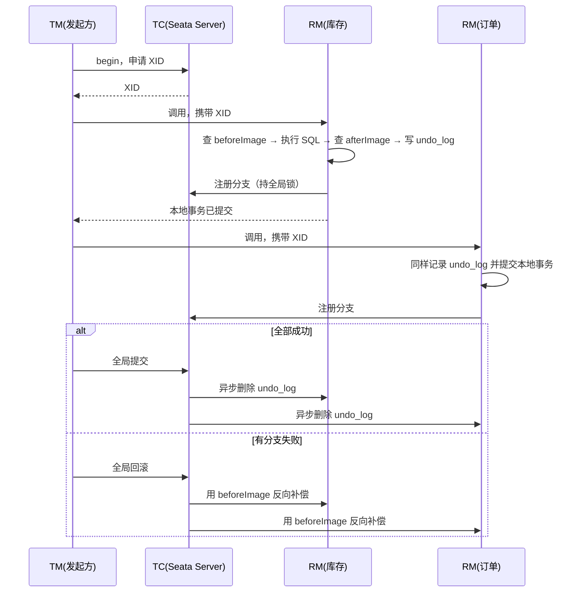
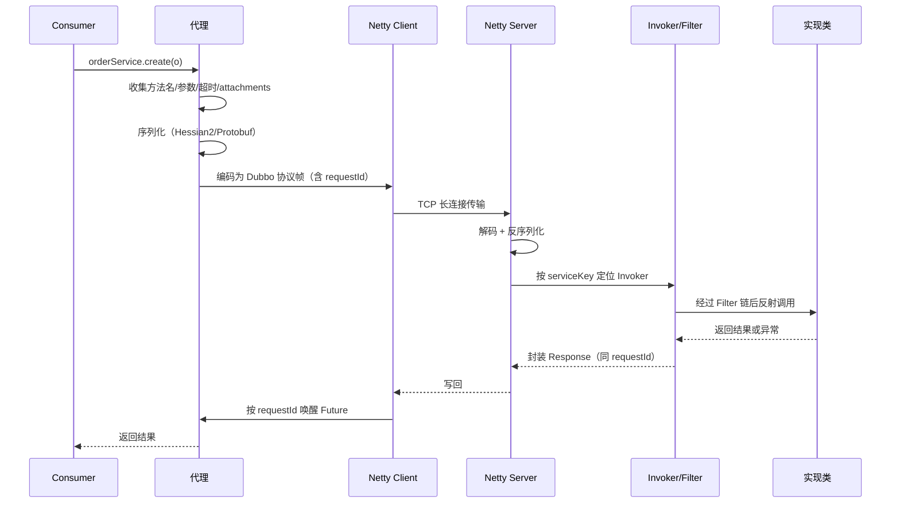

# 第 12 章 分布式与微服务：一致性、可用性与治理

> 一句话定位：这一章不考"你知道几个组件"，考的是你能不能在"一致性、可用性、复杂度"三者之间做出有理由的取舍，并且说得出代价。

## 一、本章考察重点概览

分布式题的特点是**没有标准答案，只有权衡理由**。同一个问题，回答"用 Seata 保证强一致"和回答"这里业务允许最终一致，用本地消息表更稳"，面试官的评价会完全不同——差别不在方案新旧，而在你是否知道自己放弃了什么。

面试官在这一章筛四件事：

1. **你是否理解分布式带来的根本困难。** 网络不可靠、时钟不可信、进程可能随时消失。所有方案（2PC、TCC、Saga、消息）本质上都在处理"部分失败"，能说清这一点，后面的方案就不用死记。
2. **你是否会算账。** 拆微服务的收益是独立部署与独立扩缩容，代价是分布式事务、链路变长、运维复杂度上升。说不出代价的人，通常是只在新项目里用过，没经历过故障。
3. **你是否掌握治理手段的适用边界。** 超时、重试、熔断、限流、降级、隔离，这六个手段每一个都有反作用：重试会放大流量，熔断会误杀，限流失误伤正常用户。能说出反作用，才算会用。
4. **你是否有排障经验。** 服务假死、连接池耗尽、线程池打满、注册中心脑裂，这些是微服务架构的"常见病"，答得出来说明你在生产环境待过。

| 考点 | 出现频率 | 难度 | 说明 |
| --- | --- | --- | --- |
| 微服务演进与拆分代价 | 高 | 中级 | 常作为开场，考察判断力而非知识点 |
| CAP / BASE 的正确理解 | 高 | 中级 | 背"三选二"会直接被追问到露馅 |
| 分布式事务方案选型 | 高 | 高级 | 要求说清每种方案的失败场景与代价 |
| Seata AT 原理 | 中 | 高级 | 近两年国内项目常用，问得较细 |
| 分布式 ID | 高 | 中级 | 雪花算法必问，时钟回拨是分水岭 |
| 注册中心 CP/AP | 高 | 中级 | Nacos 的临时/持久实例常被追问 |
| RPC 调用链路 | 高 | 中级 | 要求能从代理讲到序列化再讲到网络 |
| 超时与重试 | 高 | 高级 | 重试放大是高频事故题 |
| 熔断限流降级 | 高 | 中级 | 常要求对比四种限流算法 |
| 幂等设计 | 高 | 中级 | 方案题，必须给出多种手段的组合 |
| 链路追踪 | 中 | 中级 | TraceId/SpanId 的传播是重点 |
| 优雅上下线 | 中 | 中级 | 考工程细节，答得出来加分明显 |

## 二、复习优先级

| 优先级 | 题目编号 | 理由 |
| --- | --- | --- |
| P0 | Q2、Q4、Q7、Q9、Q10、Q11、Q13 | 主干题，几乎每场分布式面试都会覆盖 |
| P1 | Q1、Q3、Q5、Q6、Q8、Q12、Q15、Q16 | 决定你能否把方案讲到落地层 |
| P2 | Q14、Q17、Q18 | 加分项，记住核心概念与一两个例子即可 |

时间分配建议：本章 3 天。P0 占 60%，其中 Q4（分布式事务）与 Q10（超时重试）必须能画出时序并说出失败点；P1 占 35%，重点是把"代价"讲清楚；P2 占 5%，面试前一天扫一遍。

## 三、高频面试题清单

| 编号 | 题目 | 面试难度 | 阅读门槛 | 优先级 | 一句话答案 |
| --- | --- | --- | --- | --- | --- |
| Q1 | 为什么从单体走向微服务？代价是什么？什么规模不该拆？ | 中级 | 中 | P1 | 收益是独立部署与独立扩缩容，代价是分布式事务、链路变长、运维成本，小团队小流量不该拆 |
| Q2 | 如何正确理解 CAP 与 BASE？ | 中级 | 中 | P0 | P 是必选项，分区时在 C 与 A 之间取舍；BASE 是用最终一致换可用性 |
| Q3 | 强一致、最终一致、线性一致、顺序一致怎么区分？ | 高级 | 高 | P1 | 线性一致最强（带实时性），顺序一致只管顺序，最终一致只保证收敛 |
| Q4 | 分布式事务有哪几种方案？各自代价是什么？ | 高级 | 高 | P0 | 2PC 强一致但阻塞，TCC 性能好但侵入大，Saga 无隔离，消息最终一致 |
| Q5 | Seata AT 模式的原理是什么？ | 高级 | 高 | P1 | 前后镜像 + undo log + 全局锁，本地事务提交后靠反向 SQL 补偿 |
| Q6 | 分布式 ID 有哪些方案？雪花算法的时钟回拨怎么解决？ | 中级 | 中 | P1 | UUID、自增、号段、雪花；回拨靠等待、报警、历史最大值或借位 |
| Q7 | 注册中心选 CP 还是 AP？Nacos 的临时实例与持久实例有何区别？ | 高级 | 高 | P0 | 注册中心优先 AP；临时实例靠心跳走 AP，持久实例靠 Raft 走 CP |
| Q8 | 常见负载均衡算法有哪些？一致性哈希解决什么问题？ | 中级 | 中 | P1 | 轮询、加权、最少活跃、一致性哈希；虚拟节点解决数据倾斜 |
| Q9 | 一次 RPC 调用经历了什么？为什么比 HTTP 快？ | 中级 | 中 | P0 | 代理 → 序列化 → 协议编码 → 网络 → 反序列化 → 反射调用 → 回传 |
| Q10 | 超时和重试该怎么设置？重试为什么会放大故障？ | 高级 | 高 | P0 | 上游超时 > 下游耗时；重试指数放大流量，必须幂等 + 退避 + 预算 |
| Q11 | 熔断、限流、降级分别解决什么问题？ | 中级 | 中 | P0 | 熔断止损、限流控入口、降级保核心；三者配合而非替代 |
| Q12 | 什么是雪崩？舱壁模式怎么防？线程池隔离与信号量隔离怎么选？ | 高级 | 高 | P1 | 一个依赖拖垮全部调用；隔离故障域，线程池隔离彻底但有切换成本 |
| Q13 | 如何设计幂等？ | 中级 | 中 | P0 | token、唯一索引、状态机、去重表、乐观锁，通常组合使用 |
| Q14 | 链路追踪的原理是什么？ | 中级 | 中 | P2 | TraceId 贯穿全链路，SpanId 标识单段，通过协议头透传并串联日志 |
| Q15 | 配置中心、灰度发布、优雅上下线怎么做？ | 中级 | 中 | P1 | 推拉结合 + 长轮询；按比例/标签引流；先摘流量再停服 |
| Q16 | 服务该怎么拆？什么是分布式单体？ | 高级 | 高 | P1 | 按限界上下文与业务能力拆，共享库/共享库表/长同步链就是分布式单体 |
| Q17 | 微服务常见故障有哪些？怎么排查？ | 高级 | 高 | P2 | 假死、连接池耗尽、线程池打满、注册中心脑裂 |
| Q18 | 服务网格与 Sidecar 是什么？ | 中级 | 中 | P2 | 把治理能力下沉到边车代理，业务代码零侵入，代价是延迟与运维复杂度 |

## 四、题目详解

### Q1. 为什么从单体走向微服务？代价是什么？什么规模不该拆？（中级）

> 前置：单体、拆分、治理成本

**一句话结论**：微服务换来的核心收益是**独立部署与独立扩缩容**，代价是分布式事务、调用链变长、运维与观测成本上升；团队规模小、流量低、业务边界还没稳定的阶段，拆分的成本远大于收益。

**先把话说白**：单体像一间大开间，谁说话都听得见，改个灯要动整层电闸，但沟通成本几乎为零。微服务像一栋栋独立小楼，每栋自己配电、自己装修，但楼与楼之间要修路、要通信、要处理"这边停电那边还不知道"的问题。楼不是越多越好，取决于你有多少人、业务是否真的需要独立演进。

**底层原理**：

1. **收益来自"独立"两个字。** 独立部署意味着一个服务发版不影响其他服务；独立扩缩容意味着订单服务可以 20 个实例而用户服务只需 2 个；独立技术栈意味着新服务可以用新框架。这三条只有在"业务变化频率差异大"或"负载差异大"时才真正产生价值。

2. **代价一：原本的方法调用变成了网络调用。** 网络有延迟、会超时、会丢包、会重复。原本一个 `try-catch` 能解决的事，现在要处理超时、重试、幂等、熔断、序列化兼容。一次本地调用 0.1 微秒，一次跨机房 RPC 可能 1 毫秒以上，差四个数量级。

3. **代价二：原本的数据库事务变成了分布式事务。** 单体里一个 `@Transactional` 搞定的事，拆分后跨了库，要么引入 2PC/TCC 牺牲性能，要么接受最终一致并处理中间状态。中间状态意味着业务要能容忍"钱扣了订单还没建"这种短暂不一致。

4. **代价三：排障从"看一个日志文件"变成"跨十个服务串联"。** 必须有统一的 TraceId、集中日志、指标监控、告警。没有这套基础设施就拆微服务，等于在没有路灯的路上开夜车。

5. **代价四：组织与流程成本。** 每个服务要有 owner、要有 CI/CD 流水线、要有独立的配置与密钥管理、要有容量规划。康威定律在这里生效：系统结构最终会映射团队结构，团队没拆干净，服务也拆不干净。

6. **什么规模不该拆。** 团队少于 10 人、日活或 QPS 远未触及单体瓶颈（单库单应用能撑住的量级）、业务边界仍在快速试错阶段、没有日志/监控/发布体系。这四种情况下，模块化单体（modular monolith）是更理性的选择：代码分模块、边界清晰，但部署仍是一个进程。

**易混对比**：

| 维度 | 单体 | 微服务 |
| --- | --- | --- |
| 部署 | 一次全量 | 每服务独立 |
| 事务 | 本地事务，ACID | 分布式事务或最终一致 |
| 调用 | 进程内方法调用 | 网络调用，需处理超时重试 |
| 扩缩容 | 整体扩容 | 按服务扩容 |
| 排障 | 单一日志 | 需要链路追踪 |
| 适用 | 小团队、边界未定 | 大团队、边界清晰、负载差异大 |

**面试追问**：
- 追问：什么样的业务最适合先拆？→ 答题要点：变更频率高、负载特征独立、故障影响面需要隔离的边缘业务（如消息通知、文件处理），而不是核心交易链路。
- 追问：模块化单体和微服务的界限在哪？→ 答题要点：是否独立进程、独立部署、独立数据库；模块化单体保留清晰边界但不承担网络成本。
- 追问：拆分后最先暴露的问题通常是什么？→ 答题要点：跨服务查询（原本一条 JOIN 变成多次调用）和分布式事务，其次是链路变长导致的超时叠加。

### Q2. 如何正确理解 CAP 与 BASE？（中级）

> 前置：一致性、可用性、分区容错

**一句话结论**：CAP 说的是"网络分区发生时，只能在一致性（C）与可用性（A）之间取舍"，而分区（P）在分布式系统中不是可选项；BASE 是在承认这一点后，用基本可用、软状态、最终一致来换取系统的持续服务能力。

**先把话说白**：CAP 常被误读成"三个里挑两个"。真实情况是：只要系统跨网络部署，网络就可能断，P 你没法放弃。所以真正的选择只发生在"网断了以后"——是拒绝服务保证数据绝对一致（选 C），还是继续用可能旧的数据响应（选 A）。

**底层原理**：

1. **三个字母的准确定义。** C（Consistency）指线性一致：任何读都能看到最近一次成功写入的结果；A（Availability）指每个非故障节点都能在有限时间内返回非错误响应；P（Partition tolerance）指网络分区时系统仍能继续运行。注意 A 的定义里不含"数据正确"，只含"能响应"。

2. **为什么 P 必须选。** 分区不是"要不要容忍"，而是"发生了怎么办"。跨机房、跨可用区、甚至同机房内的交换机故障都会造成分区。一个声称"选 CA"的系统，只是在假设网络永不分区的单机环境里成立——那它本来就不是分布式系统。

3. **分区时的真实取舍。** 主从架构里，主节点与从节点断连，要么主继续接受写（选 A，但可能脑裂、数据冲突），要么主停止写（选 C，但不可用）。Raft/Paxos 选择少数派不可写，属于 CP；Eureka 选择各节点继续提供服务（可能返回过期实例），属于 AP。

4. **BASE 是什么。** Basically Available（基本可用：允许降级、限流、延迟响应）、Soft state（软状态：允许中间状态存在）、Eventually consistent（最终一致：经过一段时间后所有副本收敛）。它是 AP 方向的工程化表述，不是 CAP 的替代理论。

5. **实际系统是混合的。** 同一个系统里不同数据可以有不同取舍：库存扣减要 CP（不能超卖），商品详情可以 AP（旧一点没关系），订单查询可以最终一致（延迟几秒可接受）。回答"你们系统是 CP 还是 AP"时，正确的答法是"按业务分数据分级"。

**易混对比**：

| 系统/组件 | 分区时的选择 | 表现 |
| --- | --- | --- |
| ZooKeeper / Etcd | CP | 少数派不可写，选主期间不可用 |
| Eureka | AP | 节点间不同步，可能返回过期实例 |
| Nacos 临时实例 | AP（Distro） | 各节点独立处理，最终同步 |
| Nacos 持久实例 | CP（Raft） | 需多数派确认 |
| Redis 主从（异步复制） | AP | 故障切换可能丢数据 |
| MySQL 半同步复制 | 偏 CP | 至少一个从库确认才提交 |

**面试追问**：
- 追问：CAP 里的 C 和 ACID 里的 C 是一回事吗？→ 答题要点：不是。CAP 的 C 是线性一致（多副本读到的值），ACID 的 C 是约束不被破坏（如外键、唯一性），后者是事务属性。
- 追问：BASE 会不会导致业务出错？→ 答题要点：会，所以要把"最终一致"的中间状态设计成业务可接受的状态（如"处理中"），并用对账兜底。
- 追问：为什么说 CAP 不适合用来做选型？→ 答题要点：它只描述分区期间的极端取舍，不涉及延迟、吞吐、运维成本；工程选型更常用 PACELC（分区时选 A/C，无分区时选延迟 L 还是一致性 C）。

**加分点**：能提到 PACELC 说明你读过原文而不是只背二手总结。绝大多数时候系统不在分区状态，真正的日常取舍是"延迟 vs 一致性"。

### Q3. 强一致、最终一致、线性一致、顺序一致怎么区分？（高级）

> 前置：线性一致、顺序一致

**一句话结论**：线性一致最强，要求读写像单副本且遵守真实时间顺序；顺序一致只要求所有进程看到相同的操作顺序，不要求与真实时间对齐；最终一致最弱，只要求停止写入后副本最终收敛。

**先把话说白**：把分布式系统想成多人同时编辑同一份文档。线性一致是"任何人保存后，别人立刻看到最新版"；顺序一致是"大家看到的修改顺序一样，但可能都慢半拍"；最终一致是"现在看到的可能不一样，但过一会儿总会一样"。

**底层原理**：

1. **线性一致（Linearizability）。** 每个操作看起来都在某个时间点原子生效，且这个时间点落在操作的开始与结束之间。它包含实时性约束：如果写操作在读操作开始前已经返回，读必须看到这个写。实现代价是需要共识协议（Raft/Paxos）或单主同步复制。

2. **顺序一致（Sequential Consistency）。** 所有进程看到的操作顺序一致，且每个进程内部的顺序与它发出的顺序一致，但不同进程之间不要求真实时间对齐。它比线性一致弱：允许"写已返回但读还没看到"，只要所有读者看到的顺序相同。

3. **因果一致（Causal Consistency）。** 只保证有因果关系的操作有序（先发消息后看到消息），无因果关系的可以乱序。很多协同编辑、评论系统用它，性能比线性一致好。

4. **最终一致（Eventual Consistency）。** 不保证任何时刻的读，只保证"不再有新写入后，副本最终会一致"。它必须配合"如何读到自己刚写的数据"（read-your-writes）这类会话保证，否则用户体验会很差。

5. **强一致是个模糊词。** 工程上说"强一致"通常指线性一致或严格串行化，但不同人用法不同。面试时最好明确："我这里说的强一致指线性一致"。这种表述本身就是加分项。

**易混对比**：

| 模型 | 是否要求全局顺序 | 是否要求实时性 | 典型实现 |
| --- | --- | --- | --- |
| 线性一致 | 是 | 是 | Raft 读写主节点、ZooKeeper |
| 顺序一致 | 是 | 否 | 部分多播协议 |
| 因果一致 | 仅因果相关 | 否 | 部分分布式数据库 |
| 最终一致 | 否 | 否（只要求收敛） | DNS、异步复制、消息队列 |

**面试追问**：
- 追问：Redis 主从是强一致吗？→ 答题要点：不是，异步复制，主节点写完即返回，从节点可能落后；故障切换还可能丢数据。
- 追问：数据库的"可重复读"是线性一致吗？→ 答题要点：不是，它是单机事务隔离级别，描述同一事务内多次读的一致性，与多副本之间的一致性不是同一维度。
- 追问：怎么让用户"读到自己的写"？→ 答题要点：写后一段时间内路由到主库、把版本号带在 token 里让从库等待追平、或用会话粘滞。

### Q4. 分布式事务有哪几种方案？各自代价是什么？（高级）

> 前置：2PC、TCC、Saga、消息

**一句话结论**：主流五类是 2PC/XA（强一致、同步阻塞）、TCC（业务补偿、性能好但侵入大）、Saga（长流程补偿、无隔离性）、本地消息表（最终一致、实现简单）、事务消息（MQ 保证半消息与回查）；选择依据是"业务能否容忍中间状态"和"能否改造业务接口"。

**先把话说白**：分布式事务的本质是"多个独立的数据库，要么一起成功，要么一起失败"，但网络随时可能断在中间。所有方案都在回答一个问题：**断在最坏的位置时，怎么收场**。2PC 是把决定权交给协调者，TCC 是让业务自己写"预占/确认/释放"，Saga 是"先做，错了再补"，消息是"先记下来，保证一定送到"。

**底层原理**：

1. **2PC / XA。** 协调者先向所有参与者发 `prepare`，参与者执行事务但不提交、锁定资源并返回投票；全部 OK 后发 `commit`，否则发 `rollback`。XA 是 X/Open 定义的接口标准，MySQL 的 InnoDB 支持。问题有三：同步阻塞（prepare 后资源一直被锁）、协调者单点（协调者挂了参与者长期悬挂）、极端情况下数据不一致（部分参与者收到 commit、部分没收到）。性能差，通常只用于内部短事务或强一致要求极高的场景。

2. **TCC（Try-Confirm-Cancel）。** 业务层实现三个方法：Try 预留资源（冻结库存、预扣额度），Confirm 确认（真正扣减，必须成功且幂等），Cancel 释放（解冻，必须幂等且能处理空回滚）。它把锁的粒度从数据库行锁下沉到业务资源，性能比 2PC 好，但侵入性最强，每个参与方都要写三套逻辑。两个经典坑：**空回滚**（Try 没到，Cancel 先到，需要记录事务状态直接返回成功）、**悬挂**（Cancel 先执行，Try 后到并冻结了资源，需要 Try 检查是否已 Cancel）。

3. **Saga。** 把长事务拆成一串本地事务 T1..Tn，每个 Ti 配一个补偿 Ci。任一步失败就逆序执行已完成的补偿。它没有隔离性——中间状态对外可见（比如订单已创建但库存还没扣），需要业务设计"待确认"状态来遮蔽。适合流程长、参与方多、能接受最终一致的场景（旅行订票、订单履约）。实现分编排式（中央协调器）和协同式（事件驱动，无中心）。

4. **本地消息表。** 业务表与消息表在同一个库，用同一个本地事务写入，保证"业务成功则消息一定落库"；再由定时任务扫描消息表投递到 MQ，投递成功后标记。下游必须幂等。优点是实现简单、不依赖特殊中间件；缺点是消息表与业务库耦合、有轮询延迟、需要处理投递失败的补偿。

5. **事务消息（RocketMQ）。** 生产者先发"半消息"到 Broker（对消费者不可见），Broker 确认收到后生产者执行本地事务，再根据结果 `commit` 或 `rollback`；若生产者没回应，Broker 定时回查本地事务状态。它比本地消息表少了轮询表，但依赖 MQ 的实现，且回查接口必须幂等、可查询。

6. **选型的三个问题。** 业务能否容忍中间状态（能→消息/Saga；不能→2PC/TCC）；能否改造所有参与方接口（能→TCC；不能→消息）；流程有多长（长→Saga；短→2PC/TCC）。没有一种方案在所有维度都优。

**五种方案对比**：

| 方案 | 一致性 | 隔离性 | 性能 | 业务侵入 | 典型场景 |
| --- | --- | --- | --- | --- | --- |
| 2PC / XA | 强一致 | 有（资源锁定） | 差（同步阻塞） | 低（依赖驱动） | 内部短事务、跨库强一致 |
| TCC | 最终一致（偏强） | 业务资源预留 | 好 | 高（三个接口） | 支付、库存、额度 |
| Saga | 最终一致 | 无 | 好 | 中（补偿逻辑） | 长流程、多参与方 |
| 本地消息表 | 最终一致 | 无 | 好 | 中（消息表） | 订单成功后发通知/积分 |
| 事务消息 | 最终一致 | 无 | 好 | 中（回查接口） | 已有 RocketMQ 的异步链路 |

```java
// TCC 的三个接口：Try 预留、Confirm 确认、Cancel 释放
public interface InventoryTccService {
    // Try：冻结库存，幂等，需检查是否已被 Cancel（防悬挂）
    @TwoPhaseBusinessAction(name = "deductStock", commitMethod = "confirm", rollbackMethod = "cancel")
    boolean tryDeduct(@BusinessActionContextParameter(paramName = "skuId") Long skuId,
                      @BusinessActionContextParameter(paramName = "count") int count,
                      BusinessActionContext ctx);

    // Confirm：真正扣减，必须幂等，失败要一直重试
    boolean confirm(BusinessActionContext ctx);

    // Cancel：解冻；若 Try 未执行过，直接返回成功（防空回滚）
    boolean cancel(BusinessActionContext ctx);
}
```

**面试追问**：
- 追问：TCC 的空回滚和悬挂怎么防？→ 答题要点：建一张事务控制表，以 `xid + branchId` 为主键记录状态；Cancel 先到时插入"已回滚"记录，Try 到来时检查到该记录直接拒绝；Cancel 遇到不存在的 Try 记录直接返回成功。
- 追问：Saga 没有隔离性，业务上怎么补救？→ 答题要点：用状态机把中间态显式化（待支付、待发货），对查询做过滤；对关键资源用预占代替直接扣减；补偿必须幂等且能重试。
- 追问：为什么 2PC 性能差还要用？→ 答题要点：强一致且业务改造最小的场景，比如银行内部跨库转账、短事务；长事务用 2PC 会长时间持锁，绝对不能接受。
- 追问：本地消息表的消息会不会重复投递？→ 答题要点：会，至少一次语义，所以下游必须幂等；同时需要"已发送"状态与重试次数上限，避免死循环。

**加分点**：指出"分布式事务不是技术问题而是业务问题"——绝大多数场景应该先问"这个中间状态业务能不能接受"，而不是直接上框架。框架解决的是技术一致性，业务补偿才是一致性的最后一道防线。

### Q5. Seata AT 模式的原理是什么？（高级）

> 前置：全局锁、undo、回滚

**一句话结论**：AT 模式通过解析 SQL 自动生成前后镜像与 undo log，本地事务提交后立即释放数据库锁，全局回滚时用 before image 生成反向 SQL 补偿，并用 TC 侧的全局锁防止其他全局事务修改同一行。

**先把话说白**：AT 是"自动化的 TCC"。你不用写 Try/Confirm/Cancel，框架在你执行 `update` 前先把这行数据拍张照（before image），执行后再拍一张（after image），一起写进 undo log 表，和业务 SQL 在同一个本地事务里提交。要回滚时，它拿旧照片把数据改回去。

**底层原理**：

1. **三个角色。** TC（Transaction Coordinator，事务协调器，独立部署的 Seata Server）维护全局事务与分支事务的状态；TM（Transaction Manager，事务管理器）在发起方，负责 `begin`/`commit`/`rollback` 全局事务；RM（Resource Manager，资源管理器）在被调用方，负责分支注册、undo log 与回滚。

2. **第一阶段：执行业务并记录。** TM 向 TC 申请全局事务 ID（XID），XID 通过 RPC 上下文传播到各分支。RM 拦截业务 SQL：解析出表名、主键、`beforeImage`（`select` 出修改前的数据）、执行 SQL、再 `select` 出 `afterImage`，把两者与 SQL 类型写入 `undo_log` 表，然后**提交本地事务**并向 TC 注册分支。注意本地事务是真提交的，所以数据库行锁立即释放。

3. **全局锁。** 本地锁释放了，但 TC 侧对这个 `table + pk` 加了一把全局锁，其他全局事务想改同一行必须先拿到这把锁。这是 AT 能在"本地已提交"的前提下防止脏写的关键。

4. **第二阶段提交。** TC 收到所有分支的 OK 后，通知各 RM 异步删除 `undo_log`。这一步很轻，几乎无阻塞，这是 AT 比 2PC 性能好的原因。

5. **第二阶段回滚。** TC 通知 RM 用 `beforeImage` 生成反向 SQL（`update` 改回原值、`insert` 变 `delete`、`delete` 变 `insert`）。执行前会校验当前数据的 `afterImage` 是否与记录一致——不一致说明被别的全局事务改过（脏写），需要人工介入。补偿 SQL 也要写新的 undo log，以便回滚失败时重试。

6. **隔离级别的真相。** AT 的默认隔离是**读未提交**：因为本地事务已提交，其他事务能读到中间状态。要避免脏读，需要用 `@GlobalLock + select for update` 让查询也去竞争全局锁，代价是性能下降。这是 AT 最容易被忽略的代价。



**易混对比**：

| 维度 | Seata AT | TCC | 2PC/XA |
| --- | --- | --- | --- |
| 业务侵入 | 无（加注解即可） | 高（三个接口） | 无 |
| 锁粒度 | 行级全局锁 | 业务资源 | 数据库资源 |
| 隔离性 | 默认读未提交 | 由业务保证 | 有 |
| 性能 | 较好 | 最好 | 最差 |
| 回滚方式 | 反向 SQL 自动补偿 | 业务 Cancel | 数据库回滚 |

**面试追问**：
- 追问：AT 的全局锁会不会成为瓶颈？→ 答题要点：会，热点行（如库存）的全局锁会串行化，高并发下不如 TCC 或本地扣减 + 异步同步。
- 追问：undo_log 表需要建在哪个库？→ 答题要点：每个业务库都要有，因为它是本地事务的一部分，必须与业务 SQL 同库同事务。
- 追问：AT 支持哪些 SQL？→ 答题要点：支持 `insert`/`update`/`delete` 与基于主键的 `select for update`；不支持多表关联更新、复杂子查询等，遇到不支持的 SQL 会退化为全局锁模式。
- 追问：AT 和 XA 的本质差别？→ 答题要点：XA 在 prepare 阶段不提交、持数据库锁；AT 直接提交本地事务，用全局锁 + undo log 补偿换取吞吐。

### Q6. 分布式 ID 有哪些方案？雪花算法的时钟回拨怎么解决？（中级）

> 前置：雪花算法、时钟回拨、号段

**一句话结论**：常见方案有 UUID（本地生成但无序）、数据库自增（简单但有瓶颈）、号段模式（批量取号、性能好）、雪花算法（趋势递增、高性能但依赖时钟）；时钟回拨通过等待追平、检测报警、记录历史最大值或借助外部存储解决。

**先把话说白**：分布式 ID 要同时满足四个要求：全局唯一、趋势递增（对 B+ 树友好）、高可用（不能靠单点）、不可预测（防止被爬或被猜）。没有一种方案能全占，只能按业务优先级取舍。

**底层原理**：

1. **UUID。** 本地生成、无网络开销、绝对不会重复。但它是无序的（v4 随机），作为 InnoDB 主键会导致页分裂、插入性能下降、索引膨胀；36 个字符也比 `bigint` 大得多。适合做链路追踪 ID、幂等 token，不适合做主键。

2. **数据库自增。** 单表 `auto_increment` 最简单，但单点瓶颈且暴露业务量。改进是多实例设置不同步长（`auto_increment_increment`、`auto_increment_offset`），但扩容时要改步长，运维麻烦，且仍然依赖数据库。

3. **号段模式。** 服务一次从数据库取一段（如 1000 个）ID 缓存在内存，用完再取。数据库只承担"分配号段"的低频操作，性能提升几个数量级。美团 Leaf-segment 在此之上做了双 buffer：当前号段用到 10% 时异步预取下一段，避免取号时的毛刺；并用 ZooKeeper 保证多实例不重复分配。

4. **雪花算法（Snowflake）。** 64 位：1 位符号位固定 0，41 位毫秒时间戳（约 69 年），10 位机器 ID（1024 台），12 位序列号（每毫秒 4096 个）。趋势递增、本地生成、性能极高。缺点是强依赖机器时钟：回拨会产生重复 ID；机器 ID 分配需要外部管理（ZooKeeper、配置中心或 K8s StatefulSet 序号）。

5. **时钟回拨的处理。** 四种思路：**等待**（回拨小于阈值如 5ms 就自旋等待追平，简单但会短暂阻塞）；**拒绝服务**（超过阈值直接抛异常，让上层重试或告警）；**历史最大值**（内存记录本机最大时间戳，回拨时用 `max(lastTimestamp, current)` 继续递增，牺牲时间真实性换可用性）；**外部存储兜底**（Leaf-snowflake 用 ZooKeeper 记录上次时间戳，启动时校验，运行期回拨则报警并拒绝）。

6. **其他方案。** 百度 UidGenerator 用 RingBuffer 预生成、Cursor 消费，吞吐更高；滴滴 TinyID 基于号段 + 多级缓存；Redis `INCR` 简单但有网络往返与持久化风险（`RDB` 恢复可能回退）；数据库 + 分段 + 多 businessType 的组合在中小规模最实用。

```java
public synchronized long nextId() {
    long now = System.currentTimeMillis();
    if (now < lastTimestamp) {                       // 时钟回拨
        long offset = lastTimestamp - now;
        if (offset <= 5) {                           // 小回拨：等待追平
            now = waitUntil(lastTimestamp);
        } else {
            throw new IllegalStateException("clock moved backwards: " + offset + "ms");
        }
    }
    if (now == lastTimestamp) {
        sequence = (sequence + 1) & 4095;            // 12 位，溢出归零
        if (sequence == 0) now = waitUntil(lastTimestamp + 1);  // 同毫秒用尽，等下一毫秒
    } else {
        sequence = 0;
    }
    lastTimestamp = now;
    return ((now - EPOCH) << 22) | (workerId << 12) | sequence;
}
```

**易混对比**：

| 方案 | 唯一性保障 | 有序性 | 性能 | 主要缺点 |
| --- | --- | --- | --- | --- |
| UUID | 概率唯一 | 无序 | 高 | 主键插入差、占空间 |
| 数据库自增 | 单库唯一 | 严格递增 | 低 | 单点瓶颈、难扩容 |
| 号段模式 | 数据库分配 | 趋势递增 | 高 | 依赖数据库、重启浪费号段 |
| 雪花算法 | 机器 ID + 时间 + 序列 | 趋势递增 | 极高 | 时钟回拨、机器 ID 管理 |
| Redis INCR | 单实例唯一 | 严格递增 | 中 | 网络开销、持久化回退 |

**面试追问**：
- 追问：雪花算法的 41 位时间戳能用多久？→ 答题要点：约 69 年（2^41 毫秒），从自定义纪元开始算，所以纪元不要设成 1970，否则浪费几十年。
- 追问：容器化环境怎么分配 workerId？→ 答题要点：K8s 用 StatefulSet 的序号、ConfigMap 映射 Pod 名、或启动时向 ZooKeeper/Redis 注册临时有序节点。
- 追问：号段模式重启会不会浪费 ID？→ 答题要点：会，未用完的号段直接丢弃，产生空洞；ID 只要求唯一不要求连续，通常可接受。
- 追问：为什么 UUID 做主键性能差？→ 答题要点：InnoDB 聚簇索引按主键顺序组织，随机主键导致频繁页分裂与随机 IO，插入性能与缓存命中率都下降。

### Q7. 注册中心选 CP 还是 AP？Nacos 的临时实例与持久实例有何区别？（高级）

> 前置：CP / AP、临时实例、心跳

**一句话结论**：注册中心应优先保证可用性（AP），因为"拿到一份可能略旧的实例列表"远好于"整个服务发现不可用"；Nacos 的临时实例走 AP（Distro 协议 + 心跳），持久实例走 CP（Raft + 服务端探测），按需选择。

**先把话说白**：注册中心是"电话簿"。电话簿偶尔有一个号码过期，你打过去失败再换一个，代价可控；但电话簿打不开，所有人都找不到人，整个系统瘫痪。所以电话簿的可用性比准确性更重要。

**底层原理**：

1. **CP 型（ZooKeeper / Etcd / Consul）。** 基于共识协议，写入需要多数派确认。优点是数据一致、不会返回过期实例；缺点是选主期间（通常几百毫秒到几秒）整个集群不可写，分区时少数派完全不可用。ZooKeeper 用临时节点 + session 心跳做健康检查，客户端还会 watch 节点变化。

2. **AP 型（Eureka / Nacos 临时实例）。** 各节点独立接受注册与查询，通过异步复制最终收敛。Eureka 有自我保护机制：15 分钟内续约成功率低于 85% 就不剔除任何实例，防止网络抖动导致大面积误删；代价是可能长时间返回已下线实例。

3. **Nacos 2.x 的两种实例。** 临时实例（`ephemeral=true`，默认）用长连接 + 心跳，数据走 Distro 协议（AP），客户端断开或心跳超时后被剔除；持久实例（`ephemeral=false`）数据写入 Raft 集群（CP），由服务端主动探测健康状态，即使客户端离线实例也不会自动删除。临时实例适合无状态微服务，持久实例适合数据库、DNS 类需要人工维护的固定端点。

4. **健康检查的三种模式。** 客户端心跳（客户端定时上报，服务端超时剔除，实现简单但依赖客户端诚实）、服务端主动探测（TCP/HTTP 探活，能发现进程假死，但有探测开销）、长连接（Nacos 2.x 用 gRPC 长连接，断连即感知，实时性好）。

5. **服务剔除的连锁反应。** 剔除太快会误杀（网络抖动导致瞬间全剔），剔除太慢会流量打到死实例。实践上要配合客户端缓存（本地快照，注册中心全挂也能撑一段时间）、自我保护阈值、以及调用侧的熔断重试。

6. **多注册中心与异地容灾。** 跨机房部署时通常每个机房一个注册中心集群，服务只注册到本机房，调用方优先本机房实例（同机房优先路由），异地只做兜底。Nacos 支持 `cluster-name` 与就近访问。

**易混对比**：

| 注册中心 | 一致性模型 | 健康检查 | 分区时行为 |
| --- | --- | --- | --- |
| ZooKeeper | CP（ZAB） | 临时节点 + session | 少数派不可用，选主期间不可写 |
| Etcd | CP（Raft） | Lease + 主动探测 | 少数派不可用 |
| Eureka | AP | 客户端心跳 + 自我保护 | 各节点继续服务，可能返回旧实例 |
| Nacos 临时实例 | AP（Distro） | 长连接 + 心跳 | 各节点独立服务，最终同步 |
| Nacos 持久实例 | CP（Raft） | 服务端主动探测 | 少数派不可写 |
| Consul | CP（Raft） | 多种探活 | 少数派不可用 |

**面试追问**：
- 追问：Eureka 的自我保护机制是什么？→ 答题要点：统计每分钟续约数，若低于期望值的 85% 就进入保护模式，不剔除任何实例，避免网络分区导致"全军覆没"。
- 追问：注册中心全挂了，服务还能调用吗？→ 答题要点：能。客户端会缓存实例列表到本地，短期可按旧列表调用；新实例无法被发现，扩容与故障转移会失效。
- 追问：为什么不建议用 ZooKeeper 做注册中心？→ 答题要点：CP 模型在选主期间不可用，且大量 watch 与临时节点在高频上下线时压力大；Dubbo 早期用 ZK，后来更多转向 Nacos。
- 追问：Nacos 的临时实例下线后，调用方多久感知？→ 答题要点：取决于心跳超时（默认 15 秒未心跳标记不健康，30 秒剔除）与客户端订阅推送，通常秒级到十几秒。

### Q8. 常见负载均衡算法有哪些？一致性哈希解决什么问题？（中级）

> 前置：一致性哈希、虚拟节点

**一句话结论**：常见算法有轮询、加权轮询、随机、加权随机、最少活跃连接、最短响应时间、一致性哈希；一致性哈希解决"节点增减导致大量请求重新映射"的问题，虚拟节点解决其数据倾斜。

**先把话说白**：负载均衡就是"把活分给谁"。轮询是排队轮流，加权是能力强的多干点，最少活跃是看谁手上活少就给谁，一致性哈希是"同一类活永远给同一个人"，这样他手上的缓存就能复用。

**底层原理**：

1. **轮询与加权轮询。** 轮询假设所有节点能力相同，实现最简单（计数器取模）。加权轮询按权重分配，Nginx 的平滑加权轮询用"当前权重累加、选最大、减去总权重"的方式，避免权重大的节点被连续选中造成毛刺。

2. **随机与加权随机。** 随机在节点数多时分布接近均匀，且无需共享状态，适合无中心场景。加权随机按权重区间取值。缺点是短期可能不均。

3. **最少活跃 / 最短响应。** 记录每个节点当前的活跃请求数或平均响应时间，选最小者。能自适应慢节点，但需要维护状态，且"慢"可能是暂时抖动，容易造成抖动放大。

4. **P2C（Power of Two Choices）。** 随机选两个节点，取其中较优的一个。它以极低成本逼近"最少活跃"的效果，是 Envoy、Nginx 等现代代理的常用策略。

5. **一致性哈希。** 把节点和请求 key 都映射到一个哈希环上，请求顺时针找到第一个节点。节点增减时只有相邻区间的 key 需要迁移，而不是全部重算。代价是节点少时分布不均，需要引入虚拟节点（每个物理节点映射成几十到几百个虚拟点）来均衡。

6. **客户端 vs 服务端负载。** 客户端负载（Dubbo、Spring Cloud LoadBalancer、Ribbon）由调用方选择实例，少一跳、能感知实例元数据、支持灰度；但每个客户端要维护实例列表，语言栈多时重复实现。服务端负载（Nginx、LVS、F5）集中管理、语言无关；但多一跳、无法感知业务元数据。

**易混对比**：

| 算法 | 优点 | 缺点 | 适用 |
| --- | --- | --- | --- |
| 轮询 | 简单、均匀 | 忽略节点能力差异 | 同构无状态服务 |
| 加权轮询 | 按能力分配 | 权重需人工维护 | 机器配置不均 |
| 最少活跃 | 自适应慢节点 | 需维护状态、可能抖动 | 请求耗时差异大 |
| 一致性哈希 | 节点变更影响小 | 易倾斜，需虚拟节点 | 有状态、需缓存亲和 |
| P2C | 近似最优、开销低 | 非全局最优 | 通用代理层 |

**面试追问**：
- 追问：一致性哈希为什么需要虚拟节点？→ 答题要点：物理节点少时在环上分布不均，虚拟节点把每个物理节点打散成多个点，使 key 分布更均匀，节点增减时负载也更平滑。
- 追问：Dubbo 默认用什么负载均衡？→ 答题要点：Dubbo 2.7 默认 `random`（加权随机），可选 `roundrobin`、`leastactive`、`consistenthash`、`shortestresponse`。
- 追问：长连接场景下轮询有什么问题？→ 答题要点：连接建立后不会重新分配，新增节点分不到流量；需要配合连接重建或使用一致性哈希/动态权重。
- 追问：会话粘滞和一致性哈希是一回事吗？→ 答题要点：目标类似但实现不同，粘滞通常基于 cookie 或源 IP，一致性哈希基于请求 key 的哈希环。

### Q9. 一次 RPC 调用经历了什么？为什么比 HTTP 快？（中级）

> 前置：序列化、动态代理、网络模型

**一句话结论**：一次 RPC 调用经历"代理拦截 → 序列化 → 协议编码 → 网络传输 → 反序列化 → 定位 Invoker → 反射或字节码调用 → 结果回传"；比 HTTP 快主要因为二进制协议头更小、长连接复用、序列化更紧凑，但 HTTP/2 + Protobuf 已大幅缩小差距。

**先把话说白**：RPC 就是"让远程调用看起来像本地调用"。你在代码里写 `orderService.create(o)`，实际发生的是：代理把你的方法名和参数打包，通过网络寄到对面，对面拆包、找到对应的方法、执行、再把结果寄回来。你看到的是一次方法调用，背后是一次完整的网络通信。

**底层原理**：

1. **代理拦截。** 调用方注入的是接口的代理对象（JDK 动态代理或 ByteBuddy/Javassist 生成的字节码），`invoke` 时收集接口名、方法名、参数类型、参数值、超时、attachments（隐式参数如 traceId）。

2. **序列化与协议编码。** 把调用信息序列化成字节流（Hessian2、Protobuf、JSON、Kryo），再按协议格式加头：魔数、版本、序列化 ID、请求 ID、body 长度。Dubbo 的 `DubboProtocol` 默认用单一长连接 + 请求 ID 做多路复用；Triple 协议（Dubbo 3）基于 HTTP/2，兼容 gRPC。

3. **网络传输。** 客户端通过 Netty 的 `Channel` 写出，请求 ID 存入 `DefaultFuture` 的等待表；服务端解码后交给线程池处理（Dubbo 的 `Dispatcher` 决定派发策略），处理完按请求 ID 写回响应，客户端 `Future` 被唤醒。

4. **服务端定位与调用。** 服务端从 `exporterMap` 按 `serviceKey`（接口全名 + 版本 + 分组）找到 `Invoker`，经过 Filter 链（限流、超时、异常、token 校验），最终用反射或生成的字节码调用实现类。

5. **Dubbo 的四个角色。** Provider 启动时把服务注册到 Registry；Consumer 订阅并拿到 provider 列表，本地做负载均衡；Monitor 收集调用量、耗时、失败率（默认每分钟上报）；Registry 只负责"地址簿"，调用是直连的，不经过注册中心。

6. **为什么比 HTTP 快（要谨慎表述）。** 一是协议开销小：Dubbo 协议头约 16 字节，HTTP/1.1 的头可能几百字节；二是长连接多路复用，避免频繁建连；三是序列化紧凑（Hessian2/Protobuf 比 JSON 小），减少带宽与解析开销；四是省去 HTTP 语义处理（路由、缓存、内容协商）。但 HTTP/2 支持多路复用与头压缩，gRPC 用 Protobuf，差距已经不大，很多场景的瓶颈在业务与数据库而非协议。

7. **序列化选型。** Hessian2 是 Dubbo 2.x 默认，兼容 Java 类型、跨语言一般；Protobuf 体积最小、性能好、强 schema，但需要 IDL 与代码生成；JSON 可读、调试方便、体积大；Kryo/FST 快但跨版本兼容性差，不适合长期演进的服务。选型要同时看"性能、兼容性、可读性、跨语言"。



**易混对比**：

| 维度 | Dubbo 协议（2.x） | HTTP/1.1 + JSON | gRPC / Triple |
| --- | --- | --- | --- |
| 协议头 | 约 16 字节 | 数百字节文本 | HTTP/2 二进制头，HPACK 压缩 |
| 连接 | 单长连接多路复用 | 默认短连接或 Keep-Alive 串行 | 长连接多路复用 |
| 序列化 | Hessian2 等 | JSON | Protobuf |
| 跨语言 | 一般 | 好 | 好 |
| 适用 | 内部高性能调用 | 对外 API、调试友好 | 多语言、云原生 |

**面试追问**：
- 追问：Dubbo 为什么用单一长连接而不是连接池？→ 答题要点：长连接 + 请求 ID 多路复用，减少建连开销；单连接在流量极大时可能成为瓶颈，可通过 `connections` 配置多连接。
- 追问：RPC 调用超时后，服务端还会继续执行吗？→ 答题要点：会。超时只是客户端放弃等待，服务端可能仍在处理，这也是必须做幂等的原因。
- 追问：序列化为什么不能用 JDK 原生？→ 答题要点：体积大、性能差、有反序列化安全风险、跨语言不友好，且对类结构变化敏感。
- 追问：Dubbo 3 的 Triple 协议解决什么？→ 答题要点：兼容 gRPC、支持 HTTP/2 与流式调用、穿透网关更友好，解决了 Dubbo 协议难以被通用网关识别的问题。

### Q10. 超时和重试该怎么设置？重试为什么会放大故障？（高级）

> 前置：幂等、雪崩、退避

**一句话结论**：超时要从下游往上游逐层放大（上游超时 > 下游超时之和），重试必须建立在幂等、退避、次数上限与重试预算之上；不加约束的重试会以指数级放大流量，把局部故障变成全局雪崩。

**先把话说白**：超时是"我最多等你多久"，重试是"等不到我再问一次"。如果每个人都多问几次，本来就慢的服务会被问得更慢。重试是止痛药，不是消炎药——它能掩盖抖动，但会加重病因。

**底层原理**：

1. **超时设置的基本原则。** 上游的超时必须大于下游的超时（含重试次数 × 单次超时 + 网络开销），否则上游先放弃，下游还在执行，形成"无效工作"并浪费线程。例如 A → B → C，C 的 P99 是 200ms，B 调 C 设 300ms，A 调 B 至少要 400ms 以上。

2. **超时值的来源。** 不要拍脑袋。基于压测的 P99 或 P999 设置，并留 20%~50% 余量；同时设置"绝对上限"防止极端情况。超时太短会误杀正常慢请求，太长会拖垮调用方线程池。

3. **重试放大的数学。** 三层调用每层重试 3 次，最坏情况流量放大 3×3×3=27 倍。如果每一层都在超时时重试，故障瞬间下游会收到远超正常峰值的请求，直接压垮。

4. **只重试"可恢复"的错误。** 连接失败、连接超时、5xx、限流拒绝可以重试；业务错误（4xx、参数非法、余额不足）、非幂等操作（下单、支付）不能盲目重试。读操作天然幂等，写操作必须靠幂等键。

5. **退避与抖动。** 固定间隔重试会让所有客户端在同一时刻再次冲击（惊群）。指数退避（1s、2s、4s）加随机抖动（±20%）能打散重试流量。还要设总重试预算（如不超过请求量的 10%），超出就停止重试直接失败。

6. **重试位置的选择。** 最好只在最外层（面向用户的那一层）重试，内部各层不重试或只做一次快速失败；否则重试会叠加。服务网格里可以用 `VirtualService` 的 `retries` 统一控制，但要小心它与应用层重试叠加。

7. **重试风暴的典型链条。** 某服务变慢 → 调用方超时 → 重试 → 更多请求涌入 → 更慢 → 更多超时。破解点有三个：熔断（直接切断）、限流（保护下游）、重试预算（限制总量）。三者缺一不可。

**易混对比**：

| 错误类型 | 是否重试 | 说明 |
| --- | --- | --- |
| 连接超时 / 连接拒绝 | 是 | 通常是对端重启或网络抖动 |
| 读超时 | 谨慎 | 服务端可能已执行，需幂等 |
| HTTP 5xx | 是（有限次） | 服务端异常，可能有恢复机会 |
| HTTP 429 / 限流 | 是（带退避） | 需要给下游恢复时间 |
| HTTP 4xx | 否 | 参数或权限问题，重试无意义 |
| 业务异常（余额不足） | 否 | 确定性失败 |

**面试追问**：
- 追问：上游超时了，下游还在跑，怎么处理？→ 答题要点：下游要能感知取消（gRPC 的 `Context` 取消传播），或依赖幂等 + 结果查询；无法取消时要限制下游最大执行时间。
- 追问：重试次数一般设几次？→ 答题要点：1~2 次，配合退避；次数越多收益越低、放大越严重，非核心链路可以不重试。
- 追问：熔断和重试会冲突吗？→ 答题要点：不冲突，顺序是"重试耗尽 → 熔断打开 → 直接失败"，熔断是为了在持续失败时停止无意义的重试。
- 追问：怎么做重试预算？→ 答题要点：滑动窗口统计请求总量与重试量，重试占比超过阈值（如 10%）就拒绝新的重试，Envoy 的 `retry_budget` 就是这么做的。

### Q11. 熔断、限流、降级分别解决什么问题？（中级）

> 前置：令牌桶、漏桶、熔断器状态

**一句话结论**：限流控制入口流量、保护自身不被压垮；熔断在下游持续失败时快速失败、避免线程被拖死；降级在资源不足时牺牲非核心功能、保住核心链路。三者是配合关系，不是替代关系。

**先把话说白**：限流是"门口限量放人"，熔断是"发现前面塌方就别再往前走了"，降级是"人手不够时先关掉咖啡厅、保证出餐"。三者分别作用在入口、调用链、功能优先级三个位置。

**底层原理**：

1. **熔断的三态机。** Closed（正常放行，统计失败率）→ 失败率达到阈值转 Open（直接拒绝，不再调用下游）→ 经过冷却时间转 Half-Open（放少量请求试探）→ 成功则回 Closed，失败则回 Open。关键参数是统计窗口、失败率阈值、最小请求数、冷却时长。

2. **Sentinel 的滑动窗口。** 用 `LeapArray` 把时间切成多个桶（默认 1 秒 2 个 500ms 桶），每个桶统计通过数、异常数、RT。熔断策略有三种：慢调用比例（RT 超过阈值的请求占比）、异常比例、异常数。相比固定窗口，滑动窗口避免了临界点双倍流量问题。

3. **限流算法四种。** 固定窗口计数器（简单，但临界点可能放过 2 倍流量）；滑动窗口（把窗口切细，平滑统计，内存换精度）；漏桶（请求先入桶，以恒定速率流出，强制平滑但会排队增加延迟）；令牌桶（按速率生成令牌，请求取令牌，允许短时突发，最常用）。

4. **单机限流 vs 分布式限流。** 单机限流（Guava `RateLimiter`、Sentinel 单机模式）简单、无网络开销，但集群总量 = 单机阈值 × 实例数，扩缩容后不准。分布式限流（Redis + Lua、Sentinel 集群流控）能精确控制总量，但每次请求都要访问 Redis，带来延迟与热点 key 问题，通常用"本地预取令牌 + 批量申请"降低开销。

5. **降级的层次。** 返回兜底数据（默认值、缓存旧值）、关闭非核心功能（推荐位、评论）、同步转异步（写队列稍后处理）、读降级（只读缓存）、限流式降级（随机丢弃部分请求）。降级要有开关、要能自动触发（基于指标）也能手动触发（大促预案）。

6. **三者的协作顺序。** 请求进来先限流（保护自己），调用下游时熔断（保护线程），资源不足时降级（保护核心）。Sentinel 的 `@SentinelResource` 可以把限流、熔断、降级兜底方法串在一个资源上。

**四种限流算法对比**：

| 算法 | 平滑性 | 是否允许突发 | 实现复杂度 | 典型实现 |
| --- | --- | --- | --- | --- |
| 固定窗口计数 | 差（临界点双倍） | 允许 | 低 | 简单计数器 |
| 滑动窗口 | 较好 | 允许 | 中 | Sentinel `LeapArray` |
| 漏桶 | 最好（恒定速率） | 不允许（排队） | 中 | Nginx `limit_req` |
| 令牌桶 | 好 | 允许（桶容量内） | 中 | Guava `RateLimiter` |

**面试追问**：
- 追问：熔断和限流的本质区别？→ 答题要点：限流限制"进来多少"，熔断限制"出去多少"；前者保护自己，后者保护调用方线程与下游。
- 追问：熔断打开后请求怎么办？→ 答题要点：走 fallback（默认值、缓存、快速失败），同时要有告警；Half-Open 阶段只放少量探测流量。
- 追问：为什么固定窗口计数在临界点会出问题？→ 答题要点：窗口切换时计数清零，可能在 1 秒内跨两个窗口放过 2 倍阈值，滑动窗口或令牌桶可以缓解。
- 追问：分布式限流怎么避免 Redis 成为瓶颈？→ 答题要点：本地令牌桶预取（一次取 N 个）、按实例分片、用 Lua 保证原子性、热点场景改用配额分配而非每请求计数。

### Q12. 什么是雪崩？舱壁模式怎么防？线程池隔离与信号量隔离怎么选？（高级）

> 前置：隔离、线程池、信号量

**一句话结论**：雪崩是某个下游变慢或不可用，导致调用方线程/连接被占满，进而拖垮上游、逐级扩散；舱壁模式通过为不同依赖分配独立资源池来限制故障域，线程池隔离彻底但有切换与上下文成本，信号量隔离轻量但只能限制并发数。

**先把话说白**：一艘船进水，如果舱室之间是通的，一个舱进水就沉船；如果有隔板，进水的只是那一舱。微服务里的"隔板"就是给每个下游依赖分配独立的线程池或并发配额，一个依赖卡住不会吃掉全部资源。

**底层原理**：

1. **雪崩的三步链条。** 下游 RT 上升 → 调用方线程阻塞在等待 → 线程池队列堆积 → 线程池满后新请求被拒绝或排队 → 调用方的上游也超时 → 逐级向上扩散。同时重试会放大流量，让下游更难恢复。典型的"慢"比"挂"更可怕，因为挂了会快速失败，慢会把线程占死。

2. **线程池隔离。** 每个下游依赖一个独立线程池，调用变成异步（`Future`），超时直接放弃。优点是隔离彻底、能设置独立队列与拒绝策略、支持超时中断；缺点是线程数随依赖数膨胀、线程切换有开销、`ThreadLocal`（用户上下文、TraceId、事务）不会自动传递，需要手动包装。

3. **信号量隔离。** 用 `Semaphore` 限制同时调用某依赖的线程数，超过就拒绝。优点是零额外线程、开销极小、不涉及上下文切换；缺点是无法主动中断慢调用（只能等它自己返回）、只在当前线程内生效。Hystrix 两种都支持，默认线程池；Sentinel 的并发线程数流控本质是信号量思路。

4. **选择标准。** 依赖耗时长、可能挂起、需要超时中断 → 线程池隔离；依赖本身很快、只是怕并发打满 → 信号量隔离；线程数受限的环境（容器、函数计算）优先信号量。电商的核心交易链路通常对强依赖用线程池、对弱依赖用信号量或直接异步化。

5. **配套手段。** 光隔离不够，还要有：合理超时（不能让线程无限等）、熔断（持续失败就别再调）、限流（入口控量）、降级（兜底返回）、缓存（减少对下游依赖）、异步化（非核心链路改消息）。隔离只是"限制损失范围"，不解决"下游为什么慢"。

6. **缓存的雪崩效应。** 同类问题也出现在缓存层：大量 key 同时过期 → 请求全打到数据库 → 数据库崩。解法是过期时间加随机抖动、热点数据永不过期 + 后台更新、互斥重建（只允许一个线程回源）、多级缓存。

**易混对比**：

| 维度 | 线程池隔离 | 信号量隔离 |
| --- | --- | --- |
| 资源 | 独立线程池 | 计数器 |
| 能否超时中断 | 能 | 不能（只能等返回） |
| 上下文传递 | 需手动传递 `ThreadLocal` | 天然在同一线程 |
| 开销 | 线程切换、内存 | 极低 |
| 适用 | 慢依赖、可能挂起 | 快依赖、高并发 |
| 风险 | 线程数膨胀 | 慢调用会一直占用许可 |

**面试追问**：
- 追问：线程池隔离后 TraceId 丢了怎么办？→ 答题要点：用 `TransmittableThreadLocal` 或装饰 `Runnable` 做上下文透传，Hystrix/Sentinel 都提供了包装方式。
- 追问：为什么说"慢"比"挂"更危险？→ 答题要点：挂掉会立即失败并触发熔断，慢调用会持续占用线程与连接，直到资源耗尽，故障扩散更隐蔽。
- 追问：舱壁模式能防住所有雪崩吗？→ 答题要点：不能，它只限制故障域；还要配合超时、熔断、限流与容量评估，否则每个舱都会被慢慢占满。
- 追问：缓存雪崩、缓存穿透、缓存击穿的区别？→ 答题要点：雪崩是大批 key 同时失效，穿透是查不存在的数据，击穿是单个热点 key 失效瞬间大量回源。

### Q13. 如何设计幂等？（中级）

> 前置：唯一键、状态机、Token

**一句话结论**：幂等的核心是"给每次业务操作一个唯一标识，并在服务端做去重或状态校验"；常用手段是唯一索引、去重表、状态机、token、乐观锁，实际系统通常组合使用，唯一索引做最后兜底。

**先把话说白**：网络不可靠，客户端可能没收到响应就重发，MQ 可能重复投递，RPC 超时后重试也可能执行两次。幂等就是让"同一件事做多次"和"做一次"的结果一样。注意：幂等不等于"拒绝第二次"，也可以是"第二次直接返回第一次的结果"。

**底层原理**：

1. **唯一索引。** 最可靠、最简单：给业务唯一键（订单号、`biz_no`）建唯一索引，重复插入直接抛 `DuplicateKeyException`，捕获后返回成功或查询已有记录。优点是数据库层面兜底、并发安全；缺点是要有天然唯一键，且异常处理要规范（不能把唯一冲突当成系统错误）。

2. **去重表。** 消息消费场景常用：以 `messageId` 或业务唯一键建表，消费前先插入，插入成功才执行业务，插入冲突说明已处理过。去重表与业务表最好同库同事务，否则又引入一致性问题。

3. **状态机。** 用状态流转做幂等：`update order set status='PAID' where id=? and status='UNPAID'`，影响行数为 0 说明已处理或状态不对。优点是天然并发安全（数据库行锁保证），缺点是只适用于有明确状态机的业务。

4. **Token 机制。** 页面打开时申请 token 存入 Redis，提交时用 Lua 脚本原子地"校验并删除"，删除成功才处理。能防重复提交与恶意刷接口；缺点是依赖 Redis、token 有生命周期、用户刷新页面会拿到新 token。

5. **乐观锁。** 用版本号或时间戳：`update ... set version=version+1 where id=? and version=?`，失败则重试或返回冲突。适合更新场景，不适合插入。

6. **分布式锁。** 用 Redis/ZooKeeper 锁住业务键，同一时刻只有一个请求能执行。能保证串行，但锁的持有时间、续期、失效处理都有坑，通常作为辅助而非主力。

7. **幂等的边界。** 要区分"接口幂等"和"业务幂等"：接口幂等保证重复请求不产生重复副作用，业务幂等还要考虑"部分成功"（扣了库存没创订单）。所以幂等键要覆盖整个业务操作，而不是单个接口。

```java
// 唯一索引兜底 + 状态机校验，两种手段组合
@Transactional
public void pay(String orderNo, BigDecimal amount) {
    int updated = orderMapper.updateStatus(orderNo, "UNPAID", "PAID");  // where status='UNPAID'
    if (updated == 0) {
        Order o = orderMapper.selectByNo(orderNo);
        if ("PAID".equals(o.getStatus())) return;   // 已支付，幂等返回
        throw new BizException("订单状态不允许支付");
    }
    payRecordMapper.insert(new PayRecord(orderNo, amount));  // order_no 唯一索引
}
```

**易混对比**：

| 方案 | 实现成本 | 并发安全 | 适用场景 | 主要限制 |
| --- | --- | --- | --- | --- |
| 唯一索引 | 低 | 强 | 插入类业务 | 需天然唯一键 |
| 去重表 | 中 | 强 | MQ 消费、外部回调 | 需与业务同事务 |
| 状态机 | 低 | 强 | 有明确状态的流程 | 仅适用状态流转 |
| Token | 中 | 强 | 表单提交、开放接口 | 依赖 Redis，需处理过期 |
| 乐观锁 | 低 | 中 | 更新类业务 | 冲突高时重试成本大 |

**面试追问**：
- 追问：MQ 重复消费怎么保证幂等？→ 答题要点：消息携带业务唯一键，消费方用去重表或唯一索引，处理成功后再 ack；失败重试也要幂等。
- 追问：Token 方案怎么防"先删 token 后业务失败"？→ 答题要点：业务失败时把 token 放回（或标记为可重试），或用"处理中/已完成"状态表，token 只做入口去重。
- 追问：幂等键应该怎么选？→ 答题要点：由客户端生成并保证同一业务操作复用同一个键（如 `requestId`），不要用时间戳或随机数，否则重试就是新请求。
- 追问：分布式锁做幂等有什么风险？→ 答题要点：锁超时导致并发进入、锁服务不可用导致全部拒绝、续期失败；只能降低概率，不能替代唯一索引。

### Q14. 链路追踪的原理是什么？（中级）

> 前置：TraceID、Span、采样

**一句话结论**：链路追踪给每次请求分配全局唯一的 TraceId，给每一段调用分配 SpanId 并记录父子关系与耗时，通过协议头在服务间透传，最终聚合成调用链；OpenTelemetry 已成为统一的 API 与协议标准。

**先把话说白**：一次用户请求可能经过网关、订单、库存、支付、消息队列。每个服务各自打日志，出问题时你不知道哪一环慢。链路追踪就是给这次请求发一个"身份证号"，所有服务打日志时都带上它，再用一个系统把所有日志按这个号串起来，画成一条时间轴。

**底层原理**：

1. **三个核心概念。** Trace 表示一次完整请求，TraceId 全局唯一；Span 表示一个工作单元（一次 RPC、一次 DB 查询），有 SpanId 与 ParentSpanId；Baggage 是随链路传播的业务键值（如租户 ID、用户 ID），注意它会进入每个请求头，不宜放敏感或大对象。

2. **透传机制。** 入口服务生成 TraceId，通过 HTTP 头（W3C `traceparent`）或 RPC attachment 传给下游，下游继续沿用并把 ParentSpanId 指向调用方。跨线程、跨线程池、跨 MQ 都要显式传播：线程池要包装 `Runnable`，MQ 要放进消息头。

3. **采样。** 全量采集成本高。常见策略：头部采样（入口决定是否采样，链路完整但可能漏掉慢请求）、尾部采样（收集完再决定，能保留异常与慢链路，但需要缓冲）、按比例采样（如 1%）、按规则采样（特定用户、特定接口全采）。

4. **数据模型与上报。** SDK 在本地聚合并异步批量上报到 Collector，Collector 写入存储（ES、ClickHouse、Jaeger 后端），查询端按 TraceId 聚合。异步上报很关键，同步上报会拖慢业务。

5. **与日志、指标的关系。** 三者是 Observability 的三根支柱：Metrics 告诉你"系统整体如何"（QPS、P99、错误率），Tracing 告诉你"这一条请求慢在哪"，Logging 告诉你"具体发生了什么"。实践中把 TraceId 打进日志 MDC，就能从指标跳到链路再跳到日志。

6. **OpenTelemetry。** 统一了 API、SDK、协议（OTLP）与语义约定，兼容 Jaeger、Zipkin、Prometheus 等后端。Spring Boot 3 用 Micrometer Observation 做门面，底层可接 OTel；相比 Spring Cloud Sleuth（已停止演进），它不绑定具体厂商。

**面试追问**：
- 追问：异步线程里 TraceId 丢了怎么办？→ 答题要点：用 `TransmittableThreadLocal`、装饰线程池，或 OTel 的 `Context.wrap`；MQ 消费方从消息头恢复上下文。
- 追问：TraceId 和 SpanId 的长度与格式？→ 答题要点：W3C 标准是 32 位十六进制 TraceId、16 位 SpanId，兼容旧系统的 64 位实现要注意转换。
- 追问：采样率 1% 会不会漏掉问题？→ 答题要点：会，所以通常对错误与慢请求做强制采样（尾部采样或错误优先），再配合指标告警发现异常。
- 追问：链路追踪的性能开销大吗？→ 答题要点：主要在埋点与序列化，通常低于 1%~3%；用异步上报与采样控制，避免在高频接口上打大量自定义 Span。

### Q15. 配置中心、灰度发布、优雅上下线怎么做？（中级）

> 前置：动态配置、优雅下线

**一句话结论**：配置中心用"推拉结合 + 长轮询"实现秒级生效并保证一致性；灰度发布按流量比例、用户标签或请求头引流；优雅上下线必须先摘流量、等在途请求处理完，再停服务、关线程池、注销实例。

**先把话说白**：配置中心是"不改包就能改行为"，灰度是"新版本先让一小部分人用"，优雅下线是"下班前先把手上的活干完再走"。三件事都指向同一个目标：变更不中断服务。

**底层原理**：

1. **配置中心的推拉模型。** 客户端启动时全量拉取并写本地快照（配置中心挂了也能启动）；之后用长轮询（Nacos 默认 30 秒，服务端 hold 住请求，有变更立即返回）或长连接（Nacos 2.x gRPC）感知变化。纯推送需要服务端维护所有客户端连接，纯轮询又有延迟，长轮询是折中。

2. **配置的灰度与回滚。** 支持按 namespace/group/dataId 隔离环境，按 IP 或标签灰度推送，保留历史版本一键回滚。发布前要做配置校验（类型、必填、取值范围），避免把 `timeout=abc` 推上去导致全量启动失败。

3. **灰度的三种粒度。** 按比例（1% → 10% → 50% → 100%，基于用户 ID 哈希，保证同一用户稳定落在同一组）、按标签（内部员工、白名单用户）、按请求特征（header、设备、地域）。网关层做路由，服务间调用通过标签透传实现全链路灰度。

4. **蓝绿 vs 金丝雀 vs 滚动。** 蓝绿是两套完整环境，切流量瞬间完成，回滚快但资源翻倍；金丝雀是小比例实例先上线，观察指标后逐步扩大，资源增量小但周期长；滚动是逐批替换实例，最省资源但新旧版本会短暂共存，要求接口兼容。

5. **优雅下线的顺序。** 收到停机信号 → 从注册中心注销（或标记不健康）→ 等待一个"摘除延迟"（让调用方刷新实例列表，通常 5~30 秒）→ 停止接收新请求 → 等待在途请求完成（有上限，如 30 秒）→ 关闭线程池与连接池 → 关闭 Spring 容器 → 退出进程。K8s 里对应 `preStop` 钩子 + `terminationGracePeriodSeconds`，并且要把 `preStop` 的 sleep 放在停服之前。

6. **常见的"下线即故障"。** 不等摘流量就 `kill`，调用方还在往这个实例发请求，报一批 502；`preStop` 时间短于调用方实例缓存刷新时间；长连接（Dubbo、WebSocket）没有主动关闭通知；异步任务正在执行被强杀，消息重复或丢失。

**易混对比**：

| 维度 | 蓝绿 | 金丝雀 | 滚动 |
| --- | --- | --- | --- |
| 资源占用 | 2 倍 | 少量增量 | 最小 |
| 切流速度 | 秒级 | 分钟到小时 | 分批，较慢 |
| 回滚速度 | 秒级（切回） | 快（缩容新版本） | 中 |
| 风险 | 全量切换风险集中 | 风险最小 | 新旧共存需兼容 |
| 适用 | 核心系统、可接受双倍资源 | 大部分在线服务 | 资源紧张、无状态服务 |

**面试追问**：
- 追问：Nacos 的长轮询是怎么实现的？→ 答题要点：客户端带 md5 发起请求，服务端 hold 住（默认 30 秒），有变更立即返回新值，超时返回 304 让客户端重新发起；2.x 改用 gRPC 长连接推送。
- 追问：灰度发布时数据库结构怎么兼容？→ 答题要点：先做加法（加字段、加表），双写一段时间，确认无回滚可能后再删旧字段；禁止在新版本中直接改字段类型或删除列。
- 追问：K8s 里 readinessProbe 和 livenessProbe 的区别？→ 答题要点：readiness 决定是否接流量（失败则摘除端点），liveness 决定是否重启容器（失败则 kill）；启动慢的应用还需要 startupProbe。
- 追问：优雅下线要等多久？→ 答题要点：大于调用方实例列表的刷新周期（如 Nacos 推送 + 客户端缓存），通常 10~30 秒，配合在途请求最大耗时。

### Q16. 服务该怎么拆？什么是分布式单体？（高级）

> 前置：领域边界、分布式单体

**一句话结论**：按 DDD 的限界上下文、业务能力与变更频率拆分，让每个服务拥有独立的数据与发布节奏；分布式单体是"进程拆开了但耦合没拆"——共享库表、同步调用链过长、必须一起发布，代价全付了、收益没拿到。

**先把话说白**：拆服务的正确依据是"业务边界"，不是"技术分层"。把 UserDao、UserService、UserController 拆成三个服务，是典型的按技术拆，结果是每次改一个字段要发三次版。按"用户""订单""库存"拆，每个服务能独立演进，才是业务边界。

**底层原理**：

1. **限界上下文（Bounded Context）。** DDD 的战略设计工具：一个上下文内，术语与模型是自洽的（"商品"在交易上下文和履约上下文里含义不同）。上下文之间通过明确的契约通信（API、事件），而不是共享数据库表。这是拆服务最可靠的依据。

2. **业务能力与变更频率。** 按"能力"拆（下单、支付、履约、结算），并观察变更频率：经常一起改的放一起，很少一起改的可以拆开。变更频率差异大的模块拆开后，发布节奏才能真正独立。

3. **数据所有权。** 每个服务独占自己的库（或 schema），其他服务只能通过 API 访问。共享数据库是分布式单体的第一大特征：表结构一改，所有服务一起挂；也无法独立扩缩容。

4. **团队边界（康威定律）。** 系统架构会向组织沟通结构收敛。一个 5 人团队维护 20 个服务，运维与认知负担会压垮他们；反过来，三个团队共用一个服务，发布排队会成为瓶颈。拆服务前先看团队怎么分。

5. **分布式单体的五个特征。** 共享数据库或共享库（common 包）导致必须一起发布；服务间同步调用链过长（A→B→C→D，一个请求串行 8 次 RPC）；事务跨多个服务且用强一致；所有服务必须同时上线；一个服务的内部模型泄漏到其他服务（共享 DTO/实体）。

6. **拆分的反模式。** 按技术分层拆（Controller 服务、Service 服务）、按表拆（一个表一个服务）、为了"微服务"而拆（组织没准备好）、一开始就拆得过细（纳米服务）。合理的起点是 5~15 个服务，随业务增长再细化。

**易混对比**：

| 维度 | 健康微服务 | 分布式单体 |
| --- | --- | --- |
| 数据 | 每服务独占 | 共享库表 |
| 发布 | 独立发布 | 必须一起发 |
| 调用 | 少量同步 + 事件驱动 | 长同步调用链 |
| 事务 | 最终一致/补偿 | 跨服务强一致 |
| 代码 | 边界清晰、契约通信 | 共享 common 包、共享实体 |
| 故障 | 可隔离 | 一挂全挂 |

**面试追问**：
- 追问：共享 common 包为什么是问题？→ 答题要点：任何改动都要所有服务升级，形成隐式耦合；应改为共享契约（API 定义、事件 schema），而不是共享实现。
- 追问：跨服务查询怎么办？→ 答题要点：API 组合（聚合层）、数据冗余（宽表/读模型）、CQRS、或接受多次调用并做并发聚合；避免让一个服务直接读另一个服务的库。
- 追问：怎么判断拆分粒度合适？→ 答题要点：一个服务能由一个小组（5~8 人）独立维护、有独立的发布节奏、数据边界清晰、故障影响可控。
- 追问：单体能不能不要拆？→ 答题要点：能，模块化单体在很多场景更优；关键是模块边界清晰、内部依赖可控，未来需要时再沿边界拆。

### Q17. 微服务常见故障有哪些？怎么排查？（高级）

> 前置：超时、重试风暴、链路

**一句话结论**：高频故障是服务假死（进程活着但线程全阻塞）、连接池耗尽、线程池打满、注册中心脑裂或返回过期实例；排查顺序是"先看指标定位层面，再看线程栈与连接状态定位根因"。

**先把话说白**：微服务的故障大多不是"代码写错"，而是"资源被占满"。CPU 满了、线程满了、连接满了、队列满了，表现都是"接口超时"，但根因完全不同。所以排查第一步不是看代码，是看资源。

**底层原理**：

1. **服务假死。** 进程在、端口通、健康检查也通过（因为健康检查接口很轻），但业务请求全部超时。原因通常是业务线程池被慢调用占满、死锁、或 GC 长停顿。排查：`jstack` 看线程状态（大量 `BLOCKED`/`WAITING`）、看 GC 日志、看线程池活跃数与队列长度。对策是健康检查要检查关键依赖与线程池水位，而不只是 `return 200`。

2. **连接池耗尽。** 数据库连接池（HikariCP）、HTTP 连接池（Apache HttpClient、OkHttp）被打满，表现为"获取连接超时"。原因：慢 SQL 占住连接、连接泄漏（未关闭）、池太小、下游变慢。排查：看池的 `active`/`idle`/`waiting` 指标、`show processlist` 看数据库侧连接、抓取等待堆栈。对策：设置合理的 `maxPoolSize` 与 `connectionTimeout`，用 try-with-resources，加泄漏检测。

3. **线程池打满。** 队列堆积、拒绝策略触发（`RejectedExecutionException`）。原因：任务耗时变长、下游变慢、流量突增、线程池参数不合理。排查：活跃线程数、队列长度、拒绝计数、任务耗时分布。对策：区分 IO 密集与 CPU 密集、设置合理队列与拒绝策略（不要用无界队列）、配合熔断与限流。

4. **注册中心脑裂或数据不一致。** ZooKeeper 选主期间不可用，Eureka 自我保护导致长时间返回已下线实例，Nacos 集群网络分区导致实例列表不一致。表现：调用方大量连接被拒或超时，但服务本身正常。排查：看注册中心集群日志与节点状态、对比各节点实例列表、看调用方本地缓存的实例是否过期。

5. **其他高频问题。** 配置推错导致全量重启失败（如超时时间配成 0）；发布时新旧版本接口不兼容（新增必填字段）；DNS 解析缓存导致流量打到旧 IP；容器内存超限被 OOMKilled（JVM 堆设得比 limit 大）；时钟不同步导致 Token 校验失败或 ID 重复。

**排查动作清单**：

| 现象 | 优先看 | 常见根因 |
| --- | --- | --- |
| 接口全超时、健康检查正常 | 线程栈、线程池指标 | 线程池打满、死锁、GC 停顿 |
| 获取连接超时 | 连接池 active/waiting | 慢 SQL、连接泄漏、池太小 |
| 大量 502/503 | 注册中心实例列表、网关日志 | 实例被误剔除、下线未摘流量 |
| 只有部分请求失败 | 实例维度指标 | 单实例故障、灰度过大 |
| 定时任务重复执行 | 调度锁、实例数 | 多实例未加分布式锁 |
| 内存持续上涨后 OOMKilled | 堆 dump、容器 limit | 内存泄漏、堆大于 limit |

**面试追问**：
- 追问：怎么区分"服务假死"和"服务真挂"？→ 答题要点：端口与进程在、轻量健康检查通过，但业务线程池耗尽或全阻塞；看 `jstack` 与线程池指标即可确认。
- 追问：线程池为什么不能用无界队列？→ 答题要点：队列无限增长会把内存吃光，且任务延迟不可控；有界队列 + 拒绝策略能快速失败并触发熔断。
- 追问：容器里 JVM 堆该怎么设？→ 答题要点：堆 + Metaspace + 线程栈 + 直接内存 < 容器 limit，通常堆占 60%~75%，并显式设置 `-Xmx` 避免用默认值。
- 追问：怎么防止发布导致的故障？→ 答题要点：灰度 + 就绪探针 + 接口向后兼容 + 可快速回滚 + 发布期间观察错误率与 P99。

### Q18. 服务网格与 Sidecar 是什么？（中级）

> 前置：Sidecar、数据面与控制面

**一句话结论**：服务网格把服务发现、负载均衡、熔断、重试、mTLS、可观测性等治理能力从业务进程下沉到 Sidecar 代理，由控制面统一配置；业务代码零侵入，代价是多一跳网络、多一份资源开销与更高的运维复杂度。

**先把话说白**：原来每个服务都要引 SDK、写熔断配置、升级版本。服务网格相当于在每个服务旁边放一个"贴身秘书"（Sidecar），所有进出流量都先经过它，治理规则由总部（控制面）统一下发。业务代码只管写业务，不用知道秘书在干什么。

**底层原理**：

1. **数据面与控制面。** 数据面是一组 Sidecar 代理（Istio 用 Envoy），拦截 Pod 的进出流量；控制面（Istiod）负责服务发现、证书签发、配置下发（xDS 协议）。业务容器与 Sidecar 共享网络命名空间，通过 iptables 或 eBPF 做流量劫持。

2. **核心能力。** 流量管理（路由、超时、重试、熔断、镜像流量）、安全（mTLS、RBAC、证书轮换）、可观测性（统一 metrics、access log、分布式追踪）、策略（限流、配额）。这些能力对应用透明，多语言栈统一。

3. **代价。** 每个 Pod 多一个容器（内存几十 MB 起），每次调用多两跳（出向 + 入向），延迟增加（通常亚毫秒到数毫秒）；配置模型复杂（VirtualService、DestinationRule），排查问题要同时看应用与代理两侧；Sidecar 本身升级需要重启 Pod。

4. **Sidecar 与无 Sidecar 的演进。** Sidecar 模式资源开销随 Pod 数线性增长；Istio 的 Ambient 模式改用节点级 ztunnel 做 L4、按需启用 waypoint 做 L7，减少常驻代理；eBPF 方案（Cilium）在内核层做部分治理，进一步降低开销。

5. **什么时候需要。** 多语言栈（Java、Go、Node 混布）需要统一治理；强合规要求 mTLS 与细粒度授权；需要精细流量管理（金丝雀、故障注入、镜像流量）。反过来，单一 Java 栈、团队规模不大时，Spring Cloud Alibaba + Sentinel 更简单、更好排查。

**易混对比**：

| 维度 | SDK 模式（Spring Cloud/Dubbo） | 服务网格 |
| --- | --- | --- |
| 侵入性 | 需引依赖、改配置 | 零侵入 |
| 多语言 | 每种语言一套 SDK | 统一 |
| 性能 | 无额外跳数 | 多两跳，延迟增加 |
| 排查 | 应用内日志即可 | 需同时看 Sidecar |
| 升级 | 改依赖、重新发布 | 升级 Sidecar/控制面 |
| 适用 | 单一技术栈、中小规模 | 多语言、大规模、强合规 |

**面试追问**：
- 追问：Sidecar 注入后健康检查为什么可能失败？→ 答题要点：探针流量也被劫持，Sidecar 未就绪时探针失败；需要 `holdApplicationUntilProxyStarts` 或调整探针时机。
- 追问：服务网格能替代熔断限流组件吗？→ 答题要点：能覆盖大部分场景，但业务级限流（按用户、按接口参数）仍需应用层或网关层实现。
- 追问：mTLS 解决了什么问题？→ 答题要点：服务间通信加密与双向身份认证，防止内网嗅探与冒充；证书由控制面自动签发与轮换。
- 追问：为什么很多公司没有上服务网格？→ 答题要点：收益依赖规模与多语言程度，中小规模下 SDK 模式更简单、延迟更低、排障更直接。

## 五、本章速记卡

- 微服务的收益是独立部署与独立扩缩容，代价是分布式事务、链路变长、运维复杂度；小团队小流量优先模块化单体。
- CAP 里 P 是必选项，分区时在 C 与 A 之间取舍；不要背"三选二"。
- BASE = 基本可用 + 软状态 + 最终一致，是 AP 方向的工程化表述。
- 线性一致最强（带实时性），顺序一致只管全局顺序，最终一致只保证收敛。
- 2PC 强一致但同步阻塞、协调者单点；TCC 性能好但侵入大；Saga 无隔离性；消息最终一致。
- TCC 三坑：空回滚、悬挂、幂等；用事务控制表以 `xid + branchId` 记录状态。
- Seata AT = 前后镜像 + undo log + 全局锁；本地事务先提交，回滚靠反向 SQL；默认读未提交。
- 雪花 = 41 位时间 + 10 位机器 + 12 位序列；时钟回拨用等待、报警、历史最大值或外部存储兜底。
- 注册中心优先 AP；Nacos 临时实例走 Distro（AP），持久实例走 Raft（CP）。
- 一致性哈希用虚拟节点解决倾斜；节点增减只影响相邻区间。
- RPC 链路：代理 → 序列化 → 协议编码 → 网络 → 反序列化 → Invoker → 反射调用 → 回传。
- RPC 比 HTTP 快在协议头小、长连接复用、序列化紧凑；HTTP/2 + Protobuf 已缩小差距。
- 超时上游 > 下游；重试要幂等 + 退避 + 抖动 + 预算；三层各 3 次 = 27 倍放大。
- 限流保护自己，熔断保护线程，降级保护核心；三者配合使用。
- 熔断三态：Closed → Open → Half-Open；Sentinel 用滑动窗口统计慢调用比例/异常比例/异常数。
- 四种限流：计数器（临界问题）、滑动窗口、漏桶（恒定速率）、令牌桶（允许突发）。
- 幂等五件套：唯一索引、去重表、状态机、token、乐观锁；唯一索引做最后兜底。
- 雪崩的本质是线程/连接被慢调用占满；舱壁模式限制故障域。
- 优雅下线：先摘流量 → 等在途请求 → 停服务 → 关线程池；K8s 用 `preStop` + 宽限期。
- 分布式单体：共享库表、共享 common 包、长同步链、必须一起发布。

## 六、本章自测清单

1. 用自己的话解释"CAP 里 P 不可放弃"，并说明分区发生时你的系统会怎么取舍。
2. 画出 2PC 的两次阶段，指出三个失败点（参与者超时、协调者宕机、部分提交）各自会导致什么。
3. 对比 TCC、Saga、本地消息表在"业务侵入、隔离性、一致性"三个维度的差异，并说出各自最怕的故障。
4. 讲清 Seata AT 的第一阶段与第二阶段分别做了什么，以及全局锁为什么必要。
5. 说明雪花算法的位分配，并给出两种时钟回拨的处理方案及其代价。
6. 解释为什么注册中心通常选 AP，以及 Nacos 两种实例的适用场景。
7. 完整讲出一次 RPC 调用的链路，并说明超时后服务端是否还在执行。
8. 给定一个"订单成功后发积分"的场景，设计一套幂等 + 最终一致的方案，并说明失败后如何补偿。

## 七、动手实验与失败现象

### 实验：虚拟节点到底改善了什么

```java
import java.util.*;

public class ConsistentHashLab {
    static int hash(String s) {
        int h = 0x811c9dc5;
        for (int i = 0; i < s.length(); i++) {
            h ^= s.charAt(i);
            h *= 0x01000193;
        }
        return h & 0x7fffffff;
    }

    static TreeMap<Integer, String> buildRing(List<String> nodes, int vnodes) {
        TreeMap<Integer, String> ring = new TreeMap<Integer, String>();
        for (String n : nodes)
            for (int i = 0; i < vnodes; i++)
                ring.put(hash(n + "#" + i), n);
        return ring;
    }

    static String route(TreeMap<Integer, String> ring, String key) {
        SortedMap<Integer, String> tail = ring.tailMap(hash(key));
        return tail.isEmpty() ? ring.firstEntry().getValue() : tail.get(tail.firstKey());
    }

    public static void main(String[] args) {
        List<String> nodes = Arrays.asList("10.0.0.1", "10.0.0.2", "10.0.0.3", "10.0.0.4");
        for (int vnodes : new int[]{1, 200, 1000}) {
            TreeMap<Integer, String> ring = buildRing(nodes, vnodes);
            Map<String, Integer> count = new HashMap<String, Integer>();
            for (int i = 0; i < 10000; i++) {
                String owner = route(ring, "key-" + i);
                Integer old = count.get(owner);
                count.put(owner, old == null ? 1 : old + 1);
            }
            int max = Collections.max(count.values());
            int min = Collections.min(count.values());
            System.out.printf("虚拟节点 %-4d: 最热 %d 个 key，最冷 %d 个，比值 %.1f%n",
                    vnodes, max, min, (double) max / min);
        }
    }
}
```

运行结果（JDK 21.0.9，4 个物理节点、10000 个 key）：

```text
虚拟节点 1   : 最热 3246 个 key，最冷 355 个，比值 9.1
虚拟节点 200 : 最热 3514 个 key，最冷 1281 个，比值 2.7
虚拟节点 1000: 最热 2756 个 key，最冷 2346 个，比值 1.2
```

一个物理节点只放一个点时，它在环上占的弧长纯靠运气，最热节点扛了 32%，最冷只有 3.5%。加到 200 个虚拟节点后差距缩到 2.7 倍，1000 个时基本均匀。代价是环上的点变多，路由查找从"几乎不用比"变成 O(log n)——但 n 只有几千，可以忽略。

**改一个地方看看**：把 `hash` 换回 `Math.abs(s.hashCode())`，最热与最冷的比值会变成 1.0，看起来"完美均匀"。这是假象：`String.hashCode` 对 `key-0`、`key-1` 这类同前缀字符串只在小范围抖动，所有 key 落在同一段弧上，全被路由到一个节点。**"看起来均匀"和"真的均匀"是两件事**，这也是线上做分片时不要自己拍脑袋写哈希函数的原因。

### 失败现象：时钟回拨之后，ID 撞了

```java
public class SnowflakeRollbackLab {
    static long lastTs = -1;
    static long seq = 0;

    static long nextId(long ts) {
        if (ts == lastTs) {
            seq++;
        } else {
            if (ts < lastTs) System.out.println("检测到时钟回拨: " + lastTs + " -> " + ts);
            lastTs = ts;
            seq = 0;
        }
        return (ts << 22) | seq;
    }

    public static void main(String[] args) {
        long a = nextId(1000);
        long b = nextId(999);
        long c = nextId(1000);
        System.out.println("第一次 t=1000 的 ID: " + a);
        System.out.println("回拨后 t=999 的 ID: " + b);
        System.out.println("回到 t=1000 的 ID: " + c);
        System.out.println("是否与第一条重复: " + (a == c));
    }
}
```

**症状**：

```text
检测到时钟回拨: 1000 -> 999
第一次 t=1000 的 ID: 4194304000
回拨后 t=999 的 ID: 4190109696
回到 t=1000 的 ID: 4194304000
是否与第一条重复: true
```

**原因**：时间戳回到 1000 时，`lastTs` 是 999，代码判断"换了新毫秒"，把 `seq` 重置成 0，于是又生成了一遍 `(1000 << 22) | 0`。同一毫秒内重复，主键冲突；如果这是订单号，就是两笔订单拿到同一个号。

真实实现里要么在检测到回拨时直接拒绝服务（等时钟追上）、要么用"逻辑时间"（记录上次时间戳，永不后退），要么把 workerId 一起纳入比较。**雪花算法不是"时间戳 + 自增"这么简单，它的正确性依赖时钟单调**（回指 Q6）。
