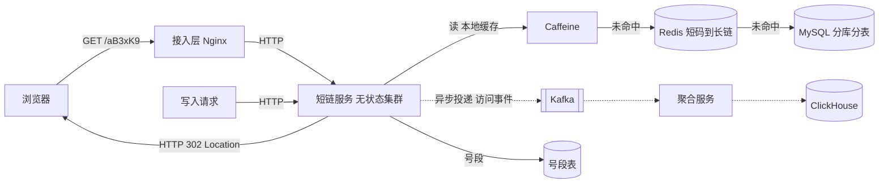
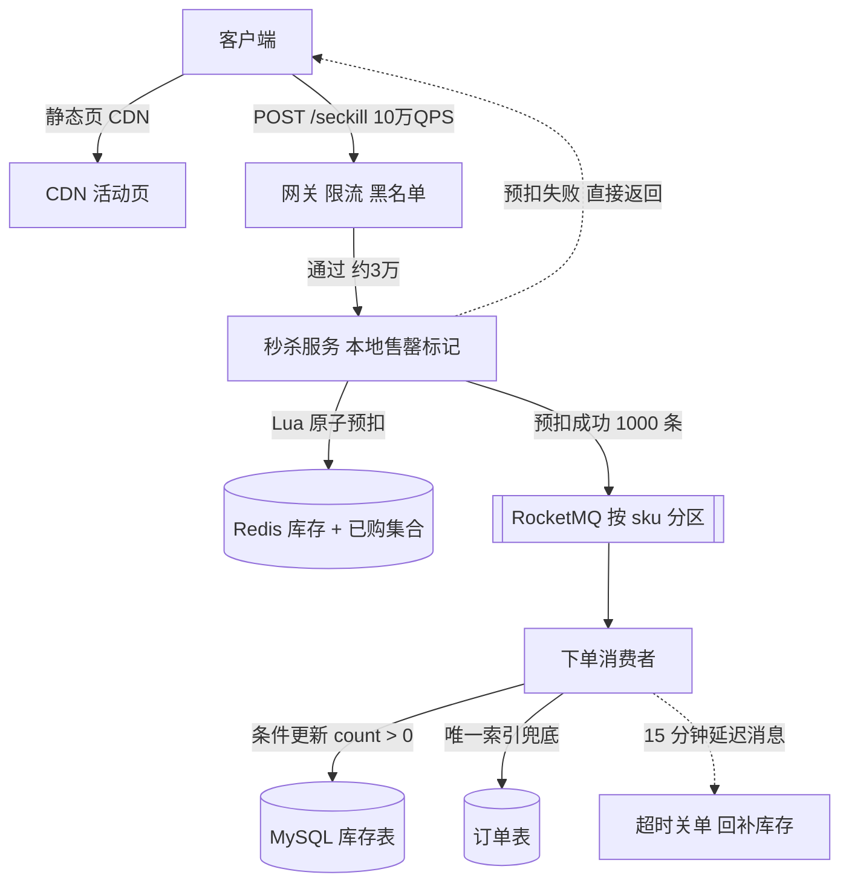
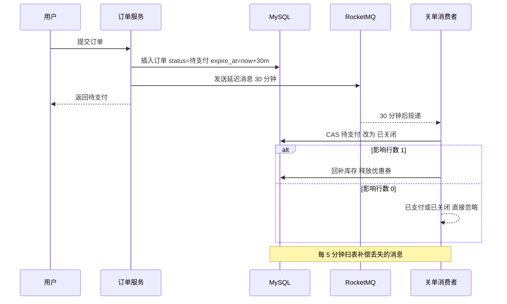
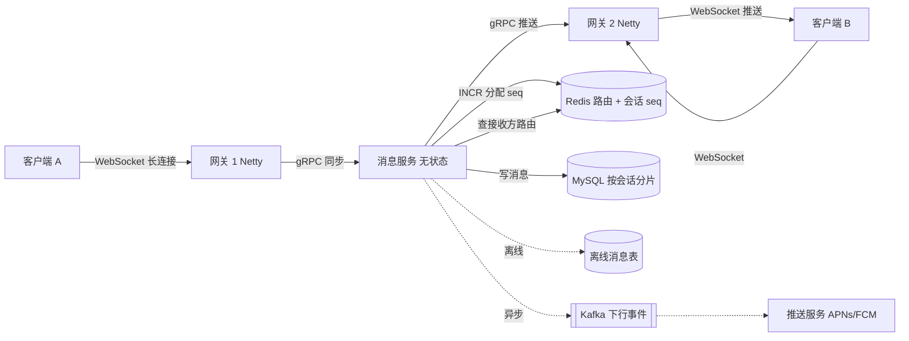
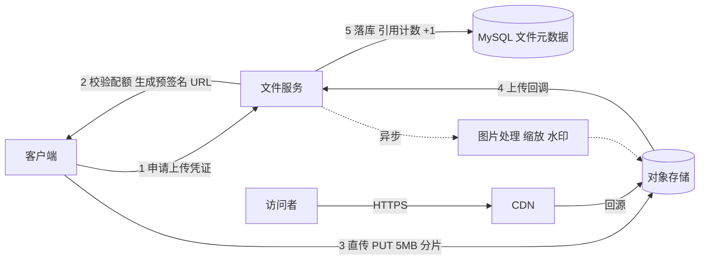

# 第 13 章 系统设计：把知识组装成方案

> 一句话定位：前面十二章是零件，这一章考的是你能不能把零件装成一台能跑的机器，并在压力下说清每个零件为什么放在那里。

## 一、本章考察重点概览

系统设计题在高级岗面试里通常占 30~45 分钟，是唯一一道没有标准答案、却能拉开档位的题。它不考你记住多少中间件，而考三件事：你能不能把一个模糊需求收敛成可讨论的边界；你能不能在资源有限的前提下做出有理由的取舍；你对"这条链路在 10 万 QPS 下会先死在哪里"有没有具体的判断。

具体到考点，有四个特征：

1. **评分是分维度的，不是整体印象分。** 需求澄清、容量估算、架构完整性、关键路径深度、取舍理由、沟通推进，这六项里任何一项交白卷，都会被单独扣分。很多人架构画得漂亮却挂掉，原因往往是从头到尾没问一句"这个系统一天有多少请求"。
2. **估算不是算术题，是决策依据。** 算出 8000 QPS，接下来的分片数、缓存容量、是否需要 MQ 才有依据。只报数字不推导，和不算没有区别。
3. **深度集中在一条路径上。** 面试官不指望你把十个模块都讲透，他会挑一条关键路径往下钻：库存怎么扣、消息怎么不重、短码怎么不冲突。这条路径讲不清，架构图再全也只是框图。
4. **取舍必须带代价。** "用 Redis 提升性能"不是取舍，是口号。"用 Redis 预扣库存，代价是 Redis 与 DB 可能短暂不一致，需要用对账和兜底扣减补回来"才是取舍。

| 考点 | 出现频率 | 难度 | 说明 |
| --- | --- | --- | --- |
| 答题框架与需求澄清 | 高 | 中级 | 决定前 5 分钟的印象，几乎每题都用 |
| 容量估算 | 高 | 中级 | 常被跳过，也是最能体现工程感的环节 |
| 短链、秒杀类高并发读写 | 高 | 中级 | 校招到社招通吃，重点在发号器与库存 |
| 异步任务与延迟触发 | 中 | 高级 | 订单关闭、超时取消，考方案对比而非单点 |
| 限流与降级 | 中 | 高级 | 常作为秒杀、网关题的追问出现 |
| IM 与 Feed 流 | 中 | 高级 | 考有状态服务与写扩散的边界 |
| 地理位置与文件存储 | 低 | 中级 | 有项目经验时才会深问 |
| 幂等、对账与最终一致 | 高 | 高级 | 支付、订单类岗位的必答题 |

## 二、复习优先级

| 优先级 | 题目编号 | 理由 |
| --- | --- | --- |
| P0 | Q2、Q3、Q6、Q7、Q9、Q12 | 框架与估算是所有题的地基，短链、秒杀、延迟关闭、IM 是最高频的四个案例 |
| P1 | Q1、Q4、Q5、Q8、Q10、Q11、Q15 | 决定你是"能画图"还是"能做方案"，限流与幂等几乎是高级岗必问 |
| P2 | Q13、Q14、Q16 | 场景相对垂直，掌握核心数据结构与流程即可 |

时间分配建议：本章 3 天。P0 占 60%，要求能不看文档在 20 分钟内讲完一个完整案例，包括估算和一张手绘架构图；P1 占 30%，重点练"给方案再给代价"的表达；P2 剩 10%，记住 GeoHash 精度表和直传流程即可。

## 三、高频面试题清单

| 编号 | 题目 | 面试难度 | 阅读门槛 | 优先级 | 一句话答案 |
| --- | --- | --- | --- | --- | --- |
| Q1 | 系统设计面试到底在打什么分？ | 中级 | 中 | P1 | 六个维度分别计分，任何一维空白都会压低档位 |
| Q2 | 45 分钟怎么分配？架构图该怎么画？ | 中级 | 中 | P0 | 5/10/15/15 四步推进，图按四层画并标注流量 |
| Q3 | 容量估算怎么做？ | 中级 | 中 | P0 | DAU 拆请求、QPS 乘峰值系数、存储乘副本与保留期 |
| Q4 | 面对多种方案怎么取舍？ | 高级 | 高 | P1 | 先定约束再打分，每个选择都要说出放弃了什么 |
| Q5 | 高可用、SLA、降级预案怎么答？ | 高级 | 高 | P1 | 99.9% 是每月 43 分钟，降级要分层且有开关 |
| Q6 | 设计一个短链接系统 | 中级 | 中 | P0 | 发号器保证唯一，Base62 压缩，302 保留统计能力 |
| Q7 | 设计一个秒杀系统 | 高级 | 高 | P0 | 核心是层层过滤无效流量，Redis 预扣加 DB 兜底 |
| Q8 | 设计一个分布式限流组件 | 高级 | 高 | P1 | Redis + Lua 保证原子，本地批量预取降往返 |
| Q9 | 订单超时自动关闭怎么实现？ | 中级 | 中 | P0 | 延迟消息为主、扫表兜底，状态机 CAS 防并发 |
| Q10 | 设计一个排行榜 | 中级 | 中 | P1 | ZSet 按分数排序，同分用时间戳拼进 score |
| Q11 | 设计一个 Feed 流 / 朋友圈 | 高级 | 高 | P1 | 推拉结合，普通用户写扩散，大 V 读时合并 |
| Q12 | 设计一个 IM 系统 | 高级 | 高 | P0 | 长连接网关加会话内序号，保证有序、去重、可补偿 |
| Q13 | 设计"附近的人" | 中级 | 中 | P2 | GeoHash 分格加九宫格邻居，Redis GEO 直接算距离 |
| Q14 | 设计图片 / 文件存储服务 | 中级 | 中 | P2 | 直传对象存储，CDN 分发，内容哈希做秒传 |
| Q15 | 支付回调怎么保证幂等？怎么对账？ | 高级 | 高 | P1 | 唯一键加状态机，T+1 三方比对加差错池 |
| Q16 | 遇到完全没做过的系统怎么办？ | 中级 | 中 | P2 | 抽象成四类基本矛盾，再套已知解法 |

## 四、题目详解

### Q1. 系统设计面试到底在打什么分？（中级）

> 前置：需求澄清、取舍、深度

**一句话结论**：系统设计按六个维度分别计分——需求澄清、容量估算、架构完整性、关键路径深度、取舍理由、沟通推进；总分不是印象分，而是"最弱一维"决定的木桶分。

**先把话说白**：这道题没有正确答案，只有"可讨论的方案"。面试官需要一个稳定的尺子来比较不同候选人，所以评分表一定是分项的。理解这一点，你的策略就会变：不是把知道的中间件全堆上去，而是保证每一维都不空缺，再把其中一维做到明显高于平均。

**底层原理**：

1. **六个维度各自看什么。**
   - 需求澄清：有没有主动确认功能范围、读写比例、数据规模、一致性要求、预算约束。一个不问规模就画图的人，后面所有设计都建立在猜测上。
   - 容量估算：数量级是否正确，估算结果有没有反过来影响设计（比如算出写 QPS 只有 50，就不该上分库分表）。
   - 架构完整性：接入层、应用层、中间件、存储层是否闭环，数据从写入到读出有没有断点。
   - 关键路径深度：能不能把一条链路讲到索引、锁、协议、失败重试这一层。
   - 取舍理由：每个选择是否说清了代价，是否知道另一种方案在什么条件下更优。
   - 沟通推进：是否结构化、是否在时间不够时主动收敛、是否回应了面试官的提示。

2. **档位大致怎么分。** 画不出闭环、数据流有断点，是不及格；能画出闭环但没有估算和取舍，是及格；有估算、有取舍、关键路径能讲到底层，是良好；在此基础上能主动指出"这里会是瓶颈，我打算这样演进"，是优秀。注意最后一档不是靠多讲一个中间件，而是靠对自己方案的批判。

3. **最常见的三种失分。** 一是开局画图，把 40 分钟全花在扩展功能上；二是名词堆砌，提到 Kafka、Redis、分库分表却说不出为什么是它；三是没有数字，问到"这个方案能撑多大"时答不上来。

4. **反过来，加分点也很集中。** 主动划出"本期不做"的范围；用估算否掉一个过度设计；指出自己方案里的单点并给出兜底；在面试官追问前就说明"这里有一致性窗口"。

**易混对比**：

| 维度 | 具体观察点 | 典型失分 |
| --- | --- | --- |
| 需求澄清 | 功能边界、读写比、规模、一致性 | 直接开始画框 |
| 容量估算 | 数量级、推导过程、是否影响决策 | 只报一个数不讲来源 |
| 架构完整性 | 四层是否齐全、数据流是否闭合 | 缺存储层或没有异步链路 |
| 关键路径 | 索引、锁、重试、失败处理 | 停在"加个缓存" |
| 取舍 | 代价、适用边界、替代方案 | 只说"性能更好" |
| 沟通 | 结构、节奏、回应提示 | 自顾自讲满 40 分钟 |

**面试追问**：
- 追问：如果时间只够讲一半，你砍哪部分？→ 答题要点：砍扩展功能，保关键路径；先保证主链路闭环，再谈演进。
- 追问：你怎么判断一个方案"够用"？→ 答题要点：用估算得出峰值，留 2~3 倍余量，再看是否触发下一档复杂度（分片、异步）。
- 追问：为什么不能一上来就分库分表？→ 答题要点：分片会带来跨库事务、跨库分页、扩容重分布三笔长期成本，规模不够时是净负债。

### Q2. 45 分钟怎么分配？架构图该怎么画？（中级）

> 前置：结构化表达、架构图

**一句话结论**：按"场景与边界 5 分钟 → 容量估算 10 分钟 → 高层设计 15 分钟 → 深挖关键路径 15 分钟"推进，架构图按接入层、应用层、中间件、存储层四层画，箭头必须标协议与同步异步，框上必须标流量与数据量。

**先把话说白**：系统设计面试像一次技术方案评审，不是考试。评审有固定节奏：先对齐要解决什么问题，再算清楚量级，然后给整体方案，最后挑风险最大的地方讨论。你按这个节奏走，面试官就知道你在真实工作里做过方案；你反过来先画图再补需求，他就会怀疑你平时是接需求而不是做设计。

**底层原理**：

1. **第一步：场景与边界（5 分钟）。** 产出三样东西：3~5 条核心功能（按优先级排）、3 条非功能指标（QPS、延迟、可用性）、一份明确的"不做清单"。例如设计短链时明确"本期不做内容审核和自定义域名"，把讨论锁在主链路。这一步还要确认读写比，因为它直接决定后面是读优化还是写优化。

2. **第二步：容量估算（10 分钟）。** 产出 QPS、存储、带宽、连接数四个数字，并且每个数字都要能推出下一步动作。算出峰值 1 万 QPS，才轮到讨论要不要加缓存、要几台机器；算出五年 500 GB，才知道单库能不能扛。

3. **第三步：高层设计（15 分钟）。** 画四层图，写核心表结构，列 3~5 个关键接口。这一步只讲"有什么"，不讲"为什么"，把细节留给下一步。图要能让人一眼看出数据从哪进、经过谁、落到哪。

4. **第四步：深挖（15 分钟）。** 通常由面试官指定一个点，比如"库存怎么扣"。回答结构是：正常流程 → 并发与失败场景 → 兜底手段 → 代价。这一段决定档位，因为只有这里能看出你是不是真的做过。

5. **留 5 分钟缓冲。** 用于回答追问、补充遗漏、或者主动讲演进路线。不要把时间排满，面试官打断你提问时，你需要有余量接住。

**画图规范**：

- **分层**：最左是客户端与 CDN，然后是接入层（Nginx、网关），中间是应用层（无状态服务），再往下是中间件（MQ、缓存、注册中心），最右或最下是存储（MySQL、对象存储、OLAP）。
- **箭头**：实线表示同步调用，虚线表示异步或旁路；线上标协议（HTTP、gRPC、TCP）和动作（读、写、投递）。
- **标注**：每个关键节点旁写量级，如"读 1 万 QPS""日增 500 万条""缓存 20 GB"。没有标注的图只是一张框图。
- **单点**：把自己方案里的单点用文字圈出来，并写明兜底方式。主动暴露单点比被问出来强。

```text
时间分配（45 分钟）
0-5    场景与边界   功能清单 / 非功能指标 / 不做什么
5-15   容量估算     QPS / 存储 / 带宽 / 连接数
15-30  高层设计     四层图 / 核心表 / 关键接口
30-45  深挖         正常流程 → 异常场景 → 兜底 → 代价
```

**面试追问**：
- 追问：面试官中途打断你问细节，怎么办？→ 答题要点：先回答他的问题，再问"要我继续讲这条链路还是回到整体"，把节奏交回去。
- 追问：能不能先画图再补需求？→ 答题要点：可以，但必须立刻回头补一句"我假设日活是 X、读写比是 Y"，否则设计没有依据。
- 追问：图要画多细？→ 答题要点：高层图只画层与组件，深挖时再画一条链路的时序，两种图不要混在一张里。

### Q3. 容量估算怎么做？（中级）

> 前置：QPS、存储、带宽

**一句话结论**：从 DAU 拆出请求量，除以 86400 得平均 QPS，再乘 2~5 的峰值系数得峰值 QPS；存储按"日增量 × 单条大小 × 副本数 × 膨胀系数 × 保留天数"推；带宽按"峰值 QPS × 平均响应大小"推；连接数按"在线用户 × 长连接比例"推。

**先把话说白**：估算的目的不是算准，而是算到"数量级不错"。真实流量没人能提前算准，但 1000 QPS 和 100 万 QPS 需要的是完全不同的架构。你要做的是保证自己没把量级搞错一个数量级，并且让每个数字都能推出一条设计决策。

**底层原理**：

1. **时间基数。** 1 天 = 86400 秒，约等于 10 万秒。记住这个数，后面所有除法都能口算：日请求 1 亿 → 平均 1000 QPS；日请求 10 亿 → 平均 1 万 QPS。

2. **峰值系数。** 流量不会均匀分布。To C 产品早晚高峰明显，峰值通常是平均值的 2~5 倍；秒杀、抢购这类定时活动不是"峰值系数"能描述的，要单独按"预约人数 × 开抢瞬间到达率"算。经验上，日常业务取 3 比较稳。

3. **存储估算的乘数。** 单条记录不只看字段长度，还要算索引（通常再乘 1.2~1.5）、副本（三副本乘 3）、以及是否存多份（冷热分离、归档）。公式：`日增条数 × 单条字节 × 1.5（索引）× 3（副本）× 保留天数`。

4. **带宽换算。** 1 Gbps ≈ 125 MB/s。峰值 QPS 1 万、平均响应 10 KB，就是 100 MB/s ≈ 800 Mbps，接近跑满一条千兆链路，这时候要么上 CDN，要么压缩响应。

5. **连接数。** 长连接系统（IM、推送）按"同时在线用户数 × 每用户连接数（多端）"算，再留 20% 余量。单机 Netty 能维持的连接数受内存与 fd 限制，通常按每连接几 KB 到几十 KB 估算。

**一套可复用的估算模板**：

```text
已知：DAU 1000 万，人均 20 次请求/天，读写比 10:1
日均请求 = 1000 万 × 20 = 2 亿
平均 QPS = 2 亿 / 86400 ≈ 2300
峰值 QPS = 2300 × 3 ≈ 7000（日常业务峰值系数取 3）
写峰值   = 7000 / 11 ≈ 640（读写比 10:1，写占 1/11）

存储：单条 500 B，日增 640 × 86400 ≈ 5500 万条 ≈ 27 GB
      索引膨胀 1.5 倍、三副本 → 27 × 1.5 × 3 ≈ 120 GB/天
      保留 1 年 → 约 44 TB（单库不可能，必须分片或冷热分离）

带宽：峰值 7000 × 平均响应 10 KB ≈ 70 MB/s ≈ 560 Mbps（需 CDN 或压缩）

连接：同时在线 100 万 × 1.2（多端）≈ 120 万长连接，按单机 10 万估需 12 台网关
```

**常见数量级参照**（只作量级判断，不是 benchmark）：

| 对象 | 量级 | 用途 |
| --- | --- | --- |
| 1 天 | 86400 秒 | 所有 QPS 换算的基数 |
| 单实例 MySQL 写入 | 千级 TPS | 超过就要考虑批量、异步或分库 |
| 单实例 Redis | 万级到十万级 QPS | 取决于命令复杂度与是否 pipeline |
| 单块 SSD 随机 IOPS | 万级 | 机械盘只有百级 |
| 单机长连接 | 十万级 | 受内存与 fd 限制，需实测 |
| 1 Gbps 带宽 | 125 MB/s | 大流量场景先算带宽再算机器 |

**易混对比**：

| 指标 | 算法 | 常见错误 |
| --- | --- | --- |
| 平均 QPS | 日请求 / 86400 | 直接用 DAU 当 QPS |
| 峰值 QPS | 平均 × 2~5 | 忘记活动流量单独算 |
| 存储 | 日增 × 单条 × 副本 × 保留期 | 只算裸数据，漏索引与副本 |
| 带宽 | QPS × 响应大小 | 用平均 QPS 算，低估 3 倍 |

**面试追问**：
- 追问：峰值系数为什么取 3 而不是 10？→ 答题要点：日常业务高峰通常是平均的 2~5 倍，取 10 会导致过度设计；活动型流量必须单独建模。
- 追问：算出来 44 TB，你怎么办？→ 答题要点：先冷热分离（只留 3 个月热数据），再按用户或时间分片，最后考虑列存做归档分析。
- 追问：估算错了会怎样？→ 答题要点：低估会导致上线即雪崩，高估会浪费成本；所以设计要留水平扩展的接口，而不是一次到位。

### Q4. 面对多种方案怎么取舍？（高级）

> 前置：权衡维度、代价

**一句话结论**：取舍的前提是把约束显式化——一致性要求、延迟预算、成本上限、团队运维能力——再用决策矩阵给每个方案在相同维度上打分；没有约束的"哪个更好"是无解问题。

**先把话说白**：面试里最容易被追问倒的一句话是"为什么用 A 不用 B"。如果你答"因为 A 性能好"，面试官会继续问"B 差在哪、差多少、你这个场景真的需要吗"。取舍的本质不是选最好的，而是在你的约束下选代价最小的。

**底层原理**：

1. **先定约束，再谈方案。** 四个约束几乎能筛掉大部分选项：数据能不能短时间不一致（一致性）、用户能等多久（延迟）、预算多少（成本）、团队会不会运维（复杂度）。支付场景一致性优先，Feed 场景可用性优先，这不是技术差异，是业务差异。

2. **一致性 vs 可用性。** 强一致意味着故障时要拒绝服务或阻塞等待，可用性优先意味着故障时返回旧数据或降级结果。多数业务属于"最终一致可接受"，真正需要强一致的只有库存扣减、支付、账务这几类。判断方法：问一句"读到旧数据会造成什么后果"，如果只是体验问题，就不需要强一致。

3. **同步 vs 异步。** 同步的代价是 RT 叠加和故障传导，收益是结果确定、调用方好处理；异步的代价是一致性窗口和消息可靠性问题，收益是解耦和削峰。判据：调用方是否必须立刻拿到结果。下单后发短信可以异步，下单后扣库存不能。

4. **推 vs 拉。** 推的成本是写扩散（写一次要写 N 份），拉的成本是读扩散（读一次要合并 N 个源）。粉丝数小用推，粉丝数大用拉，中间地带用推拉结合。这条判断在 Feed、IM 群聊、配置推送里是通用的。

5. **读写分离 vs 分库分表。** 读写分离解决"读扛不住"，代价是主从延迟导致读到旧数据；分库分表解决"数据量和写入扛不住"，代价是跨库 join、分布式事务、跨库分页全部失效。顺序应该是：先加缓存 → 再读写分离 → 再垂直拆分 → 最后水平分片。跳过前两步直接分片，是把复杂度提前引入。

6. **决策矩阵的用法。** 列出维度与权重（一致性 0.3、延迟 0.2、成本 0.2、复杂度 0.2、团队熟悉度 0.1），每个方案打 1~5 分，加权求和。矩阵的价值不在分数，而在逼你把"感觉"翻译成可比较的量。

| 场景 | 倾向 | 主要理由 | 放弃的东西 |
| --- | --- | --- | --- |
| 库存扣减 | CP + 预扣 + 对账 | 超卖的资损远大于少卖 | 部分可用性，需要补偿逻辑 |
| Feed 流 | AP + 最终一致 | 刷不出内容比看到旧内容更糟 | 强一致，短暂看不到新内容 |
| 订单超时关闭 | 异步延迟消息 | 无需同步等待，削峰 | 秒级精度，需要兜底扫表 |
| 大 V 发 Feed | 拉模式 | 写扩散成本与粉丝数成正比 | 首次读取延迟 |
| 商品详情 | 缓存 + 读写分离 | 读远多于写，能容忍秒级旧数据 | 强一致，需处理缓存一致性 |
| 日志埋点 | 批量异步写 | 吞吐优先，允许丢失少量 | 实时性，需接受采样与丢弃 |

**面试追问**：
- 追问：缓存和数据库不一致怎么办？→ 答题要点：先更新库再删缓存，配合延迟双删或订阅 binlog 补偿；接受短暂不一致，用过期时间兜底。
- 追问：为什么不是所有系统都上分库分表？→ 答题要点：分片后跨库事务、跨库分页、扩容重分布都要自己解决，规模没到就是负收益。
- 追问：异步一定比同步好吗？→ 答题要点：不是，异步把确定性换成了吞吐，需要额外的消息可靠性与幂等设计，链路反而更长。

### Q5. 高可用、SLA、降级预案怎么答？（高级）

> 前置：冗余、故障转移、降级

**一句话结论**：先记住换算——99.9% 是每月约 43 分钟不可用，99.99% 是约 4.3 分钟；再用 SLA/SLO/SLI 三层把"高可用"变成可度量目标；降级预案要按接入层、应用层、依赖层、数据层分层设计，每层都有开关和触发条件。

**先把话说白**："我们系统可用性 99.99%"这句话在面试里几乎是空话，除非你能说出它对应多少停机时间、怎么度量、故障时先牺牲什么。高可用不是"不出故障"，是"故障发生时影响可控、恢复有路径"。

**底层原理**：

1. **可用性换算。** 一个月按 30 天算，共 43200 分钟。99.9% 允许 43.2 分钟不可用；99.95% 允许 21.6 分钟；99.99% 允许 4.32 分钟；99.999% 只有 26 秒。一年维度：99.9% 是 8.76 小时，99.99% 是 52.6 分钟。每提升一个 9，成本通常翻倍以上，所以要先问业务到底需要几个 9。

2. **SLI、SLO、SLA 的区别。** SLI 是实际测量指标（成功率、P99 延迟）；SLO 是内部目标（成功率 ≥ 99.95%）；SLA 是对外承诺，通常带赔偿条款，一定比 SLO 宽松。工程上按 SLO 做容量和告警，SLA 只是商务兜底。

3. **可用性的实现路径。** 冗余（多实例、多可用区）、隔离（线程池隔离、集群隔离、读写分离）、快速失败（超时、熔断）、可降级（关非核心功能）、可回滚（灰度与开关）。注意冗余只能解决"单点故障"，解决不了"流量超过容量"，后者要靠限流和降级。

4. **降级的分层设计。**
   - 接入层：限流、黑名单、灰度分流、静态降级页。
   - 应用层：功能开关（关闭评论、推荐）、返回默认值（推荐失败返回热榜）、只读模式。
   - 依赖层：超时 + 重试 + 熔断 + 舱壁隔离，第三方不可用时走本地缓存。
   - 数据层：缓存兜底、异步落库、主从切换、热点 key 打散。

5. **容量水位。** 常规水位控制在 70% 以下，85% 触发告警并准备扩容，90% 以上开始拒绝非核心流量。水位要按"最薄弱环节"算，不是按平均值——数据库连接池打满时，应用 CPU 可能只有 30%。

6. **故障演练。** 降级预案不演练等于没有。至少要覆盖：依赖超时、缓存雪崩、主库切换、消息堆积。每个预案要有明确的触发条件（如"错误率连续 1 分钟 > 5%"）和恢复条件。

**易混对比**：

| 概念 | 含义 | 举例 |
| --- | --- | --- |
| SLI | 实际测量值 | 过去 5 分钟成功率 99.97% |
| SLO | 内部目标 | 月度成功率不低于 99.95% |
| SLA | 对外承诺与赔偿 | 低于 99.9% 赔付月度费用的 10% |
| 降级 | 主动牺牲非核心功能 | 关闭推荐，返回热榜 |
| 熔断 | 依赖故障时快速失败 | 支付渠道错误率超阈值直接拒绝 |

**面试追问**：
- 追问：多机房部署就能做到 99.99% 吗？→ 答题要点：不能，还要解决数据同步延迟、流量调度、脑裂；同城双活和异地多活是两个复杂度层级。
- 追问：限流和降级有什么区别？→ 答题要点：限流是控制进入的流量，降级是降低服务的处理能力或返回质量，通常先限流再降级。
- 追问：怎么验证降级预案有效？→ 答题要点：定期故障演练，注入超时与异常，观察开关是否生效、恢复是否自动。

### Q6. 设计一个短链接系统（中级）

> 前置：编码、哈希、跳转

**一句话结论**：这个系统的核心矛盾是"读远多于写、单次逻辑极简"，设计重点是发号器的全局唯一与跳转链路的极致延迟；用 Base62 把自增号压到 6~7 位，用 302 而不是 301 换取统计与可撤销能力。

**先把话说白**：短链做的事就是把一条几百字符的 URL 换成一条几十字符的短链，用户点短链时再跳回去。写一次、读上万次，所以它是典型的读多写少系统：写路径可以慢一点、复杂一点，读路径必须快，最好连数据库都不碰。

**需求与边界**：

- 功能：长链转短链、短码跳转、自定义短码、有效期、访问统计、封禁某条短链。
- 非功能：跳转 P99 小于 50 ms，可用性 99.99%，短码不可被轻易遍历猜测。
- 不做：内容安全审核（作为外挂服务异步做）、自有域名管理、复杂的投放分析。

**容量估算**：

```text
日新增 100 万条 → 平均写 QPS ≈ 1000000 / 86400 ≈ 12，峰值按 4 倍 ≈ 50
读写比 100:1 → 读峰值 ≈ 5000，大促期间按 1 万预留
5 年数据量 = 100 万 × 365 × 5 = 18.25 亿条
单条 200 B（短码 + 长链 + 元信息）→ 裸数据约 365 GB
加索引 1.5 倍、不分副本（读靠缓存）→ 约 550 GB，必须分片
缓存：按二八分布，2000 万热 key × 200 B ≈ 4 GB，两台 8 GB 实例足够
```

**核心设计**：

1. **发号器。** 三种选择：UUID（128 位，太长且无序，索引写入差）、数据库自增（简单但每次一次 DB 写）、号段模式（一次取 1000 个号缓存在本地，用完再取）。生产上多用号段模式，DB 只承担低频的号段分配，宕机时本地还有余量。也可以用雪花算法，但要注意时钟回拨。

2. **Base62 编码。** 62 个字符（0-9、a-z、A-Z），6 位可表示 62^6 ≈ 568 亿，7 位约 3.5 万亿。18 亿条数据 6 位完全够用。自增号直接编码会导致短码递增可枚举，解决办法是对 ID 做一次位混淆（异或固定盐）或使用打散的号段起点。

3. **跳转用 302。** 301 会被浏览器和 CDN 长期缓存，后续请求根本不到服务器，省了资源但丢了两样东西：统计和撤销能力。短链的核心价值之一就是"能改、能停、能看数据"，所以默认 302，并对搜索引擎场景单独说明。

4. **读路径。** 请求进来先查本地缓存（Caffeine，存最热的几万条），未命中查 Redis，再未命中回源 MySQL。空值也要缓存 60 秒，防止恶意短码把请求全打到数据库。前面再加一层布隆过滤器，拦截明显不存在的短码。

5. **写路径与防刷。** 写接口按用户和 IP 双维度限流；长链要做协议与域名白名单，避免被用来做钓鱼跳转；同一用户重复提交相同长链时复用已有短码，减少无效写入。

6. **统计。** 跳转链路上只做一件事：往 MQ 投一条访问事件，绝不同步写库。下游消费后按分钟聚合，落到 ClickHouse 或 ES 供查询。这样统计系统挂了也不影响跳转。



**核心表结构与接口**：

```sql
CREATE TABLE t_short_link (
  id         BIGINT UNSIGNED NOT NULL AUTO_INCREMENT,
  code       VARCHAR(8)      NOT NULL COMMENT 'Base62 短码',
  long_url   VARCHAR(2048)   NOT NULL,
  user_id    BIGINT          NOT NULL DEFAULT 0,
  expire_at  DATETIME        DEFAULT NULL,
  status     TINYINT         NOT NULL DEFAULT 1 COMMENT '1 正常 0 封禁',
  created_at DATETIME        NOT NULL DEFAULT CURRENT_TIMESTAMP,
  PRIMARY KEY (id),
  UNIQUE KEY uk_code (code)
) ENGINE = InnoDB;
-- 分片键用 code，保证跳转时能直接定位到唯一分片
```

- `POST /api/v1/links`：入参长链、可选自定义短码、有效期；返回短码与完整短链。
- `GET /{code}`：302 跳转；短码不存在返回 404 页面，已封禁返回拦截页。
- `DELETE /api/v1/links/{code}`：软删除，置 status 为 0，同时删缓存。

**易混对比**：

| 维度 | 301 永久重定向 | 302 临时重定向 |
| --- | --- | --- |
| 浏览器缓存 | 会缓存，后续不再请求 | 默认不缓存 |
| 服务端压力 | 小 | 大，每次都要请求 |
| 统计能力 | 基本丢失 | 完整可统计 |
| 可撤销性 | 用户侧已缓存，改不了 | 随时可改可停 |
| 适用场景 | 永久迁移、静态资源 | 短链、活动链接、需要统计的跳转 |

**哪里会出问题、怎么兜底**：

- 发号器宕机：号段模式本地有剩余号，可撑一段时间；号段表双写或改用雪花兜底。
- 缓存击穿：热点短码过期瞬间打穿到 DB，用逻辑过期 + 互斥重建，或热点 key 永不过期靠主动更新。
- 短码被遍历：短码随机化 + 按 IP 限流 + 异常访问告警。
- 分片扩容：一致性哈希或预分片（一开始就分 1024 张逻辑表，映射到少量物理库），避免后期全量重分布。

**面试追问**：
- 追问：为什么不用 MD5 取前 6 位？→ 答题要点：会冲突，冲突后要重试或加长；自增号 + Base62 天生唯一，还能反解出顺序。
- 追问：短码长度怎么定？→ 答题要点：按 62^n 覆盖业务量级，6 位够 568 亿，留一位做扩展余量。
- 追问：跳转延迟怎么压到 50 ms 以内？→ 答题要点：本地缓存挡住绝大部分，Redis 单次往返控制在 1 ms 内，DB 只做兜底，链路上去掉任何同步统计。
- 追问：自定义短码和自增号冲突怎么办？→ 答题要点：自定义短码走唯一索引，冲突直接返回错误让用户换；也可以给自定义码单独的前缀空间。

**加分点**：主动说明"短链是一次写多次读，所以我把复杂度都放在了写路径和缓存预热上，读路径只保留两次内存查询"。

### Q7. 设计一个秒杀系统（高级）

> 前置：削峰、库存、限流

**一句话结论**：秒杀的核心矛盾是"瞬时流量是常态流量的百倍，而有效请求只占万分之一"，所以设计的首要目标不是处理请求，而是在最外层尽快拒绝无效流量；库存靠 Redis 预扣保证不超卖，DB 条件更新做最终兜底。

**先把话说白**：100 万人抢 1000 件商品，意味着 99.9% 的请求注定失败。如果让这 100 万个请求都走到数据库，数据库一定先挂，然后连那 1000 个本该成功的人也失败。所以秒杀系统的本质是"漏斗"：每一层都尽可能多地把无效请求挡掉，让真正到达库存的请求量级和库存量级接近。

**需求与边界**：

- 功能：活动页展示、开抢下单、扣库存、订单超时回补、结果查询。
- 非功能：开抢瞬间峰值 10 万 QPS，不能超卖，不能少卖，接口 P99 小于 200 ms（失败也要快速失败）。
- 不做：复杂的优惠叠加（单独拆服务）、跨仓调拨。

**容量估算**：

```text
预约人数 100 万，开抢 10 秒内到达 80% → 峰值约 8 万 QPS，按 10 万预留
库存 1000 件 → 有效请求占比 0.1%，99.9% 的流量必须在网关或应用层被拒
若每台应用机扛 2000 QPS（含业务校验），需要约 50 台；实际靠限流控制在 30 台
Redis 预扣：10 万 QPS 分摊到 10 个分片 key，单 key 1 万 QPS，在单实例能力范围内
MQ：只有预扣成功的请求才入队，量级等于库存数（1000 级），几乎无压力
```

**核心设计**：

1. **静态化与前端削峰。** 活动页全部静态化推 CDN，商品信息、库存展示都不走动态接口。开抢前按钮置灰，加验证码或答题，把"同一毫秒到达"的流量摊平到几秒。

2. **接入层限流。** 网关按活动维度、用户维度、IP 维度三重重限流；超出直接返回"活动太火爆"，这是最便宜的一次拒绝，成本只有一次计数。

3. **应用层过滤。** 本地缓存活动信息与"售罄标记"，售罄后直接短路，不再查 Redis；校验用户是否已购（Redis Set），把重复请求挡在预扣之前。

4. **Redis 预扣库存。** 用 Lua 脚本把"判断是否已购 + 判断库存 + 扣减 + 记录用户"合成一次原子操作，避免并发下的检查与扣减分离。集群模式下多个 key 要用 hash tag 落到同一 slot。

5. **异步下单。** 预扣成功后只做一件事：把下单消息投到 MQ，按商品 ID 分区保证同一商品的顺序。接口立刻返回"排队中"，前端轮询或长连接拿结果。真正的建单、写 DB 由消费者慢慢做。

6. **DB 兜底。** 落库时的扣减必须是条件更新：`update stock set count = count - 1 where sku_id = ? and count > 0`，靠行锁保证最终不超卖。订单表建 `(user_id, activity_id)` 唯一索引，防止同一用户重复下单。

7. **超时回补。** 未支付订单通过延迟消息在 15 分钟后关闭，回补 Redis 与 DB 库存。回补要先校验订单状态，避免已支付订单被误回补。



**Redis Lua 预扣脚本**：

```lua
-- KEYS[1] 库存 key，如 stock:{act:1001}:sku:88
-- KEYS[2] 已购集合 key，如 bought:{act:1001}:sku:88
-- ARGV[1] userId
-- 返回 1 成功，0 售罄，-1 重复购买
if redis.call('SISMEMBER', KEYS[2], ARGV[1]) == 1 then
    return -1                                   -- 幂等：同一用户只放一次
end
local stock = tonumber(redis.call('GET', KEYS[1]) or '0')
if stock <= 0 then
    return 0                                    -- 已售罄，前端可置灰
end
redis.call('DECR', KEYS[1])                     -- 扣减与记录在同一脚本内原子执行
redis.call('SADD', KEYS[2], ARGV[1])
return 1
```

两个 key 用同样的 `{act:1001}` hash tag，保证在 Redis Cluster 中落在同一分片，否则脚本会因跨 slot 报错。

**哪里会出问题、怎么兜底**：

- **超卖**：Redis 预扣 + DB 条件更新双保险；即使 Redis 数据错乱，DB 也不会扣成负数。
- **少卖**：Redis 扣了但消息丢了，用户没建单。用定时对账扫描"Redis 已扣但无订单"的记录，补偿建单或回补库存。
- **Redis 挂了**：降级为"令牌 + DB 直接扣"，同时把限流阈值调到 DB 能承受的量级；不接受无限制降级，否则数据库会被打穿。
- **MQ 堆积**：消费者按库存量级设计，堆积时优先保证已预扣的请求落库，新请求直接拒绝。
- **热点 key**：单 key 十万 QPS 会打满单分片，按库存分桶（把 1000 件拆成 10 个桶各 100 件）分散压力。

**面试追问**：
- 追问：Redis 扣减成功但下单失败，库存怎么办？→ 答题要点：MQ 消费失败重试，超过次数进死信；定时任务对账补偿，宁可少卖不能超卖。
- 追问：为什么不用数据库行锁直接扣？→ 答题要点：十万 QPS 打在同一个行锁上会全部串行阻塞，连接池瞬间打满，响应时间雪崩。
- 追问：如何防止刷单？→ 答题要点：实名与风控前置、设备指纹、同 IP/同账号限购、验证码、行为序列风控，秒杀层只做粗粒度限购。
- 追问：活动开始前 1 分钟要做什么？→ 答题要点：库存预热到 Redis、缓存活动信息、扩容与压测、关闭非核心功能、盯盘与预案就位。

**易错点**：很多人把"限流"和"库存扣减"混在一起讲，实际上限流保护的是系统，库存保护的是业务，两者的阈值来源完全不同。

### Q8. 设计一个分布式限流组件（高级）

> 前置：令牌桶、分布式计数、滑动窗口

**一句话结论**：单机限流简单但不准，集中式限流准确但每次请求都要一次网络往返；工程上的主流解法是"Redis + Lua 保证原子性 + 本地批量预取配额"，用少量精度换取数量级的性能。

**先把话说白**：限流的本质是"在单位时间内只放行 N 个请求"。单机限流是每个实例各记各的，10 台机器配 100 QPS，实际可能放过 1000；集中式限流是所有人共用一本账，准，但每次都要去账本上划一笔，账本就成了瓶颈。

**需求与边界**：

- 功能：按接口、用户、IP、租户四个维度限流；支持 QPS 与并发数两种模式；规则动态下发；集群总额可控；被限流时返回明确错误码与重试时间。
- 非功能：本地判断开销小于 1 ms，远程判断小于 5 ms；规则变更 5 秒内全集群生效；Redis 故障时自动退化为单机限流。
- 不做：计费与配额结算、跨机房全局精确配额。

**容量估算**：

```text
网关入口 3 万 QPS，若每次请求都访问 Redis：
  Redis 需承担 3 万次读 + 3 万次写，会挤占业务缓存资源
改用本地预取，批量 100：
  Redis 压力降至约 300 QPS，可忽略
  误差上限 ≈ 实例数 30 × 批量 100 = 3000，相对阈值 3 万约 10%
规则数据：10 万条规则 × 500 B ≈ 50 MB，可全量推送到各实例本地内存
```

**底层原理**：

1. **四种算法的差别。** 固定窗口最简单，但窗口边界会有双倍突刺（0:59 和 1:00 各放 100 个，实际 1 秒内过了 200）。滑动窗口按时间轴精确统计，内存与请求数相关。漏桶以恒定速率流出，不允许突发。令牌桶按速率发令牌，桶里攒下的令牌允许一定突发，最适合对外 API。

2. **单机 vs 集中式。** 单机用 Guava `RateLimiter` 或 Sentinel 的本地流控，纳秒级开销，但集群总额不可控；集中式用 Redis 计数或令牌桶，全局精确，但每次请求多 1~2 ms 且 Redis 成为单点。

3. **Redis + Lua 的必要性。** "读计数 → 判断 → 写计数"三步如果分开执行，并发下会超发。Lua 脚本在 Redis 内单线程执行，天然原子。滑动窗口用 ZSET 实现：score 存时间戳，每次先删窗口外的元素，再数个数。

4. **批量预取解决性能问题。** 每个实例一次向 Redis 申请 100 个令牌存在本地，用完再申请。这样 Redis 的 QPS 降为原来的 1/100，代价是限流不精确：最坏情况下各实例本地还剩令牌，实际放行量会超过阈值，误差上限约为"实例数 × 批量大小"。

5. **热点 key 与降级。** 按资源维度限流时，单个热点资源的 key 会被所有实例访问，可以再按 key 哈希分桶，桶的阈值之和等于总额。Redis 不可用时要能自动退化为单机限流，否则限流组件本身成了故障源。

```lua
-- 滑动窗口限流：KEYS[1] 限流 key，ARGV[1] 当前毫秒，ARGV[2] 窗口毫秒，ARGV[3] 阈值
redis.call('ZREMRANGEBYSCORE', KEYS[1], 0, ARGV[1] - ARGV[2])  -- 清掉窗口外
local count = redis.call('ZCARD', KEYS[1])
if count < tonumber(ARGV[3]) then
    redis.call('ZADD', KEYS[1], ARGV[1], ARGV[1] .. '-' .. math.random())
    redis.call('PEXPIRE', KEYS[1], ARGV[2])                     -- 避免 key 永久驻留
    return 1
end
return 0
```

**易混对比**：

| 维度 | 单机限流 | 集中式限流 | 本地预取配额 |
| --- | --- | --- | --- |
| 准确性 | 差，总额 = 单机 × 实例数 | 高 | 中，有批次误差 |
| 性能开销 | 纳秒级 | 每次 1~2 ms | 接近单机 |
| 复杂度 | 低 | 中 | 高 |
| 故障影响 | 无外部依赖 | Redis 挂了限流失效 | 可退化到单机 |
| 适用场景 | 保护自身不被单机打爆 | 对外配额、计费 | 高 QPS 的核心链路 |

**哪里会出问题、怎么兜底**：

- Redis 抖动导致超时：设置很短超时（如 10 ms），超时即放行或走本地桶，宁可短暂放宽也不能阻塞业务。
- 时钟不同步：滑动窗口依赖客户端时间戳，多机时钟漂移会让窗口错乱，改用 Redis `TIME` 或在服务端统一取时。
- 突发流量打满 ZSET 内存：窗口内请求数就是 ZSET 大小，10 万 QPS × 1 秒窗口就是 10 万元素，必须用令牌桶或分段计数替代。
- 限流后的用户体验：返回 429 并带 `Retry-After`，前端排队重试；核心接口保留白名单。

**面试追问**：
- 追问：为什么不用令牌桶而用滑动窗口？→ 答题要点：滑动窗口能精确控制"任意窗口内不超过 N"，令牌桶允许突发；对外配额要精确，对内保护要允许突发。
- 追问：预取配额导致超发怎么办？→ 答题要点：把批量调小、按实例权重分配配额，或对强一致场景改用单次申请。
- 追问：Sentinel 的限流是怎么做的？→ 答题要点：本地滑动窗口（时间分桶）为主，集群流控通过 token server 协调，本质也是预取思路。
- 追问：限流阈值怎么定？→ 答题要点：压测得出单机容量，按 70% 水位反推，再结合业务目标（如"保证 90% 用户可用"）。

### Q9. 订单超时自动关闭怎么实现？（中级）

> 前置：延迟队列、定时扫表、时间轮

**一句话结论**：主流方案是"延迟消息 + 定时扫表兜底"，延迟消息保证时效，扫表保证最终不漏；所有关闭动作必须用状态机 CAS 更新，否则会和支付回调并发冲突。

**先把话说白**：用户下单后 30 分钟不付款，订单要自动关掉并把库存还回去。听起来是个定时任务，但难点在于：订单量很大不能全表扫、时间要相对准、关单和支付可能同时发生、消息可能丢也可能重复。

**需求与边界**：

- 功能：下单后 30 分钟未支付自动关闭；关单后回补库存、释放优惠券；关单与支付互斥；支持运营手动延长或提前关闭。
- 非功能：关单时延误差小于 1 分钟；绝不误关已支付订单；日订单 500 万条。
- 不做：自动退款（另走退款流程）、跨业务线的统一超时中心。

**容量估算**：

```text
日订单 500 万，待支付订单约占 30% → 150 万条/天
平均消息量 = 150 万 / 86400 ≈ 17 条/秒，峰值按 6 倍 ≈ 100 条/秒
延迟消息存储：150 万 × 200 B ≈ 300 MB/天，保留 3 天约 1 GB
兜底扫表：每分钟扫 1000 条，10 个线程并发，单轮约 10 分钟扫完 150 万条
（实际大部分已被延迟消息处理，扫表只捞漏网的，量级远小于此）
```

**底层原理**：

1. **定时扫表。** 每分钟扫一次 `status = 待支付 and expire_at < now()`。实现最简单、最可靠（DB 是唯一真相），缺点是精度受扫描间隔限制，数据量大时扫表本身有压力，需要索引 `(status, expire_at)` 并分片。

2. **延迟消息。** 下单时发一条 30 分钟后投递的消息，到期消费即关单。RocketMQ 4.x 只支持 18 个固定延迟等级，5.x 支持任意时间；RabbitMQ 用 TTL + 死信队列，但同一队列里不同 TTL 会队头阻塞，必须按延迟等级拆队列。

3. **时间轮。** Netty 的 `HashedWheelTimer` 把任务挂在时间槽上，指针转动触发，精度毫秒级、开销极低。问题是纯内存，重启即丢，只适合单机短延迟场景（如心跳检测），不能作为订单关闭的唯一方案。

4. **Redis 过期监听。** 给订单 key 设 TTL，订阅 `__keyevent@0__:expired` 事件。Redis 的过期是惰性 + 定期采样删除，事件不保证准时也不保证不丢，Pub/Sub 还没有持久化。可以当辅助信号，不能当唯一依赖。

5. **状态机与并发。** 关单的本质是一次状态跃迁：`待支付 → 已关闭`。必须用 `update t_order set status = 5 where id = ? and status = 1` 这种 CAS 写法，受影响行数为 0 说明已被支付回调改过，直接放弃。反过来支付回调也要 CAS：`where status in (1,2)`。



**五种方案对比**：

| 方案 | 精度 | 可靠性 | 实现成本 | 适用场景 |
| --- | --- | --- | --- | --- |
| 定时扫表 | 分钟级 | 高，DB 为准 | 低 | 所有场景的兜底 |
| RocketMQ 延迟消息 | 秒级（5.x 可任意） | 高，可持久化 | 低 | 主流首选 |
| RabbitMQ TTL + 死信 | 秒级 | 中，需按等级拆队列 | 中 | 已有 RabbitMQ 的团队 |
| 时间轮 | 毫秒级 | 低，重启丢失 | 中 | 单机短延迟任务 |
| Redis 过期监听 | 不准，可能丢 | 低 | 低 | 辅助信号，不作主方案 |

**表结构与兜底**：

```sql
CREATE TABLE t_order (
  id          BIGINT PRIMARY KEY,
  user_id     BIGINT NOT NULL,
  status      TINYINT NOT NULL COMMENT '1待支付 2支付中 3已支付 5已关闭',
  expire_at   DATETIME NOT NULL,
  version     INT NOT NULL DEFAULT 0,
  KEY idx_status_expire (status, expire_at)
) ENGINE = InnoDB;
```

- 消息丢失：定时任务扫 `status = 1 and expire_at < now() - 5min`，只处理"已过期一段时间"的订单，避免和延迟消息重复处理。
- 消息重复：CAS 保证幂等，第二次更新影响行数为 0。
- 回补顺序：先关单成功再回补库存，回补用幂等记录（订单号 + 库存流水唯一键），防止重复加库存。
- 时钟问题：`expire_at` 由服务端生成，不依赖客户端；跨机房部署时统一用 DB 时间。

**面试追问**：
- 追问：为什么不能只用延迟消息？→ 答题要点：消息可能丢、可能重复、可能堆积，业务上不能接受"永远不关单"，必须有扫表兜底。
- 追问：30 分钟内有 100 万订单待关，扫表扛得住吗？→ 答题要点：走 `(status, expire_at)` 索引，按时间范围小批量扫（每次 1000 条），多线程分片，且大部分关单已被延迟消息处理，扫表只捞漏网的。
- 追问：用户在第 29 分 59 秒支付，关单消息同时到达怎么办？→ 答题要点：两者都 CAS 同一行，谁先成功谁生效；关单成功后发现已支付，走退款或人工介入。
- 追问：为什么不用 Redis 过期监听做主方案？→ 答题要点：过期事件不保证准时、不保证送达、无持久化，Redis 重启或主从切换会丢事件。

### Q10. 设计一个排行榜（中级）

> 前置：ZSet、分桶、实时聚合

**一句话结论**：排行榜的核心是"按分数排序 + 按名次分页"，Redis ZSet 的跳表结构让插入 O(logN)、取 TopN O(logN+M)，天然适配；难点不在排序，而在同分排序、亿级用户和实时与离线的合并。

**先把话说白**：排行榜要回答三个问题：某人的分数是多少、前 100 名是谁、我排第几。用数据库 `order by score desc limit 100` 在数据量大时每次都要排序，扛不住高频刷新；ZSet 相当于在内存里维护了一个始终有序的结构，写入时就把顺序维护好。

**需求与边界**：

- 功能：日榜、周榜、总榜的 Top100；查询我的排名与分数；分数实时更新；同分按达成时间先后排序。
- 非功能：Top100 查询 P99 小于 20 ms；加分峰值 5 万 QPS；允许分钟级的榜单延迟。
- 不做：跨榜聚合、历史榜单永久保存、复杂的加权排序算法（先用简单规则）。

**容量估算**：

```text
DAU 500 万，人均 20 次计分行为 → 1 亿次/天
平均 QPS = 1 亿 / 86400 ≈ 1157，峰值 ×4 ≈ 5000
只把 Top 10 万放进 Redis：10 万 × 约 100 B ≈ 10 MB/榜
同时维护日、周、总榜 3 类 × 10 个业务 ≈ 300 MB，单实例足够
加分先经 MQ 聚合再批量写，Redis 实际写入从 5000 降到百级
```

**核心设计**：

1. **基础结构。** `ZINCRBY rank:hot:202610 1 video:123` 加分，`ZREVRANGE key 0 99 WITHSCORES` 取前 100，`ZREVRANK key video:123` 查我的排名。key 按"业务 + 周期 + 维度"设计，如 `rank:video:daily:20261021`，并设置过期时间。

2. **同分排序。** ZSet 的 score 是 double，只有 53 位有效尾数，直接把毫秒时间戳拼进去会丢精度。常见做法是把 score 归一化后左移：`score = 原始分 × 10^10 + (MAX_TS - 时间戳)`，保证分数高的在前、同分时先达成的在前。前提是 `原始分 × 10^10 < 2^53`，即原始分不能超过约 90 万。

3. **分页。** `ZREVRANGE start stop` 的时间复杂度是 O(logN + M)，M 是返回条数。翻到第 1 万页时 start 很大，虽然不用全量扫描，但深分页意义不大，通常只开放前 100 页。

4. **亿级用户。** 不可能把所有人都放进一个 ZSet。两种做法：只把 TopN（如 10 万）放 Redis，榜单从这 10 万里出；或者按分数段/地区分桶，每个桶一个 ZSet，查询时从高分段往下取。真实排名对长尾用户意义不大，展示"你超过了 87% 的用户"更划算。

5. **实时 vs 离线。** 离线用 Hive/Spark 每天全量重算历史累计榜，结果写入 Redis；实时用增量更新日榜、周榜。两者合并时注意边界：离线结果覆盖全量，实时部分只叠加当天增量，避免重复计分。

6. **防刷与降级。** 加分接口要幂等（同一行为只加一次，用 Set 或唯一键去重），否则刷子能瞬间刷上榜。Redis 挂了降级为读昨日的离线快照，并提示"榜单更新中"。

**Redis key 设计**：

```text
rank:{biz}:{period}:{shard}   ZSet   member=对象ID, score=归一化分数
rank:snapshot:{period}        String 离线榜单快照，JSON 或序列化后的 List
rank:dedup:{period}:{uid}     Set    当日已计分的行为 ID，防重复加分
```

**哪里会出问题、怎么兜底**：

- 大 key：单个 ZSet 超过 10 万元素后操作变慢、迁移成本高，按周期分 key 并设过期。
- 同分抖动：两名用户分数与时间戳都相同（批量导入），需要再加一个稳定的 tie breaker（如 ID 哈希）。
- 榜单与业务数据不一致：以离线快照为准，实时层允许分钟级偏差。
- 突发写入：加分走 MQ 异步聚合，批量 `ZINCRBY`，避免每个行为都打一次 Redis。

**面试追问**：
- 追问：ZSet 底层为什么能做到 O(logN) 插入？→ 答题要点：跳表 + 哈希表，哈希表存 member 到 score，跳表维护顺序，层高约 logN。
- 追问：分数会变，ZSet 怎么处理？→ 答题要点：`ZINCRBY` 内部先删旧节点再按新 score 插入，跳表删除与插入都是 O(logN)。
- 追问：怎么查"我关注的人里排第几"？→ 答题要点：为每个用户维护一个关注列表的 ZSet 成本太高，改为拉取关注对象分数后在应用层排序，或按关系链预计算。
- 追问：为什么不用数据库排序？→ 答题要点：每次都要 filesort，数据量大时延高；且高频写入会让索引频繁调整。

### Q11. 设计一个 Feed 流 / 朋友圈（高级）

> 前置：推拉模式、收件箱、扇出

**一句话结论**：Feed 流的核心矛盾是"发的人少、看的人多，但大 V 一发要推给几百万人"，所以采用推拉结合：普通用户写扩散进粉丝收件箱，大 V 只写发件箱、由粉丝读时合并。

**先把话说白**：朋友圈有两种实现思路。推模式是"你发一条，我就往你每个好友的收件箱里塞一条"，读的时候直接读自己的收件箱，快；拉模式是"你发一条只存自己名下，好友刷的时候去把他关注的所有人都拉一遍再合并"，写快。前者写放大，后者读放大。

**需求与边界**：

- 功能：发布动态、关注关系、刷新收件箱、删除、可见性（公开、仅好友、私密）、点赞与评论计数。
- 非功能：刷新 P99 小于 200 ms；发布后粉丝 1 分钟内可见（最终一致）；日活 2000 万。
- 不做：推荐排序（先只按时间倒序）、全文搜索、内容审核（异步旁路）。

**容量估算**：

```text
DAU 2000 万，人均关注 200 人，日发布 500 万条，人均刷 30 次/天
读 QPS = 2000 万 × 30 / 86400 ≈ 7000，峰值 ×3 ≈ 2 万
写扩散成本 = 500 万 × 平均粉丝 200 = 10 亿次/天
           → 平均 1.2 万 QPS，峰值约 5 万，必须异步 + 批量
收件箱缓存：2000 万用户 × 1000 条 × 8 B ≈ 160 GB
           → 只保留 30 天活跃用户（约 20%），约 32 GB，其余按需重建
```

**底层原理**：

1. **推模式（写扩散）。** 发布时查粉丝列表，给每个粉丝的收件箱插入一条 feed id。读路径极简，一次查询即可。代价是写成本与粉丝数成正比，一个千万粉的账号发一条要写一千万次，延迟不可接受。

2. **拉模式（读扩散）。** 发布只写发件箱，读时取关注列表，逐个拉最近 N 条再按时间归并。写成本 O(1)，读成本与关注数成正比，关注 5000 人时一次刷新要查 5000 次，同样不可接受。

3. **推拉结合。** 按粉丝数分档：小于阈值（如 10 万）走推，写扩散到粉丝收件箱；超过阈值标记为大 V，发布只写发件箱。用户读时，先读自己的收件箱，再异步拉取所关注大 V 的最近内容，合并排序后返回。

4. **收件箱存储。** 不能真的给每个用户存全量 feed 内容，只存 id 列表。Redis 用 ZSet 按时间戳排序，每个用户保留最近 1000 条；DB 收件箱表存 `(user_id, feed_id, author_id, create_time)`，按 `user_id` 分片，作为冷数据与重建来源。

5. **分页。** 绝对不能用 offset，因为新内容不断插入会导致重复和漏读。用游标：`last_feed_id` 或 `last_time`，每次查"小于该游标的最新 N 条"。合并多路数据时也用游标做多路归并。

6. **缓存与计数。** feed 内容本身走内容服务 + CDN，收件箱只存 id；点赞数、评论数用 Redis 计数并异步落库，避免每次刷 feed 都 count 一次。

| 维度 | 推模式 | 拉模式 | 推拉结合 |
| --- | --- | --- | --- |
| 写成本 | 高，与粉丝数成正比 | 低，O(1) | 中，仅普通用户扩散 |
| 读成本 | 低，一次查询 | 高，与关注数成正比 | 中，收件箱 + 大 V 合并 |
| 首刷延迟 | 低 | 高 | 较低 |
| 存储成本 | 高，每人一份 | 低 | 中 |
| 大 V 问题 | 严重 | 不存在 | 通过阈值规避 |
| 典型场景 | 好友数少的社交 | 关注数少的资讯 | 微博、朋友圈类 |

**表结构**：

```sql
CREATE TABLE t_feed_inbox (
  user_id     BIGINT NOT NULL COMMENT '收件人',
  feed_id     BIGINT NOT NULL,
  author_id   BIGINT NOT NULL,
  create_time DATETIME NOT NULL,
  PRIMARY KEY (user_id, feed_id),
  KEY idx_user_time (user_id, create_time DESC)
) ENGINE = InnoDB;
-- 按 user_id 分片；只保留最近 N 条，更早的靠回源作者发件箱重建
```

**哪里会出问题、怎么兜底**：

- 粉丝数突变（普通用户爆红）：阈值判断要定期重算，已扩散的历史内容不回滚，新内容转为拉模式。
- 收件箱丢失：Redis 数据可丢，DB 是真相；重建时按关注列表 + 发件箱重新聚合。
- 大量僵尸用户：写扩散前过滤长期不活跃用户，登录时再补拉。
- 删除与屏蔽：不做物理删除，读时按屏蔽关系过滤，避免写扩散时维护复杂的关系变更。

**面试追问**：
- 追问：为什么阈值定在 10 万？→ 答题要点：按写扩散的耗时与存储成本反推，本质是"一次发布能在多少时间内完成"的预算问题，没有固定值。
- 追问：大 V 的内容怎么合并排序？→ 答题要点：收件箱与大 V 发件箱分别按时间取 N 条，多路归并取前 N，用游标避免重复。
- 追问：取关后收件箱里的旧内容要删吗？→ 答题要点：读时校验关系并过滤，异步清理；同步删成本太高且阻塞。
- 追问：怎么保证刷新一定能看到新内容？→ 答题要点：读时主动拉取所关注大 V 的最新内容，普通用户靠写扩散保证；再加一层"发布后本地会话置顶"。

### Q12. 设计一个 IM 系统（高级）

> 前置：长连接、消息序号、离线消息

**一句话结论**：IM 的核心矛盾是"连接是有状态的，而消息要求不丢、不重、有序"，所以架构上必须把长连接网关与业务逻辑分离，用会话内单调递增的 seq 保证顺序，用客户端消息 ID 保证幂等。

**先把话说白**：IM 和普通 Web 服务最大的不同是服务端要主动推消息。HTTP 请求是客户端发起、服务端响应，而聊天要求 A 发的消息能立刻出现在 B 的屏幕上，服务端必须维持一条到 B 的长连接。这条连接绑在某一台机器上，于是"B 现在连在哪台机器"成了一个必须实时查询的路由问题。

**需求与边界**：

- 功能：单聊、群聊、消息漫游、离线消息、已读回执、多端同步。
- 非功能：消息端到端延迟 P99 小于 200 ms，不丢消息，不重复展示，会话内有序。
- 不做：音视频通话（另走 WebRTC）、内容审核（异步旁路）。

**容量估算**：

```text
DAU 1000 万，同时在线 20% → 200 万长连接，多端系数 1.5 → 300 万连接
单机按 10 万连接估算 → 需 30 台网关，留冗余按 40 台部署
人均每天 50 条消息 → 5 亿条/天 → 平均 5800 QPS，峰值 ×3 ≈ 1.7 万 QPS
单条消息 500 B → 日增 250 GB，加索引与副本约 1 TB/天
保留 6 个月 → 约 180 TB，必须按会话 ID 分库分表
```

**核心设计**：

1. **长连接网关。** 用 Netty 承载 WebSocket 或私有 TCP 协议，网关只做四件事：维持连接、心跳检测、协议编解码、按路由转发。业务逻辑全部下沉到无状态的消息服务，这样网关可以独立扩容，业务迭代不影响连接。

2. **路由表。** 用户上线时写 `route:{userId} -> gatewayId` 到 Redis，下线或心跳超时删除。发消息时先查接收方路由，命中则转发到对应网关推送，未命中说明对方离线，落离线消息。

3. **心跳。** 客户端每 30 秒发一次心跳，服务端连续 3 次（约 90 秒）未收到则判定断线并清理路由。心跳间隔要小于 NAT 超时时间（常见 5 分钟），否则连接会被中间设备静默断开。

4. **消息有序。** 顺序的粒度是会话，不是全局。每个会话维护一个自增 seq，由 Redis `INCR` 或 DB 号段分配，消息落库时带上 seq。客户端按 seq 排序、按 seq 补洞（发现 5 之后直接收到 7，就主动拉取 6）。

5. **消息去重。** 客户端生成 `client_msg_id`（UUID），服务端建唯一索引。重发的消息命中唯一键直接返回成功，不重复落库、不重复推送。

6. **可靠投递。** 三级 ACK：客户端发送后等服务端 ACK，服务端落库后推给接收方，接收方回 ACK 后服务端才标记已送达。发送方超时未收到 ACK 就重发，靠 `client_msg_id` 幂等。

7. **离线消息与多端同步。** 离线消息按会话存储，用户上线时按"每个会话最近 N 条 + 总条数上限"拉取，而不是全量推。多端同步用"已读位点"：每个端记录自己读到的 seq，任一端上报已读后同步给其他端。

8. **群聊扩散。** 小群（如 500 人以下）写扩散：一条消息写入每个成员的收件箱，读取快。大群（万人群）读扩散：消息只存一份，成员拉取时按群 ID 查。阈值按"成员数 × 写成本"与"读频率"权衡。



**表结构**：

```sql
CREATE TABLE t_message (
  id            BIGINT PRIMARY KEY,
  conv_id       BIGINT      NOT NULL COMMENT '会话 ID，单聊取两人 ID 哈希',
  seq           BIGINT      NOT NULL COMMENT '会话内自增序号',
  sender_id     BIGINT      NOT NULL,
  client_msg_id VARCHAR(64) NOT NULL COMMENT '客户端生成，用于幂等',
  msg_type      TINYINT     NOT NULL,
  content       TEXT,
  created_at    DATETIME(3) NOT NULL,
  UNIQUE KEY uk_conv_seq (conv_id, seq),
  UNIQUE KEY uk_client_msg (sender_id, client_msg_id)
) ENGINE = InnoDB;
-- 按 conv_id 分片，同一会话的消息落在同一分片，保证 seq 与查询局部性

CREATE TABLE t_conversation (
  conv_id     BIGINT PRIMARY KEY,
  type        TINYINT NOT NULL COMMENT '1 单聊 2 群聊',
  last_seq    BIGINT  NOT NULL,
  last_msg_id BIGINT  NOT NULL
) ENGINE = InnoDB;

CREATE TABLE t_inbox (
  user_id  BIGINT NOT NULL,
  conv_id  BIGINT NOT NULL,
  read_seq BIGINT NOT NULL DEFAULT 0,
  PRIMARY KEY (user_id, conv_id)
) ENGINE = InnoDB;
```

**哪里会出问题、怎么兜底**：

- 网关宕机：连接全部断开，客户端指数退避重连并重新上报位点；路由表按 TTL 自动清理脏数据。
- 消息重复：唯一索引兜底，客户端按 `client_msg_id` 去重。
- 消息乱序：seq 由单点（Redis 或号段）分配，同一会话串行；客户端按 seq 排序并补洞。
- 消息丢失：发送方超时重发 + 服务端落库后才回 ACK；离线消息表持久化，上线必拉。
- 大群风暴：万人群一条消息推一万人，改为读扩散 + 在线成员批量推送，离线成员只更新未读数。
- 推送通道不可用：APNs/FCM 失败降级为站内未读数，用户下次打开时拉取。

**面试追问**：
- 追问：为什么 seq 不直接用全局自增？→ 答题要点：全局自增写放大且跨分片难保证，会话内有序就够；客户端只关心同一会话的顺序。
- 追问：多端在线时消息怎么同步？→ 答题要点：每个端维护自己的已读位点，任一端上报后广播给其他端；新端上线按位点拉增量。
- 追问：怎么保证"消息一定不丢"？→ 答题要点：链路上每一跳都有 ACK 与重发，落库成功才算送达服务端；离线消息持久化，不依赖内存。
- 追问：已读回执要不要每条消息都存？→ 答题要点：不存消息级，存会话级 `read_seq`，写一条覆盖之前所有，成本从 O(消息数) 降到 O(会话数)。

**易错点**：把"不丢"和"不重"当成一件事。不丢靠重发与持久化，不重靠幂等键，两者机制相反，必须同时设计。

### Q13. 设计"附近的人"（中级）

> 前置：GeoHash、空间索引

**一句话结论**：地理位置检索的核心是把二维坐标降成一维可比较的字符串，GeoHash 用交替二分做到了这一点；工程上直接用 Redis GEO（底层是 ZSet + GeoHash 52 位整数），查询时取九宫格避免边界漏检。

**先把话说白**：要查"我周围 5 公里内的人"，最朴素的做法是遍历所有人算距离，一百万用户就是一百万次计算。GeoHash 的思路是把地图切成网格，每个格子编一个号，先按格子筛出候选集，再在候选集里算精确距离。这样从"全量计算"变成"格子内计算"。

**需求与边界**：

- 功能：上报位置、查询半径内的人、按距离排序、分页、隐私开关（隐藏位置、仅好友可见）。
- 非功能：查询 P99 小于 100 ms；位置允许滞后 1 分钟；日活 500 万。
- 不做：轨迹回放、地理围栏、跨城通勤路线计算。

**容量估算**：

```text
日活 500 万，10% 同时开启定位 → 50 万活跃位置
位置 5 分钟上报一次 → 写入 = 50 万 / 300 s ≈ 1700 QPS
查询人均 3 次/天 → 平均 170 QPS，峰值 ×10 ≈ 2000 QPS
存储：500 万 member × 约 50 B ≈ 250 MB
     按城市分 300 个 key，单 key 平均 1.7 万 member，不存在大 key
```

**底层原理**：

1. **GeoHash 的编码方式。** 经度按 [-180, 180] 二分，纬度按 [-90, 90] 二分，每次根据落在左半还是右半产生一位 0 或 1，经纬度交替进行。每 5 位转成一个 base32 字符，位数越多精度越高。

2. **精度对照。** 1 位约 5000 km，4 位约 39 km × 20 km，5 位约 4.9 km × 4.9 km，6 位约 1.2 km × 0.6 km，7 位约 153 m。查 5 公里范围通常取 5~6 位前缀。

3. **边界问题。** 两个点距离很近但恰好被分在不同格子，只查当前格子会漏。解法是同时查中心格子与周围 8 个格子（九宫格），把 9 个前缀的结果合并去重。

4. **Redis GEO 的用法。** `GEOADD key 116.40 39.90 user:1` 写入，`GEOSEARCH key FROMLONLAT 116.40 39.90 BYRADIUS 5000 m ASC COUNT 20` 查询。底层把经纬度编码成 52 位整数存进 ZSet 的 score，范围查询转成 score 区间扫描。

5. **排序与分页。** 距离排序由 Redis 完成，分页用 `COUNT` 加偏移，或记录上一页最后一个距离作为游标。业务上常把距离和活跃度加权，避免"附近全是僵尸号"。

6. **海量数据。** 全国用户放一个 key 会成为大 key。按城市或 GeoHash 前缀分 key，查询时定位到城市再查；跨城市边界时查相邻城市。

**网格划分的自建方案**：

- 按经纬度直接切矩形网格（如 0.01 度一格），格子 ID = `floor(lat/0.01) * 10000 + floor(lng/0.01)`，存入 DB 并建索引。
- 查询时算中心格与 8 个邻居格，`where grid_id in (...)` 捞出候选，再在应用层用 Haversine 公式算精确距离并排序。
- 优点是可控、可加业务过滤（性别、年龄、活跃时间）；缺点是格子大小随纬度变化，高纬度地区经度方向会变形。

**哪里会出问题、怎么兜底**：

- 边界漏检：必须查九宫格，且九宫格要按实际半径决定是否需要扩大。
- 位置更新频繁：每次上报都写 Redis 会放大写压力，按 30 秒~5 分钟节流，只保留最新位置。
- 隐私：位置模糊化（网格中心点代替精确坐标）、只对授权用户可见、查询结果不返回精确距离。
- 冷启动无人：扩大半径 + 降低活跃度门槛，产品层给"附近暂无"的兜底文案。

**面试追问**：
- 追问：GeoHash 有什么缺点？→ 答题要点：格子边界导致漏检、格子大小随纬度变形、无法直接做复杂业务过滤。
- 追问：为什么不自己算距离？→ 答题要点：全量算距离是 O(N)，GeoHash 把候选集缩到格子内，复杂度与结果集大小相关。
- 追问：Redis GEO 的 score 冲突怎么办？→ 答题要点：52 位整数精度下极小概率冲突，冲突时按 member 区分，不影响范围查询。
- 追问：怎么做到"附近 1 公里内活跃用户"？→ 答题要点：GeoHash 粗筛 + 业务属性过滤，或把活跃度编码进另一个维度做二次筛选。

### Q14. 设计图片 / 文件存储服务（中级）

> 前置：对象存储、分片上传、CDN

**一句话结论**：文件服务的核心是"不要让业务服务器中转文件字节"，用预签名 URL 让客户端直传对象存储，用内容哈希实现秒传与去重，用 CDN 承担读流量。

**先把话说白**：如果用户上传一张 5 MB 的图要先经过你的 Java 服务，再转给对象存储，那么带宽、内存、连接数全部压在你的应用上，十台机器也扛不住几个热门活动。正确做法是：应用只发"通行证"，文件字节从客户端直接进对象存储。

**需求与边界**：

- 功能：小文件上传、大文件分片上传与断点续传、下载、删除、图片多规格、私有文件鉴权。
- 非功能：上传成功率 99.9%；图片首屏加载小于 500 ms；存储成本可控。
- 不做：在线图片编辑、视频转码、跨区域双活。

**容量估算**：

```text
日上传 100 万个文件，平均 500 KB → 裸数据 500 GB/天
内容去重率按 20% 估 → 实际新增约 400 GB/天
三副本 → 1.2 TB/天，一年约 438 TB，成本敏感必须做生命周期策略
上传 QPS = 100 万 / 86400 ≈ 12，峰值 ×8 ≈ 100
下载走 CDN，回源率按 10% 估算，回源带宽约 峰值的 1/10
```

**核心设计**：

1. **直传流程。** 客户端请求 `POST /api/v1/files/token`，带上文件名、大小、类型；服务端校验权限与配额后，用对象存储 SDK 生成一个带过期时间的预签名上传 URL 和唯一的 objectKey；客户端直接 PUT 到对象存储；上传完成后对象存储回调服务端，服务端落库。

2. **秒传。** 客户端先算文件的内容哈希（小文件整体算，大文件按分片算再合并），请求服务端"这个哈希存在吗"。存在则直接建立一条新的引用记录，不传字节；不存在才走上传。哈希必须结合文件大小一起判重，避免碰撞导致内容错乱。

3. **分片上传。** 大文件切成固定大小（如 5 MB）的分片，初始化上传拿到 uploadId，各分片并行上传，服务端记录已传分片列表，最后合并。断点续传就是查"哪些分片已传"，只补缺失的。

4. **去重与引用计数。** 相同内容只存一份，用 `(file_hash, size)` 唯一键。多个业务引用同一份文件时累加 `ref_count`，删除只减计数，减到 0 才真正删对象。这样既省存储，又不会误删。

5. **CDN 与图片处理。** 读走 CDN，回源对象存储；缩略图用对象存储的图片处理能力（URL 带缩放参数）或异步生成多规格，不要把原图直接发给列表页。

6. **安全。** 上传类型白名单 + 魔数校验（不能只看后缀）；私有文件用带签名的临时 URL，过期即失效；对象 key 用随机串，不可枚举。



**表结构**：

```sql
CREATE TABLE t_file (
  id         BIGINT PRIMARY KEY AUTO_INCREMENT,
  file_hash  CHAR(64)     NOT NULL COMMENT 'SHA-256',
  size       BIGINT       NOT NULL,
  bucket     VARCHAR(64)  NOT NULL,
  object_key VARCHAR(255) NOT NULL,
  mime_type  VARCHAR(128) NOT NULL,
  ref_count  INT          NOT NULL DEFAULT 1,
  status     TINYINT      NOT NULL DEFAULT 1,
  created_at DATETIME     NOT NULL DEFAULT CURRENT_TIMESTAMP,
  UNIQUE KEY uk_hash_size (file_hash, size)
) ENGINE = InnoDB;
```

**哪里会出问题、怎么兜底**：

- 秒传被滥用：攻击者用已知哈希探测文件是否存在，敏感文件关闭秒传或加权限校验。
- 上传回调丢失：客户端上传成功后主动调一次"确认"接口，服务端以对象存储的 HEAD 结果为准。
- 孤儿文件：预签名 URL 签发后客户端没上传，对象存储里留下空记录；定时任务清理"已签发但未确认"的记录。
- 大流量回源：CDN 缓存命中率低时回源带宽暴涨，设置合理的 Cache-Control 与预热。
- 删除并发：引用计数用 `update ... set ref_count = ref_count - 1 where id = ? and ref_count > 0`，避免减成负数。

**面试追问**：
- 追问：秒传的原理和风险？→ 答题要点：内容哈希命中即复用，风险是哈希泄露与碰撞，敏感文件禁用并加权限。
- 追问：为什么不让服务端中转？→ 答题要点：带宽与内存都压在应用层，且大文件上传会占满连接池，直传把字节路径与应用路径分离。
- 追问：断点续传怎么实现？→ 答题要点：分片上传 + 服务端记录已传分片，客户端重连后查询进度只补缺失分片。
- 追问：图片服务为什么要生成多规格？→ 答题要点：列表页加载原图浪费带宽与解码时间，按场景返回合适尺寸，配合 CDN 缓存。

### Q15. 支付回调怎么保证幂等？怎么对账？（高级）

> 前置：幂等、对账、状态机

**一句话结论**：幂等的三道防线是唯一键、状态机 CAS、去重表；对账的本质是"以渠道账单为准做三方比对"，把差异分成掉单、长款、金额不符三类进入差错池，而不是试图用实时逻辑消灭所有不一致。

**先把话说白**：支付渠道的回调可能重复、可能延迟、可能乱序，你的服务也可能在处理到一半时挂掉。所以不能假设"回调只来一次且一定成功"，而要假设"它会来很多次，每次都要得到相同结果"。对账则是最后一道保险：不管实时链路多可靠，每天都要和渠道对一遍账。

**需求与边界**：

- 功能：接收支付渠道回调、主动查单补偿、T+1 对账、差错处理、退款幂等。
- 非功能：回调处理 P99 小于 200 ms；不重复扣款与发货；差异 100% 可追溯。
- 不做：清结算、分账、跨境多币种。

**容量估算**：

```text
日支付 200 万笔，80% 集中在 8 小时内 → 平均约 55 TPS，峰值按 10 倍 ≈ 550
（活动日峰值可能到 5000，需要按活动单独压测）
单笔回调处理 = 验签 + 一次 CAS 更新 + 一次 MQ 投递，耗时约几毫秒
单机可承担千级 TPS，按 10 台部署留足余量
对账文件：日 200 万行、约 200 MB，切片后并行比对，几十分钟内可完成
```

**底层原理**：

1. **唯一键。** 用业务单号（out_trade_no）在支付表建唯一索引。重复回调插入时命中唯一键，捕获异常后转为查询已有记录并返回成功。这是最硬的一道防线，即使代码逻辑有 bug 也不会产生两笔。

2. **状态机 CAS。** 支付状态只能单向流转：待支付 → 支付中 → 支付成功。更新语句带前置状态：`update t_pay set status = 3 where id = ? and status in (1, 2)`，影响行数为 0 说明已处理过或状态非法，直接返回成功（对渠道而言必须回 success，否则它会一直重试）。

3. **去重表。** 以渠道的 `notify_id` 或 `(channel, channel_trade_no)` 建唯一键，记录已处理的通知。适合回调体量大、需要审计的场景。

4. **处理顺序。** 回调只做三件事：验签、落库、投递业务消息。真正的发货、加积分等动作异步做，保证回调快速返回，避免渠道超时重试。

5. **对账流程。** T+1 下载渠道对账单（通常上午生成），与本地流水按渠道单号做全外连接比对：
   - 本地有、渠道无：可能掉单或渠道延迟入账，先挂起，T+2 再核。
   - 渠道有、本地无：长款，补单或挂账。
   - 金额不一致：差错，进人工池。
   - 状态不一致（本地成功、渠道退款）：以渠道为准修正。

6. **时区与跨日。** 23:59 的交易渠道可能记在 T+1，对账要按渠道的账期而不是本地时间切分，否则每天都会有假差异。

**表结构**：

```sql
CREATE TABLE t_pay_order (
  id             BIGINT PRIMARY KEY AUTO_INCREMENT,
  out_trade_no   VARCHAR(64) NOT NULL COMMENT '本地业务单号',
  channel        VARCHAR(32) NOT NULL,
  channel_trade_no VARCHAR(64) DEFAULT NULL,
  amount         BIGINT      NOT NULL COMMENT '单位分',
  status         TINYINT     NOT NULL COMMENT '1待支付 2支付中 3成功 4退款',
  notify_id      VARCHAR(64) DEFAULT NULL,
  version        INT         NOT NULL DEFAULT 0,
  UNIQUE KEY uk_out_trade (out_trade_no),
  UNIQUE KEY uk_channel_trade (channel, channel_trade_no),
  UNIQUE KEY uk_notify (notify_id)
) ENGINE = InnoDB;

CREATE TABLE t_reconcile_diff (
  id           BIGINT PRIMARY KEY AUTO_INCREMENT,
  bill_date    DATE NOT NULL,
  out_trade_no VARCHAR(64) NOT NULL,
  diff_type    TINYINT NOT NULL COMMENT '1掉单 2长款 3金额不符 4状态不符',
  status       TINYINT NOT NULL DEFAULT 0 COMMENT '0待处理 1已处理',
  UNIQUE KEY uk_date_trade (bill_date, out_trade_no)
) ENGINE = InnoDB;
```

**哪里会出问题、怎么兜底**：

- 回调重复：唯一键 + CAS，重复请求返回 success。
- 回调丢失：主动查单（定时轮询"支付中"订单，向渠道查询状态），这是比等回调更可靠的手段。
- 退款与支付并发：退款前先查支付状态，退款单也建唯一键，避免重复退款。
- 对账文件缺失：渠道未出账时重试下载，超过时间告警人工介入，不能用空文件覆盖。
- 分布式事务：本地消息表（业务库同事务写消息，定时投递，消费幂等）优先于 TCC，前者简单且能接受最终一致。

**面试追问**：
- 追问：为什么收到重复回调也要返回 success？→ 答题要点：返回失败会触发渠道持续重试，形成雪崩；幂等后重复处理无副作用，应尽快确认。
- 追问：主动查单和等回调哪个更可靠？→ 答题要点：主动查单更可靠，回调只是通知；生产上两者都要，查单兜底回调丢失。
- 追问：长款怎么处理？→ 答题要点：先挂账不直接入业务，核实后在渠道侧退款或补单，全程留痕。
- 追问：TCC 和本地消息表怎么选？→ 答题要点：强一致性要求高、参与方少用 TCC；跨系统、可接受最终一致用本地消息表，复杂度低很多。

### Q16. 遇到完全没做过的系统怎么办？（中级）

> 前置：类比、拆解、边界

**一句话结论**：没做过的系统不需要硬编，把它抽象成四类基本矛盾——读多写少、写多读少、强一致高并发、有状态长连接——每一类都有成熟的解法模板，你要做的是识别类型、套用模板、再补业务特有的约束。

**先把话说白**：面试官出一个你没做过的系统，不是要你背过它，而是看你遇到陌生问题时的拆解能力。真实工作里也没人做过所有系统，能迁移经验的人才是高级工程师。

**底层原理**：

1. **四类基本矛盾。** 读多写少（短链、商品详情、Feed）→ 缓存、读写分离、CDN、多级缓存。写多读少（日志、埋点、账单）→ 批量、顺序写、列存、异步。强一致高并发（库存、支付）→ 分层过滤、预扣、最终一致、对账。有状态长连接（IM、推送、协同编辑）→ 网关、路由、心跳、会话状态外置。

2. **识别方法。** 问三个问题：读写比例是多少、能否容忍短暂不一致、连接是短还是长。三个答案基本能定位到上面某一类。

3. **迁移已知系统。** 短链是"读多写少 + 唯一 ID 生成"，秒杀是"强一致 + 流量漏斗"，IM 是"长连接 + 有序消息"。新系统往往是这几块的组合，比如"直播弹幕"就是长连接 + 写多读多 + 弱一致。

4. **明确说出假设。** 遇到不确定的地方，不要沉默，直接说"我假设这里允许最终一致，如果要求强一致，方案要改成……"。这比含糊带过更能体现判断力。

5. **主动给演进路线。** 先说能支撑当前量级的简单方案，再说量级涨十倍时改哪里。这展示的是"不过度设计"和"知道天花板在哪"两种能力。

**面试追问**：
- 追问：如果这个系统你完全没接触过领域知识呢？→ 答题要点：把领域术语翻译成数据流，先问"谁产生数据、数据多大、谁读、要多快"，领域知识只影响细节不影响架构。
- 追问：怎么避免方案太空泛？→ 答题要点：至少把一条关键路径讲到表结构和失败处理，其余部分讲清边界即可。
- 追问：面试官说"量级再大十倍"怎么办？→ 答题要点：指出当前方案的第一个瓶颈（通常是单库写入或单 key 热点），给出分片或异步的具体改法。

## 五、本章速记卡

- 系统设计六维：澄清、估算、完整、深度、取舍、沟通，最弱一维决定档位。
- 45 分钟节奏：5 分钟边界、10 分钟估算、15 分钟高层、15 分钟深挖。
- 估算三步：日请求除以 86400 得平均 QPS，乘 3 得峰值，存储再乘索引 1.5 与副本 3。
- 常用量级：单库写入千级 TPS、单 Redis 万到十万 QPS、1 Gbps 约 125 MB/s。
- 可用性换算：99.9% 是每月 43 分钟，99.99% 是 4.3 分钟，每加一个 9 成本翻倍。
- 架构图四层：接入、应用、中间件、存储；箭头标协议，框上标流量。
- 短链：号段发号 + Base62 六位 + 302 跳转 + 空值缓存防穿透。
- 秒杀：静态化削峰、网关限流、Redis 预扣、MQ 异步、DB 条件更新兜底。
- 限流：单机不准、集中式慢，本地批量预取是折中，Redis 挂了要能退化。
- 超时关闭：延迟消息保时效，扫表保不漏，状态机 CAS 防并发。
- Feed：普通用户写扩散，大 V 读扩散，游标分页不用 offset。
- IM：网关管连接、路由查位置、会话 seq 保序、client_msg_id 去重。
- 附近的人：GeoHash 降维，九宫格防边界漏检，Redis GEO 直接算距离。
- 文件：应用发凭证、客户端直传、内容哈希秒传、引用计数删除。
- 支付：唯一键 + 状态机 + 去重表三防幂等，T+1 三方比对进差错池。

一条通用答题句式：先说"这个系统的核心矛盾是 X"，再说"所以我优先保证 Y，代价是 Z"，最后说"量级涨十倍时我会改 W"。

## 六、本章自测清单

1. 能不能在 3 分钟内说清一个系统设计题的六维评分，并指出自己最容易失分的一维？
2. 给你 DAU 和人均请求数，能不能口算出平均 QPS、峰值 QPS 和一年存储量，并说明每个乘数的来源？
3. 不看文档，能不能画出短链系统的完整链路，并解释为什么用 302 而不是 301？
4. 秒杀系统从网关到数据库有哪几层过滤？每一层拒绝流量的比例大概是多少？
5. 订单超时关闭的五种方案，各自的精度、可靠性和适用场景能不能对比着说出来？
6. IM 的"不丢、不重、有序"分别由什么机制保证？三者会不会互相冲突？
7. Feed 流的推、拉、推拉结合，在粉丝数变化时如何切换？切换时历史数据怎么处理？
8. 支付回调重复、丢失、乱序三种情况，分别用什么手段兜底？
